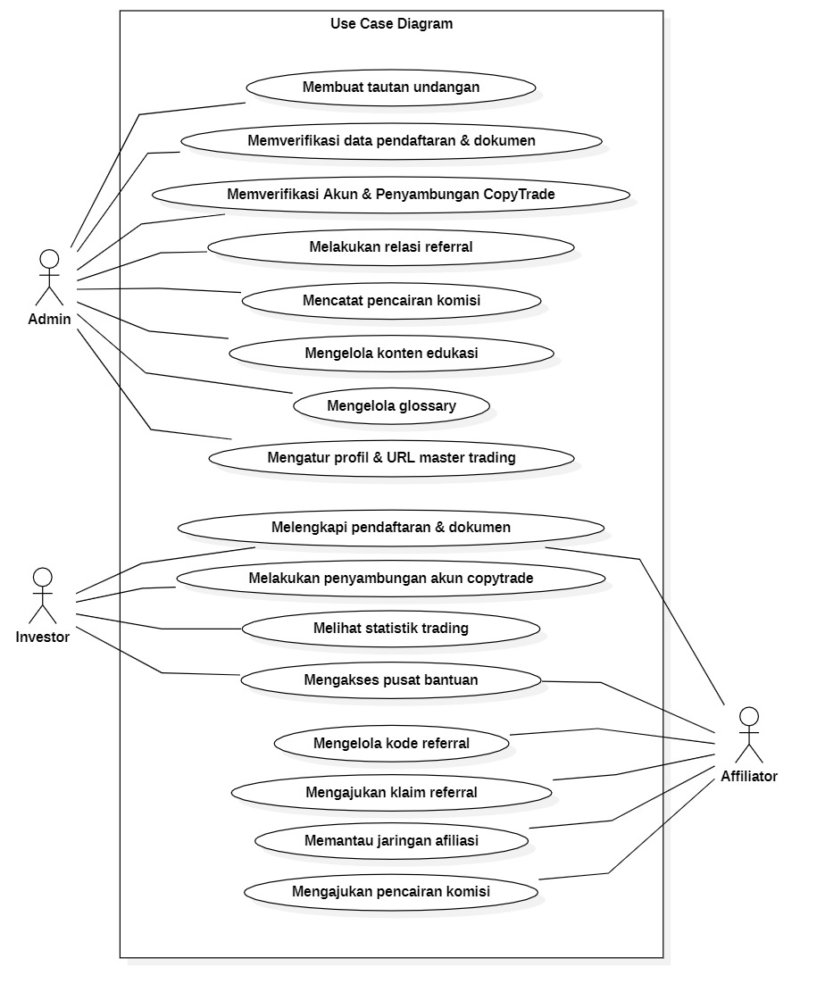

# Software Requirements Specification (SRS)

**Nama Proyek:** YZD Trading Management   
**Klien:** Pak Rizki Abiyasid  
**Versi Dokumen:** 1.2.0  
**Tanggal Update Terakhir:** 08 September 2026

## Daftar Riwayat Perubahan (Changelog)
*   **v1.0.0 (25-08-2026):** Draft inisiasi SRS dan penetapan arsitektur fase 1 (MVP).
*   **v1.1.0 (05-09-2026):** Penyelarasan aturan klaim komisi afiliasi individual pro-rata 3 bulan, formulir data klausul ahli waris, dan alur verifikasi penyambungan CopyTrade 2-tahap (stepper).
*   **v1.2.0 (08-09-2026):** Penambahan kapabilitas Progressive Web App (PWA) dengan tombol install dinamis, modul panduan pengguna (tur aplikasi & jelajah halaman), serta modul kalkulator simulasi proyeksi keuntungan bulanan investor.
---

## 1. Pendahuluan 
### 1.1 Tujuan Sistem
Aplikasi ini dirancang sebagai platform pendukung (etalase & pembukuan) bagi bisnis *copy trading*. Sistem ini berfokus pada otomatisasi manajemen portofolio investor, pembagian komisi afiliasi, dan penyusunan dokumen legal, tanpa memproses transaksi keuangan secara langsung. 

### 1.2 Batasan Sistem (Out of Scope)
* Tidak ada fitur Payment Gateway. Semua transaksi deposit dan penarikan dilakukan langsung di broker eksternal (HFM/XM).
* Tidak memiliki halaman *Landing Page* publik untuk alasan privasi.

---

## 2. Deskripsi Pengguna (Actors)
Sistem ini memiliki 3 level hak akses utama:
1. **Administrator:** Mengelola data master, menyetujui dokumen legalitas, dan memverifikasi investor/afiliator.
2. **Investor:** Pengguna yang mendaftar untuk melihat ringkasan portofolio dan menyetujui kontrak.
3. **Affiliator:** Pengguna (bisa merangkap sebagai investor) yang memiliki kode *referral* untuk memantau komisi dari anggota yang diajak.

---

## 3. Aturan Bisnis (Business Rules)
*   **Pembagian Profit (Profit Sharing):** Keuntungan (profit) tidak boleh ditarik (withdraw) 100%. Alokasi pembagiannya adalah:
    *   **20%** dapat ditarik (WD) oleh Investor.
    *   **25%** diberikan kepada Master Trader (Pak Abi) sebagai *Performance Fee*.
    *   **5%** digunakan untuk Biaya Operasional Sistem.
    *   *(Sisa 50% dibiarkan di dalam akun broker sebagai compounding/penambahan modal).*
*   **Skema Komisi Afiliasi (Tiering):** 
    - Dana dari investor > 1M maka **50%** dari profit master trader.
    - Dana dari investor 100 Jt - 1M maka **40%** dari profit master trader.
    - Dana dari investor < 100 Jt maka **30%** dari profit master trader.
*   **Batas Waktu Komisi Afiliasi:** **3 bulan** semenjak investor mulai follow master trader.

---

## 4. Kebutuhan Fungsional Fase 1 (MVP - Minimum Viable Product)

### 4.1 Modul Autentikasi & Pendaftaran
* Sistem menggunakan skema pendaftaran jalur tertutup melalui *Invitation Link* satu kali pakai yang digenerate dari dalam sistem.
* Halaman utama hanya menampilkan form Login dan kontak WhatsApp admin (tanpa akses registrasi publik).
* Formulir pendaftaran memfasilitasi perekaman data komprehensif:
  * **Informasi Akun:** Username, Email, dan Kata Sandi.
  * **Identitas Pengguna:** Nama Lengkap, Alamat Domisili, dan No. HP/WhatsApp.
  * **Klausul Ahli Waris:** Nama Ahli Waris, Hubungan dengan Ahli Waris, Alamat Ahli Waris, dan Kontak/No. HP Ahli Waris (sebagai mitigasi risiko hukum atas aset investasi).
  * **Dokumen Legalitas:** Modul unggah surat perjanjian bermaterai dan foto selfie bersama KTP.

### 4.2 Modul Administrator
*   Admin dapat membuat dan mengelola tautan undangan (*Invitation Link*) untuk dikirimkan ke calon pengguna.
*   Admin dapat melakukan verifikasi (setuju/tolak/revisi) terhadap kelengkapan data pendaftaran dan dokumen legalitas pengguna.
*   Admin dapat melakukan verifikasi 2-tahap penyambungan akun CopyTrade ke eksternal broker (Verifikasi Nomor MT4 & Deposit Broker, serta Verifikasi Bukti Follow Master).
*   Admin dapat melakukan intervensi pengikatan (*bind* manual) relasi referral susulan jika terjadi kendala pendaftaran downline.
*   Admin dapat memverifikasi pengajuan klaim komisi afiliasi per investor (memasukkan nominal profit Master Trader untuk kalkulasi otomatis nilai transfer sesuai tiering modal, serta mengunggah bukti resi transfer bank).
*   Admin dapat mengelola (tambah/edit/hapus) konten edukasi: Kamus Forex (*Glossary*) dan artikel/video FAQ pada Pusat Bantuan.

### 4.3 Modul Investor
*   Investor dapat mendaftar via link undangan dan mengunggah kelengkapan dokumen legalitas serta data ahli waris.
*   Investor menjalankan alur **Mulai CopyTrade (3-Step Stepper)**:
    *   **Langkah 1 (Registrasi Broker & Deposit):** Membuka akun di broker (HFM/XM) melalui kode referral Pak Abi, memasukkan nomor MT4, dan menunggu verifikasi deposit oleh Admin.
    *   **Langkah 2 (Penyambungan Follow Master):** Tautan privat Master CopyTrade terbuka setelah Langkah 1 disetujui; investor melakukan *copy* di broker dan mengunggah tangkapan layar (*screenshot*) bukti telah menyalin Master.
    *   **Langkah 3 (Portofolio Pribadi):** Menautkan URL statistik publik (Myfxbook/MQL5) milik investor pribadi (opsional).
*   Investor dapat melihat statistik portofolio Master Trader (Myfxbook/MQL5) di Dasbor utama.
*   Investor dapat menggunakan **Kalkulator Simulasi Proyeksi Keuntungan** untuk menghitung estimasi pertumbuhan modal secara interaktif berdasarkan aturan *compounding* 50%, potensi nilai penarikan (20% WD), *performance fee* Master Trader (25%), dan biaya operasional (5%) untuk proyeksi 1 hingga 12 bulan ke depan.
*   Investor dapat mengakses fitur panduan interaktif:
    *   **Tur Aplikasi (*Onboarding Tour*):** Panduan visual pengenalan sistem *slide-by-slide* saat pertama kali masuk ke sistem.
    *   **Jelajah Halaman (*Feature Walkthrough*):** Panduan interaktif terpandu dengan penyorotan (*spotlight*) pada menu dan tombol utama di halaman dasbor.
*   Investor dapat mengakses Kamus Forex dan Pusat Bantuan untuk melihat materi edukasi dan panduan penarikan/deposit.

### 4.4 Modul Affiliator
*   Afiliator memiliki seluruh hak akses fungsional Investor.
*   Afiliator dapat melihat, menyalin, dan membagikan kode/tautan *referral* mereka secara mandiri.
*   Afiliator dapat melihat daftar pengikut (*downline*) pada jaringan afiliasinya beserta status durasi aktif.
*   Afiliator dapat mengajukan klaim relasi referral susulan beserta bukti *chat* apabila *downline* lupa memasukkan kode saat mendaftar.
*   Afiliator dapat mengajukan klaim pencairan komisi profit afiliasi per investor yang memenuhi syarat (telah aktif minimal 3 bulan sejak follow Master Trader) berbasis perhitungan pro-rata dari profit Master Trader dan tiering modal/deposit downline (>1M: 50%, 100Jt–1M: 40%, <100Jt: 30%), serta mengunduh resi bukti pembayaran transfer.

---

## 5. Kebutuhan Non-Fungsional & Teknologi

### 5.1 Spesifikasi Teknologi
*   **Framework Backend:** Laravel
*   **Framework Frontend:** Inertia Vue.js + Tailwind CSS
*   **Database:** MySQL

### 5.2 Antarmuka & Pengalaman Pengguna (UI/UX)
*   **Tema Warna Utama:** Antarmuka (*interface*) sistem dibangun menggunakan kombinasi warna Ungu, Oranye, dan Putih.
*   **Mode Tampilan:** Sistem mendukung fitur *Dark Mode* (Mode Gelap) dan *Light Mode* (Mode Terang) yang dapat diaktifkan oleh pengguna.
*   **Multi-Bahasa (Internationalization):** Sistem menyediakan opsi pergantian bahasa (Indonesia dan Inggris). Penerapannya di-*coding* secara *native* di level *framework* (menggunakan *language dictionary* / lokalisasi Laravel & Vue), sehingga tidak bergantung pada ekstensi *translate browser* yang sering merusak *layout* HTML.
*   **Progressive Web App (PWA):** Sistem mendukung kapabilitas PWA (*Web App Manifest* dan *Service Worker*), memungkinkan pengguna memasang (*install*) aplikasi langsung ke layar utama (*home screen*) perangkat *mobile* (Android/iOS) maupun *desktop* tanpa melalui *app store*. Antarmuka menyediakan tombol instalasi dinamis yang otomatis disembunyikan saat aplikasi dijalankan dalam mode mandiri (*standalone mode*).

### 5.3 Lampiran (Proses Bisnis & Prototype)

Berikut adalah lampiran diagram alur kerja (BPMN) beserta tautan (*link*) menuju purwarupa (*prototype*) antarmuka sistem. 

> **Catatan Prototype:** Seluruh purwarupa HTML interaktif telah dikelompokkan dan dapat diakses melalui file Daftar Isi terpusat: **`https://yzd-trading-prototype.netlify.app/`**

**1. Use Case Diagram**  

**2. Alur Pendaftaran & Verifikasi Akun Pengguna**  

**3. Manajemen dan Perekaman Relasi Referral**  

**4. Pengajuan Klaim Profit Afiliasi**  

**5. Pengajuan Klaim Relasi Referral Susulan**  

**6. Konfirmasi Penyambungan CopyTrade (Via Eksternal Broker)**  
.png)