# Perancangan Skema Database & Kamus Data (ERD)
**Sistem:** YZD Center
**Versi:** 1.1.0 (Semi-Bilingual Technical-Domain Convention)  
**Target RDBMS:** MySQL 8.0+ / MariaDB 10.5+  
**ORM:** Laravel Eloquent  

---

## 1. Konvensi Penamaan (Semi Bahasa Inggris / Bahasa Indonesia)

Sesuai pedoman arsitektur pada [`catatan/2026-09-08_konvensi-penamaan-database-semi-bilingual.md`](file:///e:/frans_docs/02_projects/docs_01_forex/catatan/2026-09-08_konvensi-penamaan-database-semi-bilingual.md), skema database menggunakan pendekatan **Semi-Bilingual**:

1. **Bahasa Inggris Dipertahankan Untuk:**
   - Standar framework Laravel: `id`, `user_id`, `role_id`, `created_at`, `updated_at`, `password`, `remember_token`, `email`, `token`, `status`, `is_active`.
   - Metadata berkas & web: `file_path`, `file_name`, `mime_type`, `url`, `ip_address`.
   - Tabel inti autentikasi/RBAC: `users`, `roles`, `role_user`.
   - Terminologi universal Forex/Trading: `broker`, `mt4`, `copytrade`, `referral`, `tier`, `deposit`.
2. **Bahasa Indonesia Digunakan Untuk:**
   - Entitas domain bisnis lokal: `user_ahli_waris`, `user_dokumen`, `link_undangan`, `relasi_referral`, `klaim_referral`, `akun_copytrade`, `klaim_komisi`, `edukasi_glosarium`, `panduan_bantuan`, `pengaturan_master`, `konten_web`.
   - Atribut domain bisnis: `nama_lengkap`, `no_hp`, `alamat`, `hubungan_keluarga`, `alasan`, `catatan_admin`, `bukti_chat_path`, `bukti_transfer_path`, `nominal_deposit`, `nominal_transfer`, `profit_master`, `persentase_tier`, `kuota_maksimal`, `total_terpakai`, `tanggal_kadaluarsa`, `judul`, `konten`, `istilah`, `definisi`.

---

## 2. Diagram Relasi Entitas (Entity Relationship Diagram - ERD)

```mermaid
erDiagram
    users ||--o{ role_user : "memiliki peran"
    roles ||--o{ role_user : "diberikan kepada"
    users ||--o| user_ahli_waris : "memiliki klausul"
    users ||--o{ user_dokumen : "mengunggah berkas"
    users ||--o{ akun_copytrade : "mendaftarkan akun MT4"
    users ||--o{ relasi_referral : "sebagai affiliator"
    users ||--o| relasi_referral : "sebagai downline"
    users ||--o{ klaim_referral : "mengajukan klaim susulan"
    users ||--o{ klaim_komisi : "mengajukan klaim profit"
    users ||--o{ link_undangan : "membuat undangan (admin)"
    
    roles {
        bigint id PK
        string name UK
        string guard_name
        timestamps created_at_updated_at
    }

    role_user {
        bigint user_id PK_FK
        bigint role_id PK_FK
    }

    users {
        bigint id PK
        string nik UK
        string nama
        string username UK
        string email UK
        string password
        string no_hp
        text alamat
        enum status "pending, active, suspended, rejected"
        string referral_code UK "nullable"
        timestamp terms_agreed_at "nullable"
        string terms_version "nullable"
        string ip_address "nullable"
        timestamps created_at_updated_at
    }

    user_ahli_waris {
        bigint id PK
        bigint user_id FK
        string nama
        string hubungan_keluarga
        string no_hp
        text alamat
        timestamps created_at_updated_at
    }

    user_dokumen {
        bigint id PK
        bigint user_id FK
        enum tipe_dokumen "ktp, perjanjian, selfie_ktp"
        string file_path
        string file_name
        string mime_type
        enum status "pending, approved, revision_needed, rejected"
        text catatan_admin "nullable"
        timestamp verified_at "nullable"
        bigint verified_by FK "nullable"
        timestamps created_at_updated_at
    }

    link_undangan {
        bigint id PK
        string token UK
        enum target_role "investor, affiliator"
        string nama_event "nullable"
        int kuota_maksimal "default 1"
        int total_terpakai "default 0"
        datetime tanggal_kadaluarsa "nullable"
        bigint created_by FK
        boolean is_active "default true"
        timestamps created_at_updated_at
    }

    relasi_referral {
        bigint id PK
        bigint affiliator_id FK
        bigint downline_id FK "unique"
        enum sumber "link_otomatis, klaim_manual"
        datetime joined_at
        enum status "active, inactive"
        timestamps created_at_updated_at
    }

    klaim_referral {
        bigint id PK
        bigint affiliator_id FK
        bigint downline_id FK
        string bukti_chat_path
        text alasan
        enum status "pending, approved, rejected"
        text catatan_admin "nullable"
        bigint reviewed_by FK "nullable"
        timestamp reviewed_at "nullable"
        timestamps created_at_updated_at
    }

    akun_copytrade {
        bigint id PK
        bigint user_id FK
        enum broker_name "HFM, XM, Other"
        string mt4_account_number
        enum step1_deposit_status "pending, verified, rejected"
        timestamp step1_deposit_verified_at "nullable"
        string step2_copy_proof_path "nullable"
        enum step2_copy_status "locked, pending, active_copying, rejected"
        timestamp step2_copy_verified_at "nullable"
        string step3_mql5_url "nullable"
        datetime copy_started_at "nullable"
        timestamps created_at_updated_at
    }

    klaim_komisi {
        bigint id PK
        string kode_klaim UK
        bigint affiliator_id FK
        bigint downline_id FK
        decimal nominal_deposit "15,2"
        int persentase_tier "30, 40, 50"
        string bukti_modal_path
        decimal profit_master "15,2 nullable"
        decimal nominal_transfer "15,2 nullable"
        string bukti_transfer_path "nullable"
        enum status "pending, approved_transferred, rejected"
        text catatan_admin "nullable"
        bigint processed_by FK "nullable"
        timestamp processed_at "nullable"
        timestamps created_at_updated_at
    }

    edukasi_glosarium {
        bigint id PK
        string istilah
        string kategori
        text definisi
        bigint created_by FK
        timestamps created_at_updated_at
    }

    panduan_bantuan {
        bigint id PK
        string kategori
        string judul
        longtext konten
        string video_url "nullable"
        boolean is_published "default true"
        timestamps created_at_updated_at
    }

    pengaturan_master {
        bigint id PK
        string master_myfxbook_url
        string broker_hfm_referral_url
        string broker_xm_referral_url
        string master_copytrade_secret_url
        timestamps created_at_updated_at
    }

    konten_web {
        bigint id PK
        string key_name UK
        string judul
        longtext konten
        string versi
        timestamps created_at_updated_at
    }
```

---

## 3. Kamus Data Rinci (Data Dictionary)

### 3.1 Tabel `users` (Akun & Identitas Pengguna)
Menyimpan kredensial akun, data identitas, status akun, dan audit trail persetujuan hukum.
- **Model Laravel:** `App\Models\User`

| Nama Kolom | Tipe Data | Atribut / Constraint | Keterangan |
|---|---|---|---|
| `id` | `BIGINT UNSIGNED` | `PK, AUTO_INCREMENT` | Identitas unik pengguna. |
| `nik` | `VARCHAR(16)` | `NOT NULL, UNIQUE` | Nomor Induk Kependudukan 16 digit sesuai KTP. |
| `nama` | `VARCHAR(150)` | `NOT NULL` | Nama lengkap sesuai KTP. |
| `username` | `VARCHAR(50)` | `NOT NULL, UNIQUE` | Username unik untuk login. |
| `email` | `VARCHAR(100)` | `NOT NULL, UNIQUE` | Alamat email aktif. |
| `password` | `VARCHAR(255)` | `NOT NULL` | Kata sandi terenkripsi (Bcrypt/Argon2). |
| `no_hp` | `VARCHAR(25)` | `NOT NULL` | Nomor kontak handphone / WhatsApp aktif. |
| `alamat` | `TEXT` | `NOT NULL` | Alamat domisili lengkap sesuai KTP. |
| `status` | `ENUM` | `'pending', 'active', 'suspended', 'rejected'` | Status akun (Default: `'pending'`). |
| `referral_code` | `VARCHAR(20)` | `UNIQUE, NULLABLE` | Kode referral unik jika user adalah affiliator. |
| `terms_agreed_at` | `TIMESTAMP` | `NULLABLE` | Waktu persetujuan Syarat & Kebijakan Privasi. |
| `terms_version` | `VARCHAR(10)` | `NULLABLE` | Versi dokumen hukum yang disetujui (misal: `'v1.0'`). |
| `ip_address` | `VARCHAR(45)` | `NULLABLE` | Alamat IP saat pendaftaran untuk audit trail. |
| `remember_token`| `VARCHAR(100)` | `NULLABLE` | Token remember me Laravel. |
| `created_at` / `updated_at` | `TIMESTAMP` | `NULLABLE` | Timestamps bawaan framework. |

---

### 3.2 Tabel `roles` (Daftar Peran Hak Akses)
Menyimpan daftar peran (*roles*) yang tersedia dalam sistem (standar RBAC / Spatie).
- **Model Laravel:** `App\Models\Role`

| Nama Kolom | Tipe Data | Atribut / Constraint | Keterangan |
|---|---|---|---|
| `id` | `BIGINT UNSIGNED` | `PK, AUTO_INCREMENT` | Identitas unik peran. |
| `name` | `VARCHAR(50)` | `NOT NULL, UNIQUE` | Nama peran (`'admin'`, `'investor'`, `'affiliator'`). |
| `guard_name` | `VARCHAR(50)` | `NOT NULL, DEFAULT 'web'` | Guard autentikasi Laravel. |
| `created_at` / `updated_at` | `TIMESTAMP` | `NULLABLE` | Timestamps. |

---

### 3.3 Tabel `role_user` (Pivot Pengguna - Peran Multi-Role)
Menghubungkan satu pengguna dengan satu atau lebih peran (misalnya: Investor yang juga merangkap Affiliator).
- **Tabel Pivot Many-to-Many**

| Nama Kolom | Tipe Data | Atribut / Constraint | Keterangan |
|---|---|---|---|
| `user_id` | `BIGINT UNSIGNED` | `FK -> users.id (ON DELETE CASCADE)` | ID Pengguna. |
| `role_id` | `BIGINT UNSIGNED` | `FK -> roles.id (ON DELETE CASCADE)` | ID Peran yang dimiliki. |
| **Primary Key** | `(user_id, role_id)` | `COMPOSITE PRIMARY KEY` | Mencegah duplikasi peran yang sama pada satu user. |

---

### 3.4 Tabel `user_ahli_waris` (Klausul Perlindungan Ahli Waris)
Menyimpan data ahli waris yang sah demi perlindungan dan penanganan aset investasi jika terjadi musibah pada investor.
- **Model Laravel:** `App\Models\UserAhliWaris` (`protected $table = 'user_ahli_waris';`)

| Nama Kolom | Tipe Data | Atribut / Constraint | Keterangan |
|---|---|---|---|
| `id` | `BIGINT UNSIGNED` | `PK, AUTO_INCREMENT` | Identitas unik record. |
| `user_id` | `BIGINT UNSIGNED` | `FK -> users.id (ON DELETE CASCADE)` | ID investor pemilik klausul waris. |
| `nama` | `VARCHAR(150)` | `NOT NULL` | Nama lengkap ahli waris sesuai KTP. |
| `hubungan_keluarga` | `VARCHAR(50)` | `NOT NULL` | Hubungan (Anak, Istri, Suami, Orang Tua, Saudara). |
| `no_hp` | `VARCHAR(25)` | `NOT NULL` | Nomor kontak darurat ahli waris. |
| `alamat` | `TEXT` | `NOT NULL` | Alamat domisili ahli waris. |
| `created_at` / `updated_at` | `TIMESTAMP` | `NULLABLE` | Timestamps. |

---

### 3.5 Tabel `user_dokumen` (Berkas Legalitas & KYC Privat)
Menyimpan berkas pendaftaran (foto KTP, surat perjanjian bermaterai, dan foto selfie KTP) yang tersimpan di private storage server lokal.
- **Model Laravel:** `App\Models\UserDokumen` (`protected $table = 'user_dokumen';`)

| Nama Kolom | Tipe Data | Atribut / Constraint | Keterangan |
|---|---|---|---|
| `id` | `BIGINT UNSIGNED` | `PK, AUTO_INCREMENT` | Identitas unik dokumen. |
| `user_id` | `BIGINT UNSIGNED` | `FK -> users.id (ON DELETE CASCADE)` | ID pengguna pemilik berkas. |
| `tipe_dokumen` | `ENUM` | `'ktp', 'perjanjian', 'selfie_ktp'` | Jenis berkas legalitas. |
| `file_path` | `VARCHAR(255)` | `NOT NULL` | Path lokal privat (`dokumen/ktp_123.jpg`). |
| `file_name` | `VARCHAR(255)` | `NOT NULL` | Nama asli file saat diunggah. |
| `mime_type` | `VARCHAR(50)` | `NOT NULL` | Tipe file (`image/jpeg`, `application/pdf`). |
| `status` | `ENUM` | `'pending', 'approved', 'revision_needed', 'rejected'` | Status verifikasi oleh Admin. |
| `catatan_admin` | `TEXT` | `NULLABLE` | Catatan koreksi jika ditolak (misal: "KTP buram"). |
| `verified_at` | `TIMESTAMP` | `NULLABLE` | Waktu admin memvalidasi berkas. |
| `verified_by` | `BIGINT UNSIGNED` | `FK -> users.id, NULLABLE` | ID admin yang memvalidasi. |
| `created_at` / `updated_at` | `TIMESTAMP` | `NULLABLE` | Timestamps. |

---

### 3.6 Tabel `link_undangan` (Tautan Registrasi Tertutup)
Mengelola tautan undangan pendaftaran jalur tertutup, mendukung kuota batch untuk peserta webinar Mayar.id.
- **Model Laravel:** `App\Models\LinkUndangan` (`protected $table = 'link_undangan';`)

| Nama Kolom | Tipe Data | Atribut / Constraint | Keterangan |
|---|---|---|---|
| `id` | `BIGINT UNSIGNED` | `PK, AUTO_INCREMENT` | Identitas unik tautan. |
| `token` | `VARCHAR(64)` | `NOT NULL, UNIQUE` | String token acak URL (`?invite=token123`). |
| `target_role` | `ENUM` | `'investor', 'affiliator'` | Target peran pendaftar (`DEFAULT 'investor'`). |
| `nama_event` | `VARCHAR(150)` | `NULLABLE` | Label event (misal: "Webinar Batch 5 Mayar"). |
| `kuota_maksimal` | `INT UNSIGNED` | `NOT NULL, DEFAULT 1` | Batas maksimal pendaftar (1 atau 50+). |
| `total_terpakai` | `INT UNSIGNED` | `NOT NULL, DEFAULT 0` | Jumlah orang yang telah berhasil mendaftar. |
| `tanggal_kadaluarsa` | `DATETIME` | `NULLABLE` | Batas akhir tanggal tautan berlaku. |
| `created_by` | `BIGINT UNSIGNED` | `FK -> users.id` | ID admin pembuat link undangan. |
| `is_active` | `BOOLEAN` | `DEFAULT TRUE` | Status aktif/non-aktif manual oleh admin. |
| `created_at` / `updated_at` | `TIMESTAMP` | `NULLABLE` | Timestamps. |

---

### 3.7 Tabel `relasi_referral` (Perekaman Relasi Upline-Downline)
Merekam jaringan afiliasi permanen antara affiliator dan investor pengikutnya.
- **Model Laravel:** `App\Models\RelasiReferral` (`protected $table = 'relasi_referral';`)

| Nama Kolom | Tipe Data | Atribut / Constraint | Keterangan |
|---|---|---|---|
| `id` | `BIGINT UNSIGNED` | `PK, AUTO_INCREMENT` | Identitas unik relasi. |
| `affiliator_id` | `BIGINT UNSIGNED` | `FK -> users.id` | ID affiliator (upline). |
| `downline_id` | `BIGINT UNSIGNED` | `FK -> users.id, UNIQUE` | ID investor (downline). *1 investor hanya punya 1 upline*. |
| `sumber` | `ENUM` | `'link_otomatis', 'klaim_manual'` | Cara terhubung (via link registrasi atau klaim susulan). |
| `joined_at` | `DATETIME` | `NOT NULL` | Tanggal resmi terhubung ke jaringan. |
| `status` | `ENUM` | `'active', 'inactive'` | Status keaktifan relasi downline. |
| `created_at` / `updated_at` | `TIMESTAMP` | `NULLABLE` | Timestamps. |

---

### 3.8 Tabel `klaim_referral` (Klaim Referral Susulan - PB 4)
Menampung permohonan affiliator untuk mengikat downline yang lupa memasukkan kode saat registrasi.
- **Model Laravel:** `App\Models\KlaimReferral` (`protected $table = 'klaim_referral';`)

| Nama Kolom | Tipe Data | Atribut / Constraint | Keterangan |
|---|---|---|---|
| `id` | `BIGINT UNSIGNED` | `PK, AUTO_INCREMENT` | Identitas unik klaim susulan. |
| `affiliator_id` | `BIGINT UNSIGNED` | `FK -> users.id` | Affiliator yang mengajukan klaim. |
| `downline_id` | `BIGINT UNSIGNED` | `FK -> users.id` | Investor yang diklaim sebagai downline. |
| `bukti_chat_path` | `VARCHAR(255)` | `NOT NULL` | Path screenshot bukti chat WhatsApp/rekomendasi. |
| `alasan` | `TEXT` | `NOT NULL` | Alasan/kronologi keterlambatan memasukkan kode. |
| `status` | `ENUM` | `'pending', 'approved', 'rejected'` | Keputusan admin. |
| `catatan_admin` | `TEXT` | `NULLABLE` | Catatan persetujuan / penolakan admin. |
| `reviewed_by` | `BIGINT UNSIGNED` | `FK -> users.id, NULLABLE` | Admin pemeriksa. |
| `reviewed_at` | `TIMESTAMP` | `NULLABLE` | Waktu persetujuan. |
| `created_at` / `updated_at` | `TIMESTAMP` | `NULLABLE` | Timestamps. |

---

### 3.9 Tabel `akun_copytrade` (Stepper Penyambungan Akun Broker - PB 5)
Mengelola status verifikasi 2-tahap akun MT4 investor hingga aktif menyalin Master Trader Pak Abi.
- **Model Laravel:** `App\Models\AkunCopytrade` (`protected $table = 'akun_copytrade';`)

| Nama Kolom | Tipe Data | Atribut / Constraint | Keterangan |
|---|---|---|---|
| `id` | `BIGINT UNSIGNED` | `PK, AUTO_INCREMENT` | Identitas unik akun copytrade. |
| `user_id` | `BIGINT UNSIGNED` | `FK -> users.id` | ID investor pemilik akun. |
| `broker_name` | `ENUM` | `'HFM', 'XM', 'Other'` | Nama broker tempat membuka akun MT4. |
| `mt4_account_number` | `VARCHAR(50)` | `NOT NULL` | Nomor akun MT4 riil investor. |
| `step1_deposit_status` | `ENUM` | `'pending', 'verified', 'rejected'` | Validasi deposit broker oleh Pak Abi. |
| `step1_deposit_verified_at` | `TIMESTAMP` | `NULLABLE` | Waktu verifikasi langkah 1 disetujui. |
| `step2_copy_proof_path` | `VARCHAR(255)` | `NULLABLE` | Screenshot bukti follower telah follow master. |
| `step2_copy_status` | `ENUM` | `'locked', 'pending', 'active_copying', 'rejected'` | Gembok terbuka setelah step 1 verified. |
| `step2_copy_verified_at` | `TIMESTAMP` | `NULLABLE` | Waktu admin menyetujui penyalinan copy. |
| `step3_mql5_url` | `VARCHAR(255)` | `NULLABLE` | URL portofolio publik pribadi investor (opsional). |
| `copy_started_at` | `DATETIME` | `NULLABLE` | **Titik awal perhitungan 3 bulan aktif untuk klaim komisi.** |
| `created_at` / `updated_at` | `TIMESTAMP` | `NULLABLE` | Timestamps. |

---

### 3.10 Tabel `klaim_komisi` (Klaim Komisi Afiliasi Pro-Rata 3 Bulan - PB 3)
Menyimpan pengajuan pencairan komisi per 1 investor downline yang telah aktif minimal 3 bulan.
- **Model Laravel:** `App\Models\KlaimKomisi` (`protected $table = 'klaim_komisi';`)

| Nama Kolom | Tipe Data | Atribut / Constraint | Keterangan |
|---|---|---|---|
| `id` | `BIGINT UNSIGNED` | `PK, AUTO_INCREMENT` | Identitas unik klaim. |
| `kode_klaim` | `VARCHAR(30)` | `NOT NULL, UNIQUE` | Kode referensi klaim (e.g. `CLM-202609-001`). |
| `affiliator_id` | `BIGINT UNSIGNED` | `FK -> users.id` | Affiliator yang mengajukan klaim komisi. |
| `downline_id` | `BIGINT UNSIGNED` | `FK -> users.id` | Downline yang diklaim komisinya (syarat aktif $\ge$ 3 bulan). |
| `nominal_deposit`| `DECIMAL(15,2)` | `NOT NULL` | Total modal/deposit investor yang diajukan. |
| `persentase_tier` | `INT` | `NOT NULL` | Persentase tier otomatis: `50` (>1M), `40` (100Jt-1M), `30` (<100Jt). |
| `bukti_modal_path` | `VARCHAR(255)` | `NOT NULL` | Path tangkapan layar bukti modal/performa investor. |
| `profit_master` | `DECIMAL(15,2)` | `NULLABLE` | Total profit Master Trader periode tersebut (diinput Admin). |
| `nominal_transfer` | `DECIMAL(15,2)` | `NULLABLE` | Nominal transfer rupiah final yang dihitung sistem. |
| `bukti_transfer_path` | `VARCHAR(255)` | `NULLABLE` | Path file bukti transfer bank dari Admin. |
| `status` | `ENUM` | `'pending', 'approved_transferred', 'rejected'` | Status pembayaran klaim komisi. |
| `catatan_admin` | `TEXT` | `NULLABLE` | Catatan admin terkait transfer atau revisi. |
| `processed_by` | `BIGINT UNSIGNED` | `FK -> users.id, NULLABLE` | Admin yang memproses pembayaran. |
| `processed_at` | `TIMESTAMP` | `NULLABLE` | Tanggal transfer diselesaikan. |
| `created_at` / `updated_at` | `TIMESTAMP` | `NULLABLE` | Timestamps. |

---

### 3.11 Tabel `edukasi_glosarium` (Kamus Forex / Glossary)
Menampung kamus istilah trading yang dikelola admin dan dibaca oleh seluruh investor.
- **Model Laravel:** `App\Models\EdukasiGlosarium` (`protected $table = 'edukasi_glosarium';`)

| Nama Kolom | Tipe Data | Atribut / Constraint | Keterangan |
|---|---|---|---|
| `id` | `BIGINT UNSIGNED` | `PK, AUTO_INCREMENT` | Identitas unik istilah. |
| `istilah` | `VARCHAR(100)` | `NOT NULL` | Istilah forex (misal: "Lot", "Spread", "Drawdown"). |
| `kategori` | `VARCHAR(50)` | `NOT NULL` | Kategori istilah (Dasar, Teknikal, Manajemen Risiko). |
| `definisi` | `TEXT` | `NOT NULL` | Penjelasan istilah dalam bahasa yang ramah pemula. |
| `created_by` | `BIGINT UNSIGNED` | `FK -> users.id` | ID admin yang menambahkan. |
| `created_at` / `updated_at` | `TIMESTAMP` | `NULLABLE` | Timestamps. |

---

### 3.12 Tabel `panduan_bantuan` (Pusat Bantuan / FAQ)
Menyimpan panduan pendaftaran, deposit broker, panduan copytrade, dan tutorial video.
- **Model Laravel:** `App\Models\PanduanBantuan` (`protected $table = 'panduan_bantuan';`)

| Nama Kolom | Tipe Data | Atribut / Constraint | Keterangan |
|---|---|---|---|
| `id` | `BIGINT UNSIGNED` | `PK, AUTO_INCREMENT` | Identitas unik artikel. |
| `kategori` | `VARCHAR(50)` | `NOT NULL` | Kategori (Panduan Deposit, CopyTrade, Komisi, Umum). |
| `judul` | `VARCHAR(200)` | `NOT NULL` | Judul pertanyaan / panduan. |
| `konten` | `LONGTEXT` | `NOT NULL` | Isi panduan lengkap. |
| `video_url` | `VARCHAR(255)` | `NULLABLE` | URL embed tutorial YouTube jika ada. |
| `is_published` | `BOOLEAN` | `DEFAULT TRUE` | Status tayang artikel. |
| `created_at` / `updated_at` | `TIMESTAMP` | `NULLABLE` | Timestamps. |

---

### 3.13 Tabel `pengaturan_master` (Pengaturan Master Pak Abi)
Menyimpan link eksternal master trading dan link referral broker yang dikelola oleh Pak Abi.
- **Model Laravel:** `App\Models\PengaturanMaster` (`protected $table = 'pengaturan_master';`)

| Nama Kolom | Tipe Data | Atribut / Constraint | Keterangan |
|---|---|---|---|
| `id` | `BIGINT UNSIGNED` | `PK, AUTO_INCREMENT` | Identitas unik (Single Row). |
| `master_myfxbook_url` | `VARCHAR(255)` | `NOT NULL` | URL widget Myfxbook Master Pak Abi. |
| `broker_hfm_referral_url` | `VARCHAR(255)` | `NOT NULL` | Link referral broker HFM milik Pak Abi. |
| `broker_xm_referral_url` | `VARCHAR(255)` | `NOT NULL` | Link referral broker XM milik Pak Abi. |
| `master_copytrade_secret_url` | `VARCHAR(255)` | `NOT NULL` | Tautan privat Master CopyTrade yang baru muncul di Step 2. |
| `created_at` / `updated_at` | `TIMESTAMP` | `NULLABLE` | Timestamps. |

---

### 3.14 Tabel `konten_web` (Syarat Ketentuan & Kebijakan Privasi Dinamis)
Menyimpan pasal-pasal perlindungan hukum dan penafian risiko yang dapat diubah dinamis oleh Admin.
- **Model Laravel:** `App\Models\KontenWeb` (`protected $table = 'konten_web';`)

| Nama Kolom | Tipe Data | Atribut / Constraint | Keterangan |
|---|---|---|---|
| `id` | `BIGINT UNSIGNED` | `PK, AUTO_INCREMENT` | Identitas unik konten. |
| `key_name` | `VARCHAR(50)` | `NOT NULL, UNIQUE` | Kunci konten: `'terms_conditions'`, `'privacy_policy'`. |
| `judul` | `VARCHAR(150)` | `NOT NULL` | Judul dokumen hukum. |
| `konten` | `LONGTEXT` | `NOT NULL` | Teks pasal-pasal hukum lengkap. |
| `versi` | `VARCHAR(10)` | `NOT NULL, DEFAULT 'v1.0'` | Versi isi pasal saat ini. |
| `created_at` / `updated_at` | `TIMESTAMP` | `NULLABLE` | Timestamps. |

---

### 3.15 Tabel `profit_master_posts` & `profit_master_post_images` (Materi Promosi Profit Master)
Menyimpan materi publikasi rekap profit Master Trader beserta lampiran foto bukti performa untuk disalin/dibagikan oleh member & afiliator.
- **Model Laravel:** `App\Models\ProfitMasterPost`, `App\Models\ProfitMasterPostImage`

#### Tabel `profit_master_posts`
| Nama Kolom | Tipe Data | Atribut / Constraint | Keterangan |
|---|---|---|---|
| `id` | `BIGINT UNSIGNED` | `PK, AUTO_INCREMENT` | Identitas unik postingan materi promosi. |
| `caption` | `TEXT` | `NOT NULL` | Teks materi promosi/arahan (maks. 20.000 karakter). |
| `created_by` | `BIGINT UNSIGNED` | `FK -> users.id, CASCADE` | ID Administrator yang menerbitkan materi. |
| `created_at` / `updated_at` | `TIMESTAMP` | `NULLABLE, INDEX(created_at)` | Timestamps & Index untuk feed kronologis. |

#### Tabel `profit_master_post_images`
| Nama Kolom | Tipe Data | Atribut / Constraint | Keterangan |
|---|---|---|---|
| `id` | `BIGINT UNSIGNED` | `PK, AUTO_INCREMENT` | Identitas unik foto bukti. |
| `post_id` | `BIGINT UNSIGNED` | `FK -> profit_master_posts.id, CASCADE` | Relasi ke post materi promosi. |
| `file_path` | `VARCHAR(255)` | `NOT NULL` | Path berkas privat di disk `local` (`profit_master/{id}/...`). |
| `file_name` | `VARCHAR(255)` | `NOT NULL` | Nama asli berkas gambar. |
| `file_size` | `INT UNSIGNED` | `DEFAULT 0` | Ukuran berkas dalam bytes. |
| `mime_type` | `VARCHAR(255)` | `NOT NULL` | MIME type gambar (mis. `image/png`). |
| `urutan` | `SMALLINT UNSIGNED` | `DEFAULT 0` | Urutan tampil foto di galeri. |
| `created_at` / `updated_at` | `TIMESTAMP` | `NULLABLE` | Timestamps. |

---

## 4. Strategi Indexing & Optimasi Database

Untuk memastikan performa kencang di VPS Hostinger (1 vCPU, 4GB RAM), index berikut dipasang:

1. **Pencarian Identitas & Login Unik:**
   - `UNIQUE(nik)`, `INDEX(username)`, `INDEX(email)` pada tabel `users`.
2. **Relasi & Pencarian Downline Cepat:**
   - `INDEX(affiliator_id, downline_id)` pada `relasi_referral`.
3. **Penyaringan Klaim Berdasarkan Status:**
   - `INDEX(status)` pada `klaim_komisi` dan `user_dokumen` agar antrean validasi admin cepat diakses.
4. **Pengecekan Kuota Undangan:**
   - `INDEX(token, is_active)` pada `link_undangan`.
