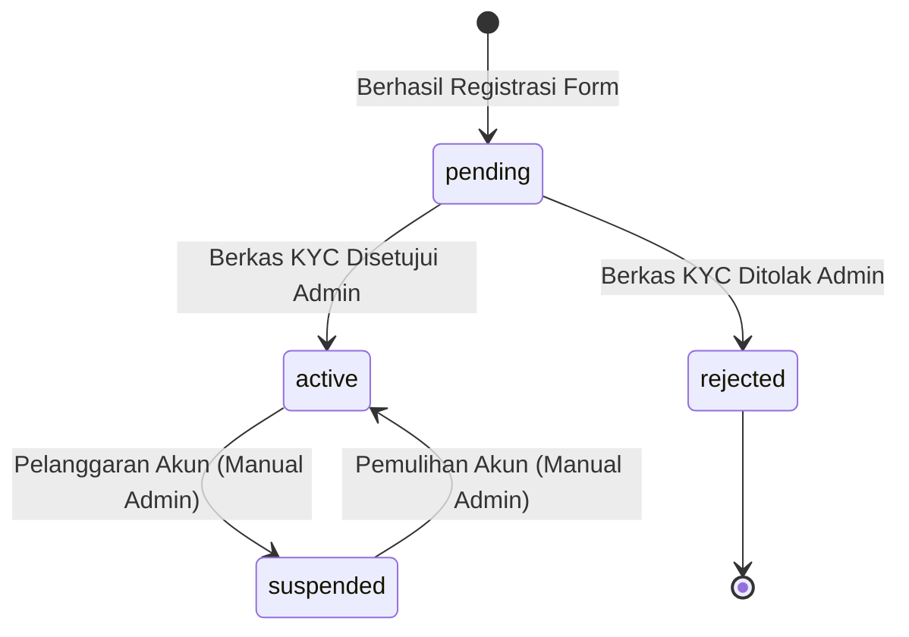

# Modul 01: Autentikasi, Manajemen Akun & Multi-Role

Dokumen ini memuat seluruh spesifikasi kebutuhan teknis dan aturan bisnis untuk perancangan dan implementasi modul autentikasi.

---

## 1. Ringkasan Fitur & Peran Terlibat

- **Registrasi Tertutup (*Closed Registration*):** Sistem tidak membuka pendaftaran umum. Registrasi hanya dapat dilakukan melalui tautan undangan (`/register?invite={token}`) yang diterbitkan oleh Administrator (misal: diintegrasikan dengan email ucapan terima kasih webinar Mayar.id).
- **Arsitektur Multi-Role:** Seorang pengguna dapat memiliki peran ganda secara bersamaan (*multi-role*), yaitu sebagai **Investor** dan merangkap sebagai **Affiliator**. Peran **Administrator** terpisah khusus untuk Pak Abi dan tim operasional.
- **Identitas & Kredensial Login:** Login menggunakan kombinasi `username` (atau `email`) dan `password`.
- **Audit Trail Legalitas Saat Registrasi:** Perekaman persetujuan Syarat & Ketentuan, Kebijakan Privasi, versi dokumen, dan alamat IP pendaftar.

---

## 2. Entitas Database Terkait

- **`users`**: Menyimpan identitas resmi (`nik`, `nama`), kredensial login (`username`, `email`, `password`), kontak (`no_hp`, `alamat`), kode referral unik (`referral_code`), dan audit trail (`terms_agreed_at`, `terms_version`, `ip_address`).
- **`roles`**: Berisi record peran (`admin`, `investor`, `affiliator`).
- **`role_user`**: Tabel pivot penghubung relasi *Many-to-Many* antara `users` dan `roles`.
- **`link_undangan`**: Menyimpan token registrasi, label event, target peran pendaftar (`target_role`: `'investor'` atau `'affiliator'`), batas kuota (`kuota_maksimal`), jumlah terpakai (`total_terpakai`), dan tanggal kadaluarsa (`tanggal_kadaluarsa`).

---

## 3. Aturan Bisnis & Logika Validasi

### 3.1 Validasi Link Undangan
1. URL registrasi wajib menyertakan parameter `invite` berupa token valid.
2. Sistem memeriksa validitas token sebelum menampilkan form:
   - Record token ditemukan di tabel `link_undangan`.
   - `is_active == TRUE`.
   - `tanggal_kadaluarsa IS NULL` ATAU `tanggal_kadaluarsa >= NOW()`.
   - `total_terpakai < kuota_maksimal`.
3. Jika token tidak valid / kuota habis / kadaluarsa, sistem menampilkan pesan error ramah pengguna: *"Tautan pendaftaran tidak valid atau kuota pendaftaran telah habis. Silakan hubungi Administrator."*
4. Jika registrasi berhasil diselesaikan, sistem melakukan `increment('total_terpakai')` pada record tautan undangan terkait dalam transaksi database yang aman (*database transaction*).

### 3.2 Penugasan Peran & Penentuan Affiliator (Multi-Role Assignment)
Hak penentuan peran **Affiliator** berada penuh di bawah kendali **Administrator (Pak Abi)** melalui 2 mekanisme:

1. **Mekanisme 1 — Calon Affiliator Belum Memiliki Akun:**
   - Administrator membuatkan tautan pendaftaran di `link_undangan` khusus dengan memilih `target_role = 'affiliator'`.
   - Calon affiliator mendaftar melalui tautan undangan khusus tersebut.
   - Setelah formulir registrasi berhasil diselesaikan, akun **otomatis mendapatkan peran ganda: `affiliator` dan `investor`**.
   - Sistem otomatis men-generate kode referral unik pada kolom `users.referral_code` (misal berbasis username unik).
2. **Mekanisme 2 — Pengguna Eksisting / Investor yang Sudah Terdaftar:**
   - Administrator membuka menu **Manajemen Pengguna** di panel admin.
   - Administrator mengedit akun pengguna terkait, lalu mencentang/menambahkan peran **`affiliator`**.
   - Sistem secara otomatis:
     - Menambahkan relasi peran di tabel pivot `role_user` (pengguna kini memiliki peran `investor` dan `affiliator`).
     - Men-generate nilai unik pada `users.referral_code` jika akun tersebut sebelumnya belum memiliki kode referral.
3. **Pendaftar Biasa (Non-Affiliator):**
   - Jika mendaftar via link undangan umum (`target_role = 'investor'`), pengguna hanya mendapatkan peran **`investor`** dan kolom `referral_code` bernilai `NULL`.
4. **Pengecekan Otorisasi di Level Kode & Tampilan UI:**
   - Pengecekan otorisasi: `$user->hasRole('investor')`, `$user->hasRole('affiliator')`, `$user->hasRole('admin')`.
   - Antarmuka UI (Inertia Vue) menampilkan menu navigasi secara dinamis. Jika pengguna memiliki peran Investor dan Affiliator, sidebar menampilkan menu portofolio investor sekaligus menu jaringan afiliasi.

### 3.3 Audit Trail Hukum Pendaftaran
1. Checkbox persetujuan Syarat & Ketentuan dan Kebijakan Privasi bersifat wajib (*required*).
2. Sistem otomatis merekam:
   - `terms_agreed_at`: `now()`
   - `terms_version`: Versi dokumen aktif saat itu (misal `'v1.0'`)
   - `ip_address`: `$request->ip()`

---

## 4. State Machine / Siklus Status Pengguna

- **`pending`**: Akun berhasil dibuat, namun belum diverifikasi berkas identitasnya oleh Administrator. Saat login, pengguna hanya diarahkan ke halaman upload/status berkas KYC.
- **`active`**: Berkas KYC telah disetujui Administrator. Pengguna memiliki akses penuh ke fitur dashboard investor/affiliator.
- **`suspended`**: Akun dibekukan sementara oleh Administrator. Tidak dapat mengakses fitur transaksi/klaim.
- **`rejected`**: Registrasi ditolak secara permanen oleh Administrator.

---

## 5. Catatan Teknis & Keamanan

- **Password Hashing:** Menggunakan standar Bcrypt / Argon2 bawaan Laravel.
- **Proteksi Brute-Force:** Mengaktifkan *rate limiting* pada endpoint login (misal maksimal 5 percobaan per menit).
- **Session Management:** Autentikasi berbasis session cookie standar Laravel (`web` guard) dengan perlindungan CSRF token aktif.
- **Sanitasi Input:** `username` hanya boleh alfanumerik tanpa spasi (`regex:/^[a-zA-Z0-9_]+$/`).

---

## 6. Ruang Catatan Tambahan (Area Kolaboratif Pengembang & AI)

*Tambahkan catatan atau perubahan kebutuhan terkait autentikasi di bawah ini:*

- **[2026-09-08]**: Disetujui implementasi multi-role menggunakan pivot table `roles` dan `role_user` (kompatibel Spatie).
- *(Tulis catatan baru di sini jika ada perubahan flow)*
- **[2026-09-08]**: Penentuan peran Affiliator eksklusif diatur oleh Admin: (1) via link undangan khusus bertarget role affiliator (`target_role = 'affiliator'`) untuk calon baru, atau (2) edit langsung akun pengguna eksisting di panel manajemen pengguna admin.

