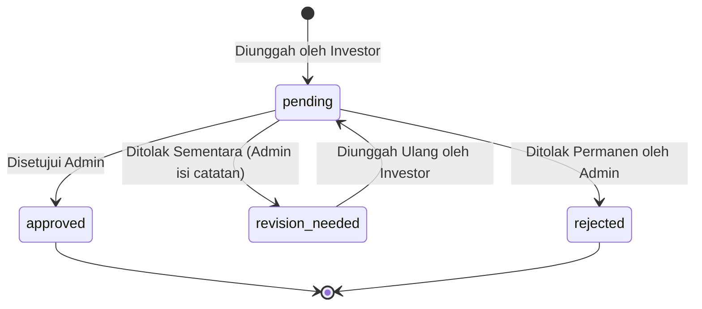

# Modul 02: Legalitas, KYC & Perlindungan Ahli Waris

Dokumen ini memuat spesifikasi teknis dan aturan bisnis untuk perancangan dan implementasi modul verifikasi identitas (KYC), klausul ahli waris, dan tata kelola berkas privat.

---

## 1. Ringkasan Fitur & Peran Terlibat

- **Klausul Perlindungan Ahli Waris:** Setiap calon investor wajib mendaftarkan 1 (satu) nama ahli waris sah. Fitur ini dirancang sebagai proteksi hukum untuk menjamin kepastian kepemilikan dan penanganan hak dana investasi jika terjadi keadaan kahar (*force majeure*) atau musibah pada investor.
- **Unggah Berkas Legalitas (KYC):** Calon investor mengunggah 3 (tiga) berkas wajib:
  1. Foto Kartu Tanda Penduduk (KTP)
  2. Foto/Scan Surat Perjanjian Kerjasama Bermaterai
  3. Foto *Selfie* memegang KTP
- **Verifikasi Admin:** Administrator memeriksa keaslian dan kejelasan berkas secara manual sebelum mengaktifkan akun investor.

---

## 2. Entitas Database Terkait

- **`user_ahli_waris`**: Terikat ke `users.id` secara *one-to-one* (`nama`, `hubungan_keluarga`, `no_hp`, `alamat`).
- **`user_dokumen`**: Terikat ke `users.id` secara *one-to-many* untuk masing-masing jenis berkas (`tipe_dokumen`, `file_path`, `file_name`, `mime_type`, `status`, `catatan_admin`, `verified_at`, `verified_by`).

---

## 3. Aturan Bisnis & Logika Validasi

### 3.1 Pengisian Ahli Waris
1. Pengisian data ahli waris bersifat wajib pada form registrasi awal.
2. Relasi keluarga yang diperbolehkan: `'Anak'`, `'Istri'`, `'Suami'`, `'Orang Tua'`, `'Saudara Kandung'`.
3. Nomor kontak ahli waris tidak boleh sama persis dengan nomor kontak calon investor (harus kontak alternatif yang dapat dihubungi saat darurat).

### 3.2 Ketentuan Unggah Berkas
1. Format file yang diizinkan: `jpg`, `jpeg`, `png`, `pdf`.
2. Batas ukuran berkas: Maksimal **5 MB** per berkas.
3. Seluruh file yang diunggah diberi nama acak hash (*UUID / SHA-256 hash*) untuk mencegah enumerasi atau tumpang tindih nama file asli.
4. Nama asli file tetap disimpan di kolom `file_name` untuk kemudahan identifikasi saat diunduh oleh Administrator.

### 3.3 Alur Verifikasi & Koreksi Berkas
1. Admin memeriksa masing-masing dari ke-3 berkas secara independen.
2. Admin dapat menentukan status masing-masing berkas:
   - **`approved`**: Berkas valid dan jelas.
   - **`revision_needed`**: Berkas kurang jelas/buram/salah. Admin **wajib** mengisi `catatan_admin` (contoh: *"Foto KTP buram, mohon foto ulang dengan pencahayaan terang"*).
   - **`rejected`**: Berkas palsu atau terindikasi manipulasi.
3. Jika terdapat berkas yang berstatus `revision_needed`, investor **hanya perlu mengunggah ulang berkas yang bermasalah saja**, tanpa perlu mengulang pengunggahan berkas lain yang sudah `approved`.
4. Akun pengguna di tabel `users` otomatis berubah dari `pending` ke **`active`** hanya jika **seluruh 3 berkas telah berstatus `approved`**.

---

## 4. State Machine / Siklus Status Berkas Dokumen



---

## 5. Catatan Teknis & Keamanan Berkas Privat (Hard Requirement)

- **Penyimpanan Lokal Privat:** Seluruh berkas KTP dan perjanjian hukum disimpan di direktori privat:
  `storage/app/private_documents/{user_id}/`
- **Dilarang Keras:** Dilarang menempatkan berkas ini di `storage/app/public/` atau membuat symlink publik via `php artisan storage:link`.
- **Akses Streaming Terotentikasi:** Akses fisik ke file hanya dapat dilakukan melalui Laravel Controller dengan validasi Policy:
  ```php
  // Hanya pemilik berkas atau Administrator yang diizinkan mengakses
  public function show(UserDokumen $dokumen)
  {
      Gate::authorize('view', $dokumen);
      return Storage::disk('local')->response($dokumen->file_path);
  }
  ```
- File dilindungi dari pengindeksan mesin pencari (*search engines*), bot web, atau akses URL langsung.

---

## 6. Ruang Catatan Tambahan (Area Kolaboratif Pengembang & AI)

*Tambahkan catatan atau perubahan kebutuhan terkait legalitas & KYC di bawah ini:*

- **[2026-09-08]**: Menggunakan private local storage Hostinger VPS untuk MVP, kode dibungkus via abstraction `Storage::disk('local')` agar siap migrasi ke S3/R2 jika kelak dibutuhkan.
- *(Tulis catatan baru di sini jika ada perubahan flow)*

