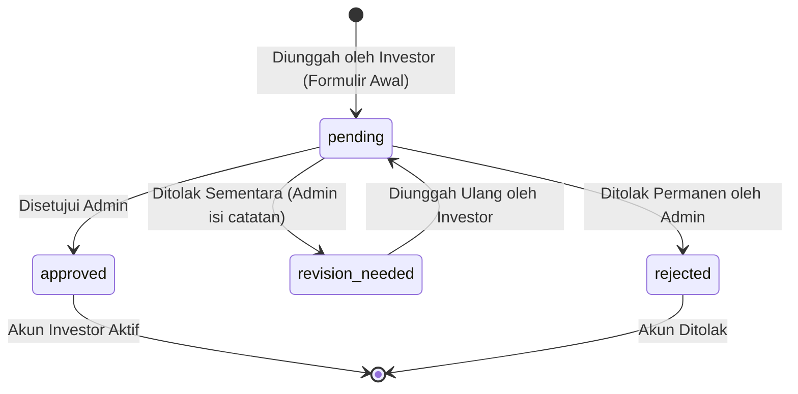

# Modul 02: Legalitas, KYC & Perlindungan Ahli Waris

Dokumen ini memuat spesifikasi teknis dan aturan bisnis untuk perancangan dan implementasi modul verifikasi identitas (KYC), klausul ahli waris, syarat & ketentuan dinamis, dan tata kelola berkas privat.

---

## 1. Ringkasan Fitur & Peran Terlibat

- **Klausul Perlindungan Ahli Waris:** Setiap calon investor wajib mendaftarkan 1 (satu) nama ahli waris sah pada form registrasi awal. Fitur ini dirancang sebagai proteksi hukum untuk menjamin kepastian kepemilikan dan penanganan hak dana investasi jika terjadi keadaan kahar (*force majeure*) atau musibah pada investor.
- **Unggah Berkas Legalitas (KYC) Disederhanakan:** Calon investor mengunggah **2 (dua) berkas wajib**:
  1. **Foto Kartu Tanda Penduduk (KTP)**
  2. **Foto/Scan Surat Perjanjian Kerjasama Bermaterai**
  *(Catatan: Foto selfie memegang KTP resmi ditiadakan untuk kemudahan dan efisiensi pengguna).*
- **Syarat & Ketentuan (Terms & Conditions) Dinamis:** Calon investor wajib membaca dan menyetujui pasal Syarat & Ketentuan serta Kebijakan Privasi sebelum menekan tombol submit terakhir. Teks dokumen hukum ini dapat diperbarui sewaktu-waktu oleh Administrator melalui panel admin.
- **Kompresi Otomatis & UX Cepat:** Aplikasi secara otomatis mengompresi foto mentah smartphone (hingga 10 MB) menjadi berkas ringan beresolusi tajam 2K (~500 KB - 800 KB) secara instan di browser pengguna sebelum diunggah ke server.
- **Pengecekan Otomatis & Verifikasi Admin:** Sistem memvalidasi dimensi minimal gambar dan ketajaman secara otomatis di backend, sementara verifikasi final keabsahan dokumen dilakukan oleh Administrator.

---

## 2. Entitas Database Terkait

- **`user_ahli_waris`**: Terikat ke `users.id` secara *one-to-one* (`nama`, `hubungan_keluarga`, `no_hp`, `alamat`).
- **`user_dokumen`**: Terikat ke `users.id` secara *one-to-many* untuk masing-masing jenis berkas (`tipe_dokumen`: `'ktp'`, `'perjanjian'`, `file_path`, `file_name`, `mime_type`, `file_size`, `status`, `catatan_admin`, `is_quality_warning`, `verified_at`, `verified_by`).
- **`konten_legal`**: Menyimpan pasal-pasal dinamis (`key_name`: `'terms_conditions'`, `'privacy_policy'`, `judul`, `konten`, `updated_by`).
- **`users` (kolom status & audit):** `status` (`'pending'`, `'active'`, `'suspended'`, `'rejected'`), `terms_agreed_at`, `ip_address`.

---

## 3. Aturan Bisnis & Logika Validasi

### 3.1 Pengisian Data Ahli Waris
1. Pengisian data ahli waris bersifat wajib pada formulir pendaftaran awal.
2. Relasi keluarga yang diperbolehkan: `'Anak'`, `'Istri'`, `'Suami'`, `'Orang Tua'`, `'Saudara Kandung'`.
3. Nomor kontak ahli waris tidak boleh sama persis dengan nomor kontak calon investor (harus kontak alternatif yang dapat dihubungi saat darurat).

### 3.2 Ketentuan Unggah Berkas & Kompresi Otomatis
1. **Format file yang diizinkan:** `jpg`, `jpeg`, `png`, `pdf`.
2. **Batas Ukuran & Kompresi Otomatis:**
   - Server mengizinkan penerimaan berkas hingga **10 MB** (terutama untuk dokumen scan PDF multi-halaman).
   - Di sisi frontend (*client-side*), foto KTP/perjanjian yang diambil dari kamera HP resolusi tinggi otomatis dikompresi menggunakan HTML5 Canvas menjadi resolusi tajam 2K (maksimal lebar/tinggi 2048 px, kualitas JPEG 85%), menghasilkan ukuran file optimal **~500 KB – 800 KB**.
   - Hal ini memastikan teks NIK, nama, dan foto wajah tetap sangat tajam dan jernih, sekaligus proses upload selesai dalam hitungan detik.
3. **Penyimpanan Privat Bersandi:**
   - Seluruh file yang diunggah diberi nama acak UUID/hash untuk mencegah enumerasi nama file.
   - Nama asli file tetap disimpan pada kolom `file_name` untuk kemudahan identifikasi saat diunduh oleh Administrator.

### 3.3 Pemrosesan Otomatis Kualitas Dokumen & Peringatan Pengguna
1. **Validasi Dimensi Minimal:** Foto KTP wajib memiliki dimensi minimal **600 x 400 piksel** untuk mencegah pengunggahan ikon/thumbnail buram yang tidak terbaca.
2. **Inspeksi Kualitas Sisi Klien (Client-side HTML5 Canvas):**
   - Saat calon investor memilih atau mengambil foto di browser (`Register.vue` maupun `Investor/Kyc/Index.vue`), modul `imageCompression.js` melakukan pengecekan resolusi dan kalkulasi varians konvolusi Laplacian 3x3 secara instan.
   - Jika foto di bawah ambang batas ketajaman (blur) atau dimensi terlalu kecil, antarmuka langsung menampilkan banner peringatan kualitas (amber alert) dan opsi tombol ganti berkas/foto sebelum formulir dikirimkan.
3. **Pendeteksian Ketajaman Gambar Sisi Server (Heuristik PHP GD):**
   - Sistem backend memvalidasi ulang varians gradien tepi foto menggunakan kernel Laplacian.
   - Jika terindikasi buram (*blurry/out of focus*), sistem menetapkan label `is_quality_warning = true` pada entitas `user_dokumen` untuk memandu perhatian Administrator saat verifikasi.

### 3.4 Persetujuan Syarat & Ketentuan Dinamis
1. Sebelum tombol submit pendaftaran terakhir, ditampilkan ringkasan Syarat & Ketentuan dengan tautan/modal dialog untuk membaca pasal lengkap.
2. Checkbox persetujuan wajib dicentang oleh calon investor.
3. Saat form dikirimkan, sistem mencatat audit trail: `terms_agreed_at = now()` dan `ip_address`.

### 3.5 Alur Verifikasi & Koreksi Berkas
1. Admin memeriksa masing-masing dari ke-2 berkas (`ktp` dan `perjanjian`) secara independen.
2. Status masing-masing berkas:
   - **`approved`**: Berkas valid dan jelas.
   - **`revision_needed`**: Berkas kurang jelas/buram/salah. Admin **wajib** mengisi `catatan_admin` (contoh: *"Foto KTP buram, mohon foto ulang dengan pencahayaan terang"*).
   - **`rejected`**: Berkas palsu atau terindikasi manipulasi.
3. **Hak Koreksi & Unggah Ulang Berkas oleh Investor:**
   - **Koreksi Karena Permintaan Revisi:** Jika dokumen berstatus `revision_needed`, investor dapat langsung mengunggah ulang dokumen pengganti sesuai catatan perbaikan dari admin.
   - **Koreksi Mandiri Berkas Berperingatan Kualitas:** Jika dokumen berstatus `pending` namun terdeteksi memiliki peringatan kualitas (`is_quality_warning = true`) atau investor ingin mengganti berkas yang lebih tajam sebelum diperiksa admin, antarmuka membuka form interaktif unggah ulang dokumen tanpa harus menunggu penolakan admin.
   - Investor **hanya perlu mengunggah ulang berkas yang bermasalah saja**, tanpa perlu mengulang pengunggahan berkas lain yang sudah `approved`.
4. Akun pengguna di tabel `users` otomatis berubah dari `pending` ke **`active`** hanya jika **seluruh 2 berkas telah berstatus `approved`**.

---

## 4. State Machine / Siklus Status Berkas Dokumen



---

## 5. Catatan Teknis & Keamanan Berkas Privat (Hard Requirement)

- **Penyimpanan Lokal Privat:** Seluruh berkas KTP dan perjanjian hukum disimpan di direktori privat:
  `storage/app/private/kyc_documents/{user_id}/`
- **Dilarang Keras:** Dilarang menempatkan berkas ini di `storage/app/public/` atau membuat symlink publik via `php artisan storage:link`.
- **Akses Streaming Terotentikasi:** Akses fisik ke file hanya dapat dilakukan melalui Laravel Controller dengan validasi Policy:
  ```php
  // Hanya pemilik berkas atau Administrator yang diizinkan mengakses
  public function show(UserDokumen $dokumen)
  {
      Gate::authorize('view', $dokumen);
      return Storage::disk('local')->response($dokumen->file_path);
  }
  ```
- File dilindungi dari pengindeksan mesin pencari (*search engines*), bot web, atau akses URL publik langsung.

---

## 6. Ruang Catatan Tambahan (Area Kolaboratif Pengembang & AI)

- **[2026-09-08]**: Menggunakan private local storage Hostinger VPS untuk MVP, kode dibungkus via abstraction `Storage::disk('local')` agar siap migrasi ke S3/R2 jika kelak dibutuhkan.
- **[2026-09-09]**: Revisi spesifikasi: (1) Berkas selfie KTP dihapus sehingga berkas wajib hanya KTP dan Surat Perjanjian; (2) Kompresi otomatis client-side HTML5 Canvas untuk foto hingga 10 MB menjadi ~500 KB-800 KB; (3) Konten Syarat & Ketentuan dinamis dikelola Admin via tabel `konten_legal`; (4) Deteksi otomatis dimensi minimal dan indikator ketajaman gambar.
- **[2026-09-16]**: (1) Integrasi inspeksi kualitas sisi klien (Laplacian variance & validasi resolusi 600x400 pada HTML5 Canvas di `imageCompression.js`) pada formulir registrasi dan re-upload berkas KYC dengan visual amber alert interaktif; (2) Penyediaan hak unggah ulang mandiri bagi investor jika berkas berstatus `pending` terdeteksi memiliki peringatan kualitas (`is_quality_warning`) atau saat investor ingin mengganti berkas yang lebih jelas; (3) Penghapusan atribut 'versi' pada konten legal dan audit persetujuan pengguna.

