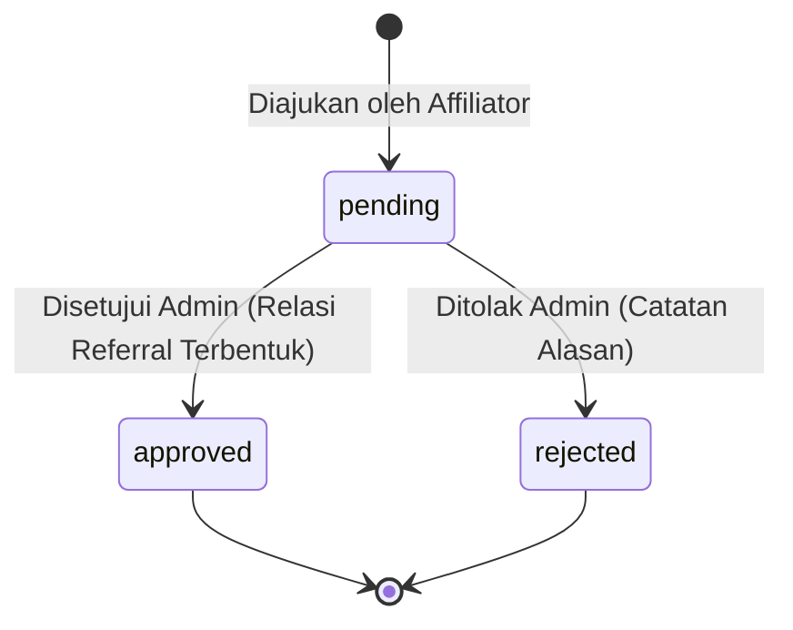

# Modul 03: Jaringan Afiliasi & Perekaman Relasi Referral

Dokumen ini memuat spesifikasi teknis dan aturan bisnis untuk modul jaringan kemitraan, kode referral, dan mekanisme klaim referral susulan (PB 4).

---

## 1. Ringkasan Fitur & Peran Terlibat

- **Struktur Afiliasi 1-Tingkat (*Single-Level Affiliate*):** Sistem menerapkan skema komisi langsung 1-tingkat (tanpa sistem piramida / MLM berjenjang).
- **Kode Referral Unik:** Setiap pengguna yang memiliki peran **Affiliator** memiliki kode referral unik (misal: `ABIYAZID-01`, `JOHNDOE-88`).
- **Integritas Relasi Permanen:** 1 (satu) orang investor hanya dapat terikat pada **1 (satu) orang affiliator saja seumur hidup**.
- **Dua Jalur Pembentukan Relasi:**
  1. **Jalur Otomatis (Link Registrasi):** Pendaftar otomatis terhubung ke upline jika mendaftar menggunakan link yang mengandung `?ref={kode}` atau menginput kode secara manual pada form registrasi.
  2. **Jalur Klaim Susulan (PB 4):** Mengakomodasi situasi nyata di mana investor lupa memasukkan kode referral saat mendaftar. Affiliator dapat mengajukan klaim susulan dengan menyertakan bukti screenshot chat.

---

## 2. Entitas Database Terkait

- **`relasi_referral`**: Merekam hubungan resmi upline dan downline (`affiliator_id`, `downline_id` [UNIQUE], `sumber`, `joined_at`, `status`).
- **`klaim_referral`**: Menampung formulir pengajuan klaim susulan oleh affiliator (`affiliator_id`, `downline_id`, `bukti_chat_path`, `alasan`, `status`, `catatan_admin`, `reviewed_by`, `reviewed_at`).

---

## 3. Aturan Bisnis & Logika Validasi

### 3.1 Perekaman Otomatis saat Registrasi
1. Jika parameter URL `ref` ada dan valid (merujuk ke `users.referral_code` milik affiliator aktif), form registrasi otomatis mengunci dan menampilkan nama affiliator terkait.
2. Dilarang melakukan *self-referral* (menggunakan kode referral milik sendiri).
3. Saat pendaftaran sukses diselesaikan, sistem otomatis membuat entri di tabel `relasi_referral`:
   - `affiliator_id`: ID Affiliator pemilik kode.
   - `downline_id`: ID Investor yang baru mendaftar.
   - `sumber`: `'link_otomatis'`.
   - `joined_at`: `now()`.
   - `status`: `'active'`.

### 3.2 Alur Pengajuan Klaim Referral Susulan (PB 4)
1. Affiliator memilih pengguna (calon downline) yang belum terikat dengan affiliator manapun. Pengguna yang sudah memiliki upline di tabel `relasi_referral` tidak akan muncul pada daftar pilihan.
2. Affiliator wajib mengunggah `bukti_chat_path` (tangkapan layar percakapan WhatsApp/Telegram yang membuktikan bahwa affiliator yang merekomendasikan pendaftaran tersebut).
3. Affiliator wajib mengisi kolom `alasan` (kronologi singkat, misal: *"Investor terburu-buru mendaftar dan lupa memasukkan kode referral saya"*).
4. Status awal pengajuan adalah **`pending`**.

### 3.3 Validasi & Keputusan Administrator pada Klaim Susulan
1. Administrator memeriksa keabsahan bukti chat dan mencocokkan waktu chat dengan waktu pendaftaran investor.
2. Jika Admin memilih **`approved`**:
   - Status pengajuan di `klaim_referral` diubah menjadi `approved`.
   - Sistem secara otomatis (*database transaction*) meng-insert record baru ke tabel `relasi_referral` dengan kolom `sumber = 'klaim_manual'`.
   - Investor resmi terdaftar di daftar downline milik affiliator tersebut.
3. Jika Admin memilih **`rejected`**:
   - Status di `klaim_referral` diubah menjadi `rejected`.
   - Admin wajib memberikan `catatan_admin` alasan penolakan (misal: *"Bukti chat tidak menunjukkan tanggal atau nomor kontak tidak cocok"*).
   - Tidak ada relasi yang dibuat di tabel `relasi_referral`.

---

## 4. State Machine / Siklus Status Klaim Susulan (PB 4)

---

## 5. Catatan Teknis & Indexing Database

- **Constraint Integritas Kuat:** Kolom `downline_id` pada tabel `relasi_referral` diberi constraint `UNIQUE`. Database MySQL secara otomatis menolak dan membatalkan transaksi jika ada usaha menduplikasi downline ke lebih dari 1 affiliator.
- **Index Kinerja:** Diberikan index gabungan `INDEX(affiliator_id, downline_id)` untuk mempercepat query penampilan daftar downline dan pohon relasi.

---

## 6. Notifikasi In-App Sistem (Database Notifications)

Sistem mengintegrasikan notifikasi in-app realtime (lonceng notifikasi) untuk alur interaksi kemitraan:

1. **`NewDownlineRegisteredNotification` (Ke Affiliator):**
   - **Pemicu:** Investor menyelesaikan pendaftaran dengan mengisi kode referral affiliator.
   - **Penerima:** Akun Affiliator pemilik kode referral.
   - **Konten:** *"Investor [Nama] (@[Username]) telah bergabung ke jaringan kemitraan Anda menggunakan kode referral [Kode]."*
   - **Aksi Klik:** Mengarahkan ke portal kemitraan (`/investor/affiliates`).

2. **`ReferralClaimSubmittedNotification` (Ke Administrator):**
   - **Pemicu:** Affiliator mengirim permohonan klaim referral susulan baru.
   - **Penerima:** Seluruh Administrator aktif.
   - **Konten:** *"Mitra Affiliator [Nama Affiliator] (@[Username]) mengajukan klaim susulan untuk investor [Nama Downline] (@[Username])."*
   - **Aksi Klik:** Mengarahkan ke panel verifikasi klaim (`/admin/referral-claims`).

3. **`ReferralClaimStatusChangedNotification` (Ke Affiliator):**
   - **Pemicu:** Administrator menetapkan keputusan verifikasi (disetujui / ditolak).
   - **Penerima:** Akun Affiliator pemohon klaim (serta affiliator pemohon lain yang klaimnya otomatis dibatalkan jika klaim disetujui untuk pemohon lain).
   - **Konten:**
     - Disetujui: *"Permohonan klaim referral Anda untuk investor [Nama Downline] telah disetujui Administrator. Relasi resmi telah aktif."*
     - Ditolak: *"Permohonan klaim referral Anda untuk investor [Nama Downline] ditolak. Catatan: [Catatan Admin]"*
   - **Aksi Klik:** Mengarahkan ke riwayat klaim (`/investor/affiliates`).

---

## 7. Ruang Catatan Tambahan (Area Kolaboratif Pengembang & AI)

*Tambahkan catatan atau perubahan kebutuhan terkait jaringan affiliator di bawah ini:*

- **[2026-09-08]**: Disepakati relasi bersifat permanen seumur hidup untuk menjaga kepercayaan affiliator Pak Abi.
- **[2026-09-21]**: Implementasi selesai. Penyesuaian arsitektur:
  1. Parameter URL `?ref=` ditiadakan karena tautan registrasi eksklusif dibuat oleh Admin. Perekaman dilakukan via input manual kode referral pada Step 4 (Konfirmasi & Persetujuan Layanan) sebelum checkbox Syarat & Ketentuan Layanan.
  2. Format kode referral distandardisasi menjadi 6 karakter: 3 huruf nama (kapital) + 3 karakter alfanumerik kapital acak (misal: `ABI8K2`, `ABIX79`).
  3. Alur klaim referral susulan (PB 4) dilengkapi proteksi private storage (`storage/app/private/referral_claims/`), otorisasi akses streaming, dan verifikasi keputusan admin dengan relasi atomik. Panduan verifikasi manual tersedia di [`docs/verifikasi-model/03_jaringan_dan_afiliasi.md`](../verifikasi-model/03_jaringan_dan_afiliasi.md).
- **[2026-09-22]**: Penerapan sistem notifikasi in-app Modul 03 (`NewDownlineRegisteredNotification`, `ReferralClaimSubmittedNotification`, `ReferralClaimStatusChangedNotification`) terhubung dengan lonceng notifikasi header dan halaman notifikasi pengguna.

