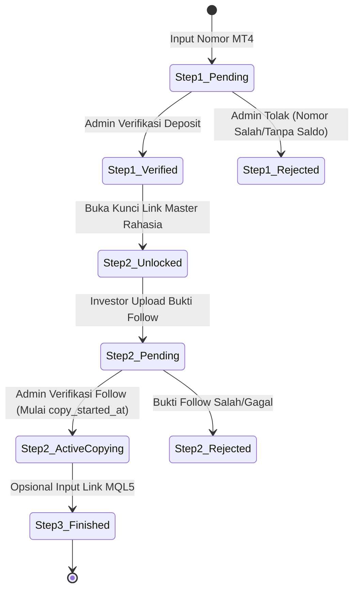

# Modul 04: CopyTrade, Akun Broker & Stepper 3-Tahap

Dokumen ini memuat spesifikasi teknis dan aturan bisnis untuk modul penyambungan akun trading eksternal, perlindungan tautan rahasia master trader, dan alur stepper 3-tahap (PB 5).

---

## 1. Ringkasan Fitur & Peran Terlibat

- **Integrasi Broker Eksternal:** Sistem mendukung broker forex mitra Pak Abi (saat ini **HFM** dan **XM**, serta opsi broker lain di masa depan).
- **Perlindungan Tautan Rahasia Master Trader:** Tautan penyalinan copytrade Pak Abi (*Master CopyTrade Secret URL*) bersifat eksklusif. Tautan ini **tidak boleh terbuka untuk umum** dan hanya boleh dilihat oleh investor yang terbukti sah telah membuka akun di bawah referral Pak Abi dan mengisi saldo deposit modal.
- **Alur Stepper 3-Tahap dengan 2-Fase Verifikasi Admin:**
  1. **Tahap 1:** Buka Akun Broker & Deposit $\rightarrow$ Verifikasi Admin Fase 1.
  2. **Tahap 2:** Buka Kunci Link Rahasia Master & Upload Bukti Follow $\rightarrow$ Verifikasi Admin Fase 2.
  3. **Tahap 3:** Pengisian Portofolio Publik MQL5 (Opsional) & Mulai Pemantauan.

---

## 2. Entitas Database Terkait

- **`akun_copytrade`**: Menyimpan status stepper dan nomor akun MT4 investor (`user_id`, `broker_name`, `mt4_account_number`, `step1_deposit_status`, `step1_deposit_verified_at`, `step2_copy_proof_path`, `step2_copy_status`, `step2_copy_verified_at`, `step3_mql5_url`, `copy_started_at`).
- **`pengaturan_master`**: Menyimpan URL referral broker Pak Abi (`broker_hfm_referral_url`, `broker_xm_referral_url`) dan URL privat master (`master_copytrade_secret_url`).

---

## 3. Aturan Bisnis & Logika Stepper 3-Tahap

### 3.1 Tahap 1: Registrasi Broker & Verifikasi Saldo Modal
1. Investor memilih broker yang diinginkan (HFM atau XM) dan mengklik link referral resmi Pak Abi yang diambil dari `pengaturan_master`.
2. Setelah investor membuat akun riil di broker dan menyetorkan deposit modal awal, investor menginput:
   - Pilihan Broker (`broker_name`)
   - Nomor Akun MT4 Riil (`mt4_account_number`)
3. Data tersimpan dengan status: `step1_deposit_status = 'pending'`.
4. Admin (Pak Abi) memeriksa IB (*Introducing Broker*) portal broker untuk mencocokkan nomor MT4 dan saldo deposit.
5. Jika valid, Admin klik **Verifikasi Deposit**:
   - `step1_deposit_status` berubah menjadi `'verified'`.
   - `step1_deposit_verified_at` dicatat `now()`.
   - Gembok Tahap 2 resmi terbuka.

### 3.2 Tahap 2: Pembukaan Gembok Link Rahasia & Bukti Follow Master
1. **Aturan Keamanan Payload (Zero-Leak):** Selama `step1_deposit_status != 'verified'`, sistem di backend Laravel dilarang mengirimkan URL `master_copytrade_secret_url` ke frontend Inertia Vue.
2. Ketika Tahap 1 sudah `verified`, sistem menampilkan tombol tautan privat copytrade Pak Abi.
3. Investor menyalin sinyal akun master trader di sistem broker.
4. Investor mengambil tangkapan layar (*screenshot*) status *follower active* di portal broker dan mengunggahnya (`step2_copy_proof_path`).
5. Status menjadi: `step2_copy_status = 'pending'`.
6. Admin memeriksa daftar follower di akun master trader:
   - Jika disetujui: Admin klik **Verifikasi CopyTrade** $\rightarrow$ `step2_copy_status = 'active_copying'`, `step2_copy_verified_at = now()`, dan **`copy_started_at = now()`**.
   - Jika ditolak: Status menjadi `'rejected'` dan investor diminta upload ulang bukti yang benar.

### 3.3 Tahap 3: Pemantauan Portofolio Pribadi (Opsional)
1. Investor dapat memasukkan URL portofolio publik pribadi (misal: Myfxbook pribadi atau tautan sinyal MQL5) pada kolom `step3_mql5_url`.
2. Halaman ini bersifat opsional untuk membantu investor memantau perkembangan akun pribadinya.

---

## 4. Peran Kritis `copy_started_at` untuk Hak Komisi Afiliasi

- Kolom `copy_started_at` mencatat tanggal dan waktu persis ketika akun copytrade investor resmi disetujui aktif menyalin (*active copying*).
- Kolom ini menjadi **titik tolak mutlak (baseline waktu)** untuk menghitung pemenuhan syarat minimal keaktifan 3 bulan pro-rata saat upline/affiliator mengajukan klaim komisi di Modul 05.

---

## 5. State Machine / Siklus Status Stepper CopyTrade

---

## 6. Ruang Catatan Tambahan (Area Kolaboratif Pengembang & AI)

*Tambahkan catatan atau perubahan kebutuhan terkait copytrade di bawah ini:*

- **[2026-09-08]**: Disepakati pemisahan 2 tahap verifikasi admin untuk memastikan investor tidak mendapatkan link rahasia master sebelum benar-benar deposit di broker.
- *(Tulis catatan baru di sini jika ada perubahan flow)*

