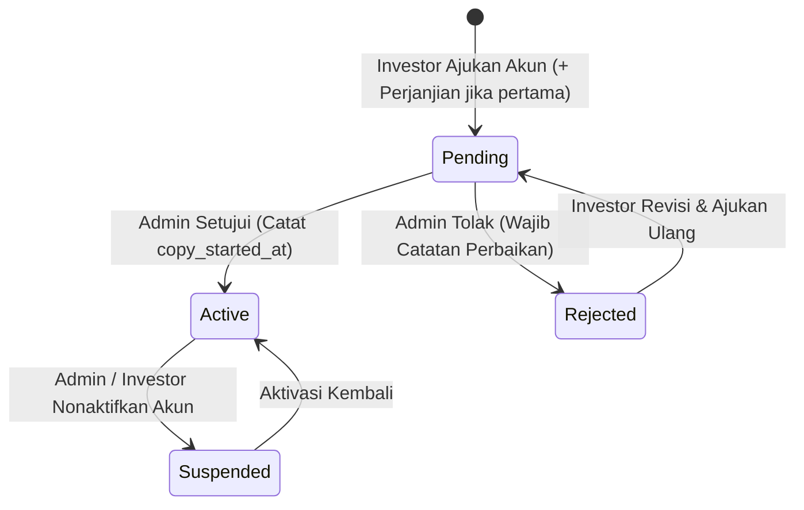

# Modul 04: CopyTrade, Akun Broker & Manajemen Multi-Akun 3-Tier

Dokumen ini memuat spesifikasi teknis dan aturan bisnis untuk penyambungan akun trading eksternal, manajemen multi-akun copytrade, konfigurasi CMS 3-tier dinamis, dan verifikasi satu pintu oleh Administrator (PB 5).

---

## 1. Ringkasan Fitur & Peran Terlibat

- **Pemisahan Pendaftaran Akun & Copytrade:** Pendaftaran akun utama (`/register`) bersih dari beban teknis trading (hanya data diri, KTP di Step 1, ahli waris di Step 2, dan persetujuan di Step 3). Pendaftaran akun copytrade dilakukan di dalam portal investor (`/investor/copytrade`).
- **Dukungan Multi-Akun Copytrade:** Satu akun investor dapat mendaftarkan dan memantau lebih dari 1 akun copytrade dengan nomor akun MT4, modal riil, dan tier yang berbeda-beda.
- **Sistem 3-Tier Investasi Dinamis (CMS):**
  - **Tier 1:** Investasi pemula/standar (default min \$100).
  - **Tier 2:** Investasi menengah (default min \$5,000 / \$500).
  - **Tier 3:** Investasi privat/eksklusif (default min \$300,000 / \$1,000) dengan akses VPS/kredensial master terenkripsi.
  - Batas minimal modal riil, link referral broker, dan link akun master MQL5 dikonfigurasi fleksibel oleh Administrator via CMS `/admin/settings/master`.
- **Aturan Berkas Surat Perjanjian Kemitraan:**
  - Pendaftaran Pertama: Wajib mengunduh template perjanjian per tier dan mengunggah kembali dokumen bertanda tangan.
  - Pendaftaran Akun Tambahan: Tidak wajib mengunggah kembali surat perjanjian karena legalitas investor sudah terikat pada pendaftaran awal.
- **Verifikasi Satu Pintu oleh Admin:**
  - Admin memeriksa kesesuaian data akun broker investor langsung di `/admin/copytrade`.
  - Jika disetujui (*active*), sistem secara otomatis mencatat `copy_started_at = now()` sebagai baseline waktu keaktifan copytrade.

---

## 2. Entitas Database Terkait

- **`akun_copytrade`**: Menyimpan seluruh data akun trading investor (`user_id`, `tier`, `broker`, `tipe_akun`, `nomor_akun_trading`, `server_broker`, `master_password`, `investor_password`, `modal_riil`, `surat_perjanjian_path`, `url_mql5, myfxbook_url`, `tanggal_mulai`, `tanggal_selesai`, `nama_bank`, `nomor_rekening`, `atas_nama_rekening`, `status`, `catatan_admin`, `verified_by`, `copy_started_at`).
- **`pengaturan_master`**: Menyimpan konfigurasi dinamis CMS (`link_referral_broker`, `link_master_akun`, `tier_1_min`, `tier_2_min`, `tier_3_min`, `tier_1_desc`, `tier_2_desc`, `tier_3_desc`, `tier_1_pdf_path`, `tier_2_pdf_path`, `tier_3_pdf_path`).
- **Sistem Panduan 3-Tier Hybrid:**
  - **Instruksi On-Screen Web (Mobile-First):** Poin-poin langkah pendaftaran akun broker, leverage, dan tata cara koneksi per tier dikelola dinamis di CMS dan tampil langsung di `/investor/copytrade`.
  - **Brosur Panduan PDF Opsional:** Admin dapat mengunggah berkas PDF panduan grafis per tier yang dapat diunduh investor sebagai referensi tambahan.

---

## 3. Aturan Bisnis & Alur Kerja

### 3.1 Portal Investor (`/investor/copytrade`)
1. Investor melihat kartu informasi master akun:
   - Tautan referral resmi pendaftaran akun broker.
   - Tautan profil akun master trading / MQL5.
2. Investor menekan tombol **Tambah Akun** untuk membuka modal pendaftaran:
   - Memilih Tier Investasi (Tier 1, 2, atau 3) yang batas minimal modalnya menyesuaikan pengaturan CMS.
   - Mengisi Nomor Akun Trading MT4 dan Modal Riil (USD).
   - Mengisi Tanggal Mulai Trading dan data rekening penarikan bank (Nama Bank, Nomor Rekening, Atas Nama).
   - **Khusus Tier 3:** Wajib mengisi Server Broker, Master Password MT4, Investor Password MT4, dan URL MQL5 (opsional). Password MT4 dienkripsi secara aman di database menggunakan `Crypt::encryptString()`.
   - **Pendaftaran Pertama:** Wajib mengunggah berkas Surat Perjanjian Kemitraan. Sistem menyediakan tombol unduh template DOCX resmi per tier.
   - **Pendaftaran Tambahan:** Berkas surat perjanjian menjadi opsional / tidak wajib diunggah.
3. Setelah dikirim, data tersimpan dengan status `pending`, dan sistem otomatis mengirimkan notifikasi database in-app (`NewCopytradeSubmittedNotification`) kepada seluruh Administrator dengan tautan langsung ke `/admin/copytrade`.

### 3.2 Portal Administrator (`/admin/copytrade` & `/admin/settings/master`)
1. **CMS Pengaturan Master (`/admin/settings/master`):**
   - Admin dapat memperbarui tautan referral broker, tautan akun master, serta nominal batas minimal modal riil untuk ketiga tier.
2. **Verifikasi Akun Copytrade (`/admin/copytrade`):**
   - Admin meninjau data investor, data akun trading, informasi rekening bank, kredensial VPS (Tier 3), serta pratinjau surat perjanjian via `/documents/copytrade/{id}`.
   - **Keputusan Terima (`active`):** Akun disetujui, `copy_started_at` diisi `now()`, status menjadi aktif, dan notifikasi in-app dikirim ke investor.
   - **Keputusan Tolak (`rejected`):** Admin wajib mengisi catatan perbaikan (`catatan_admin`), dan notifikasi in-app dikirim ke investor.

---

## 4. Baseline Kelayakan Komisi Afiliasi Berbasis 3 Laporan Bulanan

- Kelayakan klaim komisi kemitraan kini dievaluasi berdasarkan **penyelesaian 3 laporan profit bulanan pertama (`periode_ke` 1, 2, 3)** pada akun copytrade downline, menggantikan batasan kalender kaku 90 hari.
- Tautan Myfxbook publik (`myfxbook_url`) wajib disertakan saat mendaftar akun copytrade agar performa dapat diaudit secara transparan oleh affiliator dan master trader.

---

## 5. State Machine / Siklus Status Akun CopyTrade

---

## 6. Ruang Catatan Tambahan (Area Kolaboratif Pengembang & AI)

- **[2026-09-23]**: Pemisahan penuh proses copytrade dari halaman registrasi akun utama (`/register`). Foto KTP dipindahkan ke Step 1 registrasi, pendaftaran copytrade dipindahkan ke portal investor dengan dukungan multi-akun per user dan 3-tier dinamis via CMS Admin.
