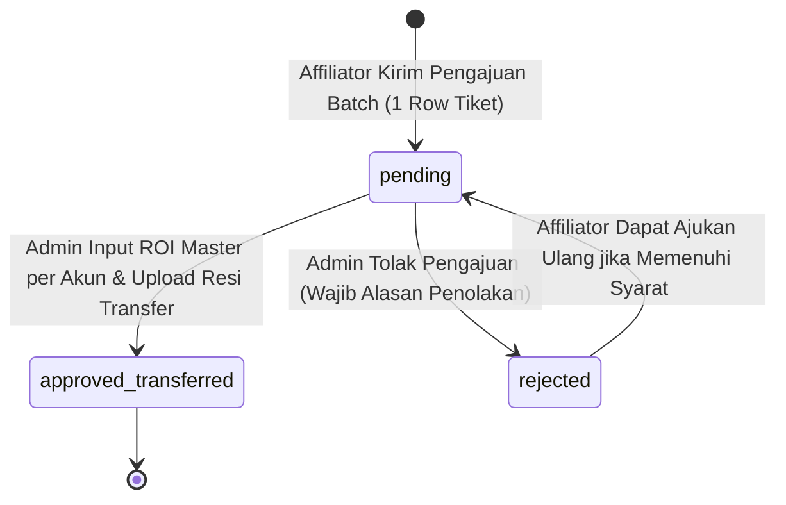

# Modul 05: Klaim Komisi Afiliasi, Tiering 4-Level & Perhitungan Berbasis ROI Master (PB 3)

Dokumen ini memuat spesifikasi teknis dan aturan bisnis untuk perhitungan hak komisi affiliator berbasis persentase pertumbuhan ROI Master Trader, skema 4-tiering, perlindungan drawdown (Drawdown Guard), pengajuan multi-downline batch 1 row, penarikan modal riil otomatis, dan pencairan dana (PB 3).

---

## 1. Ringkasan Fitur & Peran Terlibat

- **Satu Tiket Klaim = 1 Baris (1 Row):** Pengajuan klaim komisi affiliator—meskipun memilih banyak investor downline dan banyak akun copytrade sekaligus—dihitung dan dicatat sebagai **1 (satu) permohonan klaim utama (1 row)** pada tabel `klaim_komisi` dengan kode klaim tunggal (`CLM-YYYYMM-XXXX`) dan rincian item pada `klaim_komisi_items`.
- **Acuan Periode 90 Hari (1 Kali Klaim Per Downline):**
  - Hak komisi per downline diajukan **1 kali saja** untuk periode copytrade 90 hari (3 bulan).
  - Syarat kelayakan klaim: investor telah aktif copytrade minimal **90 hari** sejak pertama kali mulai.
- **Investor dengan Lebih dari 1 Akun Copytrade (Multi-Akun):**
  - Acuan hari pertama copytrade adalah waktu akun copytrade pertama kali aktif (`min(copy_started_at)`).
  - Akun pertama dihitung penuh **90 hari**.
  - Jika investor memiliki akun kedua, ketiga, dst., hari yang dihitung adalah **90 hari dikurangi selisih hari mulai akun tersebut terhadap akun pertama**:
    $$\text{hari\_kehitung} = \max(0, 90 - \Delta\text{hari\_start})$$
    *(Contoh: Akun ke-2 mulai pada hari ke-20 setelah Akun 1, maka Akun ke-2 dihitung 70 hari)*.
- **Penarikan Otomatis Modal Riil (Zero Manual Input & Zero Upload Bukti):**
  - Affiliator **tidak perlu** menginput angka nominal deposit.
  - Affiliator **tidak perlu** mengunggah file bukti modal/portofolio.
  - Sistem secara otomatis mengambil nilai modal riil (`deposit_amount` / `modal_riil`) dari masing-masing akun copytrade aktif investor downline.
- **Skema 4-Tiering Komisi Otomatis:**
  Persentase hak komisi affiliator (`affiliate_share_pct`) ditentukan berdasarkan total akumulasi modal deposit investor downline:
  - **Tier 1 (Modal deposit > Rp 10.000.000.000 / > 10 M):** Komisi **50%** dari hak Master Trader.
  - **Tier 2 (Modal deposit Rp 1.000.000.000 – Rp 10.000.000.000 / 1 M - 10 M):** Komisi **40%** dari hak Master Trader.
  - **Tier 3 (Modal deposit Rp 100.000.000 – Rp 1.000.000.000 / 100 Jt - 1 M):** Komisi **30%** dari hak Master Trader.
  - **Tier 4 (Modal deposit < Rp 100.000.000 / < 100 Jt):** Komisi **20%** dari hak Master Trader.
- **Formula Komisi Berbasis ROI & Perlindungan Drawdown (Drawdown Guard):**
  - Admin menginput persentase pertumbuhan ROI Master (`roi_percentage`) per akun copytrade pada periode aktifnya.
  - Komisi affiliator dipotong dari jatah bagi hasil Master Trader (`master_share_pct`, default: 30%).
  - Jika akun dalam posisi rugi atau impas ($\text{gross\_profit} \le 0$), berlaku **Drawdown Guard**: komisi affiliator $0, hak Master $0, dan investor menanggung gross loss tanpa potongan komisi.
- **Pencairan Terpadu 1 Transfer & 1 Bukti:** Admin melakukan transfer bank tunggal ke rekening affiliator sebesar total akumulasi komisi seluruh akun copytrade dalam tiket klaim tersebut, dan mengunggah satu bukti resi transfer sebagai transparansi.

---

## 2. Entitas Database Terkait

- **`klaim_komisi` (Header - 1 Row per Pengajuan):**
  - `id` [BigInt, PK].
  - `kode_klaim` [UK, String 30]: Kode unik tiket klaim (misal: `CLM-202609-0001`).
  - `affiliator_id` [FK $\rightarrow$ `users`].
  - `total_downline` [Unsigned Integer]: Jumlah investor unik yang diajukan.
  - `total_akun` [Unsigned Integer]: Jumlah total akun copytrade dalam tiket ini.
  - `total_deposit_amount` / `total_modal_riil` [Decimal 15,2]: Total akumulasi modal awal seluruh akun dalam USD.
  - `total_gross_profit` [Decimal 15,2, Nullable]: Akumulasi gross profit seluruh akun copytrade.
  - `total_master_gross_share` [Decimal 15,2, Nullable]: Akumulasi hak kotor Master Trader.
  - `total_master_net_share` [Decimal 15,2, Nullable]: Akumulasi hak bersih Master Trader setelah dipotong komisi affiliator.
  - `total_investor_net_profit` [Decimal 15,2, Nullable]: Akumulasi profit bersih investor.
  - `total_affiliate_commission` / `total_nominal_transfer` [Decimal 15,2, Nullable]: Total hak komisi pencairan yang ditransfer ke Affiliator.
  - `nama_bank`, `nomor_rekening`, `atas_nama_rekening` [String]: Rekening pencairan Affiliator.
  - `status` [String 30]: `pending`, `approved_transferred`, `rejected`.
  - `bukti_transfer_path` [String, Nullable]: Resi transfer bank tunggal yang diunggah Admin.
  - `catatan_admin` [Text, Nullable].
  - `processed_by` [FK $\rightarrow$ `users`, Nullable], `processed_at` [Timestamp, Nullable].

- **`klaim_komisi_items` (Detail / Itemized Rows):**
  - `id` [BigInt, PK].
  - `klaim_komisi_id` [FK $\rightarrow$ `klaim_komisi`, cascadeOnDelete].
  - `downline_id` [FK $\rightarrow$ `users`, cascadeOnDelete].
  - `akun_copytrade_id` [FK $\rightarrow$ `akun_copytrade`, nullOnDelete].
  - `broker`, `nomor_akun_trading` [String 50].
  - `is_akun_pertama` [Boolean]: True untuk akun copytrade yang pertama kali aktif.
  - `tanggal_mulai`, `tanggal_selesai` [Date].
  - `hari_kehitung` [Unsigned SmallInt]: Hari aktif yang diakui dalam periode 90 hari.
  - `deposit_amount` / `modal_riil` [Decimal 15,2]: Modal awal investor dalam USD.
  - `tier_level` [TinyInt]: 1, 2, 3, atau 4.
  - `persentase_tier` [TinyInt]: 50, 40, 30, atau 20.
  - `roi_percentage` [Decimal 8,2, Nullable]: Persentase pertumbuhan akun Master pada periode tersebut.
  - `gross_profit` [Decimal 15,2, Nullable]: Gross profit investor.
  - `master_share_pct` [Decimal 5,2]: Default 30.00%.
  - `master_gross_share` [Decimal 15,2, Nullable]: Bagi hasil kotor Master Trader.
  - `affiliate_share_pct` [Decimal 5,2]: Default sesuai persentase tier (20, 30, 40, 50).
  - `affiliate_commission` / `nominal_transfer` [Decimal 15,2, Nullable]: Komisi affiliator yang dipotong dari hak Master.
  - `master_net_share` [Decimal 15,2, Nullable]: Bagi hasil bersih Master ($\text{master\_gross\_share} - \text{affiliate\_commission}$).
  - `investor_net_profit` [Decimal 15,2, Nullable]: Profit bersih investor ($\text{gross\_profit} - \text{master\_gross\_share}$).

---

## 3. Formula Matematika & Logika Perhitungan

### 3.1 Parameter Input
1. `deposit_amount` ($): Modal awal investor dalam USD dari data akun copytrade.
2. `roi_percentage` (%): Persentase ROI akun Master Trader pada rentang tanggal aktif akun copytrade (diinput Admin).
3. `master_share_pct` (%): Hak bagi hasil kotor Master dari profit investor (default: `30.0%`).
4. `affiliate_share_pct` (%): Persentase komisi affiliator yang dipotong dari hak Master (ditentukan otomatis dari Skema 4-Tiering: 20%, 30%, 40%, atau 50%).

### 3.2 Rumus Perhitungan & Drawdown Guard
1. **Gross Profit Investor:**
   $$\text{gross\_profit} = \text{deposit\_amount} \times \left( \frac{\text{roi\_percentage}}{100} \right)$$

2. **Kondisi Rugi / Impas (Drawdown Guard):**
   Jika $\text{gross\_profit} \le 0$ (atau $\text{roi\_percentage} \le 0$):
   - $\text{affiliate\_commission} = 0$
   - $\text{master\_gross\_share} = 0$
   - $\text{master\_net\_share} = 0$
   - $\text{investor\_net\_profit} = \text{gross\_profit}$
   *(Tidak ada potongan komisi maupun bagi hasil saat posisi rugi)*.

3. **Kondisi Profit ($\text{gross\_profit} > 0$):**
   - **Bagi Hasil Kotor Master:**
     $$\text{master\_gross\_share} = \text{gross\_profit} \times \left( \frac{\text{master\_share\_pct}}{100} \right)$$
   - **Komisi Afiliator (Dipotong dari Jatah Master):**
     $$\text{affiliate\_commission} = \text{master\_gross\_share} \times \left( \frac{\text{affiliate\_share\_pct}}{100} \right)$$
   - **Bagi Hasil Bersih Master:**
     $$\text{master\_net\_share} = \text{master\_gross\_share} - \text{affiliate\_commission}$$
   - **Profit Bersih Investor:**
     $$\text{investor\_net\_profit} = \text{gross\_profit} - \text{master\_gross\_share}$$

4. **Keseimbangan Finansial (*Mathematical Balance*):**
   $$\text{investor\_net\_profit} + \text{master\_net\_share} + \text{affiliate\_commission} = \text{gross\_profit}$$

5. **Contoh Numerik:**
   - Modal deposit: $\$10.000$ (Tier 4 $\rightarrow 20\%$).
   - ROI Master: $20\%$.
   - $\text{gross\_profit} = \$10.000 \times 20\% = \$2.000$.
   - $\text{master\_gross\_share} = \$2.000 \times 30\% = \$600$.
   - $\text{affiliate\_commission} = \$600 \times 20\% = \$120$.
   - $\text{master\_net\_share} = \$600 - \$120 = \$480$.
   - $\text{investor\_net\_profit} = \$2.000 - \$600 = \$1.400$.
   - Pembuktian: $\$1.400 + \$480 + \$120 = \$2.000$ (Seimbang).

---

## 4. Alur Kerja & Siklus Status

---

## 5. Rekap Histori Perubahan

- **[2026-09-08]**: Disepakati komisi dihitung dari jatah bagi hasil Master Trader.
- **[2026-09-23]**: Skema 4-tier modal investor ditetapkan (Tier 1: 50%, Tier 2: 40%, Tier 3: 30%, Tier 4: 20%).
- **[2026-09-24]**:
  - Konfirmasi klaim komisi per downline dilakukan 1x untuk periode 90 hari (3 bulan).
  - Penambahan perhitungan multi-copytrade dengan acuan copytrade pertama (90 hari) dan akun berikutnya dihitung proporsional selisih hari.
  - Penerapan formula resmi berbasis ROI Master:
    - `gross_profit = deposit_amount * (roi / 100)`
    - `master_gross_share = gross_profit * (master_share_pct / 100)`
    - `affiliate_commission = master_gross_share * (affiliate_share_pct / 100)`
    - Drawdown Guard: jika ROI $\le 0\%$, komisi $0 dan bagi hasil Master $0.
  - Seluruh nominal deposit, gross profit, dan komisi menggunakan mata uang USD ($).
