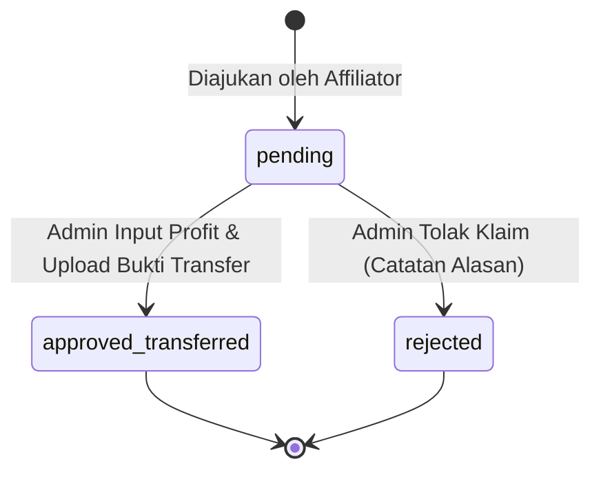

# Modul 05: Klaim Komisi Afiliasi, Tiering & Pro-Rata 3 Bulan

Dokumen ini memuat spesifikasi teknis dan aturan bisnis untuk perhitungan hak komisi affiliator, verifikasi masa aktif 3 bulan, dan pencairan dana (PB 3).

---

## 1. Ringkasan Fitur & Peran Terlibat

- **Klaim Per-Investor Pro-Rata:** Klaim komisi diajukan oleh Affiliator per 1 (satu) orang investor binaannya yang telah memenuhi syarat minimal masa aktif penyalinan (*copytrade*).
- **Syarat Masa Aktif $\ge$ 3 Bulan:** Investor downline wajib aktif menyalin master trader minimal selama **90 hari berturut-turut** terhitung sejak tanggal `copy_started_at`.
- **Skema Tiering Komisi Otomatis:** Persentase hak komisi affiliator dihitung dari **bagian profit yang diperoleh Master Trader (Pak Abi)** berdasarkan besaran modal deposit investor:
  - **Tier 1 (Modal > Rp 1.000.000.000):** Komisi **50%** dari profit Master Trader.
  - **Tier 2 (Modal Rp 100.000.000 – Rp 1.000.000.000):** Komisi **40%** dari profit Master Trader.
  - **Tier 3 (Modal < Rp 100.000.000):** Komisi **30%** dari profit Master Trader.
- **Pencairan Manual Terverifikasi:** Pembayaran dilakukan manual via transfer bank oleh Pak Abi/Admin, dan bukti transfer diunggah ke sistem sebagai transparansi.

---

## 2. Entitas Database Terkait

- **`klaim_komisi`**: Menyimpan permohonan klaim (`kode_klaim` [UK], `affiliator_id`, `downline_id`, `nominal_deposit`, `persentase_tier`, `bukti_modal_path`, `profit_master`, `nominal_transfer`, `bukti_transfer_path`, `status`, `catatan_admin`, `processed_by`, `processed_at`).
- **`relasi_referral`**: Menjamin affiliator hanya dapat mengklaim investor yang secara sah merupakan downline miliknya.
- **`akun_copytrade`**: Menjadi rujukan validasi tanggal `copy_started_at` dan status `step2_copy_status == 'active_copying'`.

---

## 3. Aturan Bisnis & Logika Validasi

### 3.1 Validasi Kelayakan Pengajuan (Eligibility Check)
Saat affiliator membuka formulir pengajuan klaim komisi:
1. Dropdown pilihan hanya menampilkan investor downline yang:
   - Terikat resmi di tabel `relasi_referral`.
   - Memiliki data di `akun_copytrade` dengan status `step2_copy_status = 'active_copying'`.
   - Masa aktif memenuhi syarat: `DATEDIFF(NOW(), copy_started_at) >= 90`.
2. Jika masa aktif masih $< 90$ hari, sistem menampilkan indikator ramah pengguna (contoh: *"Aktif 54 hari / 90 hari — Tersisa 36 hari lagi untuk dapat diklaim"*), dan tombol ajukan klaim dinonaktifkan (*disabled*).

### 3.2 Penentuan Tier Otomatis
1. Affiliator menginput `nominal_deposit` (saldo modal riil investor downline) dan melampirkan screenshot saldo modal MT4 (`bukti_modal_path`).
2. Sistem secara otomatis mengunci nilai `persentase_tier`:
   - `nominal_deposit > 1000000000` $\rightarrow$ `persentase_tier = 50`
   - `nominal_deposit >= 100000000` AND `nominal_deposit <= 1000000000` $\rightarrow$ `persentase_tier = 40`
   - `nominal_deposit < 100000000` $\rightarrow$ `persentase_tier = 30`
3. Affiliator tidak dapat memanipulasi persentase tier secara manual (ditentukan sepihak oleh sistem).
4. Status awal record: `pending`.

### 3.3 Pemrosesan & Pencairan oleh Administrator
1. Admin memeriksa keabsahan bukti modal dan histori transaksi akun investor terkait di broker.
2. Admin menginput nominal riil `profit_master` yang dihasilkan oleh Master Trader untuk portofolio investor tersebut pada periode 3 bulan berjalan.
3. Sistem secara otomatis menghitung nominal transfer final:
   $$\text{nominal\_transfer} = \text{profit\_master} \times \left( \frac{\text{persentase\_tier}}{100} \right)$$
4. Admin mentransfer uang ke rekening bank milik Affiliator.
5. Admin mengunggah foto resi/struk transfer bank (`bukti_transfer_path`).
6. Admin menekan tombol **Selesaikan Pencairan**:
   - `status` berubah menjadi `'approved_transferred'`.
   - `processed_at` diisi `now()`.
   - `processed_by` diisi `auth()->id()`.

---

## 4. State Machine / Siklus Status Klaim Komisi

---

## 5. Catatan Teknis & Indexing Database

- **Format Kode Klaim:** `CLM-YYYYMM-XXXX` (contoh: `CLM-202609-0001`) yang dibuat unik otomatis (*sequential padding*).
- **Index Performa:** Diberikan index pada `INDEX(status)` dan `INDEX(affiliator_id)` agar dashboard affiliator dan antrean persetujuan admin termuat cepat.
- **Penyimpanan Berkas Transfer:** Bukti transfer disimpan di private disk `storage/app/private_documents/transfers/` dan hanya dapat dilihat oleh affiliator terkait serta admin.

---

## 6. Ruang Catatan Tambahan (Area Kolaboratif Pengembang & AI)

*Tambahkan catatan atau perubahan kebutuhan terkait klaim komisi di bawah ini:*

- **[2026-09-08]**: Disepakati formula komisi dihitung dari bagian profit Master Trader (bukan dari total profit kotor broker), dengan pembagian tier 50% / 40% / 30%.
- *(Tulis catatan baru di sini jika ada perubahan flow)*

