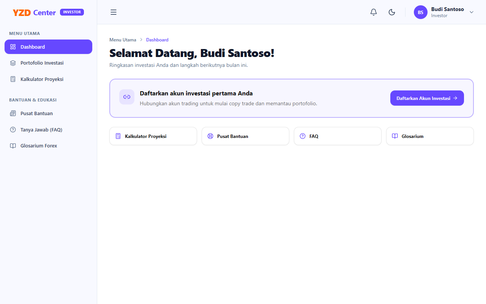
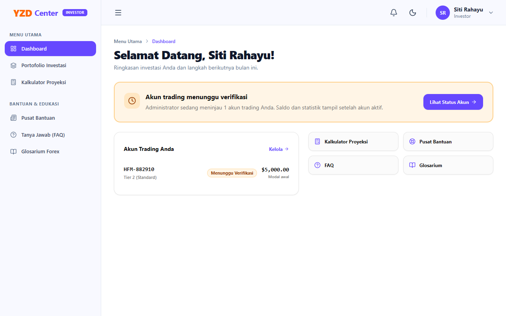
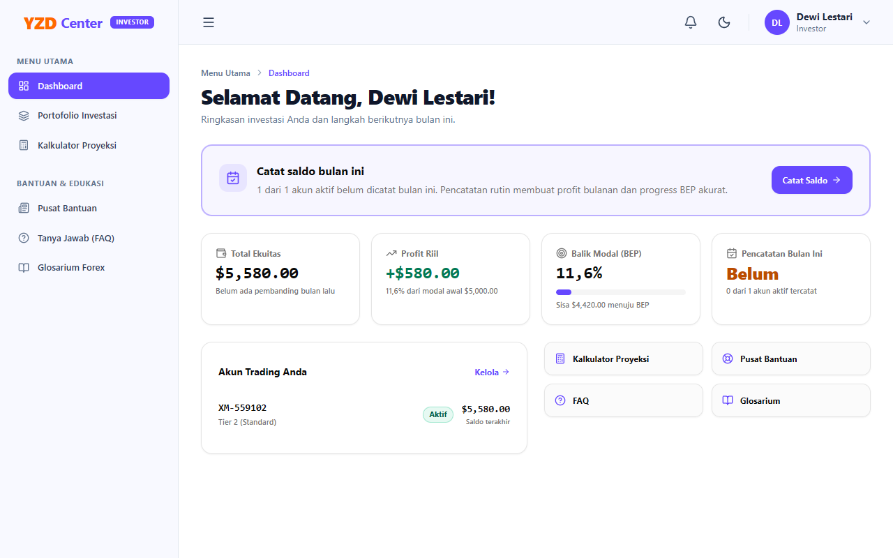
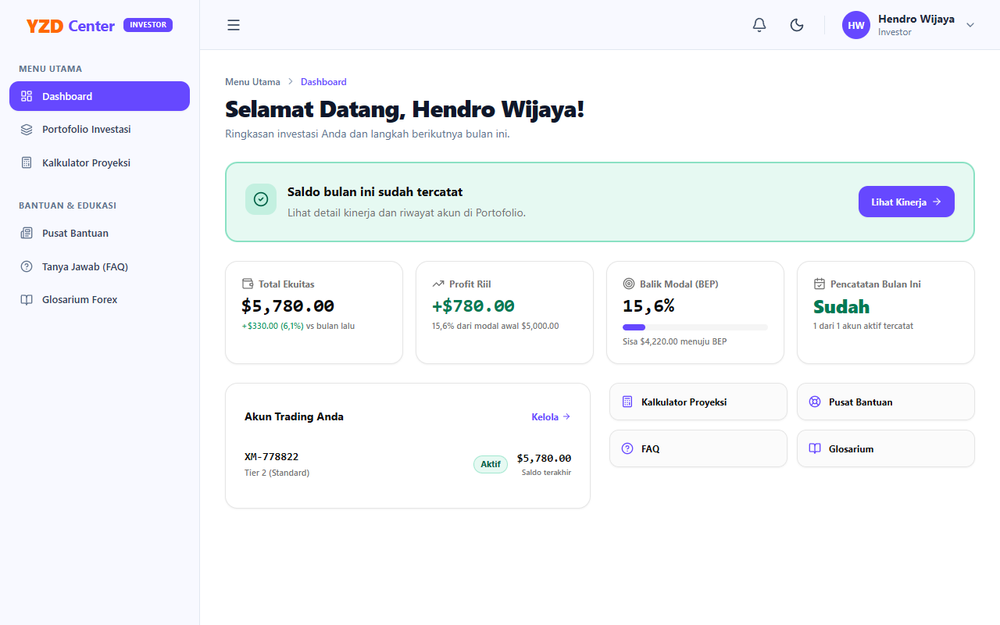
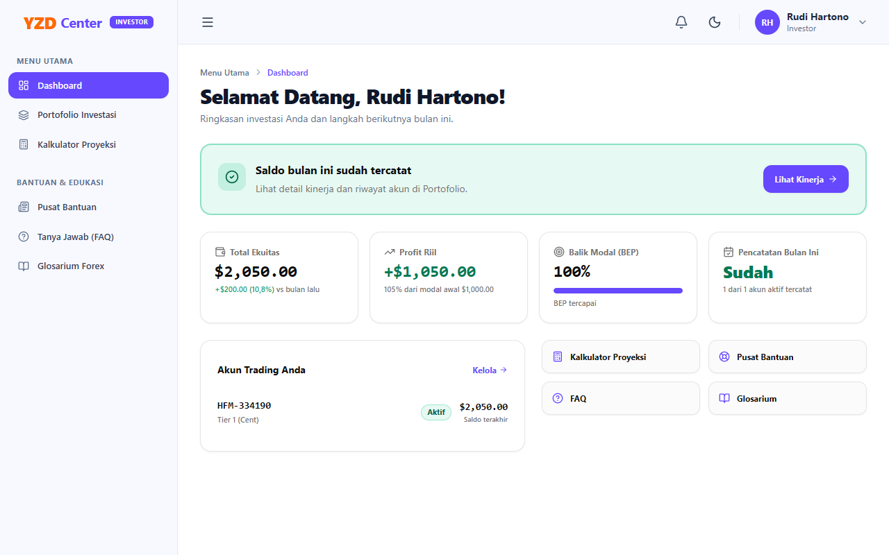
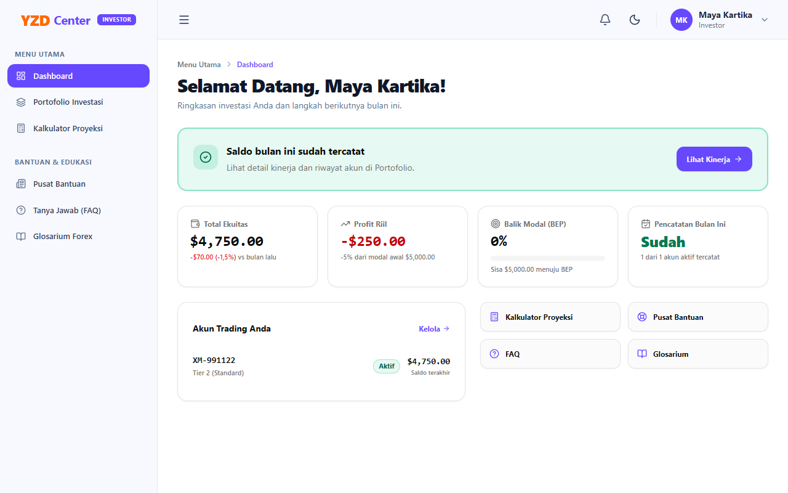
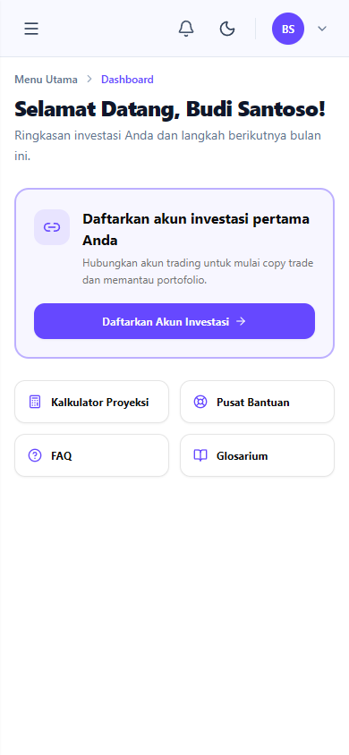
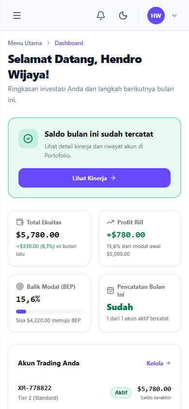

# Panduan Visual Kondisi Dasbor Investor (`InvestorDashboard.vue`)

Dokumen ini mendokumentasikan seluruh kondisi antarmuka (*UI states*) pada Dasbor Investor ([`InvestorDashboard.vue`](../src/resources/js/Pages/Investor/InvestorDashboard.vue)) di route `http://localhost:8000/investor/dashboard`.

Data statistik dan perjalanan portofolio dihitung secara dinamis oleh backend [`BalanceService.php`](../src/app/Services/BalanceService.php).

---

## 1. Matriks Ringkasan Seluruh Kondisi

| No | Kondisi / Skenario | Nilai `stage` | Status Rekap Bulan Ini | Kartu Angka Portofolio | Banner Langkah Berikutnya (*Tone*) | Tata Letak Pintasan Edukasi |
|:---|:---|:---:|:---:|:---:|:---|:---:|
| **1** | **Belum Ada Akun Investasi** | `no_account` | `false` | Sembunyi (*Hidden*) | Ungu/Primary (*Daftarkan akun investasi pertama Anda*) | Full Width (4 kolom) |
| **2** | **Akun Menunggu Verifikasi** | `pending_account` | `false` | Sembunyi (*Hidden*) | Amber/Kuning (*Akun trading menunggu verifikasi*) | 2 Kolom (List Akun + Grid 2x2) |
| **3A** | **Akun Aktif Baru (Belum Ada Riwayat Saldo)** | `running` | `false` | Tampil (Modal awal, Profit: `—`, BEP: `0%`) | Ungu/Primary (*Catat saldo bulan ini*) | 2 Kolom (List Akun + Grid 2x2) |
| **3B** | **Akun Aktif (Belum Input Saldo Bulan Berjalan)** | `running` | `false` | Tampil (Saldo terakhir, Profit positif, Status: *Belum*) | Ungu/Primary (*Catat saldo bulan ini*) | 2 Kolom (List Akun + Grid 2x2) |
| **4** | **Akun Aktif (Sudah Input Saldo Bulan Berjalan)** | `running` | `true` | Tampil (Saldo update, MoM vs bulan lalu, Status: *Sudah*) | Emerald/Hijau (*Saldo bulan ini sudah tercatat*) | 2 Kolom (List Akun + Grid 2x2) |
| **5** | **BEP 100% Tercapai (Pencapaian Modal Impas)** | `running` | `true` | Tampil (*BEP tercapai*, bar 100%, profit > 100%) | Emerald/Hijau (*Saldo bulan ini sudah tercatat*) | 2 Kolom (List Akun + Grid 2x2) |
| **6** | **Portofolio Mengalami Koreksi / Drawdown Negatif** | `running` | `true` | Tampil (Profit riil merah negatif, MoM merah) | Emerald/Hijau (*Saldo bulan ini sudah tercatat*) | 2 Kolom (List Akun + Grid 2x2) |

---

## 2. Rincian dan Screenshot Tiap Kondisi

### Kondisi 1: Belum Ada Akun Copytrade (`stage: no_account`)
- **Pemicu Data**: Investor telah terverifikasi KYC, namun belum memiliki akun copytrade/trading sama sekali (`accounts.length === 0`).
- **Karakteristik Tampilan**:
  - Banner panduan berwarna **Ungu (Primary Tone)** dengan ikon tautan (`Link2`), mengajak investor menghubungkan akun broker pertama kali.
  - Tombol CTA: **"Daftarkan Akun Investasi"** mengarah ke `/investor/investments`.
  - Seksi 4 kartu ringkasan portofolio **disembunyikan** (`v-if="isRunning"` bernilai `false`) agar tampilan ringkas dan tidak membingungkan.
  - 4 Pintasan Bantuan & Edukasi (*Kalkulator Proyeksi, Pusat Bantuan, FAQ, Glosarium*) tampil **Full Width** dalam 4 kolom sejajar di desktop.

---

### Kondisi 2: Akun Menunggu Verifikasi Administrator (`stage: pending_account`)
- **Pemicu Data**: Investor telah mendaftarkan minimal 1 akun copytrade, namun statusnya masih `pending` dan belum ada akun yang aktif.
- **Karakteristik Tampilan**:
  - Banner peringatan berwarna **Amber (Kuning Peringatan)** dengan ikon jam (`Clock`).
  - Teks deskripsi menginformasikan bahwa administrator sedang meninjau akun trading investor.
  - Tombol CTA: **"Lihat Status Akun"** mengarah ke `/investor/investments`.
  - Kartu angka angka statistik tetap disembunyikan hingga akun berstatus aktif.
  - Seksi bawah beralih ke layout split 2 kolom: Kolom kiri menampilkan kartu **"Akun Trading Anda"** berstatus badge **"Menunggu Verifikasi"** dengan nominal modal awal, dan kolom kanan menampilkan grid 2x2 pintasan edukasi.

---

### Kondisi 3A: Akun Aktif Baru / Belum Ada Catatan Saldo (`stage: running`, `has_balance_history: false`)
- **Pemicu Data**: Minimal 1 akun copytrade telah disetujui (`status === 'active'`), namun investor belum pernah melakukan pencatatan saldo bulanan perdana pada tanggal 1.
- **Karakteristik Tampilan**:
  - Banner langkah berikutnya berwarna **Ungu (Primary)** dengan teks **"Catat saldo bulan ini"** dan tombol CTA **"Catat Saldo"**.
  - **4 Kartu Angka Portofolio Aktif**:
    - **Total Ekuitas**: Menampilkan nominal modal awal dengan keterangan *"Masih modal awal (belum ada saldo tercatat)"*.
    - **Profit Riil**: Menampilkan tanda strip (**—**) dengan keterangan *"Belum ada saldo tercatat"*.
    - **Balik Modal (BEP)**: **0%** dengan keterangan sisa nominal modal menuju titik impas.
    - **Pencatatan Bulan Ini**: Berstatus **"Belum"** dengan teks berwarna amber/kuning.
  - Daftar akun menampilkan badge hijau **"Aktif"**.

---

### Kondisi 3B: Akun Aktif Memiliki Riwayat, Belum Input Saldo Bulan Berjalan (`stage: running`, `balance_recorded_this_month: false`)
- **Pemicu Data**: Akun copytrade aktif dan memiliki riwayat pencatatan pada bulan-bulan sebelumnya, namun saldo tanggal 1 untuk bulan berjalan belum diinput oleh investor.
- **Karakteristik Tampilan**:
  - Banner langkah berikutnya berwarna **Ungu (Primary)** dengan pesan tegas: *"Catat saldo bulan ini - 1 dari 1 akun aktif belum dicatat bulan ini"*.
  - **Total Ekuitas**: Menampilkan saldo posisi penutupan terakhir ($5,580.00). Keterangan MoM menampilkan *"Belum ada pembanding bulan lalu"* karena titik bulan berjalan belum tercatat.
  - **Profit Riil**: Menampilkan keuntungan riil kumulatif yang sudah tercapai (**+$580.00 / 11,6%** warna hijau).
  - **Balik Modal (BEP)**: Menampilkan progress bar dan persentase BEP (**11,6%**) serta sisa nominal menuju BEP.
  - **Pencatatan Bulan Ini**: Berstatus **"Belum"** (warna amber).

---

### Kondisi 4: Akun Aktif dan Sudah Input Saldo Bulan Berjalan (`stage: running`, `balance_recorded_this_month: true`)
- **Pemicu Data**: Seluruh akun aktif telah memiliki catatan saldo untuk bulan berjalan per tanggal 1.
- **Karakteristik Tampilan**:
  - Banner langkah berikutnya berganti menjadi hijau **Emerald (Sukses)** dengan ikon centang (`CheckCircle2`): *"Saldo bulan ini sudah tercatat - Lihat detail kinerja dan riwayat akun di Portofolio"*.
  - Tombol CTA: **"Lihat Kinerja"** mengarah langsung ke riwayat kinerja portofolio.
  - **Total Ekuitas**: Mengkalkulasi perbandingan *Month-over-Month* (MoM) terhadap bulan sebelumnya secara akurat, misalnya: **+$330.00 (6,1%) vs bulan lalu** (warna hijau).
  - **Profit Riil**: Total keuntungan kumulatif terbaru (**+$780.00 / 15,6%**).
  - **Balik Modal (BEP)**: Progress terakumulasi menjadi **15,6%**.
  - **Pencatatan Bulan Ini**: Berstatus **"Sudah"** dengan warna hijau emerald solid.

---

### Kondisi 5: Portofolio Mencapai Titik Impas / BEP 100% (`bep_achieved: true`)
- **Pemicu Data**: Total profit kumulatif yang dihasilkan portofolio investor telah melampaui atau sama dengan 100% dari total modal awal investasi ($1,050 profit dari modal $1,000 = 105%).
- **Karakteristik Tampilan**:
  - Pada kartu **Balik Modal (BEP)**, persentase mencapai **100%** dengan *progress bar* terisi penuh.
  - Label sisa target secara otomatis berganti menjadi teks tebal: **"BEP tercapai"**.
  - Profit riil menampilkan nilai di atas 100% modal awal (**+$1,050.00 / 105%**).

---

### Kondisi 6: Portofolio Posisi Koreksi Pasar / Drawdown Negatif (`total_all_time_profit < 0`)
- **Pemicu Data**: Terjadi fluktuasi pasar di mana total ekuitas saat ini berada di bawah modal awal investasi ($4,750 dari modal awal $5,000 = rugi $250).
- **Karakteristik Tampilan**:
  - Nilai **Profit Riil** berganti warna kontras **Merah Solid (WCAG AA compliant)**: **-$250.00 (-5% dari modal awal $5,000.00)**.
  - Perbandingan pertumbuhan MoM vs bulan lalu juga bernilai negatif berwarna merah: **-$70.00 (-1,5%) vs bulan lalu**.
  - Persentase BEP tetap terkunci di **0%** secara aman tanpa nilai negatif yang merusak visual.

---

## 3. Tampilan Responsif Mobile (Viewport Layar Smartphone 390px)

Sesuai standar antarmuka *mobile-first*:
- Seluruh kartu statis dan metrik portofolio tetap tersusun rapi dalam format 2 kolom proporsional pada layar sempit tanpa pergeseran tata letak (*zero layout shift*).
- Tombol aksi (*CTA*) otomatis melebar penuh (*full-width*) dengan *touch target* nyaman (tinggi minimal 40px–44px).
- Tidak ada teks yang terpotong atau bergantung pada *hover*.

| Mobile - Belum Ada Akun (`no_account`) | Mobile - Saldo Tercatat (`running`) |
|:---:|:---:|
|  |  |

---

## 4. Rangkuman Teknis Backend & Frontend

1. **Service Backend (`App\Services\BalanceService`)**:
   - Menghasilkan struktur data responsif `stage`, `portfolio`, `balance_recorded_this_month`, `unrecorded_accounts_count`, `mom_change`, dan `accounts`.
   - Mengelompokkan status menjadi:
     - `'running'`: Jika terdapat akun aktif (`status === 'active'`).
     - `'pending_account'`: Jika belum ada akun aktif tetapi terdapat akun `pending`.
     - `'no_account'`: Jika tidak ada akun terdaftar sama sekali.
2. **Komponen Frontend (`resources/js/Pages/Investor/InvestorDashboard.vue`)**:
   - `nextStep`: Mengatur judul, deskripsi, warna *tone*, ikon *lucide*, dan tujuan CTA berdasarkan kondisi `dashboard.stage` dan `dashboard.balance_recorded_this_month`.
   - `isRunning`: Penentu apakah seksi 4 kartu angka (`Total Ekuitas`, `Profit Riil`, `Balik Modal`, `Pencatatan Bulan Ini`) dirender ke layar.
   - `profitClass`: Memberikan warna hijau (`text-emerald-700`) saat profit `>= 0` dan warna merah (`text-red-700`) saat profit `< 0` dengan dukungan dark mode.
