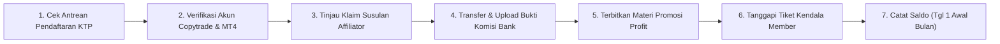
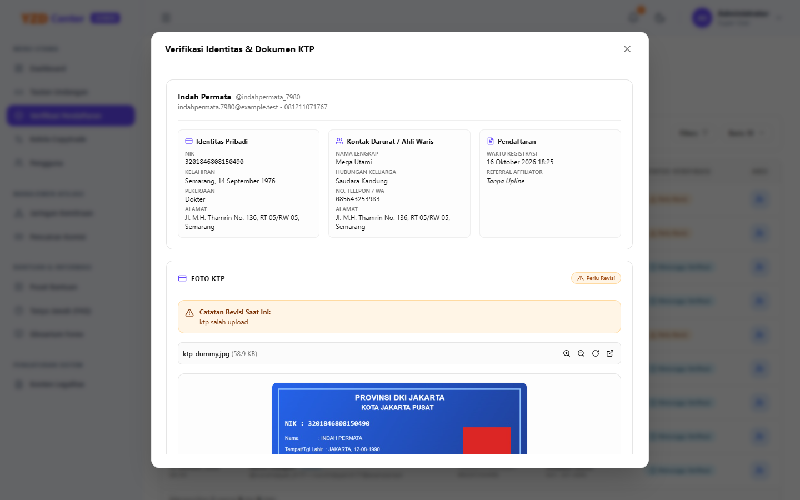
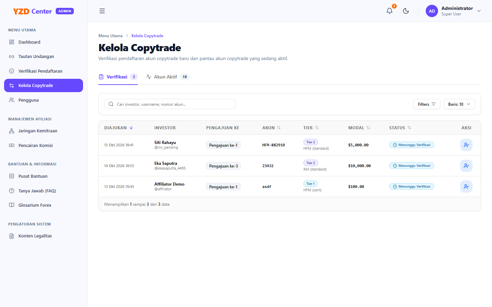
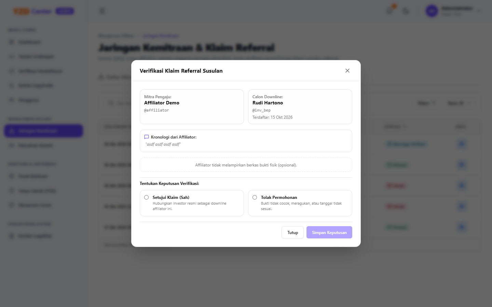
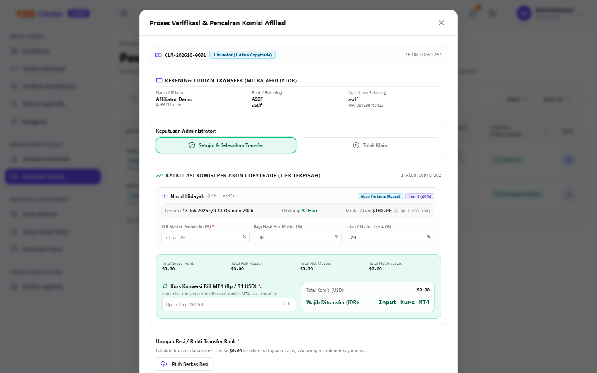
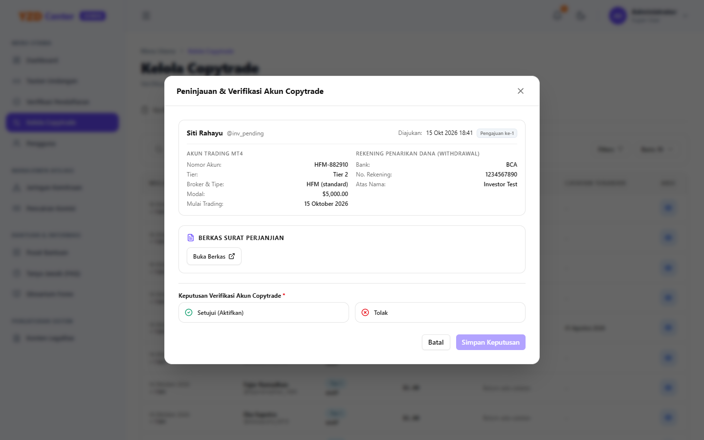

# Panduan Ringkas Administrator: Checklist SOP Harian YZD Center
*(Khusus Tim Operasional & Verifikator Harian)*

Panduan praktis ini dirancang sebagai rujukan cepat kerja harian bagi tim **Administrator** agar dapat menyelesaikan antrean tugas verifikasi dan tata kelola platform YZD Center dengan cepat, akurat, dan sesuai standar operasional (SLA).

---

## 📌 Alur Cepat Langkah Kerja Administrator

> 💻 **Tips Akses Cepat Operasional (Install App ke Desktop / Laptop):**  
> Administrator dapat memasang pintasan portal YZD Center langsung ke Desktop / Taskbar komputer dengan menekan tombol ungu **"Install App"** di bilah atas (header). Sistem akan berjalan dalam jendela mandiri (*standalone window*) tanpa bilah peramban web agar monitoring antrean kerja harian lebih fokus dan cepat.

---

## Tugas 1: Memeriksa Antrean Pendaftaran & Verifikasi KTP (KYC)

1. Buka menu **Verifikasi Pendaftaran** (`/admin/registrations`).
2. Periksa baris data berstatus **"Menunggu Verifikasi"** $\rightarrow$ klik tombol biru **"Tinjau Pendaftaran"**.
3. **Pengecekan Data vs Foto KTP:**
   - Pastikan Nama Lengkap dan NIK (16 digit) sesuai dengan foto KTP.
   - Pastikan foto KTP tajam, terbaca jelas, dan bukan hasil manipulasi.
4. **Eksekusi:**
   - **Jika Valid:** Pilih **"Setujui Pendaftaran"** $\rightarrow$ klik **"Simpan Keputusan"**.
   - **Jika Tidak Valid / Buram:** Pilih **"Tolak Pendaftaran"** $\rightarrow$ ketik alasan di kolom catatan $\rightarrow$ klik **"Simpan Keputusan"**.

---

## Tugas 2: Memverifikasi Akun Copytrade & Menyiapkan Kredensial (MT4/VPS)

1. Buka menu **Kelola Copytrade** (`/admin/copytrade`) $\rightarrow$ pilih tab **Menunggu Verifikasi**.
2. Klik tombol **"Tinjau Pengajuan"** pada akun yang baru didaftarkan.
3. Periksa berkas legalitas: Klik tombol **"Buka Berkas"** untuk memastikan dokumen Surat Perjanjian Kemitraan telah ditandatangani dan bermaterai.
4. **Penyesuaian Tier Modal:**
   - **Tier 1 ($100 — $499) & Tier 2 ($500 — $999):** Pastikan deposit di broker mencukupi $\rightarrow$ Setujui.
   - **Tier 3 ($\ge$ $1.000):** Wajib lengkapi data kredensial MT4 (Nomor Akun, Server Broker, Master Password, Investor Password) dan IP Server VPS Pribadi $\rightarrow$ Setujui.

---

## Tugas 3: Meninjau Permohonan Klaim Referral Susulan dari Affiliator

1. Buka menu **Jaringan Kemitraan** (`/admin/affiliates`) $\rightarrow$ klik tab **Verifikasi Klaim Susulan Referral**.
2. Klik tombol **"Tinjau & Putuskan"** pada permohonan yang berstatus *Pending*.
3. Periksa kronologi alasan dan buka gambar/dokumen bukti percakapan WhatsApp:
   - Pastikan tanggal obrolan membuktikan affiliator yang pertama kali mengarahkan investor.
4. **Logika Form Keputusan:**
   - **Jika Disetujui:** Pilih opsi **"Setujui Permohonan"** (kolom catatan otomatis hilang) $\rightarrow$ klik **"Simpan Keputusan"**. Relasi downline langsung terbentuk otomatis.
   - **Jika Ditolak:** Pilih opsi **"Tolak Permohonan"** (kolom catatan otomatis muncul) $\rightarrow$ tuliskan alasan penolakan secara jelas $\rightarrow$ klik **"Simpan Keputusan"**.

---

## Tugas 4: Memproses Pencairan Komisi Afiliasi ke Rekening Bank

1. Buka menu **Pencairan Komisi** (`/admin/commissions`).
2. Pada baris berstatus *Pending*, klik tombol **"Proses Pencairan"**.
3. Buka aplikasi m-banking atau internet banking perusahaan:
   - Transfer dana sesuai **Total Nominal (IDR)** ke Nama Bank, Nomor Rekening, dan Atas Nama yang tertera.
   - Simpan struk / tangkapan layar bukti transfer perbankan yang sah.
4. Kembali ke modal sistem $\rightarrow$ unggah file struk di kolom **"Berkas Bukti Transfer Bank"**.
5. Masukkan catatan nomor referensi bank (opsional) $\rightarrow$ klik **"Konfirmasi Pembayaran Selesai"**.

---

## Tugas 5: Menerbitkan Materi Promosi (Profit Master)

Untuk mendukung aktivitas promosi mitra afiliator dan memotivasi seluruh member:
1. Buka menu **Materi Promosi** (`/admin/profit-master`).
2. Klik tombol **"Buat Post"** atau kotak *"Bagikan materi promosi profit baru..."*.
3. Tuliskan teks caption promosi (capaian profit, pair trading, rekap performa).
4. Pilih 1 atau beberapa foto screenshot bukti profit/withdraw (JPG, PNG, WEBP maks. 10 MB/foto — dikompresi otomatis di latar belakang).
5. Klik **"Terbitkan Sekarang"**. Materi akan langsung tampil di feed seluruh member.

---

## Tugas Berkala: Pencatatan Saldo Bulanan Akun Copytrade (Setiap Tanggal 1)

1. Pada tanggal 1 setiap awal bulan, buka tab **Kelola Copytrade** $\rightarrow$ **Akun Aktif**.
2. Buka detail akun investor $\rightarrow$ periksa tabel **Riwayat Saldo**.
3. Masukkan nominal saldo terkini per tanggal 1.
4. Sistem otomatis mengalkulasi pertumbuhan profit dan persentase:
   - Jika saldo tidak mengalami perubahan dibanding bulan sebelumnya, sistem secara presisi menampilkan **+$0.00 (0%)** dengan indikator netral.

---

## Tugas 6: Mengelola Tiket Bantuan & Pelaporan Kendala Member

1. Buka menu **Tiket Bantuan** (`/admin/tickets`) atau klik kartu antrean **"Tiket Butuh Respons"** di Dasbor Admin.
2. **Filter Status:** Gunakan tab filter **"Butuh Respons"** untuk memprioritaskan tiket berstatus Open atau balasan terbaru dari member.
3. Klik tombol **Lihat Utas Tiket** pada baris tiket.
4. **Memberikan Solusi / Tanggapan:**
   - Tinjau kronologi kendala dan gambar lampiran yang dikirimkan member.
   - Ketik pesan balasan pada form tanggapan admin (dapat menyertakan tangkapan layar solusi).
   - Klik **"Kirim Tanggapan"**. Status tiket otomatis berubah menjadi **Dijawab (Answered)** dan member menerima notifikasi in-app.
5. **Mengubah Status Manual:**
   - Jika investigasi teknis membutuhkan waktu, klik tombol **"Ubah Status Tiket"** $\rightarrow$ pilih **"Sedang Diproses" (In Progress)**.
   - Jika kendala selesai dan member belum menandai selesai, admin dapat menutup tiket menjadi **Ditutup (Closed)**.

---

## Tugas Khusus: Alih Peran Pengguna (Investor ↔ Affiliator Cepat Tanpa Akun Baru)

Jika ada Investor lama yang ingin menjadi Mitra Affiliator (atau sebaliknya):
1. Buka menu **Manajemen Pengguna** (`/admin/users`).
2. Cari nama atau username akun yang bersangkutan.
3. **Eksekusi:**
   - **Angkat Jadi Affiliator:** Klik ikon **UserCheck** pada baris pengguna (atau tombol ungu di header detail `/admin/users/{id}`) $\rightarrow$ klik **"Ya, Angkat Jadi Affiliator"**. Sistem otomatis menerbitkan kode referral unik 6 karakter dan memutus sesi pengguna agar login ulang dengan menu Afiliasi baru.
   - **Kembalikan Jadi Investor:** Klik ikon **ArrowLeftRight** ("Ubah Menjadi Investor") $\rightarrow$ klik konfirmasi. *(Catatan: Aksi diblokir jika affiliator masih memiliki klaim komisi berstatus Pending).*

---

## ✅ Checklist SOP Harian Administrator

| Waktu Kerja | Target Pekerjaan | Lokasi Menu Platform | Standar SLA |
| :--- | :--- | :--- | :--- |
| **09:00 WIB** | Verifikasi pendaftaran KTP baru & terbitkan tautan undangan | `/admin/registrations` `/admin/invitations` | < 1 Jam |
| **11:00 WIB** | Validasi akun copytrade baru & input kredensial MT4/VPS | `/admin/copytrade` | < 2 Jam |
| **14:00 WIB** | Audit dan putuskan klaim referral susulan affiliator | `/admin/affiliates?tab=claims` | < 24 Jam |
| **15:00 WIB** | Publikasikan update materi promosi profit Master Trader | `/admin/profit-master` | Fleksibel |
| **16:00 WIB** | Eksekusi transfer bank komisi affiliator & unggah bukti | `/admin/commissions` | < 24 Jam |
| **16:30 WIB** | Tanggapi tiket bantuan & pelaporan kendala member | `/admin/tickets` | < 4 Jam |
| **Tgl 1 Awal Bulan** | Input saldo bulanan seluruh akun aktif investor | `/admin/copytrade?tab=aktif` | 1–2 Hari |

---
*SOP Ringkas Operasional Administrator YZD Center.*
