# Buku Panduan Administrator (Manual Book) — Tata Kelola Operasional Platform YZD Center

**Versi Dokumen:** 1.0  
**Target Pengguna:** Tim Administrator, Operasional & Verifikator YZD Center  
**Platform:** Portal Administrasi Web YZD Center (Desktop & Perangkat Seluler)

---

## Daftar Isi

1. [Bab 1: Gambaran Umum & Tanggung Jawab Administrator](#bab-1-gambaran-umum--tanggung-jawab-administrator)
   - [1.1 Peran Administrator dalam Ekosistem YZD Center](#11-peran-administrator-dalam-ekosistem-yzd-center)
   - [1.2 Peta Operasional Hulu ke Hilir (Alur Kerja SOP Harian)](#12-peta-operasional-hulu-ke-hilir-alur-kerja-sop-harian)
   - [1.3 Akses Masuk, Sesi Keamanan & Navigasi Antarmuka](#13-akses-masuk-sesi-keamanan--navigasi-antarmuka)
   - [1.4 Dashboard Analitik & Pemantauan Metrik Utama](#14-dashboard-analitik--pemantauan-metrik-utama)
   - [1.5 Akses Cepat Operasional (Pemasangan Semi-PWA di Desktop & Mobile)](#15-akses-cepat-operasional-pemasangan-semi-pwa-di-desktop--mobile)
2. [Bab 2: Manajemen Tautan Undangan (Closed-Loop Registration)](#bab-2-manajemen-tautan-undangan-closed-loop-registration)
   - [2.1 Konsep Sistem Registrasi Eksklusif (Closed System)](#21-konsep-sistem-registrasi-eksklusif-closed-system)
   - [2.2 Prosedur Pembuatan Tautan Undangan Baru](#22-prosedur-pembuatan-tautan-undangan-baru)
   - [2.3 Pelacakan Kuota & Siklus Masa Berlaku Token](#23-pelacakan-kuota--siklus-masa-berlaku-token)
   - [2.4 Manajemen & Penghapusan Massal (Batch Delete) Tautan](#24-manajemen--penghapusan-massal-batch-delete-tautan)
   - [2.5 Kondisi Khusus (Edge Cases) pada Tautan Undangan](#25-kondisi-khusus-edge-cases-pada-tautan-undangan)
3. [Bab 3: SOP Verifikasi Pendaftaran & Audit KYC (KTP)](#bab-3-sop-verifikasi-pendaftaran--audit-kyc-ktp)
   - [3.1 Kriteria & Standar Validasi Data Identitas Investor/Affiliator](#31-kriteria--standar-validasi-data-identitas-investoraffiliator)
   - [3.2 Langkah Demi Langkah Peninjauan Berkas Pendaftaran](#32-langkah-demi-langkah-peninjauan-berkas-pendaftaran)
   - [3.3 Penolakan Pendaftaran & Notifikasi Alasan Penolakan](#33-penolakan-pendaftaran--notifikasi-alasan-penolakan)
   - [3.4 Kondisi Khusus (Edge Cases) pada Verifikasi Pendaftaran](#34-kondisi-khusus-edge-cases-pada-verifikasi-pendaftaran)
4. [Bab 4: Pengelolaan Akun Copytrade & Konfigurasi MT4 / VPS](#bab-4-pengelolaan-akun-copytrade--konfigurasi-mt4--vps)
   - [4.1 Siklus Hidup Akun Copytrade (Menunggu, Aktif, Ditolak)](#41-siklus-hidup-akun-copytrade-menunggu-aktif-ditolak)
   - [4.2 Prosedur Verifikasi & Pengelompokan Modal Berdasarkan 3 Tier](#42-prosedur-verifikasi--pengelompokan-modal-berdasarkan-3-tier)
   - [4.3 Setup Kredensial MT4 & VPS Khusus Tier 3 ($1.000+)](#43-setup-kredensial-mt4--vps-khusus-tier-3-1000)
   - [4.4 SOP Pembaruan Riwayat Saldo Bulanan (Snapshot Tanggal 1 & Kalkulasi Profit/Persentase)](#44-sop-pembaruan-riwayat-saldo-bulanan-snapshot-tanggal-1--kalkulasi-profitpersentase)
   - [4.5 Akses Dokumen Surat Perjanjian Kemitraan Bermaterai](#45-akses-dokumen-surat-perjanjian-kemitraan-bermaterai)
   - [4.6 Kondisi Khusus (Edge Cases) pada Copytrade](#46-kondisi-khusus-edge-cases-pada-copytrade)
5. [Bab 5: Pengawasan Jaringan Kemitraan & Verifikasi Klaim Referral Susulan](#bab-5-pengawasan-jaringan-kemitraan--verifikasi-klaim-referral-susulan)
   - [5.1 Audit Struktur Downline & Pemantauan Performa Affiliator](#51-audit-struktur-downline--pemantauan-performa-affiliator)
   - [5.2 Standar Penilaian Bukti Klaim Susulan (Chat & Kronologi)](#52-standar-penilaian-bukti-klaim-susulan-chat--kronologi)
   - [5.3 Prosedur Eksekusi Keputusan Klaim (Logika Kolom Catatan Penolakan Dinamis & Truncate Notifikasi)](#53-prosedur-eksekusi-keputusan-klaim-logika-kolom-catatan-penolakan-dinamis--truncate-notifikasi)
   - [5.4 Mitigasi Klaim Ganda & Hubungan Siklikal Referral](#54-mitigasi-klaim-ganda--hubungan-siklikal-referral)
   - [5.5 Kondisi Khusus (Edge Cases) pada Klaim Referral](#55-kondisi-khusus-edge-cases-pada-klaim-referral)
6. [Bab 6: SOP Verifikasi Pencairan Komisi Afiliasi (Payout & Upload Bukti Transfer)](#bab-6-sop-verifikasi-pencairan-komisi-afiliasi-payout--upload-bukti-transfer)
   - [6.1 Audit Antrean Pengajuan Komisi Berbasis Rekening Bank](#61-audit-antrean-pengajuan-komisi-berbasis-rekening-bank)
   - [6.2 Langkah Demi Langkah Pencairan Komisi & Transfer Bank Riil](#62-langkah-demi-langkah-pencairan-komisi--transfer-bank-riil)
   - [6.3 Pengunggahan Bukti Transfer Resmi & Notifikasi Real-Time](#63-pengunggahan-bukti-transfer-resmi--notifikasi-real-time)
   - [6.4 Kondisi Khusus (Edge Cases) pada Pencairan Komisi](#64-kondisi-khusus-edge-cases-pada-pencairan-komisi)
7. [Bab 7: Manajemen Pengguna, Hak Akses & Keamanan Sistem](#bab-7-manajemen-pengguna-hak-akses--keamanan-sistem)
   - [7.1 Daftar Pengguna, Filter Peran & Pencarian Akun](#71-daftar-pengguna-filter-peran--pencarian-akun)
   - [7.2 Prosedur Promosi / Demosi Peran (Role Switching: Investor ↔ Affiliator)](#72-prosedur-promosi--demosi-peran-role-switching-investor--affiliator)
   - [7.3 Penonaktifan (Suspend) & Aktivasi Akun Pengguna](#73-penonaktifan-suspend--aktivasi-akun-pengguna)
   - [7.4 Penggantian Kata Sandi & Manajemen Keamanan Administrator](#74-penggantian-kata-sandi--manajemen-keamanan-administrator)
   - [7.5 Kondisi Khusus (Edge Cases) pada Manajemen Pengguna & Alih Peran](#75-kondisi-khusus-edge-cases-pada-manajemen-pengguna--alih-peran)
8. [Bab 8: Pengelolaan Pusat Edukasi & Pengaturan Legalitas Platform](#bab-8-pengelolaan-pusat-edukasi--pengaturan-legalitas-platform)
   - [8.1 Manajemen Artikel Bantuan & Panduan Pengguna](#81-manajemen-artikel-bantuan--panduan-pengguna)
   - [8.2 Manajemen Topik & Butir Pertanyaan FAQ Interaktif](#82-manajemen-topik--butir-pertanyaan-faq-interaktif)
   - [8.3 Manajemen Glosarium Istilah](#83-manajemen-glosarium-istilah)
   - [8.4 Pembaruan Dokumen Legalitas (Syarat & Ketentuan serta Kebijakan Privasi)](#84-pembaruan-dokumen-legalitas-syarat--ketentuan-serta-kebijakan-privasi)

---

## Bab 1: Gambaran Umum & Tanggung Jawab Administrator

### 1.1 Peran Administrator dalam Ekosistem YZD Center
**Administrator** memegang otoritas tertinggi (*Super User*) dalam memastikan kepatuhan hukum (*compliance*), akurasi finansial, keamanan data, dan kelancaran alur operasional di seluruh sistem YZD Center. 

Tanggung jawab utama Administrator mencakup:
1. **Pengendalian Gerbang Masuk (*Gatekeeping*):** Menerbitkan tautan undangan eksklusif pendaftaran agar tidak terjadi pendaftaran liar (*closed system*).
2. **Audit Kepatuhan Identitas (*KYC & Legal Compliance*):** Memverifikasi berkas KTP dan dokumen legalitas bermaterai sebelum akun dapat beroperasi.
3. **Pengelolaan Akun Trading Copytrade:** Meninjau kesesuaian modal, mengaktifkan akun, mengatur kredensial MetaTrader 4 (MT4) dan Virtual Private Server (VPS), serta mencatat pembaruan riwayat saldo bulanan.
4. **Validasi Kemitraan & Klaim Referral:** Memverifikasi permohonan klaim susulan affiliator secara adil berdasarkan bukti percakapan yang sah.
5. **Eksekusi Pembayaran Finansial (*Payout Reconciliation*):** Memvalidasi klaim komisi berjenjang (*4-Tier*) dan mentransfer hak affiliator melalui bank resmi secara tepat waktu.
6. **Pemeliharaan Konten:** Mengelola materi edukasi, pusat bantuan, tanya jawab, dan kebijakan legalitas platform.

---

### 1.2 Peta Operasional Hulu ke Hilir (Alur Kerja SOP Harian)

Diagram berikut merangkum siklus operasional harian Administrator dari verifikasi pendaftaran hingga pembayaran komisi:

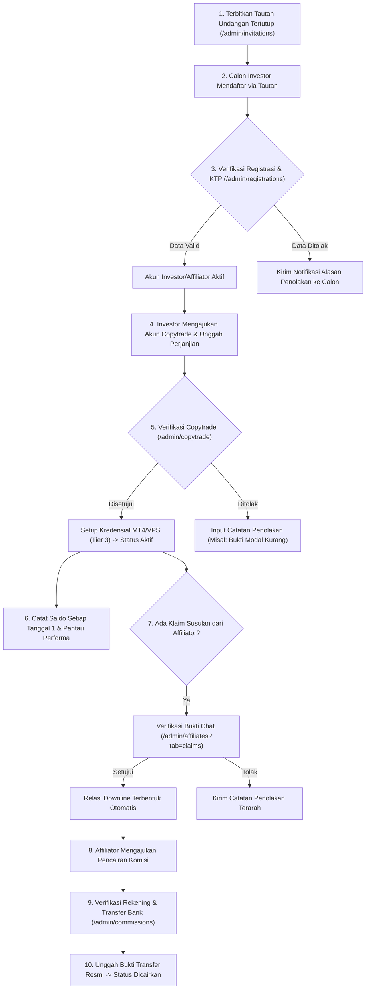

---

### 1.3 Akses Masuk, Sesi Keamanan & Navigasi Antarmuka
1. **Akses Portal:** Masuk melalui alamat [http://localhost:8000/login](http://localhost:8000/login) menggunakan *username* atau *email* berhak akses Administrator.
2. **Keamanan Sesi:** Portal dilengkapi sistem *rate limiting*, proteksi CSRF, dan pemutusan sesi otomatis jika pengguna tidak aktif.
3. **Bilah Navigasi Samping (*Sidebar*):** 
   - **Menu Utama:** Dashboard, Tautan Undangan, Verifikasi Pendaftaran, Kelola Copytrade.
   - **Manajemen Afiliasi:** Jaringan Kemitraan (dan Klaim Referral), Pencairan Komisi.
   - **Manajemen Sistem:** Manajemen Pengguna, Materi Bantuan, Tanya Jawab (FAQ), Glosarium, Pengaturan Legalitas, Ganti Password.
4. **Header Navigasi Atas:** Berisi tombol menu ponsel, tombol perkecil *sidebar*, tombol *toggle* tema gelap/terang (*Dark/Light Mode*), bel notifikasi sistem *real-time*, dan menu profil administrator.

---

### 1.4 Dashboard Analitik & Pemantauan Metrik Utama

Halaman Dashboard (`/admin/dashboard`) menyajikan ringkasan performa sistem secara komprehensif untuk memudahkan pengambilan keputusan cepat:

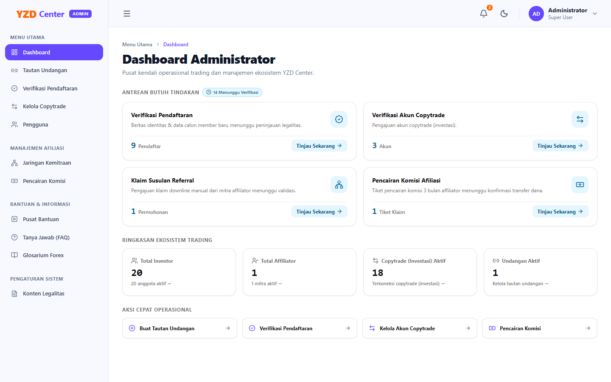

1. **Kartu Statistik Utama:**
   - **Total Modal Investor (USD):** Akumulasi modal aktif seluruh akun copytrade yang berjalan di sistem.
   - **Total Investor Terdaftar:** Jumlah pengguna dengan hak akses investor yang berstatus aktif.
   - **Total Mitra Affiliator:** Jumlah affiliator aktif pembina jaringan.
   - **Total Akun Copytrade:** Rincian akun yang sedang berjalan (*aktif*), antrean verifikasi, dan akun yang nonaktif.
2. **Antrean Pekerjaan Hari Ini (*Action Needed*):**
   - Menampilkan *badge counter* merah/kuning jika terdapat registrasi KTP baru, pengajuan copytrade baru, permohonan klaim referral susulan, atau permintaan pencairan komisi bank yang belum diproses.
3. **Pintasan Cepat (*Quick Shortcuts*):** Tombol langsung menuju modul antrean verifikasi yang paling membutuhkan perhatian.

---

### 1.5 Akses Cepat Operasional (Pemasangan Semi-PWA di Desktop & Mobile)

Untuk memudahkan tim Administrator dalam merespons antrean verifikasi harian secara cepat tanpa harus membuka peramban web dan mengetik URL secara berulang, portal YZD Center dilengkapi dengan kemampuan **Semi-PWA (*Progressive Web App*)**.

#### Karakteristik & Fitur Tombol Install:
- **Penempatan:** Terletak di bilah atas (*Top Header*) di sebelah kiri bel notifikasi, dipisahkan secara rapi oleh garis pembatas vertikal (`<!-- Vertical Divider -->`) untuk menghindari salah klik.
- **Warna & Tampilan:**
  - **Layar Desktop (`sm:` ke atas):** Tombol solid warna tema korporat ungu (*Violet-600*) dengan teks **"Install App"** dan ikon unduh putih kontras.
  - **Layar Mobile (`< 640px`):** Tombol kotak ringkas berukuran `38x38px` dengan ikon unduh putih agar bilah navigasi ponsel tetap ringkas.
- **Sistem Mandiri (*Standalone Window*):** Setelah terpasang, aplikasi administrasi terbuka dalam jendela mandiri tanpa tab peramban dan tanpa bilah URL, sehingga fokus kerja lebih tinggi layaknya aplikasi desktop/native.
- **Sembunyi Otomatis:** Tombol "Install App" beserta garis pembatasnya akan otomatis disembunyikan ketika portal diakses dari dalam jendela aplikasi yang telah terpasang (*standalone mode*).

#### Prosedur Pemasangan:
1. **Perangkat Komputer (Google Chrome / Microsoft Edge di Windows atau macOS):**
   - Klik tombol **"Install App"** di bilah atas antarmuka administrasi.
   - Pada jendela pop-up peramban, klik tombol konfirmasi **Install**.
   - Pintasan YZD Center akan langsung dibuat di Desktop dan Taskbar/Dock komputer Anda.
2. **Perangkat Seluler (Android Chrome / Samsung Internet):**
   - Klik tombol ikon unduh di header $\rightarrow$ pilih **Install** pada dialog konfirmasi sistem.
3. **Perangkat Apple iOS (Safari di iPhone / iPad):**
   - Klik tombol ikon unduh di header $\rightarrow$ ikuti panduan 3 langkah di jendela modal (*Ketuk ikon Share Safari -> Pilih 'Tambah ke Layar Utama' -> Ketuk 'Tambah'*).

---

## Bab 2: Manajemen Tautan Undangan (Closed-Loop Registration)

### 2.1 Konsep Sistem Registrasi Eksklusif (Closed System)
Untuk menjaga integritas dan kualitas ekosistem, YZD Center menerapkan kebijakan **pendaftaran tertutup** (*by invitation only*). Pengunjung publik tidak dapat mendaftar langsung tanpa memiliki token undangan resmi yang diterbitkan oleh Administrator.

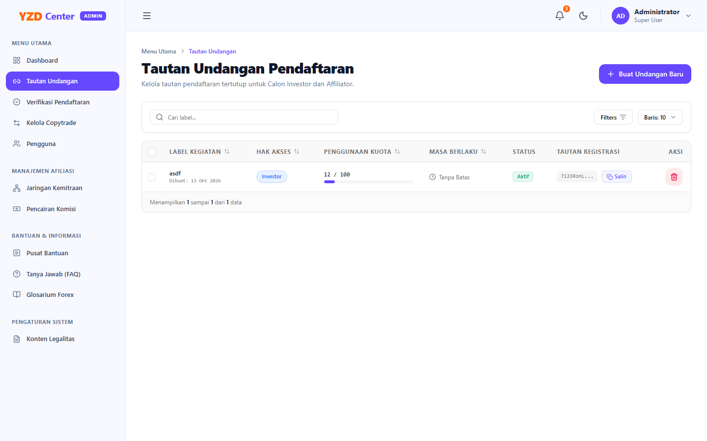

---

### 2.2 Prosedur Pembuatan Tautan Undangan Baru

Untuk membuat tautan undangan baru:
1. Buka menu **Tautan Undangan** (`/admin/invitations`).
2. Klik tombol **"Buat Undangan Baru"** pada pojok kanan atas halaman.
3. Formulir modal pembuatan undangan akan muncul di layar:

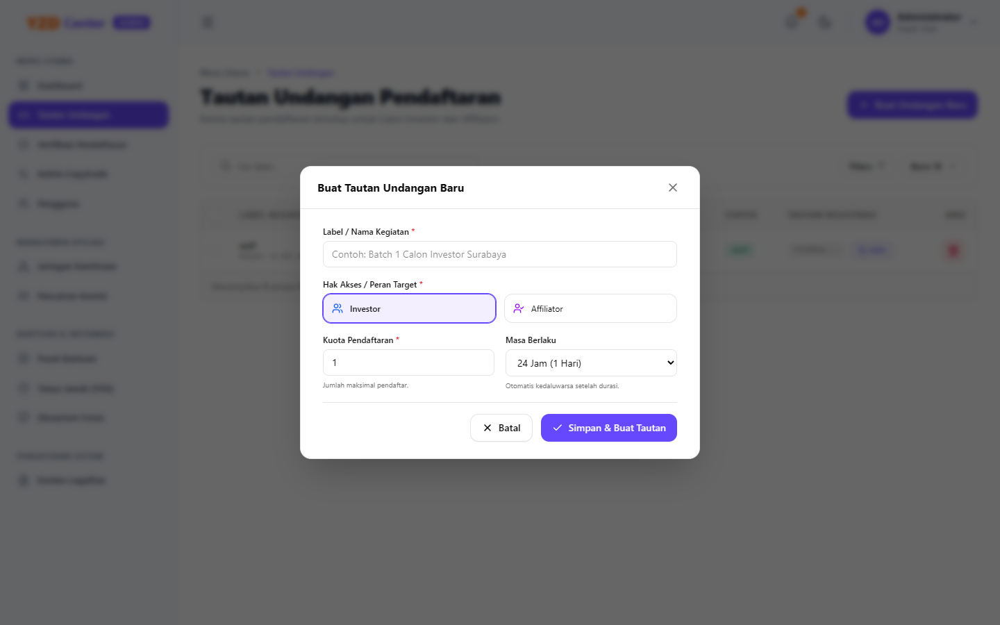

4. Isi parameter formulir sesuai kebutuhan kegiatan:
   - **Label / Nama Kegiatan (Wajib):** Berikan nama kegiatan yang jelas dan mudah diidentifikasi (contoh: *"Batch 1 Investor Seminar Surabaya"*, *"Undangan Private Affiliator VIP"*).
   - **Target Peran (Role):** Pilih peran yang akan diperoleh calon pendaftar:
     - **Investor:** Calon pengguna akan terdaftar dengan hak akses akun investor biasa.
     - **Affiliator:** Calon pengguna langsung mendapatkan hak akses mitra affiliator beserta fitur jaringan kemitraan dan komisi.
     > [!TIP]
     > Jika calon affiliator sebelumnya sudah memiliki akun Investor aktif di platform, Anda **tidak perlu** membuatkan tautan undangan baru. Cukup gunakan fitur **Alih Peran Pengguna (Role Switching)** pada menu Manajemen Pengguna ([Bab 7.2](#72-prosedur-promosi--demosi-peran-role-switching-investor--affiliator)) untuk langsung mengangkat perannya menjadi Affiliator secara instan tanpa perlu registrasi ulang.
   - **Kuota Pendaftaran:** Tentukan batas maksimal jumlah orang yang dapat menggunakan tautan ini (minimal `1`, maksimal `10000`).
   - **Masa Berlaku:** Pilih durasi aktif tautan:
     - `24 Jam (1 Hari)`
     - `72 Jam (3 Hari)`
     - `7 Hari (1 Minggu)`
     - `30 Hari (1 Bulan)`
     - `Tanpa Batas Waktu` (token berlaku permanen hingga kuota habis atau dihapus manual).
5. Klik **"Simpan & Buat Tautan"**. Sistem akan meng-generate token kriptografi unik dan menampilkannya di tabel utama.

---

### 2.3 Pelacakan Kuota & Siklus Masa Berlaku Token
Administrator dapat memantau status setiap token pada tabel data:
- **Badge Hijau (Aktif):** Token masih berlaku dan sisa kuota pendaftaran masih tersedia.
- **Badge Kuning (Kuota Habis):** Jumlah pendaftar telah mencapai batas kuota maksimal yang ditetapkan.
- **Badge Merah (Kedaluwarsa):** Batas waktu kedaluwarsa telah terlampaui meskipun sisa kuota masih ada.
- **Aksi Salin Tautan:** Klik tombol **"Salin"** pada baris token untuk menduplikasi tautan URL registrasi langsung ke *clipboard*.

---

### 2.4 Manajemen & Penghapusan Massal (Batch Delete) Tautan
Jika terdapat sejumlah tautan promosi yang sudah usang atau tidak relevan:
1. Centang kotak seleksi (*checkbox*) di sisi kiri baris tautan yang ingin dihapus.
2. Bilah aksi massal (*batch action bar*) akan muncul di atas tabel.
3. Klik tombol merah **"Hapus Terpilih (N)"**.
4. Konfirmasikan dialog pemusnahan token. Seluruh tautan yang dipilih akan dinonaktifkan permanen dan tidak dapat diakses lagi oleh publik.

---

### 2.5 Kondisi Khusus (Edge Cases) pada Tautan Undangan

| Kondisi Khusus | Respon Sistem | Solusi Administrator |
| :--- | :--- | :--- |
| **Calon pengguna mengakses tautan yang sudah kedaluwarsa** | Sistem menampilkan halaman peringatan *"Tautan Undangan Kedaluwarsa"* dan menolak form registrasi. | Terbitkan tautan undangan baru atau perpanjang masa berlaku undangan baru. |
| **Calon pengguna mendaftar saat kuota tersisa 0** | Sistem menolak pendaftaran dengan pesan *"Kuota pendaftaran pada tautan ini telah habis"*. | Buat undangan baru dengan kuota tambahan sesuai estimasi peserta. |
| **Token dihapus saat calon pengguna sedang mengisi form** | Saat form disubmit, validasi backend menggagalkan transaksi karena token tidak ditemukan. | Pastikan tidak menghapus token kegiatan yang sedang aktif disebarkan. |

---

## Bab 3: SOP Verifikasi Pendaftaran & Audit KYC (KTP)

### 3.1 Kriteria & Standar Validasi Data Identitas Investor/Affiliator
Setiap calon pengguna yang mendaftar melalui tautan undangan wajib melalui proses verifikasi identitas resmi (*Know Your Customer* / KYC).

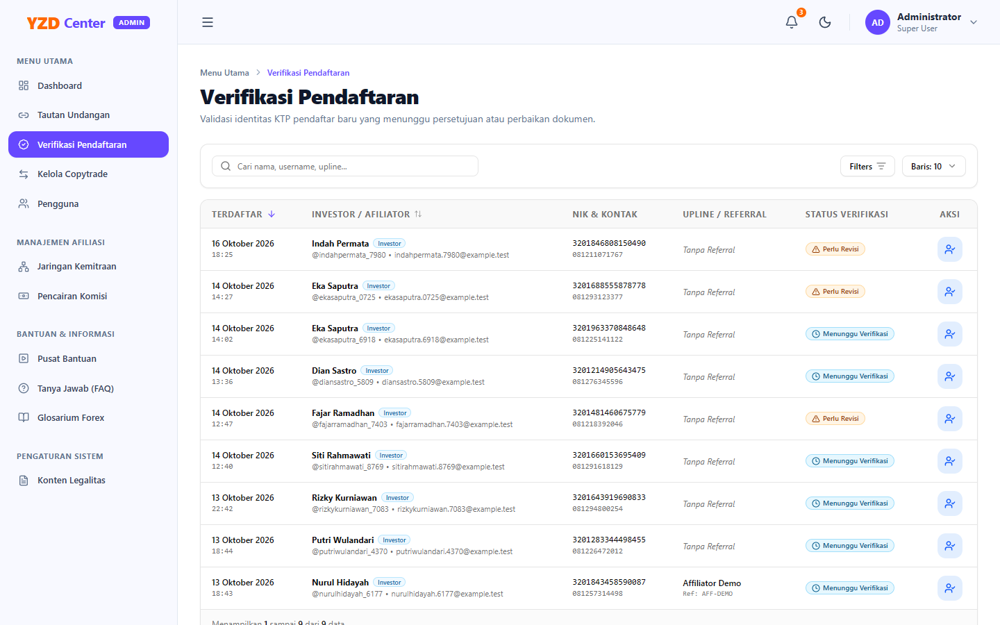

**Standar Kelayakan Data Identitas:**
1. **Nama Lengkap:** Wajib sesuai dengan nama yang tertera di dokumen identitas fisik (KTP/Paspor).
2. **NIK (Nomor Induk Kependudukan):** Terdiri dari 16 digit angka valid dan belum pernah terdaftar sebelumnya di sistem.
3. **Foto Berkas KTP:** Foto harus jelas, terbaca sempurna, tidak terpotong sudutnya, bukan hasil rekayasa grafis, dan data teks pada foto identik dengan data input form.
4. **Nomor Kontak / WhatsApp:** Nomor aktif berformat baku Indonesia (`08...` atau `+62...`).

---

### 3.2 Langkah Demi Langkah Peninjauan Berkas Pendaftaran
1. Buka menu **Verifikasi Pendaftaran** (`/admin/registrations`).
2. Periksa baris pendaftar berstatus **"Menunggu Verifikasi"** (*Pending*).
3. Klik tombol aksi biru bersimbol user check (**"Tinjau Pendaftaran"**).
4. Modal peninjauan berkas registrasi akan terbuka:

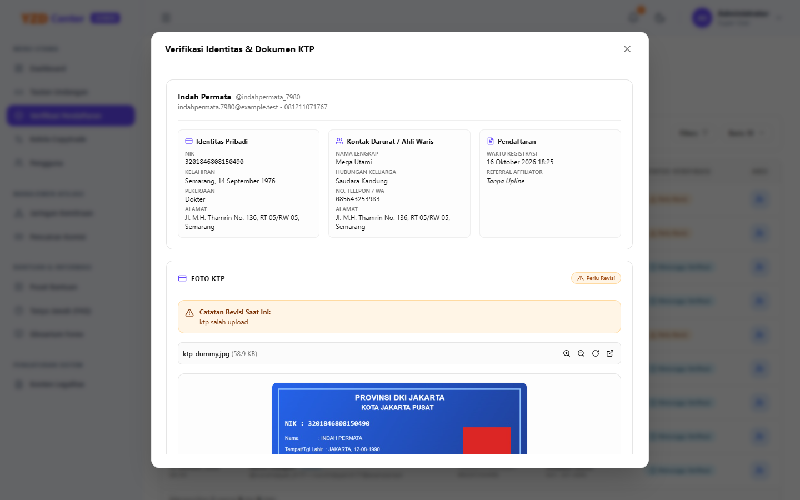

5. Lakukan verifikasi visual:
   - Bandingkan Nama Lengkap, NIK, Tempat/Tanggal Lahir, dan Alamat input form dengan foto dokumen identitas di sisi kanan.
   - Klik gambar KTP untuk memperbesar pratinjau jika tulisan tampak kecil.
6. Jika seluruh data telah valid dan sesuai standar:
   - Pilih opsi keputusan **"Setujui Pendaftaran"**.
   - Klik **"Simpan Keputusan"**.
   - Sistem akan mengaktifkan status akun pengguna secara instan dan mengirimkan email konfirmasi berhasil kepada investor.

---

### 3.3 Penolakan Pendaftaran & Notifikasi Alasan Penolakan
Jika ditemukan ketidaksesuaian data (misal: foto buram, NIK tidak terbaca, atau foto KTP palsu):
1. Pada modal verifikasi, pilih opsi **"Tolak Pendaftaran"**.
2. Kolom **"Alasan Penolakan (Wajib Diisi)"** akan muncul.
3. Tuliskan alasan penolakan secara spesifik, santun, dan jelas (contoh: *"Foto KTP buram dan silau pada bagian NIK. Mohon foto ulang dengan pencahayaan cukup dan unggah kembali"*).
4. Klik **"Simpan Keputusan"**.
5. Sistem akan menandai pendaftaran sebagai *Rejected* dan mengirimkan notifikasi resmi berisi alasan penolakan kepada calon pengguna agar dapat melakukan perbaikan.

---

### 3.4 Kondisi Khusus (Edge Cases) pada Verifikasi Pendaftaran

| Skenario Khusus | Dampak Sistem | Tindakan SOP Administrator |
| :--- | :--- | :--- |
| **Foto KTP terbalik atau miring** | Sulit diverifikasi secara visual. | Tolak pendaftaran dengan instruksi: *"Mohon unggah dokumen KTP dengan orientasi tegak dan horizontal"*. |
| **Calon pengguna telah disetujui tetapi ternyata data fiktif** | Akun sudah terlanjur berstatus aktif. | Buka menu **Manajemen Pengguna** (`/admin/users`), cari akun terkait, lalu ubah status akun menjadi **Nonaktif (Suspended)**. |

---

## Bab 4: Pengelolaan Akun Copytrade & Konfigurasi MT4 / VPS

### 4.1 Siklus Hidup Akun Copytrade (Menunggu, Aktif, Ditolak)
Modul **Kelola Copytrade** (`/admin/copytrade`) mengelola seluruh akun trading riil yang terhubung dengan master perdagangan otomatis YZD Center. 

Terdapat 3 tab pengelolaan:
1. **Tab Menunggu Verifikasi:** Daftar akun trading baru yang didaftarkan investor dan menunggu validasi modal serta berkas perjanjian.
2. **Tab Akun Aktif:** Daftar akun copytrade yang sedang berjalan, menghasilkan profit, dan dipantau kinerjanya.
3. **Tab Ditolak:** Catatan historis pengajuan copytrade yang ditolak oleh Administrator beserta alasan penolakannya.

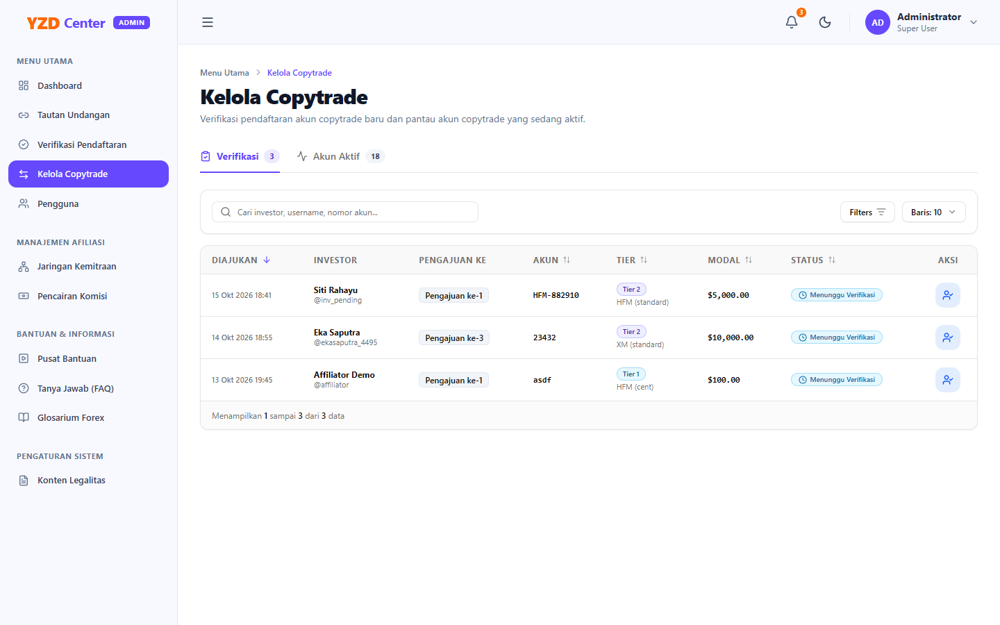

---

### 4.2 Prosedur Verifikasi & Pengelompokan Modal Berdasarkan 3 Tier
Saat investor mendaftarkan akun MT4 baru, sistem mengelompokkannya ke dalam salah satu dari 3 Tier modal perdagangan:

| Tier Copytrade | Rentang Modal Bersih (USD) | Skema Layanan Platform | Kebutuhan Konfigurasi Admin |
| :---: | :---: | :--- | :--- |
| **Tier 1** | **$100 — $499** | Server Bersama (*Shared VPS*), Master Copytrade Standar | Verifikasi nomor MT4 & kecukupan deposit broker. |
| **Tier 2** | **$500 — $999** | Server Prioritas (*Dedicated Thread*), Master Copytrade Standar | Verifikasi nomor MT4, server broker & kecukupan deposit. |
| **Tier 3** | **$\ge$ $1.000** | **VPS Khusus Pribadi (*Private Dedicated VPS*)** | **Wajib input kredensial MT4 lengkap & IP/Akses VPS Pribadi.** |

**Langkah Verifikasi Pengajuan:**
1. Masuk ke tab **Menunggu Verifikasi**.
2. Klik tombol **"Tinjau Pengajuan"** pada baris akun investor.
3. Periksa kesesuaian Nomor Akun MT4, Nama Broker, Server MT4, dan Tanggal Efektif Berlangganan.
4. Periksa **Berkas Surat Perjanjian Kemitraan**: Klik tombol **"Buka Berkas"** untuk memastikan dokumen legalitas telah dibubuhi tanda tangan dan materai resmi.
5. Jika modal dan dokumen valid, pilih keputusan **Setujui**.

---

### 4.3 Setup Kredensial MT4 & VPS Khusus Tier 3 ($1.000+)
Khusus akun dengan modal minimal **\$1.000 (Tier 3)**, Administrator wajib mengalokasikan unit Virtual Private Server (VPS) mandiri:
1. Pada form persetujuan akun Tier 3, lengkapi formulir kredensial:
   - **Nomor Akun MT4 & Server Broker:** Pastikan sesuai dengan akun riil broker.
   - **Kata Sandi Investor (Investor Password):** Digunakan sistem untuk pemantauan posisi *read-only*.
   - **Kata Sandi Utama (Master Password MT4):** Digunakan sistem EA untuk mengeksekusi perdagangan otomatis.
   - **Alamat IP VPS:** Masukkan alamat IP publik server VPS yang telah dideploy untuk investor ini.
   - **Port VPS / RDP:** Default port `3389` atau port kustom provider VPS.
   - **Username & Password VPS:** Kredensial akses remote desktop Windows Server.
2. Klik **"Simpan & Aktifkan Copytrade"**.
3. **Enkripsi Keamanan:** Seluruh *password* MT4 dan VPS otomatis dienkripsi menggunakan algoritma AES-256 Eloquent cast (`encrypted`) di database, sehingga aman dari potensi kebocoran data.

---

### 4.4 SOP Pembaruan Riwayat Saldo Bulanan (Snapshot Tanggal 1 & Kalkulasi Profit/Persentase)
Untuk menyajikan riwayat kinerja transparan kepada investor dan menghitung pembagian hasil secara akurat, Administrator melakukan pembaruan saldo bulanan secara berkala:

1. Buka tab **Akun Aktif** $\rightarrow$ klik tombol **"Tinjau / Detail Akun"**.
2. Modal Detail Akun Copytrade Aktif akan terbuka:

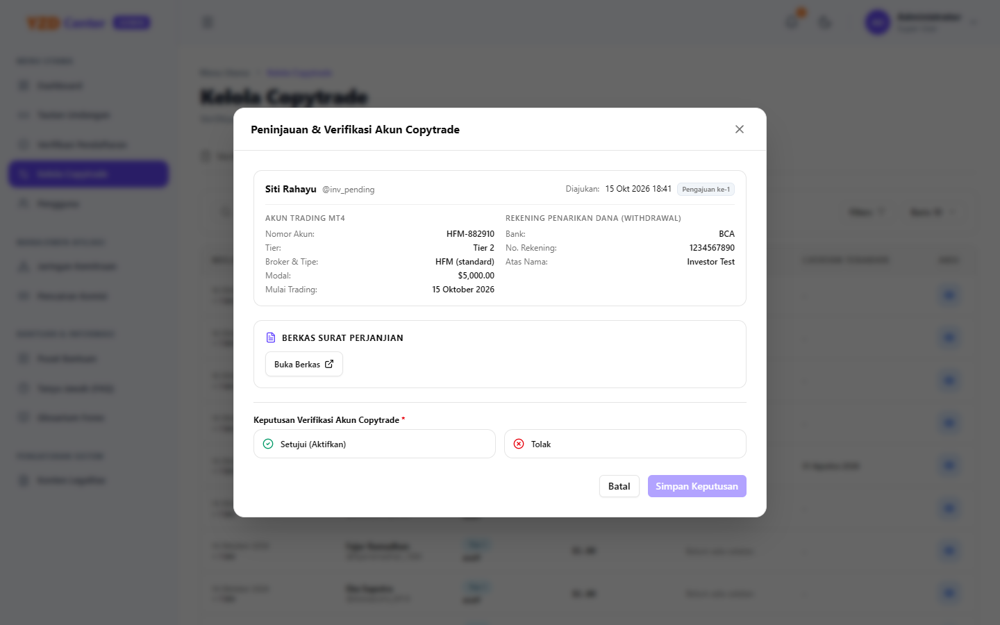

3. Periksa tabel **Riwayat Saldo (24 Catatan Terakhir)**:
   - Setiap baris menampilkan Tanggal Snapshot, Saldo Akhir, Nominal Profit/Rugi, dan Persentase Pertumbuhan.
4. **Rumus Perhitungan Profit & Persentase Resmi:**
   - **Snapshot Pertama:** Baseline dihitung terhadap Saldo Awal Deposit (`initial_deposit`).
     $$\text{Profit} = \text{Saldo Catatan 1} - \text{Deposit Awal}$$
     $$\% = \left( \frac{\text{Profit}}{\text{Deposit Awal}} \right) \times 100\%$$
   - **Snapshot Berjalan:** Dihitung selisihnya terhadap snapshot periode tepat sebelumnya.
     $$\text{Profit} = \text{Saldo}_{t} - \text{Saldo}_{t-1}$$
     $$\% = \left( \frac{\text{Saldo}_{t} - \text{Saldo}_{t-1}}{\text{Saldo}_{t-1}} \right) \times 100\%$$
   > [!IMPORTANT]
   > Jika nilai saldo pada dua tanggal pencatatan bernilai sama (misal saldo bulan Januari \$110 dan bulan Februari \$110), sistem secara presisi menampilkan Profit **+$0.00** dengan persentase **0%** dan ikon netral abu-abu (*Minus*). Nilai tidak boleh terhitung plus ganda.

---

### 4.5 Akses Dokumen Surat Perjanjian Kemitraan Bermaterai
Dokumen perjanjian kemitraan yang diunggah investor disimpan secara aman pada direktori privat (`storage/app/private`).
- Akses berkas hanya dapat dibuka oleh Administrator dan pemilik akun bersangkutan melalui rute streaming aman `/documents/copytrade/{id}`.
- Pada modal detail akun copytrade, Administrator cukup mengeklik tombol **"Buka Berkas"** untuk meninjau atau mencetak dokumen perjanjian dalam tab baru browser.

---

### 4.6 Kondisi Khusus (Edge Cases) pada Copytrade

| Kasus Khusus | Risiko | Prosedur Solusi Administrator |
| :--- | :--- | :--- |
| **Investor salah memasukkan nomor akun MT4** | Perdagangan otomatis gagal terhubung ke broker. | Hubungi investor untuk konfirmasi nomor yang benar, lakukan koreksi pada data akun di database/modal sebelum mengaktifkan. |
| **Deposit di akun broker ditarik investor (*withdrawal*) sehingga modal turun di bawah batas tier** | Akun tidak lagi memenuhi kualifikasi Tier yang berjalan. | Berikan peringatan kepada investor untuk menambah saldo, atau sesuaikan status akun menjadi *Nonaktif* jika modal di bawah batas minimum \$100. |

---

## Bab 5: Pengawasan Jaringan Kemitraan & Verifikasi Klaim Referral Susulan

### 5.1 Audit Struktur Downline & Pemantauan Performa Affiliator
Menu **Jaringan Kemitraan** (`/admin/affiliates`) menyajikan visibilitas penuh atas seluruh jaringan pemasaran kemitraan YZD Center:

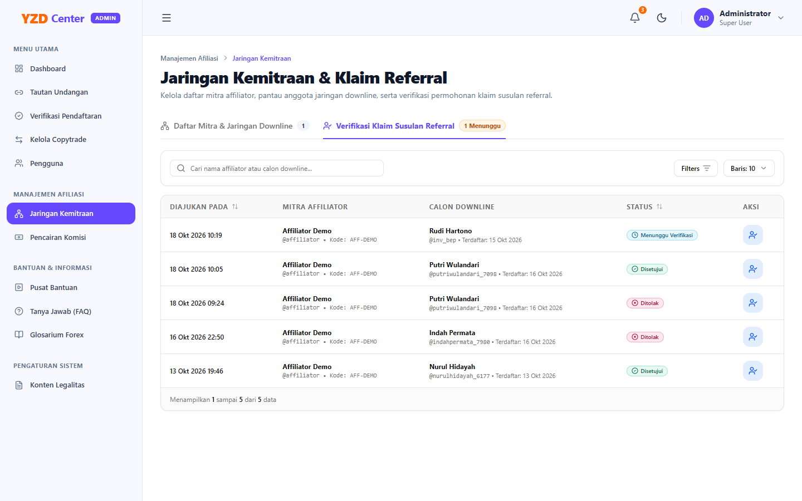

1. **Tab 1: Daftar Mitra & Jaringan Downline:**
   - Menampilkan daftar mitra Affiliator, kode referral unik, nomor kontak, total investor binaan (*downline*), serta jumlah akun copytrade aktif binaan.
   - **Tinjau Struktur:** Klik tombol bersimbol mata (**"Lihat Downline"**) pada baris affiliator untuk melihat daftar rincian nama investor downline, tanggal bergabung, sumber tautan (*link otomatis vs klaim susulan*), dan akumulasi modal investasi mereka.

---

### 5.2 Standar Penilaian Bukti Klaim Susulan (Chat & Kronologi)
Klaim referral susulan terjadi ketika seorang investor mendaftar langsung tanpa mengeklik link referral mitra affiliator yang mengajaknya. Affiliator kemudian mengajukan klaim susulan dengan menyertakan bukti interaksi.

**Kriteria Bukti yang Sah untuk Disetujui:**
1. Tanggal percakapan mendahului atau sama dengan tanggal registrasi calon investor di platform.
2. Terdapat percakapan eksplisit yang menunjukkan affiliator memandu pendaftaran atau memperkenalkan program YZD Center kepada investor tersebut.
3. Nama kontak atau nomor WhatsApp pada bukti percakapan identik dengan data profil investor di sistem.

---

### 5.3 Prosedur Eksekusi Keputusan Klaim (Logika Kolom Catatan Penolakan Dinamis & Truncate Notifikasi)

1. Buka tab **Verifikasi Klaim Susulan Referral** (`/admin/affiliates?tab=claims`).
2. Klik tombol aksi biru (**"Tinjau & Putuskan"**).
3. Modal verifikasi klaim akan ditampilkan:

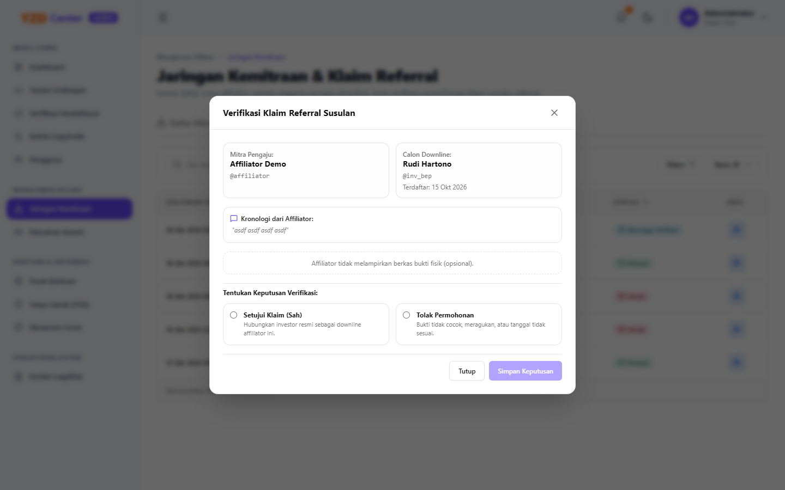

4. Evaluasi kronologi alasan dan pratinjau bukti pendukung (klik gambar untuk memperbesar atau klik *"Buka Dokumen PDF"* jika bukti berformat PDF).
5. **Logika Form Dinamis Keputusan:**
   - **Jika Opsi "Setujui Permohonan" Dipilih:**
     - Field *"Catatan Instruksi / Alasan Keputusan"* otomatis **tersembunyi** dari layar agar form ringkas dan bebas friksi.
     - Klik **"Simpan Keputusan"**.
     - Sistem secara otomatis membentuk relasi kemitraan di database: akun investor tersebut resmi menjadi *downline* affiliator, dan seluruh akun copytrade aktif miliknya otomatis tercatat sebagai akun yang layak komisi (*eligible*) bagi sang affiliator.
   - **Jika Opsi "Tolak Permohonan" Dipilih:**
     - Field *"Catatan Instruksi / Alasan Keputusan"* otomatis **muncul** di layar dan menjadi wajib diisi.
     - Tuliskan alasan penolakan yang objektif (contoh: *"Bukti chat tidak menyertakan tanggal percakapan yang jelas. Silakan ajukan ulang dengan screenshot lengkap"*).
     - Klik **"Simpan Keputusan"**.
     - Sistem mencatat penolakan dan mengirimkan notifikasi *in-app* ke Affiliator. Catatan admin otomatis dipotong secara cerdas (*truncate*) pada notifikasi ringkas agar tidak merusak tata letak antarmuka, dengan tombol pengarah langsung ke detail riwayat klaim.

---

### 5.4 Mitigasi Klaim Ganda & Hubungan Siklikal Referral
Sistem YZD Center telah dilengkapi validasi otomatis tingkat tinggi:
- **Anti-Klaim Ganda:** Investor yang sudah memiliki upline permanen tidak dapat diklaim oleh affiliator lain.
- **Anti-Siklikal / Self-Referral:** Affiliator dilarang mengklaim akunnya sendiri atau mengklaim upline-nya sendiri (*circular referral*).

---

### 5.5 Kondisi Khusus (Edge Cases) pada Klaim Referral

| Kasus Khusus | Aturan Sistem | Rekomendasi Tindakan Administrator |
| :--- | :--- | :--- |
| **Dua affiliator mengklaim satu investor yang sama** | Hanya klaim pertama yang dapat disetujui; klaim kedua akan otomatis gagal saat relasi terbentuk. | Periksa tanggal interaksi pertama pada bukti percakapan kedua affiliator. Prioritas diberikan kepada affiliator yang pertama kali mengedukasi investor. |
| **Investor menyangkal bahwa ia diajak oleh affiliator pelapor** | Konflik kepentingan antara investor dan mitra. | Hubungi kedua pihak via kontak resmi WhatsApp untuk mediasi sebelum memutuskan. |

---

## Bab 6: SOP Verifikasi Pencairan Komisi Afiliasi (Payout & Upload Bukti Transfer)

### 6.1 Audit Antrean Pengajuan Komisi Berbasis Rekening Bank
Menu **Pencairan Komisi** (`/admin/commissions`) menampung seluruh antrean permohonan penarikan dana bonus dari mitra Affiliator.

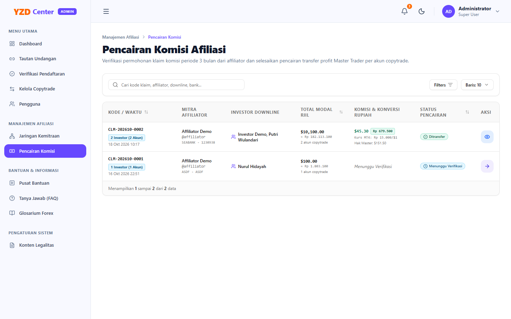

Setiap pengajuan memuat rincian:
- **Nama Affiliator & Username.**
- **Daftar Akun Downline yang Diklaim:** Menampilkan nomor akun MT4 downline beserta tier komisinya.
- **Total Komisi (IDR):** Nilai rupiah yang wajib ditransfer (dengan acuan kurs resmi platform \$1 = Rp 15.000,-).
- **Rincian Rekening Bank Tujuan:** Nama Bank (BCA, Mandiri, BRI, BNI, dll.), Nomor Rekening, dan Nama Lengkap Pemilik Rekening.

---

### 6.2 Langkah Demi Langkah Pencairan Komisi & Transfer Bank Riil

1. Buka halaman `/admin/commissions` dan filter status **"Menunggu Pembayaran"** (*Pending*).
2. Periksa baris pengajuan komisi, lalu klik tombol **"Proses Pencairan"**.
3. Modal pemrosesan pencairan komisi akan terbuka:

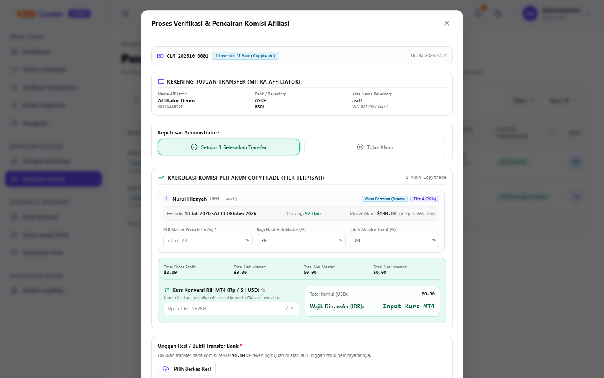

4. **Eksekusi Transfer Bank:**
   - Buka aplikasi perbankan resmi perusahaan (*m-banking*, *internet banking*, atau *cash management*).
   - Lakukan transfer dana ke Rekening Bank Tujuan persis sebesar nominal yang tertera pada modal.
   - Unduh atau simpan tangkapan layar (*screenshot*) tanda bukti transfer perbankan yang berhasil.

---

### 6.3 Pengunggahan Bukti Transfer Resmi & Notifikasi Real-Time

1. Kembali ke modal **Proses Pencairan Komisi** di sistem YZD Center.
2. Unggah berkas tanda bukti transfer pada kolom **"Berkas Bukti Transfer Bank"** (format JPG, PNG, atau PDF). Berkas gambar akan dikompresi otomatis tanpa mengurangi keterbacaan data struk transfer.
3. Masukkan catatan transaksi perbankan opsional (contoh: *"Transfer berhasil via KlikBCA No. Ref: 20261018001"*).
4. Klik tombol hijau **"Konfirmasi Pembayaran Selesai"**.
5. Sistem akan:
   - Mengubah status pengajuan menjadi **"Berhasil Ditransfer"** (*transferred*).
   - Mengunci akun-akun trading bersangkutan agar tidak dapat diklaim ulang (*one-time claim policy*).
   - Mengirimkan notifikasi *real-time* kepada Affiliator lengkap dengan tautan untuk melihat bukti transfer resmi.

---

### 6.4 Kondisi Khusus (Edge Cases) pada Pencairan Komisi

| Kasus Khusus | Risiko | Tindakan SOP Administrator |
| :--- | :--- | :--- |
| **Nomor rekening bank salah / nama pemilik tidak cocok** | Transfer perbankan gagal (*rejected* oleh bank penerima). | Hubungi Affiliator terkait untuk memperbarui informasi nomor rekening yang valid, lalu lakukan transfer ulang dan unggah bukti baru. |
| **Bukti transfer terunggah salah dokumen** | Bukti yang dilihat affiliator tidak relevan. | Admin dapat memperbarui berkas bukti transfer dengan mengedit pengajuan melalui menu detail pembayaran. |

---

## Bab 7: Manajemen Pengguna, Hak Akses & Keamanan Sistem

### 7.1 Daftar Pengguna, Filter Peran & Pencarian Akun
Menu **Manajemen Pengguna** (`/admin/users`) memberikan wewenang penuh untuk memantau seluruh entitas akun di platform:

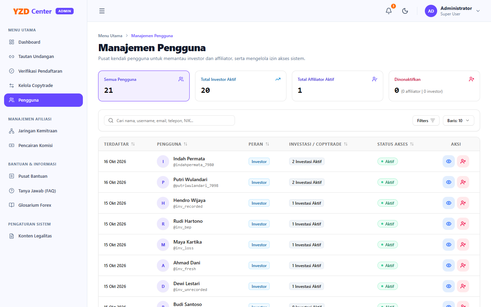

- **Filter Peran:** Filter instan berdasarkan *Administrator*, *Investor*, atau *Affiliator*.
- **Pencarian Universal:** Pencarian berdasarkan nama pengguna, username, email, maupun nomor telepon.

---

### 7.2 Prosedur Promosi / Demosi Peran (Role Switching: Investor ↔ Affiliator)

Fitur **Alih Peran Dua Arah (Bidirectional Role Switching)** memungkinkan Administrator mengelola status kemitraan pengguna secara fleksibel:
- **Kebutuhan Kasus Nyata:** Sering kali terdapat Investor lama yang telah lama bergabung dan memiliki pengalaman trading, kemudian berminat aktif menjadi Mitra Affiliator untuk mengajak relasinya. Dengan fitur ini, investor tersebut **tidak perlu melakukan registrasi akun baru** atau mengulang proses verifikasi identitas (KTP).
- Sebaliknya, jika seorang Affiliator ingin berhenti dari program kemitraan atau dialihkan kembali menjadi Investor reguler, Administrator dapat mengembalikannya secara aman tanpa merusak riwayat transaksi.

#### A. Dua Titik Akses Tombol Alih Peran
Administrator dapat mengeksekusi alih peran dari dua tempat:
1. **Dari Tabel Daftar Pengguna (`/admin/users`):**
   - Pada kolom **Aksi** di setiap baris pengguna, terdapat tombol aksi alih peran yang dinamis:
     - **Akun Investor:** Tombol dengan ikon centang pengguna (`UserCheck`) bertuliskan tooltip *"Angkat Menjadi Affiliator"*.
     - **Akun Affiliator:** Tombol dengan ikon panah bolak-balik (`ArrowLeftRight`) bertuliskan tooltip *"Ubah Menjadi Investor"*.
2. **Dari Halaman Detail Pengguna (`/admin/users/{id}`):**
   - Pada area kanan atas (*Header Actions*), terdapat tombol *outline* ungu:
     - **Akun Investor:** Bertuliskan **"Angkat Jadi Affiliator"** dengan ikon `UserCheck`.
     - **Akun Affiliator:** Bertuliskan **"Ubah Jadi Investor"** dengan ikon `ArrowLeftRight`.

#### B. Prosedur Pengangkatan: Investor → Affiliator
1. Klik tombol **"Angkat Menjadi Affiliator"** (dari tabel atau header detail).
2. Kotak dialog konfirmasi interaktif akan muncul di layar:
   
   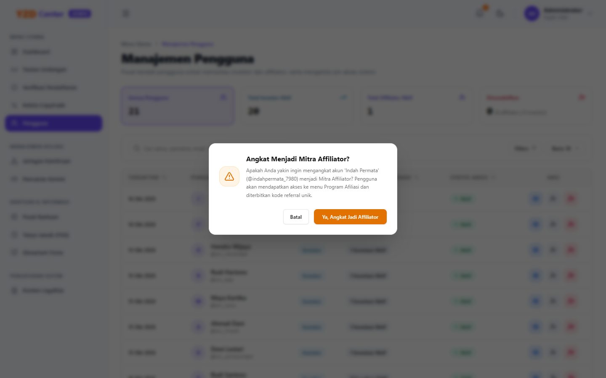

3. Dialog menampilkan pesan konfirmasi:  
   *"Apakah Anda yakin ingin mengangkat akun '[Nama Pengguna]' (@username) menjadi Mitra Affiliator? Pengguna akan mendapatkan akses ke menu Program Afiliasi dan diterbitkan kode referral unik."*
4. Klik tombol **"Ya, Angkat Jadi Affiliator"**.
5. Sistem secara otomatis menjalankan runtutan logika berikut:
   - **Penerbitan Kode Referral Otomatis:** Jika pengguna belum memiliki kode referral, sistem secara otomatis menerbitkan kode referral unik 6 karakter (kombinasi 3 huruf nama depan + 3 alfanumerik acak, contoh: `IND7A2`). Jika pengguna pernah menjadi affiliator sebelumnya, kode referral unik yang lama tetap dipertahankan.
   - **Pembaruan Hak Akses:** Peran (*role*) akun di basis data berubah menjadi `affiliator`.
   - **Pemutusan Sesi Pengguna (*Session Invalidation*):** Seluruh sesi aktif pengguna dihapus seketika dari basis data agar saat login ulang, pengguna langsung disajikan menu baru **Program Afiliasi** (Jaringan Kemitraan dan Klaim Komisi).
   - Notifikasi *toast* hijau akan muncul mengonfirmasi keberhasilan aksi: *"Peran pengguna [Nama] berhasil diubah menjadi Affiliator."*.
   
   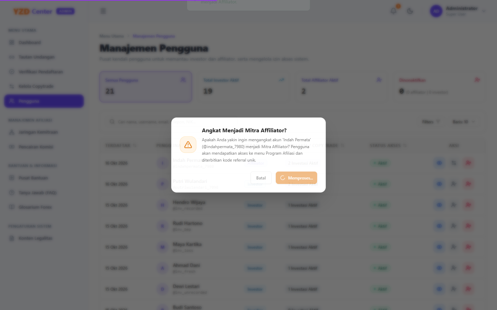

#### C. Prosedur Pengembalian: Affiliator → Investor
1. Klik tombol **"Ubah Menjadi Investor"** (dari tabel atau header detail).
2. Dialog konfirmasi interaktif akan muncul di layar:  
   *"Apakah Anda yakin ingin mengubah akun '[Nama Pengguna]' (@username) kembali menjadi Investor biasa? Akses menu Program Afiliasi akan dinonaktifkan."*
3. Klik tombol **"Ya, Ubah Jadi Investor"**.
4. Sistem memverifikasi aturan bisnis dan mengeksekusi perubahan:
   - **Proteksi Transaksi Pencairan Pending:** Jika Affiliator masih memiliki permohonan pencairan komisi yang berstatus *Pending*, sistem **akan menolak** aksi alih peran dan menampilkan pesan peringatan: *"Tidak dapat mengubah peran menjadi Investor karena pengguna masih memiliki pengajuan pencairan komisi berstatus Pending. Silakan proses atau tolak pengajuan komisi terlebih dahulu."*
   - **Histori Downline Tetap Terlindungi:** Relasi binaan investor (*downline*) pada tabel `relasi_referral` yang telah terbentuk sebelumnya **tidak akan dihapus**, sehingga audit historis rekam jejak kemitraan tetap utuh.
   - **Pembaruan Peran & Pemutusan Sesi:** Peran akun diubah menjadi `investor`, hak akses menu afiliasi dicabut, dan sesi login aktif pengguna diputus seketika demi keamanan.
   - Notifikasi *toast* hijau akan muncul: *"Peran pengguna [Nama] berhasil diubah menjadi Investor."*.

#### D. Proteksi Akun Administrator
- Tombol alih peran disembunyikan secara otomatis untuk seluruh akun dengan peran `administrator`.
- Lapisan logika backend (*UserService*) secara mutlak memproteksi akun Administrator agar tidak dapat diubah menjadi Investor maupun Affiliator, baik oleh sesama Administrator maupun oleh dirinya sendiri.

---

### 7.3 Penonaktifan (Suspend) & Aktivasi Akun Pengguna
Jika terdapat indikasi kecurangan, pelanggaran etika, atau permintaan penutupan akun:
1. Pada baris pengguna di tabel akun, klik tombol aksi status akun.
2. Ubah status menjadi **Nonaktif (Suspended)**.
3. Saat akun berstatus nonaktif, pengguna otomatis ditendang dari sesi aktif dan dicegah untuk melakukan *login* kembali ke portal hingga diaktifkan ulang oleh Administrator.

---

### 7.4 Penggantian Kata Sandi & Manajemen Keamanan Administrator
Untuk menjaga keamanan akun Administrator:
1. Buka menu profil di pojok kanan atas $\rightarrow$ klik **"Ganti Password"** (`/admin/settings/password`).
2. Masukkan Kata Sandi Lama, Kata Sandi Baru (minimal 8 karakter kombinasi huruf besar, kecil, angka, dan simbol), serta Konfirmasi Kata Sandi Baru.
3. Klik **"Perbarui Kata Sandi"**.

---

### 7.5 Kondisi Khusus (Edge Cases) pada Manajemen Pengguna & Alih Peran

| Kasus Khusus | Risiko | Tindakan SOP Administrator |
| :--- | :--- | :--- |
| **Affiliator masih memiliki pengajuan klaim komisi berstatus Pending saat hendak diubah menjadi Investor** | Kerancuan status finansial dan potensi kegagalan audit *payout* setelah akun kehilangan akses menu afiliasi. | Sistem secara otomatis memblokir demosi. Administrator wajib membuka menu **Pencairan Komisi** (`/admin/commissions`), lalu memproses transfer atau menolak pengajuan tersebut terlebih dahulu sebelum mengubah peran. |
| **Investor yang diangkat menjadi Affiliator kemudian dikembalikan ke Investor, lalu di kemudian hari diangkat kembali** | Potensi duplikasi kode referral atau inkonsistensi tautan lama yang sudah pernah dibagikan mitra kepada publik. | Sistem mendeteksi kode referral lama yang pernah dimiliki pengguna dan mempertahankannya tanpa membuat kode baru, sehingga materi promosi atau tautan referral yang pernah dibagikan mitra di masa lalu tetap valid. |
| **Pengguna sedang aktif membuka dashboard saat perannya diubah oleh Administrator** | Tampilan antarmuka (*sidebar*) masih menyajikan menu lama sampai pengguna melakukan penyegaran halaman. | Sistem secara otomatis menghapus seluruh rekaman sesi aktif pengguna di tabel `sessions`. Begitu pengguna melakukan navigasi berikutnya, sistem akan mengarahkannya kembali ke halaman login agar menu peran barunya dimuat secara utuh. |

---

## Bab 8: Pengelolaan Pusat Edukasi & Pengaturan Legalitas Platform

### 8.1 Manajemen Artikel Bantuan & Panduan Pengguna
Administrator mengelola seluruh konten tutorial dan panduan operasional bagi investor dan affiliator di portal:

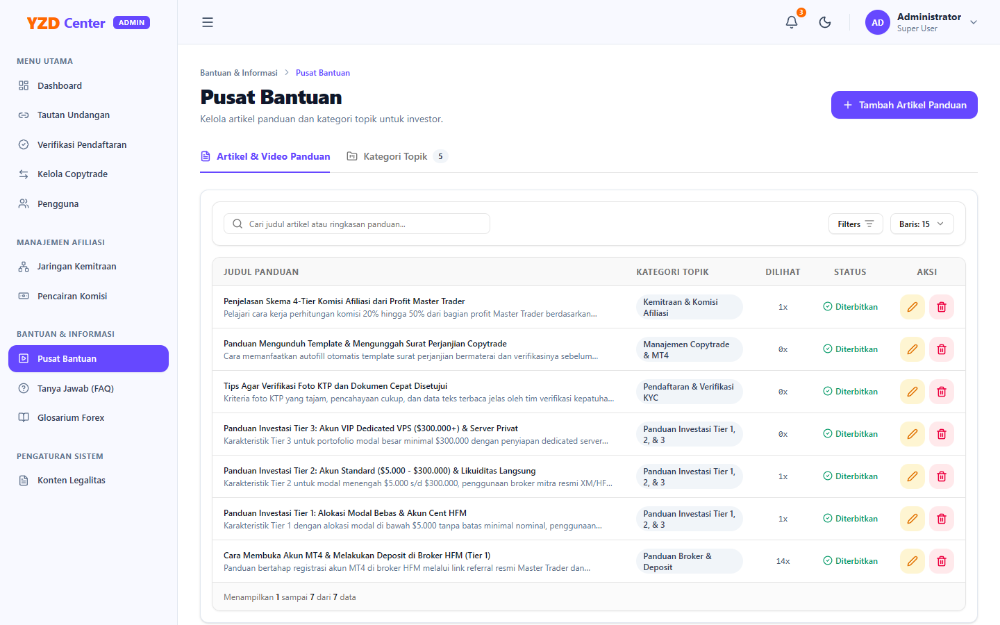

1. **Akses Menu:** Buka `/admin/education/help`.
2. **Tambah Artikel Baru:** Klik **"Tulis Artikel Bantuan"**.
   - Masukkan Judul Artikel, Kategori Panduan (misal: *Memulai*, *Copytrade*, *Kemitraan*), dan Isi Artikel menggunakan editor Markdown terstruktur.
   - Tentukan status tayang: *Draft* atau *Published*.
3. **Pembaruan & Penghapusan:** Artikel yang telah usang dapat disunting ulang secara langsung atau dihapus dari sistem.

---

### 8.2 Manajemen Topik & Butir Pertanyaan FAQ Interaktif
1. Buka menu **Tanya Jawab (FAQ)** (`/admin/education/faq`).
2. **Kelola Topik:** Buat kelompok topik utama (contoh: *Umum*, *Deposit & Penarikan*, *Afiliasi*, *Teknis MT4*).
3. **Kelola Butir FAQ:** Tambahkan pertanyaan yang sering diajukan beserta jawaban komprehensif. Atur nomor urutan tampilan agar pertanyaan paling esensial tampil di urutan teratas.

---

### 8.3 Manajemen Glosarium Istilah
1. Buka menu **Glosarium** (`/admin/education/glossary`).
2. Tambahkan istilah finansial dan teknis perdagangan (misal: *Drawdown*, *Equity*, *Leverage*, *Spread*, *VPS*) beserta definisi ringkas yang ramah bagi investor awam.

---

### 8.4 Pembaruan Dokumen Legalitas (Syarat & Ketentuan serta Kebijakan Privasi)
Dokumen legalitas platform diakses oleh publik dan pengguna saat registrasi.

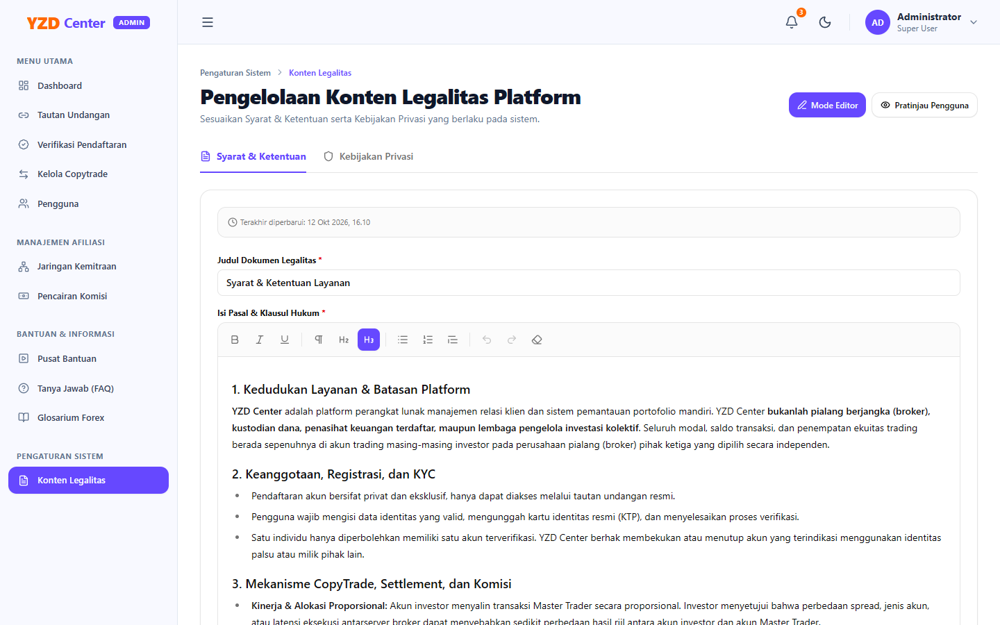

1. Buka menu **Pengaturan Legalitas** (`/admin/settings/legal`).
2. Pilih dokumen yang ingin disunting:
   - **Tab Syarat & Ketentuan Layanan (*Terms of Service*):** Mengatur hak, kewajiban, batasan tanggung jawab risiko perdagangan, dan ketentuan kemitraan.
   - **Tab Kebijakan Privasi (*Privacy Policy*):** Mengatur perlakuan data identitas pribadi, kerahasiaan dokumen KTP, dan transmisi data.
3. Sunting isi dokumen secara langsung pada editor teks yang disediakan.
4. Klik tombol **"Simpan Perubahan Dokumen Legal"**. Konten yang diperbarui akan seketika tampil di halaman registrasi dan *footer* portal aplikasi.

---

## Ringkasan Standar Mutu Administrator (Operational SLA)

Untuk memastikan keunggulan layanan operasional YZD Center, seluruh tim Administrator berpegang pada Service Level Agreement (SLA) berikut:

| Jenis Antrean Tugas | Target Waktu Penyelesaian (SLA) | Prioritas |
| :--- | :---: | :---: |
| **Verifikasi Pendaftaran & KTP Baru** | Maksimal **1 Jam** pada jam operasional | 🔴 Tinggi |
| **Persetujuan & Setup Akun Copytrade (Termasuk VPS Tier 3)** | Maksimal **2 Jam** setelah deposit terkonfirmasi | 🔴 Tinggi |
| **Verifikasi Permohonan Klaim Referral Susulan** | Maksimal **1x24 Jam** kerja | 🟡 Sedang |
| **Pencairan & Transfer Bank Komisi Afiliasi** | Maksimal **1x24 Jam** kerja | 🔴 Tinggi |
| **Pembaruan Saldo Bulanan Akun Copytrade** | Setiap tanggal **1 s/d 2 awal bulan** | 🟡 Terjadwal |

---
*Buku Panduan Operasional Administrator YZD Center — Hak Cipta Dilindungi Undang-Undang.*
