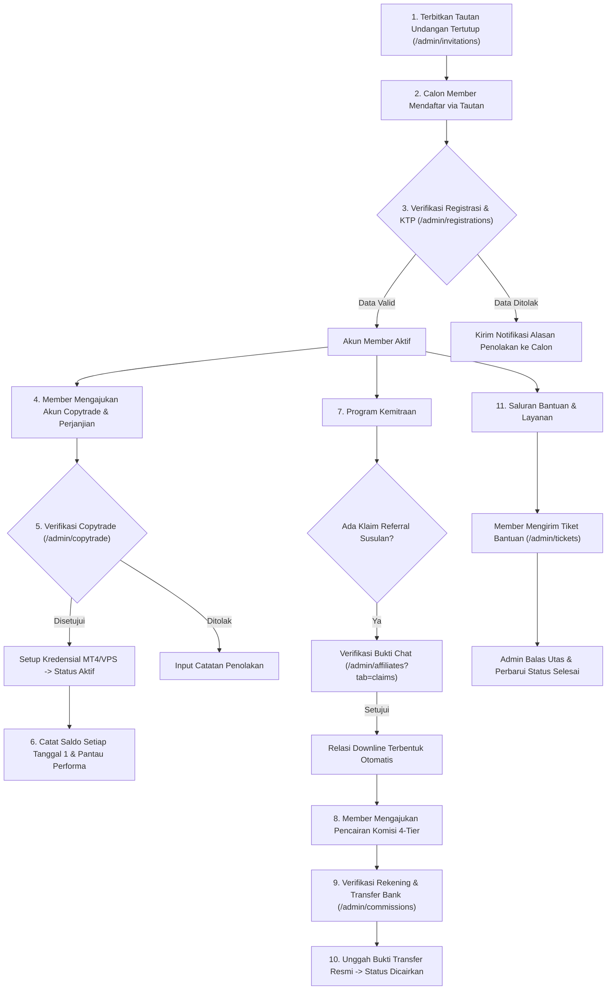

# Buku Panduan Administrator (Manual Book) — Tata Kelola Operasional Platform YZD Center

**Versi Dokumen:** 2.0  
**Target Pengguna:** Tim Administrator, Operasional & Verifikator YZD Center  
**Platform:** Portal Administrasi Web YZD Center (Desktop & Perangkat Seluler)

---

## Daftar Isi

1. [Bab 1: Gambaran Umum & Tanggung Jawab Administrator](#bab-1-gambaran-umum--tanggung-jawab-administrator)
   - [1.1 Peran Administrator dalam Ekosistem YZD Center](#11-peran-administrator-dalam-ekosistem-yzd-center)
   - [1.2 Peta Operasional Hulu ke Hilir (Alur Kerja SOP Harian)](#12-peta-operasional-hulu-ke-hilir-alur-kerja-sop-harian)
   - [1.3 Akses Masuk, Sesi Keamanan & Navigasi Antarmuka](#13-akses-masuk-sesi-keamanan--navigasi-antarmuka)
   - [1.4 Dashboard Analitik & Pemantauan Metrik Utama (Termasuk Tiket Bantuan)](#14-dashboard-analitik--pemantauan-metrik-utama-termasuk-tiket-bantuan)
   - [1.5 Akses Cepat Operasional (Pemasangan Semi-PWA di Desktop & Mobile)](#15-akses-cepat-operasional-pemasangan-semi-pwa-di-desktop--mobile)
2. [Bab 2: Manajemen Tautan Undangan (Closed-Loop Registration)](#bab-2-manajemen-tautan-undangan-closed-loop-registration)
   - [2.1 Konsep Sistem Registrasi Eksklusif (Closed System)](#21-konsep-sistem-registrasi-eksklusif-closed-system)
   - [2.2 Prosedur Pembuatan Tautan Undangan Baru](#22-prosedur-pembuatan-tautan-undangan-baru)
   - [2.3 Pelacakan Kuota & Siklus Masa Berlaku Token](#23-pelacakan-kuota--siklus-masa-berlaku-token)
   - [2.4 Manajemen & Penghapusan Massal (Batch Delete) Tautan](#24-manajemen--penghapusan-massal-batch-delete-tautan)
   - [2.5 Kondisi Khusus (Edge Cases) pada Tautan Undangan](#25-kondisi-khusus-edge-cases-pada-tautan-undangan)
3. [Bab 3: SOP Verifikasi Pendaftaran & Audit KYC (KTP)](#bab-3-sop-verifikasi-pendaftaran--audit-kyc-ktp)
   - [3.1 Kriteria & Standar Validasi Data Identitas Calon Member](#31-kriteria--standar-validasi-data-identitas-calon-member)
   - [3.2 Langkah Demi Langkah Peninjauan Berkas Pendaftaran](#32-langkah-demi-langkah-peninjauan-berkas-pendaftaran)
   - [3.3 Penolakan Pendaftaran & Notifikasi Alasan Penolakan](#33-penolakan-pendaftaran--notifikasi-alasan-penolakan)
   - [3.4 Kondisi Khusus (Edge Cases) pada Verifikasi Pendaftaran](#34-kondisi-khusus-edge-cases-pada-verifikasi-pendaftaran)
4. [Bab 4: Pengelolaan Akun Copytrade & Konfigurasi MT4 / VPS](#bab-4-pengelolaan-akun-copytrade--konfigurasi-mt4--vps)
   - [4.1 Siklus Hidup Akun Copytrade (Menunggu, Aktif, Ditolak)](#41-siklus-hidup-akun-copytrade-menunggu-aktif-ditolak)
   - [4.2 Prosedur Verifikasi & Pengelompokan Modal Berdasarkan 3 Tier](#42-prosedur-verifikasi--pengelompokan-modal-berdasarkan-3-tier)
   - [4.3 Setup Kredensial MT4 & VPS Khusus Tier 3 ($300.000+)](#43-setup-kredensial-mt4--vps-khusus-tier-3-300000)
   - [4.4 SOP Pembaruan Riwayat Saldo Bulanan (Snapshot Tanggal 1 & Kalkulasi Profit/Persentase)](#44-sop-pembaruan-riwayat-saldo-bulanan-snapshot-tanggal-1--kalkulasi-profitpersentase)
   - [4.5 Akses Dokumen Surat Perjanjian Kemitraan Bermaterai](#45-akses-dokumen-surat-perjanjian-kemitraan-bermaterai)
   - [4.6 Kondisi Khusus (Edge Cases) pada Copytrade](#46-kondisi-khusus-edge-cases-pada-copytrade)
5. [Bab 5: Pengawasan Jaringan Kemitraan & Verifikasi Klaim Referral Susulan](#bab-5-pengawasan-jaringan-kemitraan--verifikasi-klaim-referral-susulan)
   - [5.1 Audit Struktur Downline & Pemantauan Performa Mitra](#51-audit-struktur-downline--pemantauan-performa-mitra)
   - [5.2 Standar Penilaian Bukti Klaim Susulan (Chat & Kronologi)](#52-standar-penilaian-bukti-klaim-susulan-chat--kronologi)
   - [5.3 Prosedur Eksekusi Keputusan Klaim](#53-prosedur-eksekusi-keputusan-klaim)
   - [5.4 Mitigasi Klaim Ganda & Hubungan Siklikal Referral](#54-mitigasi-klaim-ganda--hubungan-siklikal-referral)
   - [5.5 Kondisi Khusus (Edge Cases) pada Klaim Referral](#55-kondisi-khusus-edge-cases-pada-klaim-referral)
6. [Bab 6: SOP Verifikasi Pencairan Komisi Afiliasi (Payout & Upload Bukti Transfer)](#bab-6-sop-verifikasi-pencairan-komisi-afiliasi-payout--upload-bukti-transfer)
   - [6.1 Audit Antrean Pengajuan Komisi Berbasis Rekening Bank](#61-audit-antrean-pengajuan-komisi-berbasis-rekening-bank)
   - [6.2 Langkah Demi Langkah Pencairan Komisi & Transfer Bank Riil](#62-langkah-demi-langkah-pencairan-komisi--transfer-bank-riil)
   - [6.3 Pengunggahan Bukti Transfer Resmi & Notifikasi Real-Time](#63-pengunggahan-bukti-transfer-resmi--notifikasi-real-time)
   - [6.4 Kondisi Khusus (Edge Cases) pada Pencairan Komisi](#64-kondisi-khusus-edge-cases-pada-pencairan-komisi)
7. [Bab 7: Manajemen Pengguna & Hak Akses (Ekosistem Terpadu Member)](#bab-7-manajemen-pengguna--hak-akses-ekosistem-terpadu-member)
   - [7.1 Konsep Peran Tunggal: Member dengan Label Turunan (Derived Labels)](#71-konsep-peran-tunggal-member-dengan-label-turunan-derived-labels)
   - [7.2 Daftar Pengguna, Filter Cepat & Pencarian Akun](#72-daftar-pengguna-filter-cepat--pencarian-akun)
   - [7.3 Penonaktifan (Suspend) & Aktivasi Akun Pengguna](#73-penonaktifan-suspend--aktivasi-akun-pengguna)
   - [7.4 Penggantian Kata Sandi & Manajemen Keamanan Administrator](#74-penggantian-kata-sandi--manajemen-keamanan-administrator)
   - [7.5 Kondisi Khusus (Edge Cases) pada Manajemen Pengguna](#75-kondisi-khusus-edge-cases-pada-manajemen-pengguna)
8. [Bab 8: Manajemen Materi Promosi (Profit Master Feed)](#bab-8-manajemen-materi-promosi-profit-master-feed)
   - [8.1 Fungsi Modul Materi Promosi Master Trader](#81-fungsi-modul-materi-promosi-master-trader)
   - [8.2 Prosedur Penerbitan Materi Baru & Unggah Multi-Gambar](#82-prosedur-penerbitan-materi-baru--unggah-multi-gambar)
   - [8.3 Pengeditan Caption & Pembaruan Foto Materi](#83-pengeditan-caption--pembaruan-foto-materi)
   - [8.4 Penghapusan Postingan Materi & Konfirmasi Aman](#84-penghapusan-postingan-materi--konfirmasi-aman)
   - [8.5 Pemantauan Feed Real-Time & Integrasi Tautan Member](#85-pemantauan-feed-real-time--integrasi-tautan-member)
9. [Bab 9: Manajemen Tiket Bantuan (Customer Support Helpdesk)](#bab-9-manajemen-tiket-bantuan-customer-support-helpdesk)
   - [9.1 Konsep Saluran Layanan Tiket Terpusat](#91-konsep-saluran-layanan-tiket-terpusat)
   - [9.2 Antrean Tiket Terpusat (AppDataTable, Filter Status & Pencarian Multi-Kolom)](#92-antrean-tiket-terpusat-appdatatable-filter-status--pencarian-multi-kolom)
   - [9.3 Meninjau Detail Kendala Awal & Utas Percakapan](#93-meninjau-detail-kendala-awal--utas-percakapan)
   - [9.4 Mengirim Balasan Solutif & Lampiran Gambar Pendukung](#94-mengirim-balasan-solutif--lampiran-gambar-pendukung)
   - [9.5 Prosedur Pembaruan Status Manual (Modal Status Tanpa Catatan Opsional)](#95-prosedur-pembaruan-status-manual-modal-status-tanpa-catatan-opsional)
   - [9.6 Keamanan Berkas Lampiran Privat (Streaming Otentikasi)](#96-keamanan-berkas-lampiran-privat-streaming-otentikasi)
   - [9.7 Otomasi Sistem: Penutupan Otomatis 7 Hari (Close Resolved Tickets Scheduler)](#97-otomasi-sistem-penutupan-otomatis-7-hari-close-resolved-tickets-scheduler)
10. [Bab 10: Pengelolaan Pusat Edukasi & Pengaturan Legalitas Platform](#bab-10-pengelolaan-pusat-edukasi--pengaturan-legalitas-platform)
    - [10.1 Manajemen Artikel Bantuan & Panduan Pengguna](#101-manajemen-artikel-bantuan--panduan-pengguna)
    - [10.2 Manajemen Topik & Butir Pertanyaan FAQ Interaktif](#102-manajemen-topik--butir-pertanyaan-faq-interaktif)
    - [10.3 Manajemen Glosarium Istilah](#103-manajemen-glosarium-istilah)
    - [10.4 Pembaruan Dokumen Legalitas (Syarat & Ketentuan serta Kebijakan Privasi)](#104-pembaruan-dokumen-legalitas-syarat--ketentuan-serta-kebijakan-privasi)
11. [Bab 11: Pemantauan Audit & Log Aktivitas Sistem (Activity Logs)](#bab-11-pemantauan-audit--log-aktivitas-sistem-activity-logs)
    - [11.1 Konsep & Arsitektur Jejak Audit Imutabel (Immutable Audit Trail)](#111-konsep--arsitektur-jejak-audit-imutabel-immutable-audit-trail)
    - [11.2 Akses Menu, Filter Multi-Kriteria & Pencarian Log](#112-akses-menu-filter-multi-kriteria--pencarian-log)
    - [11.3 Rincian Rekam Perubahan Atribut (Audit Diff: Sebelum vs Sesudah)](#113-rincian-rekam-perubahan-atribut-audit-diff-sebelum-vs-sesudah)
    - [11.4 Penyamaran Otomatis Data Sensitif & Kredensial (Data Masking)](#114-penyamaran-otomatis-data-sensitif--kredensial-data-masking)
    - [11.5 Ekspor Jejak Audit ke Dokumen Spreadsheet (Format Excel .XLSX)](#115-ekspor-jejak-audit-ke-dokumen-spreadsheet-format-excel-xlsx)
12. [Bab 12: Ringkasan Standar Mutu Administrator (Operational SLA)](#bab-12-ringkasan-standar-mutu-administrator-operational-sla)

---

## Bab 1: Gambaran Umum & Tanggung Jawab Administrator

### 1.1 Peran Administrator dalam Ekosistem YZD Center
**Administrator** memegang otoritas tertinggi (*Super User*) dalam memastikan kepatuhan hukum (*compliance*), akurasi finansial, keamanan data, dan kelancaran alur operasional di seluruh sistem YZD Center. 

Tanggung jawab utama Administrator mencakup:
1. **Pengendalian Gerbang Masuk (*Gatekeeping*):** Menerbitkan tautan undangan eksklusif pendaftaran agar tidak terjadi pendaftaran liar (*closed system*).
2. **Audit Kepatuhan Identitas (*KYC & Legal Compliance*):** Memverifikasi berkas KTP dan dokumen legalitas bermaterai sebelum akun Member dapat beroperasi penuh.
3. **Pengelolaan Akun Trading Copytrade:** Meninjau kesesuaian modal, mengaktifkan akun, mengatur kredensial MetaTrader 4 (MT4) dan Virtual Private Server (VPS), serta mencatat pembaruan riwayat saldo bulanan setiap tanggal 1.
4. **Validasi Kemitraan & Klaim Referral:** Memverifikasi permohonan klaim susulan affiliator secara adil berdasarkan bukti percakapan yang sah.
5. **Eksekusi Pembayaran Finansial (*Payout Reconciliation*):** Memvalidasi klaim komisi berjenjang (*4-Tier*) dan mentransfer hak mitra melalui bank resmi secara tepat waktu.
6. **Penerbitan Materi Promosi (Profit Master Feed):** Menyediakan narasi dan infografis hasil trading resmi untuk kebutuhan promosi para member.
7. **Penyelesaian Kendala Pengguna (Customer Support Helpdesk):** Membalas tiket bantuan member secara cepat dan mengawal perbaikan kendala hingga tuntas (*resolved*).
8. **Pemeliharaan Konten Edukasi & Legalitas:** Mengelola materi artikel pusat bantuan, tanya jawab (FAQ), glosarium, dan kebijakan privasi platform.
9. **Audit & Jejak Rekam Sistem (*Activity & Security Audit*):** Memantau rekam jejak operasional, riwayat mutasi data sensitif, dan log perubahan atribut melalui audit trail imutabel.

---

### 1.2 Peta Operasional Hulu ke Hilir (Alur Kerja SOP Harian)



---

### 1.3 Akses Masuk, Sesi Keamanan & Navigasi Antarmuka
1. **Akses Portal:** Masuk melalui alamat `/login` menggunakan *username* atau *email* berhak akses Administrator.
2. **Keamanan Sesi:** Portal dilengkapi sistem *rate limiting*, proteksi CSRF, enkripsi sesi, dan pemutusan sesi otomatis jika pengguna tidak aktif.
3. **Bilah Navigasi Samping (*Sidebar*):** 
   - **Menu Utama:** Dashboard, Tautan Undangan, Verifikasi Pendaftaran, Kelola Copytrade, Pengguna.
   - **Manajemen Afiliasi:** Jaringan Kemitraan (dan Klaim Referral), Pencairan Komisi, **Materi Promosi**.
   - **Bantuan & Informasi:** Pusat Bantuan, **Tiket Bantuan**, Tanya Jawab (FAQ), Glosarium Forex.
   - **Pengaturan Sistem:** Log Aktivitas (Audit Trail), Konten Legalitas, Ganti Password.
4. **Header Navigasi Atas:** Berisi tombol menu ponsel, tombol perkecil *sidebar*, tombol *toggle* tema gelap/terang (*Dark/Light Mode*), lonceng notifikasi sistem *real-time*, dan menu profil administrator.

---

### 1.4 Dashboard Analitik & Pemantauan Metrik Utama (Termasuk Tiket Bantuan)
Halaman Dashboard (`/admin/dashboard`) menyajikan ringkasan performa sistem secara komprehensif:


1. **Kartu Statistik Utama:**
   - **Total Modal Investor (USD):** Akumulasi modal aktif seluruh akun copytrade yang berjalan di sistem.
   - **Total Pengguna Terdaftar:** Jumlah pengguna berstatus aktif.
   - **Total Akun Copytrade:** Rincian akun yang sedang berjalan (*aktif*), antrean verifikasi, dan akun nonaktif.
2. **Antrean Tindakan Tertunda (*Action Needed*):**
   - Kartu antrean dinamis yang menampilkan jumlah tugas mendesak hari ini:
     - **Pendaftaran Akun Baru:** Menampilkan jumlah calon member yang menunggu verifikasi KTP.
     - **Akun Copytrade Baru:** Menampilkan pengajuan akun MT4 yang siap diverifikasi.
     - **Klaim Referral Susulan:** Menampilkan permohonan klaim hubungan downline.
     - **Pengajuan Pencairan Komisi:** Menampilkan klaim komisi yang siap ditransfer ke bank.
     - **Tiket Bantuan Butuh Respons:** Menampilkan jumlah tiket bantuan yang berstatus `Open` atau `In Progress` yang membutuhkan respons segera dari tim admin.
3. **Pintasan Cepat (*Quick Shortcuts*):** Tombol langsung menuju modul antrean verifikasi yang paling membutuhkan perhatian.

---

### 1.5 Akses Cepat Operasional (Pemasangan Semi-PWA di Desktop & Mobile)
Portal YZD Center dilengkapi dengan kemampuan **Semi-PWA (*Progressive Web App*)**:
- **Tombol Install App:** Terletak di bilah atas (*Top Header*) di sebelah kiri bel notifikasi, dipisahkan secara rapi oleh garis pembatas vertikal.
- **Tampilan:**
  - **Layar Desktop (`sm:` ke atas):** Tombol solid warna tema ungu (*Violet-600*) dengan teks **"Install App"** dan ikon unduh.
  - **Layar Mobile (`< 640px`):** Tombol kotak ringkas berukuran `38x38px` yang ramah sentuhan.
- **Jendela Mandiri (*Standalone Window*):** Aplikasi administrasi terbuka dalam jendela mandiri tanpa tab peramban dan tanpa bilah URL untuk fokus kerja maksimal. Tombol install akan otomatis disembunyikan saat diakses dari aplikasi yang telah terpasang.

---

## Bab 2: Manajemen Tautan Undangan (Closed-Loop Registration)

### 2.1 Konsep Sistem Registrasi Eksklusif (Closed System)
Untuk menjaga integritas komunitas dan mencegah pendaftaran bot/spam, sistem YZD Center tidak membuka registrasi publik secara bebas. Setiap pendaftaran **wajib memiliki token undangan yang sah**.

---

### 2.2 Prosedur Pembuatan Tautan Undangan Baru
1. Masuk ke menu **Tautan Undangan** (`/admin/invitations`).
2. Klik tombol **"Buat Tautan Undangan"**.
3. Pada jendela modal yang muncul:
   - **Nama / Label Undangan:** Tuliskan label penerima (contoh: *"Undangan Batch 1 Komunitas Surabaya"*).
   - **Kuota Penggunaan:** Tentukan berapa kali tautan dapat digunakan untuk registrasi (misal: `1` untuk undangan personal, atau `50` untuk acara seminar).
   - **Masa Berlaku:** Tentukan tanggal dan jam kedaluwarsa tautan (opsional; kosongkan jika berlaku tanpa batas waktu).
4. Klik **"Simpan Tautan"**. Tautan undangan akan langsung dibuat dengan kode token acak yang unik.
5. Klik ikon **Salin Tautan** untuk membagikannya ke calon member.

---

### 2.3 Pelacakan Kuota & Siklus Masa Berlaku Token
Tabel daftar tautan undangan menyajikan informasi:
- **Token Undangan:** Kode token 32 karakter unik.
- **Penggunaan:** Jumlah kuota terpakai vs total kuota (contoh: `3 / 10`).
- **Status:** *Aktif*, *Kuota Habis*, atau *Kedaluwarsa*.
- Jika kuota telah terpenuhi atau tanggal kedaluwarsa telah lewat, sistem secara otomatis menolak setiap upaya registrasi baru menggunakan token tersebut.

---

### 2.4 Manajemen & Penghapusan Massal (Batch Delete) Tautan
- **Penghapusan Satuan:** Klik ikon tempat sampah pada baris tautan yang ingin dicabut.
- **Penghapusan Massal (*Bulk Delete*):** Centang beberapa kotak pada tabel, lalu klik tombol **"Hapus Terpilih"** di toolbar atas untuk mencabut banyak token sekaligus.

---

## Bab 3: SOP Verifikasi Pendaftaran & Audit KYC (KTP)

### 3.1 Kriteria & Standar Validasi Data Identitas Calon Member
Pendaftaran baru yang masuk ke antrean **Verifikasi Pendaftaran** (`/admin/registrations`) wajib diteliti berdasarkan standar berikut:
1. **Keaslian Foto KTP:**
   - Foto harus memperlihatkan fisik e-KTP asli (bukan fotokopi buram atau tangkapan layar digital beresolusi rendah).
   - Nama lengkap, NIK 16 digit, tempat/tanggal lahir, dan alamat pada foto KTP harus terbaca jelas dan cocok dengan data isian formulir.
2. **Kesesuaian Ahli Waris:**
   - Memiliki kontak darurat keluarga yang logis dan memiliki nomor telepon yang berbeda dari nomor pemohon.

---

### 3.2 Langkah Demi Langkah Peninjauan Berkas Pendaftaran
1. Buka menu **Verifikasi Pendaftaran** (`/admin/registrations`).
2. Klik tombol **"Tinjau Pendaftaran"** pada baris pengguna yang berstatus *Menunggu Verifikasi*.
3. Periksa jendela modal verifikasi:
   - Cocokkan data formulir dengan pratinjau gambar foto KTP.
   - Gunakan fitur perbesar gambar (*zoom/modal*) untuk memeriksa NIK jika gambar beresolusi tinggi.
4. Jika seluruh data valid, klik tombol hijau **"Setujui Pendaftaran"**. Akun pengguna akan seketika aktif dan pengguna dapat masuk serta mengakses menu portofolio.

---

### 3.3 Penolakan Pendaftaran & Notifikasi Alasan Penolakan
Jika foto KTP buram, tidak terbaca, atau data tidak cocok:
1. Klik tombol merah **"Tolak / Minta Revisi"**.
2. Masukkan alasan penolakan secara jelas pada kolom **Catatan Admin** (contoh: *"Foto KTP buram dan NIK terpotong pada sudut kiri. Mohon unggah ulang foto KTP yang lebih jelas"*).
3. Klik **"Kirim Penolakan"**. Status dokumen berubah menjadi *Perlu Revisi*, dan pengguna menerima notifikasi in-app untuk mengunggah ulang KTP perbaikan melalui halaman Informasi Akun mereka.

---

## Bab 4: Pengelolaan Akun Copytrade & Konfigurasi MT4 / VPS

### 4.1 Siklus Hidup Akun Copytrade (Menunggu, Aktif, Ditolak)
Setiap akun trading MT4 yang didaftarkan oleh Member akan masuk ke antrean **Kelola Copytrade** (`/admin/copytrade`):
- **Menunggu Verifikasi (Pending):** Akun baru diajukan oleh Member.
- **Aktif (Running):** Akun telah diperiksa, bukti deposit valid, dan strategi copytrade telah tersambung.
- **Ditolak (Rejected):** Pengajuan ditolak (misal: nomor akun MT4 salah atau modal tidak sesuai tier).

---

### 4.2 Prosedur Verifikasi & Pengelompokan Modal Berdasarkan 3 Tier
1. Buka menu **Kelola Copytrade** $\rightarrow$ klik **"Tinjau Akun"**.
2. Periksa kesesuaian modal deposit:
   - **Tier 1:** Modal di bawah $\$5,000$.
   - **Tier 2:** Modal $\$5,000$ hingga $\$300,000$.
   - **Tier 3:** Modal $\ge \$300,000$.
3. Verifikasi apakah nomor akun MT4 dan broker telah terdaftar dengan benar di bawah jaringan PAMM/Copytrade master broker.
4. Klik **"Setujui & Aktifkan Akun"**.

---

### 4.3 Setup Kredensial MT4 & VPS Khusus Tier 3 ($300.000+)
Khusus untuk investor Tier 3 dengan modal besar, sistem menyediakan pencatatan kredensial server terdedikasi:
- Admin dapat menginput alamat IP VPS, port koneksi, username, dan password server VPS.
- Seluruh kredensial tersimpan dalam basis data menggunakan enkripsi kuat Eloquent (`'encrypted'`) sehingga terhindar dari pembacaan teks mentah (*plaintext*).

---

### 4.4 SOP Pembaruan Riwayat Saldo Bulanan (Snapshot Tanggal 1 & Kalkulasi Profit/Persentase)
1. Setiap tanggal **1 s/d 2 awal bulan**, Admin dapat memverifikasi atau membantu menginput saldo bulanan akun copytrade melalui menu rincian akun.
2. Memasukkan saldo akhir MT4 akan memicu rekalkulasi otomatis sistem atas metrik:
   - Profit/Loss Month-on-Month (MoM) nominal dolar dan persentase.
   - Pertumbuhan kumulatif terhadap modal awal.
   - Progres kembalinya modal (BEP %).

---

### 4.5 Akses Dokumen Surat Perjanjian Kemitraan Bermaterai
Pada halaman detail akun pengguna, Administrator dapat mengunggah draf resmi **Surat Perjanjian Kemitraan** yang telah dibubuhi materai, atau memeriksa berkas perjanjian bertanda tangan yang dikembalikan oleh investor.

---

## Bab 5: Pengawasan Jaringan Kemitraan & Verifikasi Klaim Referral Susulan

### 5.1 Audit Struktur Downline & Pemantauan Performa Mitra
Buka menu **Jaringan Kemitraan** (`/admin/affiliates`):
- Tab **Daftar Jaringan:** Memantau seluruh pohon hubungan upline-downline, tanggal bergabung, status akun trading binaan, dan sumber relasi (*Tautan Otomatis* atau *Klaim Susulan*).
- Tab **Klaim Referral:** Memeriksa antrean permohonan klaim susulan yang diajukan oleh mitra.

---

### 5.2 Standar Penilaian Bukti Klaim Susulan (Chat & Kronologi)
Sebelum menyetujui klaim susulan:
1. Klik tombol **"Tinjau Klaim"** pada tab antrean klaim.
2. Periksa bukti tangkapan layar percakapan:
   - Pastikan terdapat stempel waktu (*timestamp*) percakapan sebelum downline mendaftar.
   - Pastikan isi percakapan menunjukkan bimbingan aktif dari mitra yang mengajukan klaim.
3. Pastikan calon downline saat ini belum terhubung di bawah mitra upline lain.

---

### 5.3 Prosedur Eksekusi Keputusan Klaim
- **Menyetujui Klaim:** Klik tombol **"Setujui Klaim"**. Sistem otomatis membuat baris relasi di tabel `relasi_referral`. Downline resmi terhubung di bawah mitra pemohon dan seluruh akun trading aktifnya siap diklaim hak komisinya.
- **Menolak Klaim:** Klik tombol **"Tolak Klaim"**, masukkan alasan penolakan pada kolom catatan (misal: *"Bukti chat tidak memperlihatkan tanggal percakapan yang jelas"*), lalu klik kirim. Pemohon menerima notifikasi alasan penolakan.

---

### 5.4 Mitigasi Klaim Ganda & Hubungan Siklikal Referral
- **Pencegahan Hubungan Siklikal (*Circular Reference*):** Sistem memvalidasi agar pengguna A tidak dapat mengklaim pengguna B jika pengguna B sudah berada di atas struktur pengguna A.
- **Klaim Ganda:** Jika terdapat dua klaim bersaing untuk satu investor, persetujuan pada salah satu klaim otomatis membatalkan klaim pesaingnya demi mencegah sengketa komisi.

---

## Bab 6: SOP Verifikasi Pencairan Komisi Afiliasi (Payout & Upload Bukti Transfer)

### 6.1 Audit Antrean Pengajuan Komisi Berbasis Rekening Bank
Buka menu **Pencairan Komisi** (`/admin/commissions`):
- Menampilkan antrean pengajuan pencairan komisi berjenjang (*4-Tier*) dari mitra.
- Setiap pengajuan memuat rincian akun-akun MT4 binaan yang diklaim, nama bank, nomor rekening, nama pemilik rekening, dan total nominal transfer Rupiah.

---

### 6.2 Langkah Demi Langkah Pencairan Komisi & Transfer Bank Riil
1. Klik tombol **"Proses Klaim"** pada antrean permohonan berstatus *Menunggu Verifikasi*.
2. Cocokkan rekening tujuan dan transfer dana komisi melalui portal bank resmi perusahaan sesuai nominal yang tertera.
3. Simpan struk bukti transfer resmi dari bank (format `PDF`, `JPG`, atau `PNG`).

---

### 6.3 Pengunggahan Bukti Transfer Resmi & Notifikasi Real-Time
1. Pada modal penyelesaian pencairan, unggah berkas bukti transfer bank resmi.
2. Klik tombol **"Konfirmasi Selesai & Kirim Bukti"**.
3. Status pencairan komisi otomatis berubah menjadi **Berhasil Ditransfer (Hijau)**.
4. Mitra pemohon seketika menerima notifikasi in-app lengkap dengan berkas bukti transfer yang dapat diunduh/dilihat kapan saja.

---

## Bab 7: Manajemen Pengguna & Hak Akses (Ekosistem Terpadu Member)

### 7.1 Konsep Peran Tunggal: Member dengan Label Turunan (Derived Labels)
Sistem YZD Center telah menyederhanakan arsitektur hak akses pengguna menjadi peran tunggal: **`Member`**. 

Administrator tidak perlu lagi melakukan prosedur rumit "angkat peran" atau "demosi peran" antara Investor dan Affiliator:
- Setiap pengguna yang mendaftar memegang peran `member` dan langsung memiliki akses ke seluruh fitur investasi maupun fitur kemitraan.
- **Label / Peran Turunan (*Derived Labels*):** Pada tabel pengguna, kolom peran secara dinamis menampilkan label sesuai keaktifan portofolio dan jaringannya:
  - 🔵 **Investor:** Memiliki minimal 1 akun copytrade yang aktif.
  - 🟣 **Affiliator:** Memiliki minimal 1 downline binaan yang aktif.
  - 🔵🟣 **Investor & Affiliator:** Memiliki akun copytrade aktif sekaligus membina downline aktif.
  - ⚪ **Member:** Pengguna baru yang belum mengaktifkan akun trading maupun mengajak downline.

---

### 7.2 Daftar Pengguna, Filter Cepat & Pencarian Akun
Buka menu **Pengguna** (`/admin/users`):
- **Filter Tab Cepat:** Filter instan berdasarkan *Semua Pengguna*, *Investor*, *Affiliator*, atau *Nonaktif (Suspended)*.
- **Pencarian Cepat:** Pencarian cerdas berdasarkan nama, username, email, nomor HP, atau NIK.
- **Detail Pengguna (`/admin/users/{id}`):** Membuka informasi profil lengkap, rincian data ahli waris, daftar akun copytrade yang dimiliki, daftar downline, dan dokumen KTP.

---

### 7.3 Penonaktifan (Suspend) & Aktivasi Akun Pengguna
Jika ditemukan indikasi pelanggaran aturan, penipuan, atau permintaan pembekuan akun:
1. Buka halaman detail pengguna (`/admin/users/{id}`).
2. Klik tombol merah **"Nonaktifkan Akun"** di kanan atas.
3. Konfirmasikan keputusan Anda pada dialog `AppConfirmDialog`.
4. Sistem seketika mencabut sesi aktif pengguna dari sistem. Saat mencoba login, pengguna akan diblokir dengan pemberitahuan bahwa akun sedang dinonaktifkan oleh administrator.
5. Untuk mengaktifkan kembali, klik tombol **"Aktifkan Akun"**.

---

### 7.4 Penggantian Kata Sandi & Manajemen Keamanan Administrator
Untuk menjaga keamanan akun Administrator:
1. Buka menu profil di pojok kanan atas $\rightarrow$ klik **"Ganti Password"** (`/admin/settings/password`).
2. Masukkan kata sandi lama, kata sandi baru (minimal 8 karakter kombinasi huruf dan angka), dan konfirmasikan ulang.
3. Klik **"Simpan Kata Sandi"**.

---

### 7.5 Kondisi Khusus (Edge Cases) pada Manajemen Pengguna
- **Proteksi Akun Administrator:** Akun dengan peran `administrator` dilindungi oleh sistem sehingga tidak dapat dinonaktifkan secara tidak sengaja oleh sesama admin.

---

## Bab 8: Manajemen Materi Promosi (Profit Master Feed)

Menu **Materi Promosi** (`/admin/profit-master`) adalah modul penerbitan materi edukasi, infografis performa, dan tangkapan layar bukti profit Master Trader resmi yang akan tampil di feed seluruh Member.

---

### 8.1 Fungsi Modul Materi Promosi Master Trader
Modul ini memfasilitasi tim manajemen dan Master Trader YZD Center untuk:
- Mempublikasikan rekap keuntungan harian/mingguan dan analisa pasar secara berkala.
- Menyediakan narasi teks (*caption*) profesional yang siap dibagikan oleh para member ke jejaring calon investor mereka.
- Mengunggah galeri foto bukti transaksi beresolusi tinggi.

---

### 8.2 Prosedur Penerbitan Materi Baru & Unggah Multi-Gambar
1. Buka menu **Manajemen Afiliasi** $\rightarrow$ **Materi Promosi** (`/admin/profit-master`).
2. Klik tombol **"+ Terbitkan Materi"** di sudut kanan atas.
3. Pada modal **Terbitkan Materi Promosi**:
   - **Caption Promosi:** Ketikkan narasi atau copywriting promosi yang menarik.
   - **Unggah Gambar:** Klik area unggah gambar atau seret foto-foto bukti profit (dapat memilih hingga 5 gambar sekaligus dalam format `JPG`, `JPEG`, `PNG`, `WEBP`, maks. 10 MB per berkas).
   - Sistem secara otomatis mengompresi gambar tanpa mengurangi keterbacaan angka transaksi trading.
4. Klik tombol **"Terbitkan Post"**. Postingan akan langsung tayang di feed seluruh member secara *real-time*.

---

### 8.3 Pengeditan Caption & Pembaruan Foto Materi
1. Pada kartu postingan materi yang ingin disunting, klik ikon titik tiga (`⋮`) di sudut kanan atas kartu $\rightarrow$ pilih **"Edit Post"**.
2. Anda dapat memperbaiki teks caption, menghapus foto yang sudah tidak relevan dengan menekan tombol silang (`×`) pada thumbnail foto, atau mengunggah foto tambahan baru.
3. Klik tombol **"Simpan Perubahan"**.

---

### 8.4 Penghapusan Postingan Materi & Konfirmasi Aman
1. Pada menu opsi titik tiga (`⋮`) kartu postingan, pilih **"Hapus Post"**.
2. Dialog konfirmasi interaktif `AppConfirmDialog` akan muncul menanyakan kepastian penghapusan.
3. Klik **"Ya, Hapus"**. Seluruh berkas gambar terkait akan dihapus dari penyimpanan disk dan postingan ditarik dari feed member.

---

### 8.5 Pemantauan Feed Real-Time & Integrasi Tautan Member
Setiap materi yang diterbitkan oleh Admin di modul ini dapat langsung disalin oleh Member. Saat Member mengklik tombol "Salin Caption" di halaman mereka, sistem secara cerdas menyematkan tautan undangan dan kode referral pribadi milik member tersebut di akhir teks promosi, memudahkan konversi pendaftaran downline baru.

---

## Bab 9: Manajemen Tiket Bantuan (Customer Support Helpdesk)

Menu **Tiket Bantuan** (`/admin/tickets`) adalah pusat kendali layanan dukungan teknis dan operasional untuk melayani keluhan, pertanyaan, dan kendala Member secara resmi, privat, dan terdokumentasi.

---

### 9.1 Konsep Saluran Layanan Tiket Terpusat
Melalui sistem tiket bantuan terpadu:
- Seluruh percakapan tercatat kronologis dan tidak tercecer di pesan instan pribadi.
- Setiap tiket memiliki nomor identitas unik bulanan berurutan: `TKT-YYYYMM-XXXX` (misal: `TKT-202610-0001`).
- Hak akses berkas lampiran (KTP, slip deposit, tangkapan layar MT4) dilindungi enkripsi dan hanya dapat dilihat oleh pelapor yang bersangkutan dan tim Administrator.

---

### 9.2 Antrean Tiket Terpusat (AppDataTable, Filter Status & Pencarian Multi-Kolom)
Halaman antrean tiket (`/admin/tickets`) dibangun menggunakan komponen standar `AppDataTable`:
1. **Tab Filter Cepat Antrean:**
   - **Total:** Seluruh riwayat tiket yang pernah diajukan.
   - **Butuh Respons:** Menampilkan tiket berstatus `Open` dan `In Progress` yang sedang menunggu balasan admin.
   - **Open:** Tiket baru atau tiket yang baru saja dibalas member.
   - **Sedang Diproses (In Progress):** Tiket dalam penanganan teknis.
   - **Dijawab Admin (Answered):** Tiket yang telah dikirimi pesan balasan oleh admin.
   - **Selesai (Resolved):** Tiket yang telah ditandai selesai.
   - **Ditutup (Closed):** Tiket yang telah resmi diarsipkan.
2. **Pencarian Cerdas Multi-Kolom:** Kotak pencarian otomatis menyaring data berdasarkan nomor tiket, subjek kendala, nama lengkap member, username, maupun alamat email pelapor.

---

### 9.3 Meninjau Detail Kendala Awal & Utas Percakapan
Klik tombol detail pada baris tiket untuk membuka halaman percakapan (`/admin/tickets/{id}`):
- **Kartu Identitas Kendala Utama:**
  - Menampilkan nomor tiket, lencana status terkini, waktu pembuatan, dan waktu pembaruan terakhir.
  - Menampilkan profil identitas pelapor (Nama, Username, Email) beserta tombol pintasan **"Profil Pengguna"** untuk membuka data akun pelapor jika diperlukan investigasi lebih lanjut.
  - Menyajikan subjek kendala, deskripsi pembuka yang ditulis member, serta pratinjau thumbnail gambar lampiran awal.
- **Utas Komunikasi Interaktif:** Menyajikan seluruh riwayat tanggapan dua arah secara kronologis. Pesan member tampil dengan lencana Member, sedangkan tanggapan admin tampil dengan lencana Tim Admin.

---

### 9.4 Mengirim Balasan Solutif & Lampiran Gambar Pendukung
1. Pada area **Kirim Balasan** di bagian bawah halaman percakapan:
   - Ketikkan pesan penjelasan solusi atau instruksi teknis kepada member pada kolom teks.
   - Jika perlu menyertakan bukti panduan visual (misal: tangkapan layar konfigurasi MT4), klik ikon klip kertas (`Paperclip`) untuk mengunggah gambar.
2. Klik tombol **"Kirim Balasan"**.
3. Sistem secara otomatis memperbarui status tiket menjadi **Dijawab Admin (Answered)** dan mengirimkan notifikasi in-app seketika ke akun member pelapor.

---

### 9.5 Prosedur Pembaruan Status Manual (Modal Status Tanpa Catatan Opsional)
Selain melalui pengiriman balasan, Administrator dapat memperbarui status tiket kapan saja:
1. Klik tombol **"Ubah Status Tiket"** pada header aksi halaman.
2. Jendela modal **Pembaruan Status Tiket Bantuan** yang ringkas dan bersih akan muncul:
   - **Kartu Ringkasan:** Menampilkan Nomor Tiket, Nama Pelapor, dan Status Saat Ini.
   - **Pilihan Status Baru:** Pilih status yang diinginkan (*Open*, *Sedang Diproses*, *Dijawab Admin*, *Selesai*, atau *Ditutup*). Status saat ini diberi tanda pengenal `(Status Saat Ini)`.
3. Tombol **"Simpan Perubahan"** otomatis aktif jika Anda memilih status yang berbeda. Klik simpan untuk mengeksekusi perubahan. Member otomatis menerima notifikasi pembaruan status tiket mereka.

---

### 9.6 Keamanan Berkas Lampiran Privat (Streaming Otentikasi)
Seluruh lampiran gambar tiket bantuan disimpan pada direktori privat aplikasi (`storage/app/private/tiket_bantuan/{tiket_id}/...`). Berkas dialirkan secara aman melalui `DocumentStreamController` dengan verifikasi otentikasi ketat: hanya Administrator resmi dan Member pemilik tiket yang berhak membuka atau mengunduh berkas tersebut.

---

### 9.7 Otomasi Sistem: Penutupan Otomatis 7 Hari (Close Resolved Tickets Scheduler)
Sistem YZD Center dilengkapi perintah konsol otomatis:
```bash
php artisan app:close-resolved-tickets --days=7
```
Perintah ini dijalankan setiap hari secara otomatis melalui task scheduler Laravel (`routes/console.php`). Seluruh tiket yang telah berstatus **Resolved** selama lebih dari 7 hari tanpa ada sanggahan atau pembukaan kembali dari member akan otomatis diubah statusnya menjadi **Closed (Ditutup)** dan diarsipkan permanen.

---

## Bab 10: Pengelolaan Pusat Edukasi & Pengaturan Legalitas Platform

### 10.1 Manajemen Artikel Bantuan & Panduan Pengguna
Buka menu **Pusat Bantuan** (`/admin/education/help`):
- **Tulis Artikel Baru:** Masukkan Judul Artikel, Kategori Panduan (*Memulai*, *Copytrade*, *Kemitraan*, dll.), dan Isi Artikel menggunakan editor terstruktur.
- Tentukan status publikasi: *Draft* atau *Published*.
- Seluruh artikel yang diterbitkan langsung dapat dibaca oleh seluruh member di portal mereka.

---

### 10.2 Manajemen Topik & Butir Pertanyaan FAQ Interaktif
Buka menu **Tanya Jawab (FAQ)** (`/admin/education/faq`):
- Buat kategori topik pertanyaan (misal: *Umum*, *Deposit & Penarikan*, *Afiliasi*, *Teknis MT4*).
- Tambahkan butir pertanyaan dan jawaban ringkas. Atur nomor urutan prioritas agar pertanyaan paling penting tampil di urutan atas.

---

### 10.3 Manajemen Glosarium Istilah
Buka menu **Glosarium** (`/admin/education/glossary`):
- Tambahkan istilah teknis perdagangan (*Drawdown, Equity, Lot, Leverage, Slippage, VPS*) beserta definisi bahasa awam yang mudah dipahami.

---

### 10.4 Pembaruan Dokumen Legalitas (Syarat & Ketentuan serta Kebijakan Privasi)
Buka menu **Pengaturan Legalitas** (`/admin/settings/legal`):
- Tab **Syarat & Ketentuan Layanan (*Terms of Service*)**: Sunting klausul hak, kewajiban, dan mitigasi risiko perdagangan.
- Tab **Kebijakan Privasi (*Privacy Policy*)**: Sunting aturan penanganan data identitas dan perlindungan dokumen.
- Klik **"Simpan Perubahan Dokumen Legal"** untuk langsung memperbarui teks di halaman registrasi dan footer aplikasi.

---

## Bab 11: Pemantauan Audit & Log Aktivitas Sistem (Activity Logs)

### 11.1 Konsep & Arsitektur Jejak Audit Imutabel (Immutable Audit Trail)
Setiap tindakan operasional penting di platform YZD Center dicatat secara otomatis ke dalam **Log Aktivitas (*Audit Trail*)** di `/admin/activity-logs`.

Prinsip Utama:
1. **Sifat Imutabel (*Append-Only*):** Log aktivitas yang tersimpan dilarang dan tidak dapat diubah maupun dihapus oleh siapa pun.
2. **Konteks Lengkap:** Menyimpan identitas pelaku, waktu presisi WIB, alamat IP, peramban, serta objek data yang dimodifikasi.
3. **Tingkat Kepentingan:** 🔵 *Info*, 🟡 *Peringatan (Warning)*, dan 🔴 *Tindakan Kritis (Critical)*.

---

### 11.2 Akses Menu, Filter Multi-Kriteria & Pencarian Log
- **Filter Rentang Tanggal:** Membatasi audit pada periode tertentu.
- **Kategori Aktivitas:** `Autentikasi`, `Copytrade`, `Keuangan`, `Referral`, `Pengguna`, `Konten`, `Tiket Bantuan`, `Sistem`.
- **Bilah Pencarian Cepat:** Mencari kata kunci nama pelaku, deskripsi kejadian, atau alamat IP.

---

### 11.3 Rincian Rekam Perubahan Atribut (Audit Diff: Sebelum vs Sesudah)
Klik ikon mata pada baris log untuk membuka modal rincian:
- Menampilkan tabel komparasi nilai atribut **Data Sebelum** (merah lembut) vs **Data Sesudah** (hijau lembut) untuk melihat perubahan secara transparan.
- Tersedia opsi **"Lihat JSON Mentah"** untuk inspeksi teknis mendalam.

---

### 11.4 Penyamaran Otomatis Data Sensitif & Kredensial (Data Masking)
Sistem secara otomatis menyamarkan atribut kata sandi, kredensial MT4, PIN VPS, token, dan nomor rekening menjadi nilai tetap **`[TERENKRIPSI/RAHASIA]`** untuk mencegah kebocoran informasi rahasia.

---

### 11.5 Ekspor Jejak Audit ke Dokumen Spreadsheet (Format Excel .XLSX)
Klik tombol **"Ekspor XLSX"** untuk mengunduh berkas laporan resmi Microsoft Excel (`log_aktivitas_yzd_YYYY-MM-DD.xlsx`) yang telah dilengkapi pengaturan bungkus teks otomatis (*auto-wrap text*) dan penyesuaian lebar kolom proporsional.

---

## Bab 12: Ringkasan Standar Mutu Administrator (Operational SLA)

Seluruh tim Administrator berpegang pada Service Level Agreement (SLA) operasional berikut:

| Jenis Antrean Tugas | Target Waktu Penyelesaian (SLA) | Tingkat Prioritas |
| :--- | :---: | :---: |
| **Verifikasi Pendaftaran & KTP Baru** | Maksimal **1 Jam** pada jam operasional | 🔴 Tinggi |
| **Persetujuan & Setup Akun Copytrade (Termasuk VPS Tier 3)** | Maksimal **2 Jam** setelah deposit terkonfirmasi | 🔴 Tinggi |
| **Tanggapan Pertama Tiket Bantuan Member** | Maksimal **2 Jam** pada jam operasional | 🔴 Tinggi |
| **Verifikasi Permohonan Klaim Referral Susulan** | Maksimal **1x24 Jam** kerja | 🟡 Sedang |
| **Pencairan & Transfer Bank Komisi Afiliasi** | Maksimal **1x24 Jam** kerja | 🔴 Tinggi |
| **Pembaruan Saldo Bulanan Akun Copytrade** | Setiap tanggal **1 s/d 2 awal bulan** | 🟡 Terjadwal |
| **Penerbitan Materi Promosi Profit Master** | Berkala (Minimal **2x per minggu**) | 🟢 Normal |
| **Audit & Peninjauan Log Aktivitas Kritis** | Pemantauan harian & investigasi seketika | 🔴 Tinggi |

---
*Buku Panduan Operasional Administrator YZD Center — Hak Cipta Dilindungi Undang-Undang.*
