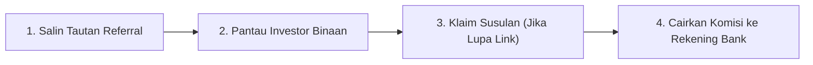
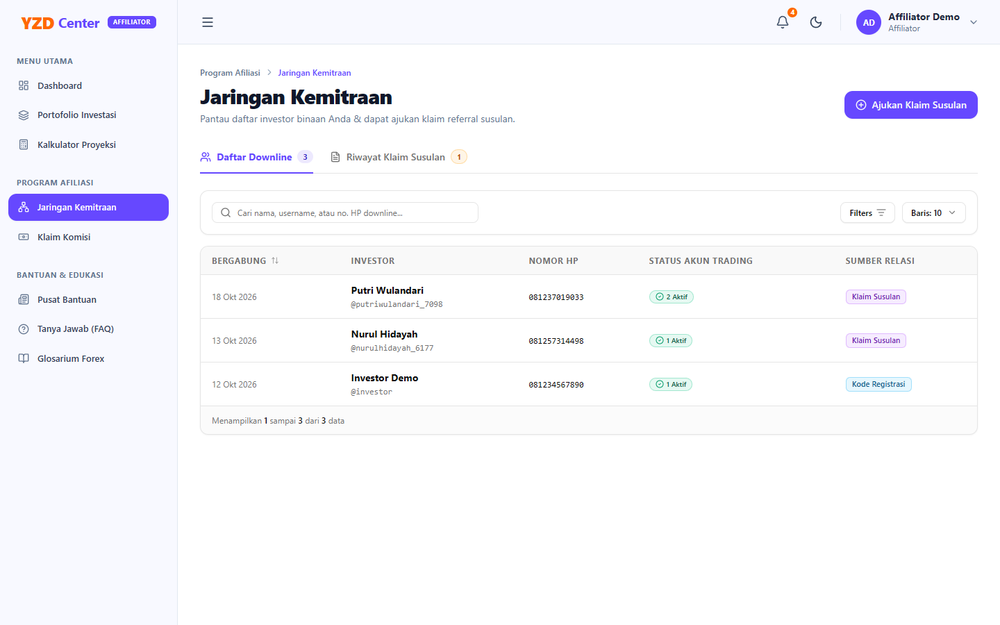
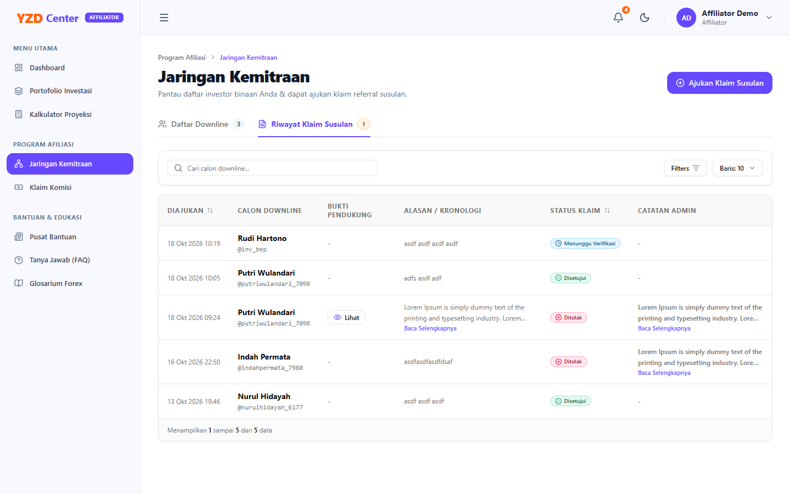
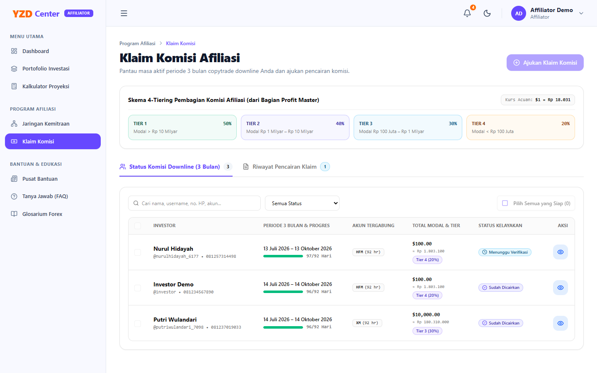

# Panduan Ringkas Pengguna: Program Kemitraan & Afiliasi YZD Center
*(Khusus Pengguna Awam / Non-IT)*

Panduan ini ditujukan bagi Anda selaku **Mitra Affiliator** yang ingin mengajak investor baru dan mendapatkan komisi kemitraan tanpa pusing dengan istilah teknis.

---

## 📌 Alur Cepat 4 Langkah Affiliator

> 📱 **Tips Akses Cepat (Install App ke Layar Depan HP / Komputer):**  
> Setelah berhasil login, Anda dapat mengeklik tombol ungu **"Install App"** di bar atas layar (di samping lonceng notifikasi) untuk menambahkan pintasan YZD Center langsung ke layar utama (*Home Screen*) HP atau desktop Anda. Aplikasi akan terbuka penuh layaknya aplikasi bawaan tanpa perlu membuka browser secara manual.

---

## Langkah 1: Mengambil & Membagikan Tautan Referral Anda

1. Masuk ke Portal YZD Center: [http://localhost:8000/login](http://localhost:8000/login).
2. Di bilah menu sebelah kiri, buka kelompok menu **Program Afiliasi** $\rightarrow$ klik **Jaringan Kemitraan**.
3. Pada kartu paling atas, Anda akan melihat kotak **Tautan Referral Anda**:
   - Klik tombol **"Salin Tautan"**.
   - Kirimkan tautan tersebut ke calon investor melalui WhatsApp, Telegram, atau media sosial.
4. Ketika calon investor mengeklik tautan tersebut dan mendaftar, mereka akan otomatis tercatat sebagai investor binaan (*downline*) Anda.

---

## Langkah 2: Memantau Investor Binaan yang Bergabung

1. Buka kembali menu **Jaringan Kemitraan**.
2. Di bagian bawah, periksa tabel **Daftar Downline**:
   - Anda dapat melihat Nama Investor, Nomor WhatsApp, Tanggal Bergabung, serta **Status Akun Trading**.
   - Jika statusnya bertuliskan **"Aktif"**, artinya investor tersebut sudah sukses mendepositkan modal dan akun copytrade-nya sudah berjalan. Akun aktif inilah yang menghasilkan komisi untuk Anda!

---

## Langkah 3: Mengajukan Klaim Susulan (Jika Investor Lupa Memakai Tautan Anda)

Apakah ada rekan Anda yang mendaftar tapi lupa mengeklik tautan referral Anda? Jangan khawatir, Anda tetap bisa mengklaimnya:

1. Pada menu **Jaringan Kemitraan**, klik tombol **"Ajukan Klaim Susulan"** di pojok kanan atas.
2. Ketikkan **Username** investor tersebut $\rightarrow$ klik **"Cek Database"**.
3. Unggah **Foto Bukti Chat** (screenshot percakapan WhatsApp yang membuktikan Anda yang mengajak mereka bergabung).
4. Tuliskan alasan singkat di kolom kronologi (misal: *"Investor mendaftar lewat arahan saya tapi lupa klik link referral"*).
5. Klik **"Kirim Permohonan Klaim"**.
6. Admin akan memeriksa bukti Anda dalam waktu 1x24 jam. Jika disetujui, investor tersebut akan langsung dipindahkan ke bawah jaringan binaan Anda.

---

## Langkah 4: Mencairkan Komisi ke Rekening Bank Pribadi

Komisi dihitung berdasarkan setiap akun trading aktif binaan Anda dengan kurs resmi **\$1 = Rp 15.000,-**:

### Tabel Besaran Komisi (Sistem Bertingkat):
- **10 Akun Pertama:** Anda menerima **Rp 150.000,-** per akun.
- **Akun ke-11 sampai ke-30:** Naik menjadi **Rp 375.000,-** per akun.
- **Akun ke-31 ke atas:** Naik menjadi **Rp 750.000,-** per akun.

### Cara Menarik Komisi:
1. Buka menu **Program Afiliasi** $\rightarrow$ klik **Klaim Komisi**.
2. Periksa kotak **Komisi Siap Dicairkan**. Jika nominalnya sudah ada (lebih dari Rp 0), klik tombol **"Ajukan Klaim Komisi"**.

3. Centang akun-akun investor binaan yang ingin Anda cairkan komisinya (bisa centang sebagian atau klik *Pilih Semua*).
4. Periksa rekening bank Anda (BCA, Mandiri, dll.). Pastikan nomor rekening dan nama pemilik rekening sudah benar.
5. Klik **"Kirim Pengajuan Pencairan"**.
6. Admin akan mentransfer dana ke rekening bank Anda dan melampirkan bukti transfer bank resmi di sistem.

---

## 💡 Pertanyaan yang Sering Ditanyakan (FAQ Singkat)

- **Kapan komisi bisa ditarik?**  
  Kapan saja! Begitu akun trading investor binaan Anda disetujui Admin (berstatus Aktif), nilai komisi langsung masuk ke saldo siap cair.
- **Berapa kali satu akun trading bisa menghasilkan komisi?**  
  Satu akun MT4 unik memberikan komisi **1 kali seumur hidup**.
- **Bagaimana jika klaim susulan saya ditolak?**  
  Buka tab **Riwayat Klaim Susulan** dan klik tombol **"Baca Selengkapnya"** pada kolom catatan admin untuk membaca alasan penolakan (misalnya bukti chat buram atau tidak terbaca). Anda dapat memperbaiki bukti dan mengajukannya kembali.
- **Saya sudah terdaftar sebagai Investor lama, apakah harus mendaftar akun baru jika ingin jadi Affiliator?**  
  Tidak perlu! Cukup hubungi tim Administrator YZD Center untuk mengangkat peran akun Anda menjadi Mitra Affiliator. Kode referral unik Anda akan diterbitkan secara otomatis oleh sistem, akun lama Anda tetap utuh, dan Anda cukup melakukan *login* ulang untuk melihat menu kemitraan baru.

---

## ✅ Checklist Praktis Mitra Affiliator

| Tugas Mitra | Frekuensi | Menu di Portal |
| :--- | :--- | :--- |
| Bagikan Tautan Referral ke Calon Investor | Setiap Saat | Jaringan Kemitraan |
| Cek Apakah Downline Sudah Mengaktifkan MT4 | 1–2 Hari Sekali | Tab Daftar Downline |
| Ajukan Klaim Susulan jika ada yang terlewat | Sesuai Kebutuhan | Tombol "Ajukan Klaim Susulan" |
| Tarik Komisi ke Rekening Bank | Bebas (Saat ada saldo siap cair) | Menu Klaim Komisi |
