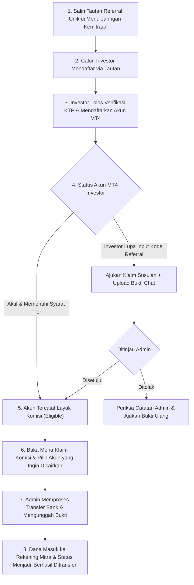
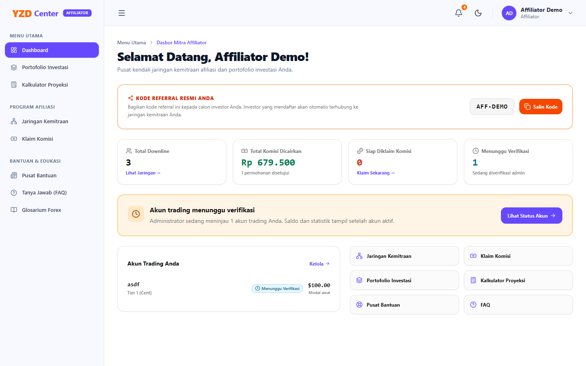
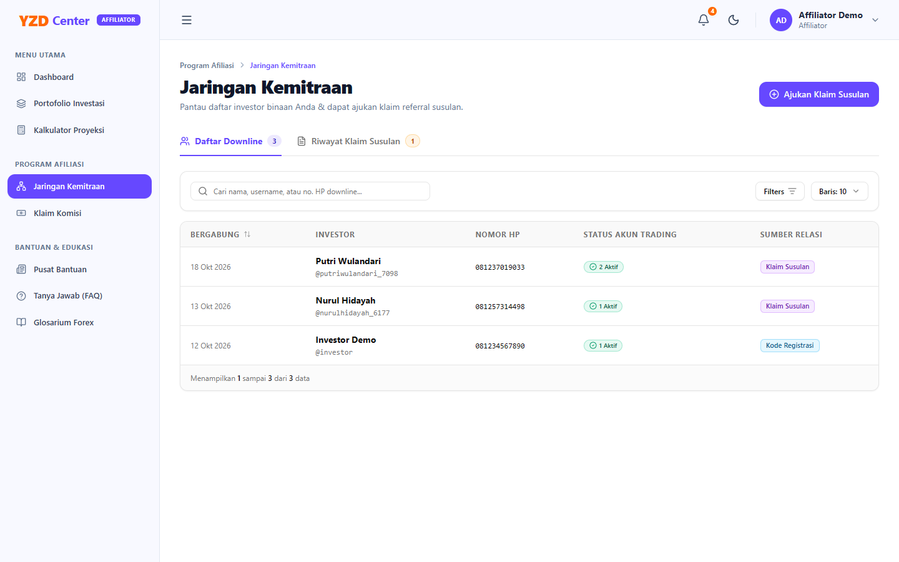
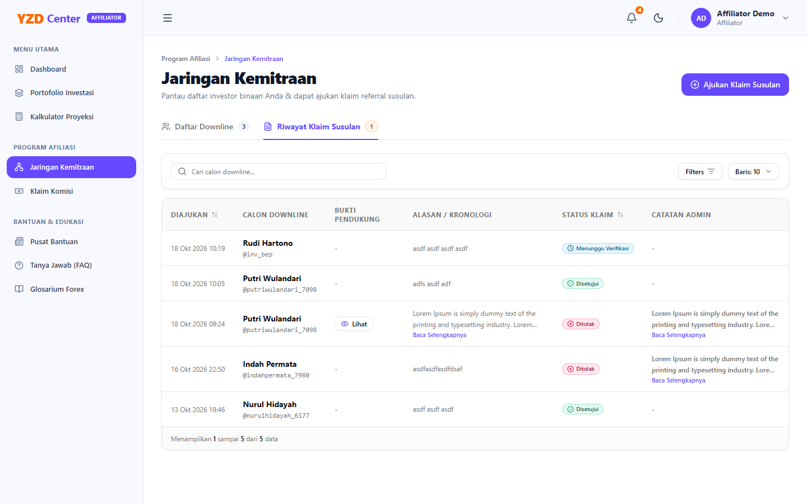
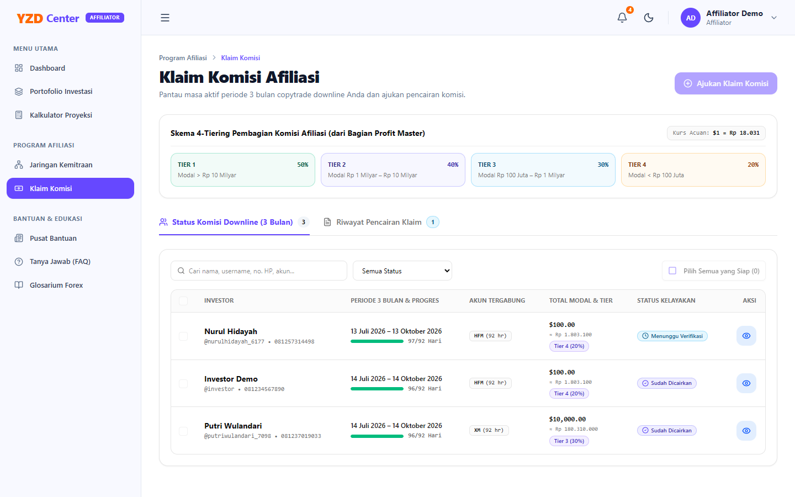

# Buku Panduan Pengguna (Manual Book) — Program Kemitraan & Afiliasi YZD Center

**Versi Dokumen:** 1.0  
**Target Pengguna:** Mitra Affiliator YZD Center  
**Platform:** Aplikasi Web YZD Center (Desktop & Perangkat Seluler)

---

## Daftar Isi

1. [Bab 1: Pendahuluan & Gambaran Umum Program Afiliasi](#bab-1-pendahuluan--gambaran-umum-program-afiliasi)
   - [1.1 Tentang Program Kemitraan & Afiliasi YZD Center](#11-tentang-program-kemitraan--afiliasi-yzd-center)
   - [1.2 Peta Perjalanan Pengguna (Alur Hulu ke Hilir Affiliator)](#12-peta-perjalanan-pengguna-alur-hulu-ke-hilir-affiliator)
   - [1.3 Perbedaan Hak Akses Akun Investor Biasa vs Akun Affiliator](#13-perbedaan-hak-akses-akun-investor-biasa-vs-akun-affiliator)
   - [1.4 Tata Letak Layar & Navigasi Khusus Afiliasi](#14-tata-letak-layar--navigasi-khusus-afiliasi)
   - [1.5 Akses Cepat Aplikasi (Instalasi Semi-PWA di HP & Komputer)](#15-akses-cepat-aplikasi-instalasi-semi-pwa-di-hp--komputer)
2. [Bab 2: Tautan Referral & Penambahan Investor Binaan (Downline)](#bab-2-tautan-referral--penambahan-investor-binaan-downline)
   - [2.1 Mekanisme Tautan Referral Unik Otomatis](#21-mekanisme-tautan-referral-unik-otomatis)
   - [2.2 Cara Membagikan Tautan & Melacak Status Downline](#22-cara-membagikan-tautan--melacak-status-downline)
   - [2.3 Membaca Tabel Jaringan Downline](#23-membaca-tabel-jaringan-downline)
   - [2.4 Kondisi Khusus (Edge Cases) pada Registrasi Referral](#24-kondisi-khusus-edge-cases-pada-registrasi-referral)
3. [Bab 3: Prosedur & Tata Cara Pengajuan Klaim Referral Susulan](#bab-3-prosedur--tata-cara-pengajuan-klaim-referral-susulan)
   - [3.1 Kapan Klaim Susulan Diperlukan?](#31-kapan-klaim-susulan-diperlukan)
   - [3.2 Langkah Demi Langkah Pengajuan Klaim Susulan](#32-langkah-demi-langkah-pengajuan-klaim-susulan)
   - [3.3 Status Pemeriksaan Klaim Susulan (Menunggu, Disetujui, Ditolak)](#33-status-pemeriksaan-klaim-susulan-menunggu-disetujui-ditolak)
   - [3.4 Ketentuan Berkas Bukti Pendukung & Audit Anti-Klaim Ganda](#34-ketentuan-berkas-bukti-pendukung--audit-anti-klaim-ganda)
   - [3.5 Kondisi Khusus (Edge Cases) pada Klaim Susulan](#35-kondisi-khusus-edge-cases-pada-klaim-susulan)
4. [Bab 4: Skema Komisi Berjenjang (4-Tier) & Perhitungan Bonus](#bab-4-skema-komisi-berjenjang-4-tier--perhitungan-bonus)
   - [4.1 Prinsip Perhitungan Komisi Berbasis Akun Trading Aktif](#41-prinsip-perhitungan-komisi-berbasis-akun-trading-aktif)
   - [4.2 Tabel Rincian Skema Komisi 4-Tier](#42-tabel-rincian-skema-komisi-4-tier)
   - [4.3 Kriteria Akun Downline yang Layak Diklaim (Eligible)](#43-kriteria-akun-downline-yang-layak-diklaim-eligible)
   - [4.4 Aturan Klaim Komisi Satu Kali Seumur Hidup per Akun](#44-aturan-klaim-komisi-satu-kali-seumur-hidup-per-akun)
5. [Bab 5: Pengajuan Pencairan Komisi & Monitoring Transfer Bank](#bab-5-pengajuan-pencairan-komisi--monitoring-transfer-bank)
   - [5.1 Membaca Kartu Ringkasan Metrik Komisi](#51-membaca-kartu-ringkasan-metrik-komisi)
   - [5.2 Langkah Demi Langkah Pengajuan Pencairan Komisi](#52-langkah-demi-langkah-pengajuan-pencairan-komisi)
   - [5.3 Proses Review Administrator & Bukti Transfer Bank](#53-proses-review-administrator--bukti-transfer-bank)
   - [5.4 Kondisi Khusus (Edge Cases) pada Pencairan Komisi](#54-kondisi-khusus-edge-cases-pada-pencairan-komisi)
6. [Bab 6: Notifikasi Sistem, Bantuan & Keamanan Akun Mitra](#bab-6-notifikasi-sistem-bantuan--keamanan-akun-mitra)
   - [6.1 Notifikasi In-App Khusus Status Klaim & Transfer](#61-notifikasi-in-app-khusus-status-klaim--transfer)
   - [6.2 Pusat Bantuan, Tanya Jawab & Konsultasi Kemitraan](#62-pusat-bantuan-tanya-jawab--konsultasi-kemitraan)
   - [6.3 Keamanan Akun & Penggantian Kata Sandi](#63-keamanan-akun--penggantian-kata-sandi)

---

## Bab 1: Pendahuluan & Gambaran Umum Program Afiliasi

### 1.1 Tentang Program Kemitraan & Afiliasi YZD Center
**Program Afiliasi YZD Center** adalah kemitraan resmi yang memberikan penghargaan kepada Anda sebagai Mitra (*Affiliator*) yang memperkenalkan dan membina investor baru ke dalam ekosistem perdagangan otomatis (*copytrade*) YZD Center.

Melalui portal ini, Anda dapat:
- Mendapatkan **Tautan Referral Unik** untuk mengundang calon investor binaan secara otomatis.
- Memantau keaktifan akun trading MetaTrader 4 (MT4) seluruh investor binaan secara *real-time*.
- Mengajukan **Klaim Referral Susulan** jika terdapat investor yang mendaftar tanpa melalui tautan langsung.
- Mencairkan komisi apresiasi dalam mata uang Rupiah langsung ke rekening bank Anda dengan skema **4-Tier Transparan**.

> [!TIP]
> **Sudah Terdaftar Sebagai Investor Lama?**
> Jika Anda sebelumnya sudah memiliki akun Investor di platform YZD Center dan kini ingin aktif mengembangkan jaringan kemitraan sebagai Mitra Affiliator, Anda **tidak perlu melakukan registrasi akun baru** dari awal. Cukup hubungi tim Administrator YZD Center untuk meminta pengangkatan peran (*promotion*). Administrator dapat langsung mengubah akun Anda menjadi Mitra Affiliator tanpa proses verifikasi KTP ulang.

---

### 1.2 Peta Perjalanan Pengguna (Alur Hulu ke Hilir Affiliator)

Diagram berikut menggambarkan alur kemitraan sejak pembagian tautan hingga pencairan komisi ke rekening bank Anda:

---

### 1.3 Perbedaan Hak Akses Akun Investor Biasa vs Akun Affiliator

| Fitur / Modul | Akun Investor Biasa | Akun Mitra Affiliator |
| :--- | :---: | :---: |
| **Portofolio Pribadi & Input Saldo Tanggal 1** | ✅ Tersedia | ✅ Tersedia |
| **Kalkulator Proyeksi & Materi Edukasi** | ✅ Tersedia | ✅ Tersedia |
| **Bilah Menu Program Afiliasi** | ❌ Tersembunyi | ✅ **Aktif** |
| **Menu Jaringan Kemitraan (`/investor/affiliates`)** | ❌ Tidak Ada | ✅ **Aktif (Kelola Downline & Klaim Susulan)** |
| **Menu Klaim Komisi (`/investor/commissions`)** | ❌ Tidak Ada | ✅ **Aktif (Tarik Komisi ke Rekening Bank)** |
| **Tautan Referral Unik Otomatis** | ❌ Tidak Ada | ✅ **Aktif** |

> [!NOTE]
> **Transisi & Keamanan Sesi Akun:**
> Saat Administrator mengangkat akun Anda dari Investor menjadi Affiliator (atau sebaliknya), sistem secara otomatis mengakhiri sesi aktif (*session logout*) Anda demi keamanan. Anda cukup melakukan *login* kembali menggunakan username dan kata sandi yang sama. Begitu masuk kembali, bilah navigasi samping (*sidebar*) Anda akan langsung menampilkan kelompok menu **Program Afiliasi**.

---

### 1.4 Tata Letak Layar & Navigasi Khusus Afiliasi
Saat akun Anda telah diangkat sebagai Affiliator oleh Administrator, bilah menu samping (*sidebar*) Anda akan menampilkan kelompok menu tambahan **"Program Afiliasi"**:

1. **Menu Jaringan Kemitraan (`/investor/affiliates`):** Berisi panel penyalinan tautan referral, ringkasan statistik investor binaan, tabel daftar downline, dan tab riwayat klaim susulan.
2. **Menu Klaim Komisi (`/investor/commissions`):** Berisi kartu saldo komisi yang dapat dicairkan, kartu skema 4-tier, tombol pengajuan klaim baru, serta tabel riwayat transfer komisi bank.

---

### 1.5 Akses Cepat Aplikasi (Instalasi Semi-PWA di HP & Komputer)

Agar Anda dapat memantau pergerakan downline dan mencairkan komisi secara instan kapan saja, portal YZD Center mendukung teknologi **Semi-PWA (*Progressive Web App*)**. Anda dapat memasang ikon aplikasi YZD Center langsung di layar utama (*Home Screen*) ponsel atau *desktop taskbar* tanpa perlu mengunduh file berat dari toko aplikasi (*Play Store / App Store*).

#### Lokasi Tombol Install:
Tombol **"Install App"** berwarna ungu (*Violet-600*) terletak pada **Top Header** di sebelah kanan atas (di samping lonceng notifikasi, dipisahkan oleh garis pembatas vertikal):
- **Di Layar Komputer / Laptop (`sm:` ke atas):** Menampilkan tombol ungu dengan ikon panah unduh dan label teks **"Install App"**.
- **Di Layar Smartphone / Ponsel (`< 640px`):** Menampilkan tombol ikon ungu kotak ringkas (`38x38px`) dengan ikon panah unduh kontras agar bilah navigasi ponsel tetap lega.

#### Panduan Pemasangan Berdasarkan Perangkat:
1. **Google Chrome / Microsoft Edge (Android & Komputer PC / Mac):**
   - Klik tombol **"Install App"** di bagian atas layar.
   - Kotak dialog instalasi resmi peramban akan muncul: *"Install app YZD Center?"*.
   - Pilih **Install**. Ikon pintasan YZD Center akan langsung dibuat di layar depan HP atau Desktop Anda.
2. **Apple Safari (iPhone / iPad iOS):**
   - Klik tombol **"Install App"** pada header.
   - Jendela panduan interaktif 3 langkah akan terbuka di layar:
     1. Ketuk tombol **Bagikan (*Share*)** (ikon kotak dengan panah ke atas) pada bilah navigasi bawah Safari.
     2. Gulir menu ke bawah dan pilih **Tambah ke Layar Utama (*Add to Home Screen*)**.
     3. Ketuk **Tambah (*Add*)** di sudut kanan atas. Pintasan YZD Center akan langsung muncul di beranda iOS Anda.

> [!TIP]
> **Tampilan Mandiri Bebas Hambatan (*Standalone Mode*):**  
> Begitu Anda membuka aplikasi melalui ikon pintasan yang telah dipasang, aplikasi akan berjalan dalam mode layar penuh mandiri (*standalone*) tanpa bilah alamat URL peramban, memberikan pengalaman yang sama cepat dan mulusnya seperti aplikasi bawaan sistem. Tombol "Install App" akan otomatis disembunyikan saat aplikasi dijalankan dalam mode ini.

---

## Bab 2: Tautan Referral & Penambahan Investor Binaan (Downline)

### 2.1 Mekanisme Tautan Referral Unik Otomatis
Setiap Affiliator memiliki **Kode Referral Unik** (misalnya `AFF-DEMO` atau 6 karakter alfanumerik otomatis seperti `IND7A2`). Kode ini diterbitkan secara otomatis oleh sistem saat Anda mendaftar melalui tautan undangan khusus affiliator, atau saat akun Investor Anda diangkat menjadi Affiliator oleh Administrator. Jika Anda pernah menjadi Affiliator di masa lalu, sistem akan tetap mempertahankan kode referral lama Anda.

Pada halaman **Jaringan Kemitraan**, sistem menyediakan kotak khusus berwarna latar lembut dengan tombol **"Salin Tautan"** satu kali klik:

- Format Tautan: `http://localhost:8000/register?invitation=KODE_UNDANGAN&ref=KODE_REFERRAL_ANDA`
- Ketika calon investor membuka tautan tersebut, sistem secara otomatis mengunci kode referral Anda pada formulir pendaftaran langkah 1 tanpa perlu diketik manual.

---

### 2.2 Cara Membagikan Tautan & Melacak Status Downline
1. Buka menu **Program Afiliasi** $\rightarrow$ **Jaringan Kemitraan**.
2. Pada kartu **Tautan Referral Anda**, klik tombol **"Salin Tautan"**. Notifikasi hijau *"Tautan referral berhasil disalin ke clipboard"* akan muncul.
3. Bagikan tautan tersebut melalui pesan WhatsApp, Telegram, atau media sosial kepada calon investor Anda.
4. Ketika investor menyelesaikan pendaftaran dan verifikasi KTP, nama mereka langsung muncul di tabel **Daftar Downline**.

---

### 2.3 Membaca Tabel Jaringan Downline
Tabel **Daftar Downline** menyajikan informasi terperinci mengenai perkembangan investor binaan Anda:

- **Bergabung:** Tanggal dan waktu investor resmi terdaftar di bawah jaringan Anda.
- **Investor:** Nama lengkap investor dan username akun (misal: *Budi Santoso (@budisantoso)*).
- **Nomor HP:** Nomor kontak WhatsApp aktif investor untuk memudahkan pendampingan.
- **Status Akun Trading:** Menampilkan status kesiapan akun trading investor binaan (*Belum Mendaftar*, *Menunggu Verifikasi*, atau *Aktif*).
- **Sumber Relasi:** Menunjukkan bagaimana relasi terbentuk:
  - **Tautan Otomatis:** Investor mendaftar langsung melalui tautan referral Anda.
  - **Klaim Susulan:** Investor terhubung setelah Anda mengajukan klaim susulan yang disetujui Admin.

---

### 2.4 Kondisi Khusus (Edge Cases) pada Registrasi Referral

> [!NOTE]
> **Kondisi Khusus yang Perlu Diperhatikan:**
> 1. **Investor Menggunakan Perangkat Berbeda Saat Mendaftar:** Jika calon investor membuka tautan di HP tetapi mendaftar di laptop tanpa membuka tautan referral Anda, relasi otomatis mungkin tidak terbentuk. Dalam kondisi ini, Anda dapat memanfaatkan fitur **Klaim Referral Susulan** (Bab 3).
> 2. **Investor Mendaftar Tanpa Tautan Undangan Resmi:** Pendaftaran tidak akan diproses sistem karena pendaftaran di YZD Center bersifat berbasis undangan eksklusif.

---

## Bab 3: Prosedur & Tata Cara Pengajuan Klaim Referral Susulan

### 3.1 Kapan Klaim Susulan Diperlukan?
Fitur **Klaim Referral Susulan** disediakan sebagai solusi adil bagi Mitra Affiliator jika:
- Calon investor binaan Anda lupa mengeklik tautan referral saat mendaftar.
- Calon investor terdaftar secara organik atau tanpa kode referral, namun Anda memiliki bukti komunikasi/chat bahwa Anda yang membimbing mereka bergabung.

---

### 3.2 Langkah Demi Langkah Pengajuan Klaim Susulan

1. Masuk ke menu **Jaringan Kemitraan** $\rightarrow$ klik tombol **"Ajukan Klaim Susulan"** di kanan atas.
2. Pada jendela modal yang muncul:
   - **Username Calon Downline:** Ketikkan username investor yang ingin diklaim (misal: `budisantoso`), lalu klik tombol **"Cek Database"**. Sistem akan memverifikasi apakah akun tersebut ada dan memenuhi syarat untuk diklaim.
   - **Bukti Pendukung (Screenshot Chat):** Unggah tangkapan layar percakapan WhatsApp/Telegram yang membuktikan bahwa Anda yang mengajak dan membimbing investor tersebut (format JPG, PNG, atau WebP, maks. 5 MB).
   - **Kronologi / Alasan Klaim:** Tuliskan penjelasan singkat mengenai kronologi perkenalan Anda dengan investor tersebut.
3. Klik tombol **"Kirim Permohonan Klaim"**.

---

### 3.3 Status Pemeriksaan Klaim Susulan (Menunggu, Disetujui, Ditolak)
Pantau status permohonan Anda pada tab **Riwayat Klaim Susulan** (`/investor/affiliates?tab=claims`):

- **Menunggu Verifikasi (Kuning):** Permohonan sedang dalam antrean pemeriksaan oleh Administrator.
- **Disetujui (Hijau):** Permohonan klaim sah. Investor resmi dipindahkan menjadi downline binaan Anda, dan seluruh akun trading aktifnya siap diklaim komisinya.
- **Ditolak (Merah):** Permohonan ditolak oleh Admin disertai alasan di kolom **Catatan Admin**. Anda dapat membaca penjelasan lengkap dengan menekan tombol **"Baca Selengkapnya"**.

---

### 3.4 Ketentuan Berkas Bukti Pendukung & Audit Anti-Klaim Ganda
- **Aturan Anti-Klaim Ganda:** Jika dua affiliator berbeda mengajukan klaim untuk investor yang sama, Administrator akan memeriksa bukti chat dengan stempel waktu (*timestamp*) paling awal dan paling valid. Ketika salah satu klaim disetujui, klaim lainnya otomatis dibatalkan sistem.
- **Privasi Berkas:** Tangkapan layar chat yang Anda unggah disimpan di disk privat yang terenkripsi dan hanya dapat dilihat oleh Administrator yang berwenang demi menjaga kerahasiaan percakapan Anda.

---

## Bab 4: Skema Komisi Berjenjang (4-Tier) & Perhitungan Bonus

### 4.1 Prinsip Perhitungan Komisi Berbasis Akun Trading Aktif
Komisi kemitraan di YZD Center dihitung berdasarkan **jumlah akun trading copytrade aktif** yang dimiliki oleh seluruh investor binaan Anda. Sistem menerapkan **Skema 4-Tier Berjenjang** yang memberikan nilai apresiasi lebih besar seiring berkembangnya jaringan kemitraan Anda.

---

### 4.2 Tabel Rincian Skema Komisi 4-Tier

Perhitungan komisi menggunakan kurs acuan resmi sistem: **\$1 USD = Rp 15.000,-**.

| Tingkatan Tier | Batas Akun Aktif | Nominal Komisi per Akun (USD) | Nominal Komisi per Akun (IDR) |
| :---: | :---: | :---: | :---: |
| **Tier 1 (Dasar)** | Akun ke-1 s/d ke-10 | **\$10.00** | **Rp 150.000,-** |
| **Tier 2 (Menengah)** | Akun ke-11 s/d ke-30 | **\$25.00** | **Rp 375.000,-** |
| **Tier 3 (Tinggi)** | Akun ke-31 s/d ke-70 | **\$50.00** | **Rp 750.000,-** |
| **Tier 4 (VIP Partner)** | Akun ke-71 ke atas | **\$50.00 + Bonus Khusus** | **Rp 750.000,- + Insentif** |

> [!TIP]
> **Contoh Perhitungan Berjenjang:**  
> Jika total akun trading binaan Anda mencapai **15 akun aktif**, maka perhitungannya adalah:
> - 10 akun pertama di Tier 1: $10 \times \text{Rp } 150.000 = \text{Rp } 1.500.000$
> - 5 akun berikutnya di Tier 2: $5 \times \text{Rp } 375.000 = \text{Rp } 1.875.000$
> - **Total Hak Komisi:** $\mathbf{\text{Rp } 3.375.000,-}$

---

### 4.3 Kriteria Akun Downline yang Layak Diklaim (Eligible)
Suatu akun trading downline berstatus **Layak Diklaim (*Eligible*)** jika memenuhi syarat:
1. Investor pemilik akun berstatus aktif dan terdaftar resmi sebagai downline Anda.
2. Akun trading MT4 telah diverifikasi dan disetujui Administrator (status akun: **Aktif**).
3. Akun trading tersebut **belum pernah diklaim** pada pengajuan klaim komisi sebelumnya.

---

### 4.4 Aturan Klaim Komisi Satu Kali Seumur Hidup per Akun
Setiap nomor akun trading MT4 unik hanya dapat memberikan hak komisi sebanyak **1 kali seumur hidup** kepada Mitra Affiliator. Akun yang telah dicairkan komisinya akan berstatus *Claimed* dan tidak akan muncul kembali pada formulir penarikan berikutnya.

---

## Bab 5: Pengajuan Pencairan Komisi & Monitoring Transfer Bank

### 5.1 Membaca Kartu Ringkasan Metrik Komisi
Buka menu **Program Afiliasi** $\rightarrow$ **Klaim Komisi** (`/investor/commissions`):

1. **Total Komisi Diterima:** Akumulasi total nominal Rupiah yang sudah berhasil ditransfer Admin ke rekening bank Anda.
2. **Komisi Siap Dicairkan:** Nominal Rupiah dari akun-akun trading aktif baru yang siap Anda ajukan pencairannya sekarang.
3. **Komisi Dalam Proses:** Nominal Rupiah dari permohonan klaim yang sedang ditinjau atau sedang ditransfer oleh Admin.
4. **Total Akun Aktif Binaan:** Jumlah seluruh akun MT4 aktif yang berada di bawah pembinaan Anda.

---

### 5.2 Langkah Demi Langkah Pengajuan Pencairan Komisi

1. Pada halaman **Klaim Komisi**, pastikan nilai **Komisi Siap Dicairkan** lebih dari Rp 0, lalu klik tombol **"Ajukan Klaim Komisi"**.
2. Pada jendela modal pengajuan:
   - **Pilih Akun Trading:** Centang akun-akun trading binaan yang ingin Anda cairkan komisinya (Anda dapat memilih sebagian atau klik *Pilih Semua*).
   - **Ringkasan Kalkulasi:** Sistem otomatis menghitung total akun terpilih dan total nominal transfer Rupiah yang akan Anda terima.
   - **Konfirmasi Rekening Bank:** Periksa Nama Bank, Nomor Rekening, dan Atas Nama rekening penarikan Anda. Pastikan data rekening benar karena pencairan dana akan dikirimkan ke rekening tersebut.
3. Klik tombol **"Kirim Pengajuan Pencairan"**.

---

### 5.3 Proses Review Administrator & Bukti Transfer Bank
Setelah permohonan diajukan, Administrator akan melakukan verifikasi perbankan:
1. **Pemeriksaan & Transfer:** Administrator memverifikasi keaktifan akun dan mentransfer dana via kliring/real-time transfer ke rekening bank Anda.
2. **Unggah Bukti Transfer:** Administrator mengunggah berkas tanda terima transfer resmi bank ke dalam sistem.
3. **Penyelesaian Status:** Status klaim berubah menjadi **Berhasil Ditransfer (Hijau)**.
4. **Melihat Bukti Transfer:** Anda dapat mengeklik baris riwayat klaim tersebut untuk melihat jendela detail dan membuka tautan **"Lihat Bukti Transfer Bank"** sebagai tanda bukti sah penerimaan komisi.

---

### 5.4 Kondisi Khusus (Edge Cases) pada Pencairan Komisi

> [!WARNING]
> 1. **Nomor Rekening Bank Berubah:** Jika Anda ingin mengganti rekening tujuan transfer komisi, perbarui data rekening Anda di menu profil sebelum mengirimkan pengajuan klaim komisi.
> 2. **Klaim Ditolak:** Jika terdapat akun trading yang bermasalah (misalnya terjadi pembatalan deposit di broker), Administrator dapat menolak klaim disertai alasan rinci pada catatan admin. Dana komisi akun lain yang valid tetap dapat diajukan kembali.
> 3. **Pengalihan Peran Kembali Menjadi Investor Saat Ada Klaim Pending:** Jika Anda mengajukan permohonan kepada Administrator untuk mengembalikan akun Anda menjadi akun Investor biasa, permohonan alih peran tersebut hanya dapat dieksekusi setelah seluruh pengajuan pencairan komisi Anda yang berstatus *Pending* diselesaikan (berhasil ditransfer) atau ditolak oleh Admin. Sistem memblokir alih peran jika masih terdapat antrean pencairan komisi aktif demi menjaga integritas data keuangan Anda.

---

## Bab 6: Notifikasi Sistem, Bantuan & Keamanan Akun Mitra

### 6.1 Notifikasi In-App Khusus Status Klaim & Transfer
Sebagai Mitra Affiliator, sistem memberikan notifikasi cerdas langsung ke akun Anda:
- **Pemberitahuan Downline Baru:** Muncul saat ada investor yang berhasil mendaftar menggunakan tautan referral Anda.
- **Pemberitahuan Keputusan Klaim Susulan:** Muncul saat klaim susulan disetujui atau ditolak (dengan cuplikan catatan admin maksimal 10 kata dan tombol redirect langsung ke tab riwayat klaim).
- **Pemberitahuan Pencairan Dana:** Muncul saat dana komisi Anda telah berhasil ditransfer ke rekening bank beserta kode transfer.

---

### 6.2 Pusat Bantuan, Tanya Jawab & Konsultasi Kemitraan
- Seluruh materi edukasi di menu **Pusat Bantuan**, **Tanya Jawab (FAQ)**, dan **Glosarium Forex** tetap dapat diakses penuh oleh Mitra Affiliator.
- Jika Anda memiliki kendala teknis jaringan atau membutuhkan konsultasi pengembangan komunitas investor di kota Anda, silakan hubungi tim Admin YZD Center melalui saluran kontak resmi kemitraan.

---

### 6.3 Keamanan Akun & Penggantian Kata Sandi
Karena akun Affiliator mengelola jaringan investor dan pencairan dana komisi:
- Selalu gunakan kata sandi yang kuat (minimal 8 karakter kombinasi huruf besar, kecil, angka, dan simbol).
- Jangan pernah membagikan kredensial login akun Anda kepada pihak mana pun.
- Gantilah kata sandi secara berkala melalui menu profil di pojok kanan atas.
