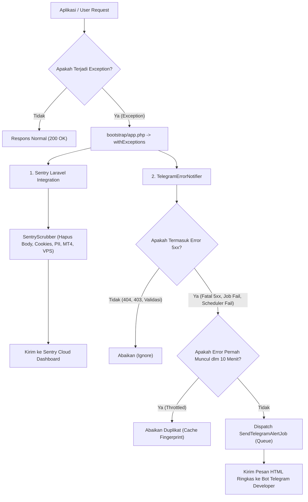

# Panduan Pengembang (Developer Guide) — Manajemen Log Error, Sentry & Telegram Alerting

**Platform:** YZD Center Platform  
**Target Pengguna:** Tim Pengembang (Software Engineer / DevOps)  
**Versi:** 1.0 (Oktober 2026)  

---

## Daftar Isi
1. [Gambaran Umum Arsitektur Pemantauan Error](#1-gambaran-umum-arsitektur-pemantauan-error)
2. [Setup Bot Telegram untuk Notifikasi Instan](#2-setup-bot-telegram-untuk-notifikasi-instan)
3. [Setup Sentry (Cloud Error Tracking)](#3-setup-sentry-cloud-error-tracking)
4. [Konfigurasi Environment (.env) & Variabel Acuan](#4-konfigurasi-environment-env--variabel-acuan)
5. [Verifikasi & Pengujian Koneksi (CLI Test Command)](#5-verifikasi--pengujian-koneksi-cli-test-command)
6. [Operasional Antrean Queue & Supervisor di Server VPS](#6-operasional-antrean-queue--supervisor-di-server-vps)
7. [Mekanisme Proteksi Privasi & Scrubbing PII (Zero-PII)](#7-mekanisme-proteksi-privasi--scrubbing-pii-zero-pii)
8. [Debugging Log Lokal & Pemeliharaan Log Server](#8-debugging-log-lokal--pemeliharaan-log-server)
9. [Checklist Deployment Produksi](#9-checklist-deployment-produksi)

---

## 1. Gambaran Umum Arsitektur Pemantauan Error

Aplikasi YZD Center menerapkan strategi pemantauan error dua pilar (*dual-layer observability*) untuk memastikan tim pengembang dapat merespons anomali sistem secara seketika (*real-time*):



### Karakteristik & Perilaku Sistem:
- **Telegram sebagai Titik Masuk Utama (*Single Source of Alert*):** Pesan Telegram cukup memuat ringkasan singkat: nama galat, rute URL & method, status pengguna, waktu kejadian, dan tautan langsung (*deep link*) ke insiden Sentry terkait.
- **Sentry Hanya Dibuka Saat Dibutuhkan:** Ketika ada notifikasi masuk di Telegram, Anda cukup mengklik tautan tersebut untuk melompat ke dasbor Sentry guna memeriksa *stack trace*, rekam jejak tombol yang ditekan pengguna (*breadcrumbs*), dan nomor baris kode yang bermasalah.
- **Bebas Notifikasi Ganda (Anti-Spam Email):** Notifikasi email insiden di Sentry dinonaktifkan sehingga kotak masuk surel Anda tetap bersih dan tidak terdistraksi.
- **Throttling (10 Menit):** Mencegah banjir notifikasi Telegram jika terjadi loop error yang berulang dalam rentang waktu singkat (1 pesan / jenis error / 10 menit).
- **Zero Request-Lag:** Pengiriman HTTP ke bot Telegram dieksekusi secara asinkron melalui antrean worker (`SendTelegramAlertJob`) sehingga tidak memperlambat waktu respon user.
- **Mode Diam (Safe NO-OP):** Jika kredensial Sentry atau Telegram belum diatur di `.env`, sistem otomatis berjalan dalam mode *silent* tanpa melempar error tambahan apapun.

---

## 2. Setup Bot Telegram untuk Notifikasi Instan

Untuk menerima pesan alert langsung di ponsel atau desktop Anda, lakukan pembuatan bot Telegram melalui langkah berikut:

### Langkah 1: Buat Bot via `@BotFather`
1. Buka aplikasi Telegram dan cari akun resmi **`@BotFather`** (bertanda centang biru).
2. Kirim pesan:
   ```text
   /newbot
   ```
3. Masukkan nama tampilan bot Anda (contoh: `YZD Center Monitor`).
4. Masukkan username bot (wajib diakhiri kata `bot`, contoh: `yzd_alert_bot` atau `yzd_monitor_bot`).
5. `@BotFather` akan mengirimkan pesan konfirmasi berisi **HTTP API Token**.  
   *Contoh token:* `7123456789:AAFlm3kP9Q_XyZ12345AbcDeFGHIJKlmNoP`
6. Simpan token ini untuk variabel `MONITORING_TELEGRAM_TOKEN`.

---

### Langkah 2: Ambil `chat_id` Akun Telegram Anda
Bot Telegram tidak dapat mengirim pesan kepada Anda sebelum Anda memulai obrolan (*Start*) dengan bot tersebut.

1. Buka tautan bot yang baru dibuat (misal: `t.me/yzd_alert_bot`) lalu klik tombol **START** (atau ketik `/start`).
2. Kirim pesan teks sembarang ke bot tersebut (contoh: `halo`).
3. Dapatkan nomor ID chat Anda menggunakan salah satu dari dua cara berikut:

#### Opsi A: Melalui Browser (API Telegram Resmi)
Buka URL berikut pada browser Anda (ganti `<TOKEN_BOT>` dengan token dari Langkah 1):
```text
https://api.telegram.org/bot<TOKEN_BOT>/getUpdates
```
Cari bagian JSON `"chat":{"id": 123456789, ...}`. Angka `123456789` tersebut adalah **Chat ID** Anda.

#### Opsi B: Melalui Bot Pencari ID Telegram
1. Cari akun bot `@userinfobot` atau `@raw_data_bot` di Telegram.
2. Klik Start, bot tersebut akan langsung membalas dengan nomor ID akun Telegram Anda.

> [!TIP]
> **Jika ingin alert dikirim ke Grup/Channel tim pengembang:**  
> 1. Buat grup di Telegram, lalu undang bot Anda ke dalam grup tersebut sebagai Administrator.  
> 2. Kirim satu pesan di grup, lalu cek kembali endpoint `getUpdates`. ID grup biasanya diawali tanda minus (contoh: `-1001987654321`).  
> 3. Gunakan ID tersebut pada `MONITORING_TELEGRAM_CHAT_ID`.

---

## 3. Setup Sentry (Cloud Error Tracking)

Sentry menyediakan paket gratis (*Developer Free Tier*) hingga 5.000 events error per bulan, sangat memadai untuk platform YZD Center.

### Langkah 1: Registrasi Akun Sentry
1. Kunjungi [https://sentry.io](https://sentry.io) dan lakukan registrasi akun (bisa menggunakan akun GitHub/Google).
2. Tentukan nama organisasi Anda (contoh: `yzd-trading-management`).

### Langkah 2: Buat Project Sentry untuk Laravel
1. Masuk ke menu **Projects** $\rightarrow$ klik **Create Project**.
2. Pilih platform: **Laravel**.
3. Berikan nama project: `yzd-backend` (atau `yzd-center`).
4. Atur alert frequency: *"Alert me on every new issue"*.
5. Klik **Create Project**.
6. Sentry akan menampilkan halaman panduan instalasi. Salin nilai **DSN** yang tertera.  
   *Format DSN:* `https://a1b2c3d4e5f6@o123456.ingest.sentry.io/7890123`
7. Simpan nilai ini untuk variabel `SENTRY_LARAVEL_DSN`.

### Langkah 3: Setup Project Frontend Vue (Opsional / Terpadu)
Anda memiliki dua opsi untuk pelacakan error di frontend (Vue 3 / Inertia):
- **Opsi Praktis (Direkomendasikan):** Gunakan DSN yang sama dengan backend. Isi variabel `VITE_SENTRY_DSN` dengan nilai yang sama dengan `SENTRY_LARAVEL_DSN`.
- **Opsi Terpisah:** Buat project baru di Sentry dengan memilih platform **Vue**, lalu isi DSN-nya ke `VITE_SENTRY_DSN`.

### Langkah 4: Matikan Notifikasi Email Insiden di Sentry (Pencegahan Notifikasi Ganda)
Agar alur kerja tetap rapi dan tidak terdistraksi notifikasi ganda:
1. Buka dasbor Sentry $\rightarrow$ klik avatar profil Anda di kiri bawah $\rightarrow$ pilih **User Settings** (atau **Preferences**).
2. Masuk ke menu **Notifications**.
3. Matikan opsi **Workflow / Alerts email** untuk setiap issue baru (set ke *Never* atau nonaktifkan toggle notifikasi email).
4. Dengan begitu, kotak masuk surel Anda tidak akan dibanjiri pesan setiap kali sistem mendeteksi galat, dan notifikasi insiden terpusat 100% pada bot Telegram.

---

## 4. Konfigurasi Environment (`.env`) & Variabel Acuan

Buka berkas `.env` pada folder root Laravel (`src/.env`), lalu perbarui variabel konfigurasi berikut:

```ini
# =========================================================================
# KONFIGURASI LOGGING APLIKASI
# =========================================================================
LOG_CHANNEL=stack
LOG_STACK=daily
LOG_LEVEL=debug

# =========================================================================
# MONITORING SENTRY CLOUD
# =========================================================================
# Kosongkan jika ingin mode NO-OP saat pengembangan lokal
SENTRY_LARAVEL_DSN=https://a1b2c3d4e5f6@o123456.ingest.sentry.io/7890123
VITE_SENTRY_DSN=https://a1b2c3d4e5f6@o123456.ingest.sentry.io/7890123
SENTRY_TRACES_SAMPLE_RATE=0

# Slug organisasi Sentry (untuk tautan langsung Telegram -> Sentry issue)
SENTRY_ORGANIZATION_SLUG=frans-gabriel-hutauruk

# =========================================================================
# NOTIFIKASI ERROR INSTAN TELEGRAM BOT
# =========================================================================
# Token HTTP API dari @BotFather
MONITORING_TELEGRAM_TOKEN=7123456789:AAFlm3kP9Q_XyZ12345AbcDeFGHIJKlmNoP

# ID Akun / ID Grup penerima notifikasi
MONITORING_TELEGRAM_CHAT_ID=123456789

# Jendela penahanan duplikasi error serupa (menit)
MONITORING_THROTTLE_MINUTES=10
```

> [!NOTE]
> Seluruh nilai konfigurasi di atas dibaca melalui [`src/config/monitoring.php`](file:///e:/5_projects/yzd-trading-management/src/config/monitoring.php) dan [`src/config/sentry.php`](file:///e:/5_projects/yzd-trading-management/src/config/sentry.php). Sesuai aturan arsitektur platform, **dilarang memanggil `env()` secara langsung** di dalam controller, service, atau job.

---

## 5. Verifikasi & Pengujian Koneksi (CLI Test Command)

Aplikasi telah dilengkapi dengan perintah artisan mandiri untuk menguji apakah token Telegram dan DSN Sentry berfungsi dengan benar tanpa harus sengaja membuat bug di kode aplikasi.

Jalankan perintah pengujian dari terminal:

```powershell
# Jalankan pengujian penuh (Telegram + Sentry)
php artisan monitoring:test

# Atau uji hanya notifikasi bot Telegram:
php artisan monitoring:test --telegram

# Atau uji hanya pengiriman event Sentry:
php artisan monitoring:test --sentry
```

### Hasil Pengujian yang Diharapkan:
1. **Telegram:** Muncul pesan centang hijau di konsol, dan bot Telegram Anda akan seketika menerima pesan berformat HTML:
   ```html
   ✅ [LOCAL] Uji Coba Monitoring YZD Center
   Koneksi bot Telegram berhasil terhubung.
   Notifikasi error kritis & peringatan sistem siap dikirim secara real-time.
   Waktu Uji: 21 Oct 2026, 15:30:00 WIB
   Trigger: php artisan monitoring:test
   ```
2. **Sentry:** Muncul pesan sukses beserta nomor Event ID di konsol. Saat membuka dashboard Sentry, isu baru dengan judul *"YZD Center - Event Uji Coba dari php artisan monitoring:test"* akan langsung tercatat.

---

## 6. Operasional Antrean Queue & Supervisor di Server VPS

Agar notifikasi Telegram tidak membebani respon request HTTP pengguna, notifikasi dikirimkan melalui job antrean Laravel:
[`SendTelegramAlertJob.php`](file:///e:/5_projects/yzd-trading-management/src/app/Jobs/SendTelegramAlertJob.php).

### 1. Lingkungan Lokal (Local Development)
Pada environment lokal (`QUEUE_CONNECTION=database` atau `sync`), jika Anda ingin memproses antrean secara manual, buka terminal terpisah dan jalankan:
```powershell
php artisan queue:work --tries=3
```

### 2. Lingkungan Server Produksi (Linux VPS via Supervisor)
Di server produksi, antrean wajib dijalankan secara terus-menerus sebagai daemon background process menggunakan **Supervisor**.

1. Buat berkas konfigurasi `/etc/supervisor/conf.d/yzd-worker.conf`:
   ```ini
   [program:yzd-worker]
   process_name=%(program_name)s_%(process_num)02d
   command=php /var/www/yzd-center/artisan queue:work database --sleep=3 --tries=3 --max-time=3600 --timeout=90
   autostart=true
   autorestart=true
   stopasgroup=true
   killasgroup=true
   user=www-data
   numprocs=2
   redirect_stderr=true
   stdout_logfile=/var/www/yzd-center/storage/logs/worker.log
   stopwaitsecs=3600
   ```

2. Muat dan jalankan service Supervisor:
   ```bash
   sudo supervisorctl reread
   sudo supervisorctl update
   sudo supervisorctl start yzd-worker:*
   sudo supervisorctl status
   ```

3. **Penting:** Setiap kali Anda melakukan `git pull` atau deploy kode baru di server, selalu jalankan restart queue worker agar worker memuat kode terbaru:
   ```bash
   php artisan queue:restart
   ```

---

## 7. Mekanisme Proteksi Privasi & Scrubbing PII (Zero-PII)

Platform YZD Center mengelola data identitas hukum sensitif (KTP, foto selfie, buku rekening) serta kredensial akun trading (password MetaTrader 4, master password, dan PIN server VPS).

Oleh karena itu, sistem pemantauan error dilengkapi dengan pengamanan **Zero-PII** berlapis melalui [`SentryScrubber.php`](file:///e:/5_projects/yzd-trading-management/src/app/Support/Monitoring/SentryScrubber.php):

### Komponen yang Otomatis Disaring:
1. **Request Body Ditiadakan:** Seluruh isi *payload body request* pengguna di-drop secara total (`$request['data'] = []`). Tidak ada payload formulir yang dikirimkan ke Sentry cloud.
2. **Cookies & Header Dihapus:** Header `Authorization` (Bearer token), `Cookie`, `X-CSRF-TOKEN`, dan kredensial HTTP Basic Auth dihapus bersih.
3. **Pembersihan Kata Kunci Sensitif (Recursive Scrubbing):**  
   Atribut atau parameter query yang memuat kata kunci berikut otomatis diganti menjadi string `[SCRUBBED]`:
   - `password`, `kata_sandi`
   - `ktp`, `selfie`, `nik`
   - `pin`, `vps_pin`
   - `token`, `secret`, `remember_token`
   - `mt4_`, `vps_`
   - `nomor_rekening`, `rekening`, `kartu`
4. **Penyusutan Konteks Pengguna (Minimal User Context):**  
   Informasi pengguna pada Sentry dan pesan Telegram **hanya menyertakan ID dan Peran (Role)**, misalnya: `User #14 (investor)`. Nama pengguna, alamat email, nomor handphone, dan alamat IP **tidak pernah dikirimkan**.

---

## 8. Debugging Log Lokal & Pemeliharaan Log Server

### 1. Rotasi Log Harian (`LOG_STACK=daily`)
Konfigurasi `LOG_STACK=daily` di `.env` membagi berkas log menjadi arsip per tanggal:
- Berkas log tersimpan di: `src/storage/logs/laravel-YYYY-MM-DD.log`.
- Log lama otomatis dirotasi dan dihapus setelah 14 hari sehingga harddisk server tidak akan penuh oleh tumpukan file log.

### 2. Live Log Streaming Menggunakan Laravel Pail
Laravel Pail telah terpasang di proyek ini untuk memantau log secara real-time dari terminal:
```bash
# Streaming seluruh log yang masuk
php artisan pail

# Streaming khusus log dengan tingkat error
php artisan pail --level=error

# Filter pesan log berdasarkan kata kunci
php artisan pail --filter="Copytrade"
```

### 3. Log Aktivitas Bisnis vs Log Error Teknis
Perlu dibedakan antara dua jenis pencatatan di YZD Center:
- **Log Error Teknis (Sentry & Telegram):** Menangani exception kode yang tidak terduga, bug PHP, query crash, dan kegagalan worker background.
- **Log Aktivitas Pengguna (Audit Trail):** Menangani rekaman tindakan sah pengguna dan admin di platform (pendaftaran KYC, mutasi saldo, klaim referral, payout). Log ini dapat dipantau langsung melalui antarmuka web di menu `/admin/activity-logs`.

---

## 9. Checklist Deployment Produksi

Sebelum merilis platform ke server produksi, pastikan seluruh checklist berikut telah terpenuhi:

- [ ] Variabel `SENTRY_LARAVEL_DSN` dan `VITE_SENTRY_DSN` telah diisi di `.env` server produksi.
- [ ] Variabel `MONITORING_TELEGRAM_TOKEN` dan `MONITORING_TELEGRAM_CHAT_ID` telah diisi.
- [ ] Nilai `APP_DEBUG=false` sudah dipastikan aktif di server produksi.
- [ ] Supervisor sudah berjalan aktif untuk memproses antrean `database` (`sudo supervisorctl status`).
- [ ] Jalankan perintah `php artisan monitoring:test` di server untuk memastikan firewall VPS tidak memblokir koneksi keluar (*outbound traffic*) ke `api.telegram.org` dan ingest Sentry.
- [ ] Lakukan verifikasi bahwa pesan uji coba masuk ke Telegram tanpa kendala.

---
*Dokumen ini merupakan panduan resmi pengembangan platform YZD Center. Hak Cipta Dilindungi Undang-Undang.*
