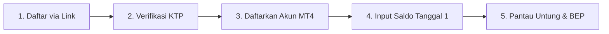
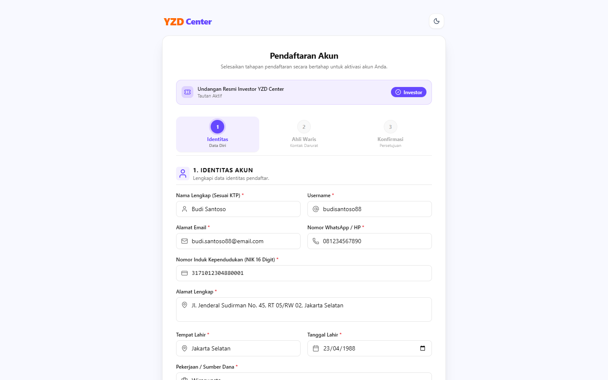
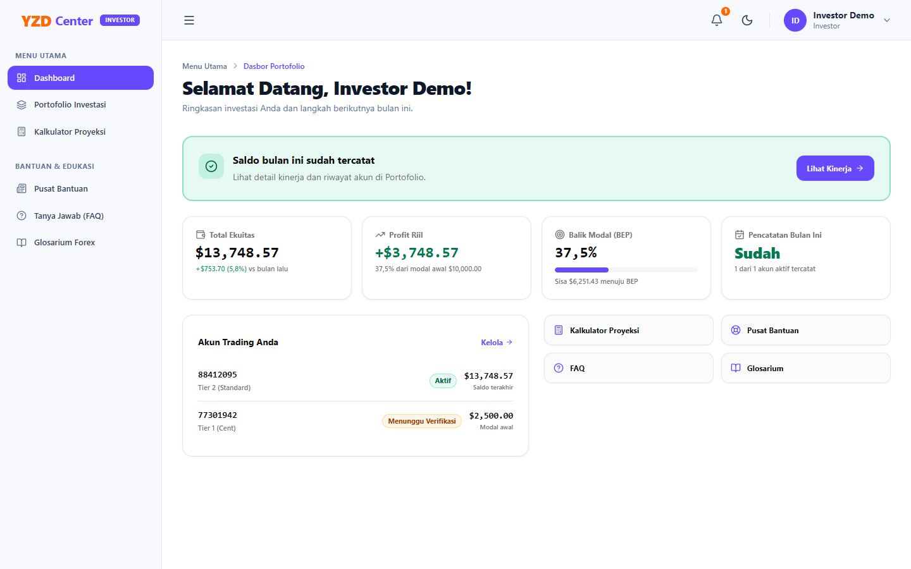
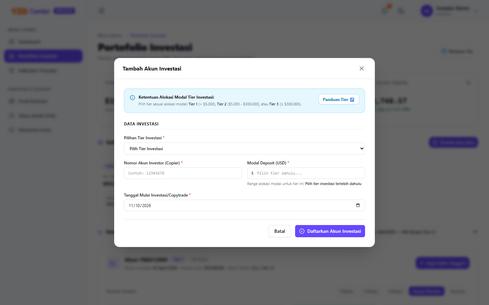
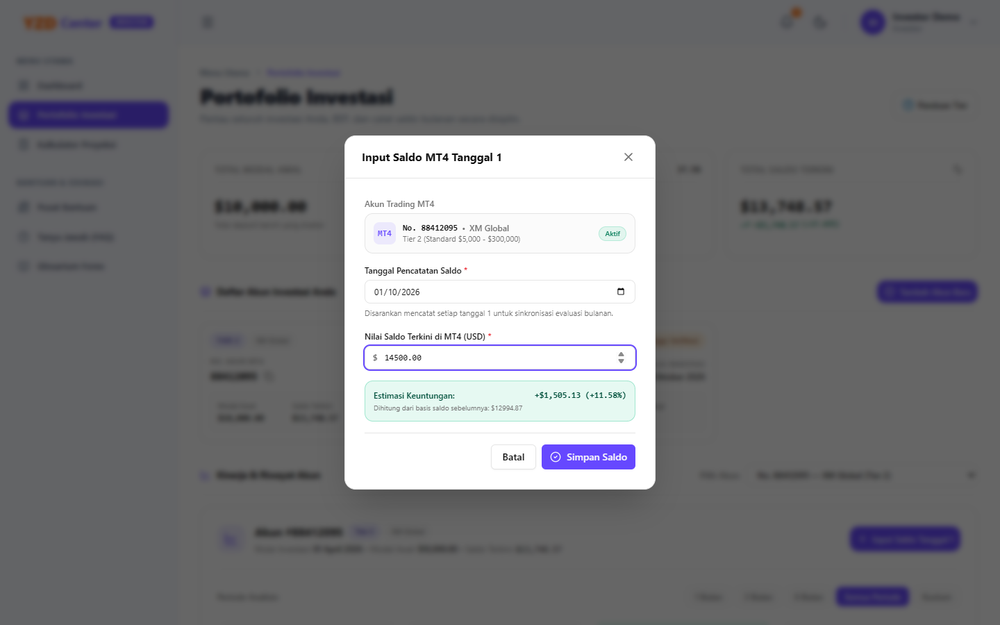
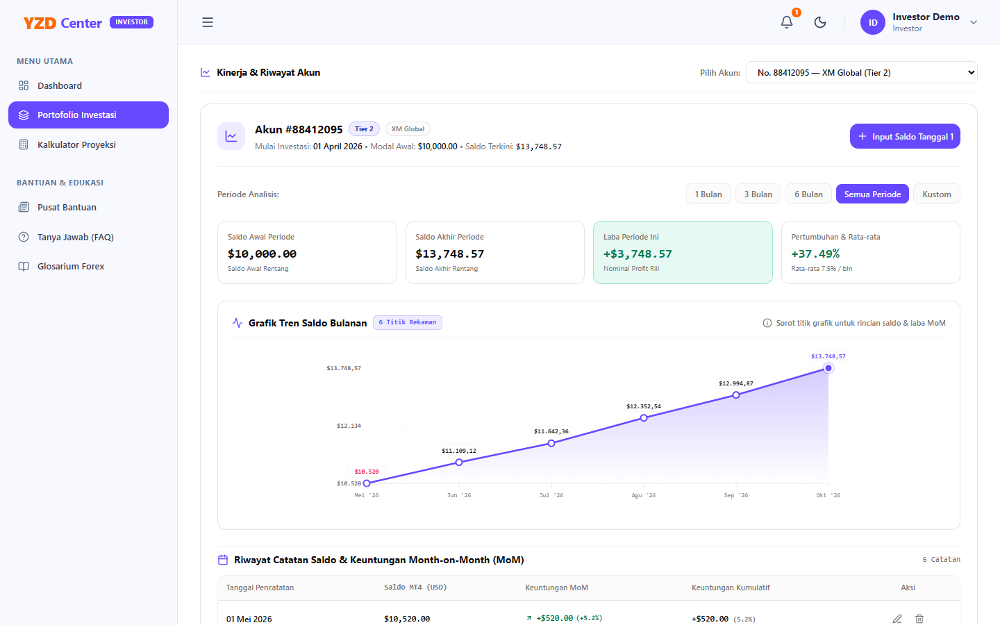
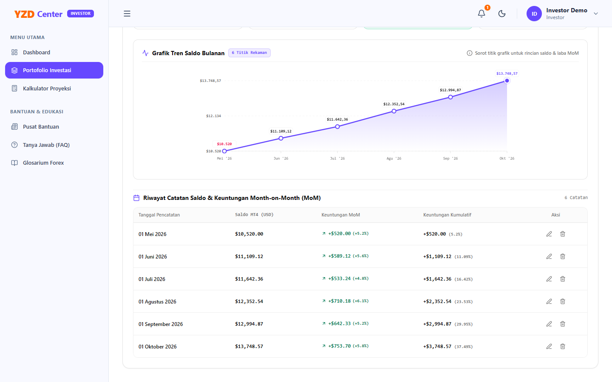

# Panduan Ringkas Pengguna: Portal Investor YZD Center
*(Khusus Pengguna Awam / Non-IT)*

Buku panduan ini disusun dengan bahasa sederhana tanpa istilah teknis yang rumit. Ikuti langkah-langkah mudah di bawah ini untuk mengelola akun investasi Anda mulai dari pendaftaran hingga memantau keuntungan bulanan.

---

## 📌 Alur Cepat 5 Langkah Investor

> 📱 **Tips Akses Cepat (Install App ke Layar Depan HP / Komputer):**  
> Setelah berhasil login, Anda dapat mengeklik tombol ungu **"Install App"** di bilah atas layar (di samping lonceng notifikasi) untuk menambahkan pintasan aplikasi YZD Center langsung ke layar utama (*Home Screen*) HP atau desktop Anda. Aplikasi akan terbuka penuh layaknya aplikasi bawaan tanpa perlu membuka browser secara manual.

---

## Langkah 1: Mendaftar Akun Baru (Via Tautan Undangan)

Pendaftaran di YZD Center bersifat eksklusif dan hanya bisa dilakukan jika Anda menerima **Tautan Undangan Resmi** dari Administrator.

1. Buka tautan undangan yang Anda terima di aplikasi browser HP atau komputer (misal: `http://localhost:8000/register?invitation=KODE_ANDA`).
2. Isi formulir pendaftaran 3 langkah berikut:
   - **Bagian 1 (Data Diri):** Masukkan Nama Lengkap, NIK (16 digit sesuai KTP), Tempat & Tanggal Lahir, Nomor HP (WhatsApp aktif), Alamat, Pekerjaan, Username, Kata Sandi, serta **Unggah Foto KTP** yang jelas dan terbaca.
   - **Bagian 2 (Ahli Waris):** Masukkan Nama Ahli Waris, Hubungan Keluarga (misal: Istri, Anak, Orang Tua), Nomor HP, dan Alamat Ahli Waris. Bagian ini penting untuk perlindungan hukum dana Anda.
   - **Bagian 3 (Konfirmasi):** Centang persetujuan syarat ketentuan, lalu klik tombol **"Kirim Pendaftaran"**.
3. Pendaftaran Anda selesai dan masuk ke antrean pemeriksaan oleh Administrator.

---

## Langkah 2: Masuk ke Akun & Cek Status Verifikasi KTP

1. Buka alamat sistem di peramban web: [http://localhost:8000/login](http://localhost:8000/login).
2. Masukkan **Username** dan **Kata Sandi** yang telah Anda buat pada Langkah 1, lalu klik **"Masuk"**.
3. **Cek Status Dokumen:**
   - Masuk ke menu **Informasi Akun** (ikon pengguna di bilah samping).
   - Jika status bertuliskan **"Disetujui"** (ikon hijau), seluruh menu utama (Dashboard & Portofolio) sudah terbuka dan siap digunakan.
   - Jika status bertuliskan **"Perlu Revisi"** (ikon kuning), baca catatan yang diberikan Admin (misalnya foto KTP buram), lalu tekan tombol **"Unggah Ulang KTP"** untuk mengirimkan foto yang baru.

---

## Langkah 3: Menambahkan Akun Trading (Copytrade)

Setelah akun Anda disetujui, daftarkan akun MetaTrader 4 (MT4) Anda yang telah terhubung ke program copytrade:

1. Buka menu **Portofolio Investasi** di bilah samping kiri.
2. Klik tombol biru **"Tambah Akun Investasi"** di kanan atas.
3. Isi data akun trading Anda:
   - **Tier Investasi:** Pilih sesuai nominal modal Anda (misal: **Tier 1** untuk modal \$100 – \$4.999).
   - **Nomor Akun Trading:** Nomor akun MT4 Anda di broker resmi (misal: broker HFM tipe akun Cent).
   - **Modal Awal (USD):** Jumlah modal riil yang Anda setorkan (misal: \$100.00).
   - **Tanggal Mulai Trading:** Tanggal akun Anda mulai berjalan.
   - **Rekening Penarikan:** Masukkan Nama Bank (BCA, Mandiri, dll.), Nomor Rekening, dan Nama Pemilik Rekening (harus sama dengan nama KTP Anda).
   - **Surat Perjanjian:** Unggah berkas Surat Perjanjian Kemitraan bermaterai (khusus untuk akun pertama Anda).
4. Klik tombol **"Kirim Pendaftaran Akun"**. Akun Anda akan ditinjau Admin dalam waktu 1x24 jam hingga berubah status menjadi **Aktif**.

---

## Langkah 4: Tugas Rutin — Mengisi Saldo Setiap Tanggal 1 Awal Bulan

Ini adalah satu-satunya tugas rutin Anda setiap bulan untuk memastikan perkembangan modal tercatat rapi:

1. Setiap **tanggal 1 awal bulan**, buka aplikasi MetaTrader 4 (MT4) di HP Anda dan lihat angka **Balance (Saldo)** terakhir.
2. Buka Portal YZD Center $\rightarrow$ menu **Portofolio Investasi**.
3. Pada kartu akun Anda, klik tombol **"Input Saldo Tanggal 1"**.
4. Ketikkan angka saldo MT4 terkini pada kolom yang tersedia (misal: `110.00`). Sistem akan langsung menampilkan pratinjau keuntungan Anda (misal: `+$10.00`).
5. Klik **"Simpan Saldo"**.

> [!TIP]
> **Lupa Catat Tanggal 1?**  
> Jika Anda terlambat beberapa hari, sistem tetap mengizinkan pengisian saldo susulan. Cukup pilih tanggal yang sesuai pada jendela input saldo.

---

## Langkah 5: Cara Membaca Grafik Keuntungan & Balik Modal (BEP)

Pada halaman **Dashboard** dan **Portofolio Investasi**, Anda dapat melihat laporan keuangan yang sangat mudah dipahami:

1. **Kotak Balik Modal (BEP):**
   - Menampilkan persentase pencapaian balik modal modal Anda dari 0% hingga 100%.
   - Jika sudah mencapai 100%, artinya total keuntungan yang dihasilkan sudah setara dengan modal awal Anda (modal sudah kembali utuh).
2. **Grafik Pertumbuhan Saldo:**
   - Garis grafik yang menanjak ke atas menunjukkan saldo modal Anda terus bertumbuh.
   - Sentuh atau arahkan kursor ke titik-titik pada grafik untuk melihat rincian saldo dan keuntungan per bulan.

3. **Tabel Riwayat Saldo:**
   - **Warna Hijau (`+$...`):** Menandakan Anda mendapatkan keuntungan (*profit*) pada bulan tersebut.
   - **Warna Merah (`-$...`):** Menandakan terjadi penurunan pasar (*drawdown*) pada bulan tersebut.
   - **Warna Abu-abu Netral (`$0.00` / `—`):** Menandakan saldo sama persis dengan bulan sebelumnya (tidak ada penambahan/pengurangan).

---

## 🛠️ Fitur Pendukung yang Perlu Anda Ketahui

- **Tiket Bantuan & Kendala (Bantuan & Edukasi):**  
  Mengalami kendala akun, deposit MT4, atau pertanyaan seputar copytrade? Buka menu **Tiket Bantuan** $\rightarrow$ klik **"Buat Tiket Baru"**. Anda dapat mengunggah foto bukti kendala dan berdiskusi langsung dengan tim admin melalui percakapan resmi.

- **Kalkulator Proyeksi (Menu Utama):**  
  Ingin tahu simulasi modal Anda jika berkembang selama 1 hingga 5 tahun ke depan? Buka menu **Kalkulator Proyeksi**, masukkan rencana modal Anda, lalu geser persentase estimasi keuntungan untuk melihat tabel simulasi tahunan.
- **Pusat Bantuan & FAQ (Bantuan & Edukasi):**  
  Jika ada yang kurang jelas, buka menu **Tanya Jawab (FAQ)** atau **Pusat Bantuan**. Seluruh pertanyaan umum sudah terjawab lengkap di sana.
- **Lonceng Notifikasi (`🔔`):**  
  Periksa ikon lonceng di pojok kanan atas layar untuk melihat pesan masuk dari Admin mengenai status akun Anda.

---

## 💡 Pertanyaan yang Sering Ditanyakan (FAQ Singkat)

- **Apakah saya bisa mendaftar lebih dari satu akun MT4?**  
  Bisa! Cukup tekan tombol **"Tambah Akun Investasi"** kembali untuk setiap akun trading baru Anda.
- **Apakah saya perlu mengirim ulang foto KTP setiap kali menambah akun?**  
  Tidak perlu. Verifikasi KTP hanya dilakukan satu kali saat pertama kali Anda mendaftar.
- **Bagaimana jika saya ingin mengganti kata sandi?**  
  Klik nama Anda di pojok kanan atas $\rightarrow$ pilih **Ganti Password**.

---

## 📞 Butuh Bantuan Tambahan?
Buka menu **Pusat Bantuan** di portal Anda atau hubungi layanan Administrator melalui kontak resmi yang tertera di dokumen legalitas Anda.
