# Buku Panduan Pengguna (Manual Book) — Portal Investor YZD Center

**Versi Dokumen:** 1.0  
**Target Pengguna:** Investor YZD Center  
**Platform:** Aplikasi Web YZD Center (Desktop & Perangkat Seluler)

---

## Daftar Isi

1. [Bab 1: Pendahuluan & Gambaran Umum Alur Investor](#bab-1-pendahuluan--gambaran-umum-alur-investor)
   - [1.1 Tentang Portal Investor YZD Center](#11-tentang-portal-investor-yzd-center)
   - [1.2 Peta Perjalanan Pengguna (Alur Hulu ke Hilir)](#12-peta-perjalanan-pengguna-alur-hulu-ke-hilir)
   - [1.3 Mengenal Tata Letak Layar & Navigasi](#13-mengenal-tata-letak-layar--navigasi)
   - [1.4 Akses Cepat Aplikasi (Instalasi Semi-PWA di Smartphone & Desktop)](#14-akses-cepat-aplikasi-instalasi-semi-pwa-di-smartphone--desktop)
2. [Bab 2: Pendaftaran Akun (Via Tautan Undangan) & Masuk ke Sistem](#bab-2-pendaftaran-akun-via-tautan-undangan--masuk-ke-sistem)
   - [2.1 Ketentuan Eksklusif Pendaftaran Berbasis Undangan](#21-ketentuan-eksklusif-pendaftaran-berbasis-undangan)
   - [2.2 Langkah Demi Langkah Pendaftaran Akun Baru](#22-langkah-demi-langkah-pendaftaran-akun-baru)
   - [2.3 Tabel Ketentuan Pengisian Formulir Pendaftaran](#23-tabel-ketentuan-pengisian-formulir-pendaftaran)
   - [2.4 Cara Masuk ke Sistem (Login)](#24-cara-masuk-ke-sistem-login)
   - [2.5 Kondisi Khusus (Edge Cases) & Solusi pada Pendaftaran & Login](#25-kondisi-khusus-edge-cases--solusi-pada-pendaftaran--login)
3. [Bab 3: Informasi Akun & Verifikasi Dokumen Legalitas (KYC)](#bab-3-informasi-akun--verifikasi-dokumen-legalitas-kyc)
   - [3.1 Memeriksa Data Identitas, Ahli Waris & Dokumen](#31-memeriksa-data-identitas-ahli-waris--dokumen)
   - [3.2 Mengenal Status Verifikasi Dokumen](#32-mengenal-status-verifikasi-dokumen)
   - [3.3 Prosedur Revisi / Unggah Ulang Dokumen yang Ditolak](#33-prosedur-revisi--unggah-ulang-dokumen-yang-ditolak)
   - [3.4 Tabel Ketentuan Berkas Legalitas](#34-tabel-ketentuan-berkas-legalitas)
   - [3.5 Kondisi Khusus (Edge Cases) & Solusi pada Verifikasi Akun](#35-kondisi-khusus-edge-cases--solusi-pada-verifikasi-akun)
4. [Bab 4: Menu Utama 1 — Dashboard Portofolio](#bab-4-menu-utama-1--dashboard-portofolio)
   - [4.1 Fungsi Utama Halaman Dashboard](#41-fungsi-utama-halaman-dashboard)
   - [4.2 Membaca 4 Kartu Metrik Utama](#42-membaca-4-kartu-metrik-utama)
   - [4.3 Daftar Akun Trading & Pintasan Cepat](#43-daftar-akun-trading--pintasan-cepat)
   - [4.4 Kondisi Khusus (Edge Cases) & Solusi pada Dashboard](#44-kondisi-khusus-edge-cases--solusi-pada-dashboard)
5. [Bab 5: Menu Utama 2 — Portofolio Investasi & Pencatatan Saldo Bulanan](#bab-5-menu-utama-2--portofolio-investasi--pencatatan-saldo-bulanan)
   - [5.1 Ringkasan Konsolidasi & Progres Balik Modal (BEP)](#51-ringkasan-konsolidasi--progres-balik-modal-bep)
   - [5.2 Mendaftarkan Akun Investasi / Copytrade Baru](#52-mendaftarkan-akun-investasi--copytrade-baru)
   - [5.3 Tabel Ketentuan Tier Investasi & Rentang Modal](#53-tabel-ketentuan-tier-investasi--rentang-modal)
   - [5.4 Memantau Kinerja Akun & Grafik Tren Saldo Bulanan](#54-memantau-kinerja-akun--grafik-tren-saldo-bulanan)
   - [5.5 Disiplin Pencatatan: Input Saldo Tanggal 1](#55-disiplin-pencatatan-input-saldo-tanggal-1)
   - [5.6 Mengelola Tabel Riwayat Catatan Saldo (Ubah & Hapus)](#56-mengelola-tabel-riwayat-catatan-saldo-ubah--hapus)
   - [5.7 Kondisi Khusus (Edge Cases) & Solusi pada Portofolio Investasi](#57-kondisi-khusus-edge-cases--solusi-pada-portofolio-investasi)
6. [Bab 6: Menu Utama 3 — Kalkulator Proyeksi Investasi](#bab-6-menu-utama-3--kalkulator-proyeksi-investasi)
   - [6.1 Fungsi Kalkulator Proyeksi](#61-fungsi-kalkulator-proyeksi)
   - [6.2 Langkah Penggunaan & Pengaturan Parameter Simulasi](#62-langkah-penggunaan--pengaturan-parameter-simulasi)
   - [6.3 Membaca Hasil Proyeksi, Grafik & Tabel Rincian Tahunan](#63-membaca-hasil-proyeksi-grafik--tabel-rincian-tahunan)
   - [6.4 Kondisi Khusus (Edge Cases) pada Kalkulator Proyeksi](#64-kondisi-khusus-edge-cases-pada-kalkulator-proyeksi)
7. [Bab 7: Menu Bantuan & Edukasi (Pusat Bantuan, FAQ & Glosarium Forex)](#bab-7-menu-bantuan--edukasi-pusat-bantuan-faq--glosarium-forex)
   - [7.1 Pusat Bantuan (Artikel Panduan Lengkap)](#71-pusat-bantuan-artikel-panduan-lengkap)
   - [7.2 Tanya Jawab (FAQ)](#72-tanya-jawab-faq)
   - [7.3 Glosarium Forex (Kamus Istilah Trading)](#73-glosarium-forex-kamus-istilah-trading)
   - [7.4 Kondisi Khusus (Edge Cases) pada Menu Bantuan & Edukasi](#74-kondisi-khusus-edge-cases-pada-menu-bantuan--edukasi)
8. [Bab 8: Pengaturan Akun, Notifikasi & Keamanan (Ganti Password)](#bab-8-pengaturan-akun-notifikasi--keamanan-ganti-password)
   - [8.1 Mengelola Notifikasi Sistem](#81-mengelola-notifikasi-sistem)
   - [8.2 Mengganti Kata Sandi (Password) Akun](#82-mengganti-kata-sandi-password-akun)
   - [8.3 Pengaturan Tampilan (Mode Terang / Gelap) & Keluar Akun (Logout)](#83-pengaturan-tampilan-mode-terang--gelap--keluar-akun-logout)
   - [8.4 Kondisi Khusus (Edge Cases) pada Notifikasi & Keamanan](#84-kondisi-khusus-edge-cases-pada-notifikasi--keamanan)

---

## Bab 1: Pendahuluan & Gambaran Umum Alur Investor

### 1.1 Tentang Portal Investor YZD Center
**Portal Investor YZD Center** adalah sistem manajemen portofolio terpadu yang dirancang khusus untuk memudahkan Anda sebagai Investor dalam:
- Mengelola identitas legalitas (*Know Your Customer* / KYC) serta data perlindungan ahli waris secara aman.
- Mendaftarkan dan memantau seluruh akun trading MetaTrader 4 (MT4) yang terhubung ke layanan *copytrade*.
- Melacak capaian **Progres Balik Modal (*Break-Even Point* / BEP)** serta pertumbuhan keuntungan bulanan (*Month-on-Month* / MoM) secara transparan.
- Menghitung simulasi proyeksi pertumbuhan modal jangka panjang dan mengakses materi edukasi investasi kapan saja.

---

### 1.2 Peta Perjalanan Pengguna (Alur Hulu ke Hilir)
Berikut adalah diagram alur perjalanan Anda sebagai Investor sejak menerima tautan undangan hingga memantau perkembangan portofolio secara rutin setiap bulan:

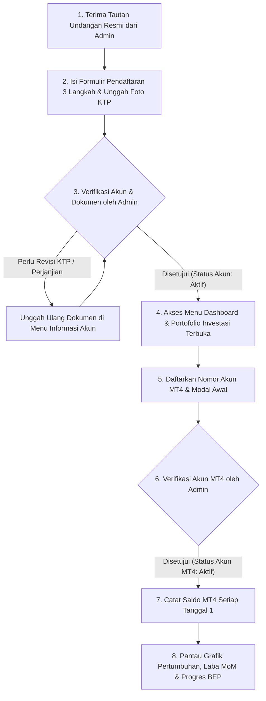

---

### 1.3 Mengenal Tata Letak Layar & Navigasi
Saat masuk ke dalam sistem, layar Anda terbagi menjadi tiga area utama:
1. **Bilah Navigasi Samping (*Sidebar* Kiri):**
   - **Menu Utama:** Berisi menu **Dashboard**, **Portofolio Investasi**, dan **Kalkulator Proyeksi**.
   - **Bantuan & Edukasi:** Berisi menu **Pusat Bantuan**, **Tanya Jawab (FAQ)**, dan **Glosarium Forex**.
   - *(Pada layar ponsel/HP, bilah samping ini dapat dibuka dengan menekan tombol ikon garis tiga `☰` di pojok kiri atas).*
2. **Bilah Atas (*Header*):**
   - Menampilkan jalur halaman (*breadcrumb*) di sisi kiri.
   - Menampilkan **Tombol "Install App"** (untuk akses cepat PWA), garis pembatas vertikal, **Ikon Lonceng Notifikasi** (beserta jumlah pesan belum dibaca), **Tombol Tema Tampilan** (Mode Terang/Gelap), dan **Menu Profil Pengguna** di pojok kanan atas.
3. **Area Kerja Utama (Tengah):**
   - Menampilkan isi halaman, grafik kinerja, tabel riwayat, serta jendela formulir (*modal*) sesuai menu yang sedang Anda pilih.

---

### 1.4 Akses Cepat Aplikasi (Instalasi Semi-PWA di Smartphone & Desktop)

Untuk memudahkan Anda dalam mengecek performa portofolio dan menginput saldo bulanan tanpa perlu berulang kali membuka peramban web dan mengetik alamat URL, portal YZD Center mendukung teknologi **Semi-PWA (*Progressive Web App*)**. Anda dapat menambahkan ikon aplikasi YZD Center langsung ke layar utama (*Home Screen*) HP atau desktop komputer Anda tanpa perlu mengunduh aplikasi berbayar atau file berukuran besar dari Google Play Store / Apple App Store.

#### Karakteristik & Tampilan Tombol:
- **Di Layar Komputer / Laptop (`sm:` ke atas):** Tombol solid warna ungu (*Violet-600*) bertuliskan **"Install App"** dengan ikon unduh putih.
- **Di Layar Smartphone / Ponsel (`< 640px`):** Tombol ikon ungu berukuran `38x38px` yang pas untuk sentuhan jari (*touch target*) tanpa memakan ruang header.

#### Cara Memasang Aplikasi:
1. **Melalui Browser Chrome / Edge (Android, Windows, atau Mac):**
   - Klik tombol **"Install App"** di bagian atas layar.
   - Kotak konfirmasi peramban akan muncul: *"Install app YZD Center?"*.
   - Pilih **Install**. Ikon pintasan YZD Center akan langsung dibuat di layar beranda ponsel atau taskbar komputer Anda.
2. **Melalui Browser Safari (iPhone / iPad):**
   - Klik tombol **"Install App"** di bagian header.
   - Jendela panduan interaktif 3 langkah akan muncul di layar:
     1. Ketuk tombol **Bagikan (*Share*)** (ikon kotak panah ke atas di bagian bawah Safari).
     2. Gulir menu ke bawah lalu pilih opsi **Tambah ke Layar Utama (*Add to Home Screen*)**.
     3. Ketuk **Tambah (*Add*)** di pojok kanan atas. Pintasan YZD Center akan langsung siap digunakan di layar utama iPhone Anda.

> [!TIP]
> **Tampilan Mandiri (*Standalone Mode*):**  
> Saat Anda membuka YZD Center melalui ikon aplikasi yang telah dipasang, aplikasi akan berjalan penuh tanpa bilah alamat URL peramban (layaknya aplikasi *native*). Pada mode ini, tombol "Install App" akan otomatis disembunyikan.

---

## Bab 2: Pendaftaran Akun (Via Tautan Undangan) & Masuk ke Sistem

### 2.1 Ketentuan Eksklusif Pendaftaran Berbasis Undangan
YZD Center menerapkan sistem pendaftaran tertutup berbasis undangan (*invitation-only*) demi menjaga keamanan komunitas investor. Anda **tidak dapat** mendaftar secara bebas tanpa tautan undangan resmi yang masih aktif dari Administrator YZD Center.

---

### 2.2 Langkah Demi Langkah Pendaftaran Akun Baru

#### Langkah 1: Pengisian Identitas Akun & Unggah Foto KTP
1. Buka tautan undangan resmi yang Anda terima dari Administrator pada peramban (*browser*) perangkat Anda.
2. Pastikan pada bagian atas formulir muncul keterangan lencana **"Tautan Aktif"** dengan peran **"Investor"**.
3. Lengkapi data identitas diri sesuai KTP: **Nama Lengkap**, **Username**, **Alamat Email**, **Nomor WhatsApp/HP**, **NIK (16 Digit)**, **Alamat Lengkap**, **Tempat Lahir**, **Tanggal Lahir**, dan **Pekerjaan / Sumber Dana**.
4. Buat **Kata Sandi** (minimal 8 karakter) dan ketik ulang pada kolom **Konfirmasi Kata Sandi**.
5. Pada kotak **Foto KTP**, klik area unggah atau seret berkas foto KTP asli Anda (`JPG`, `JPEG`, atau `PNG`, maksimal `10 MB`). Sistem akan otomatis mengoptimalkan ukuran foto dan menampilkan pratinjau gambarnya.
6. Klik tombol **"Lanjutkan ke Data Ahli Waris"** di bagian bawah formulir.

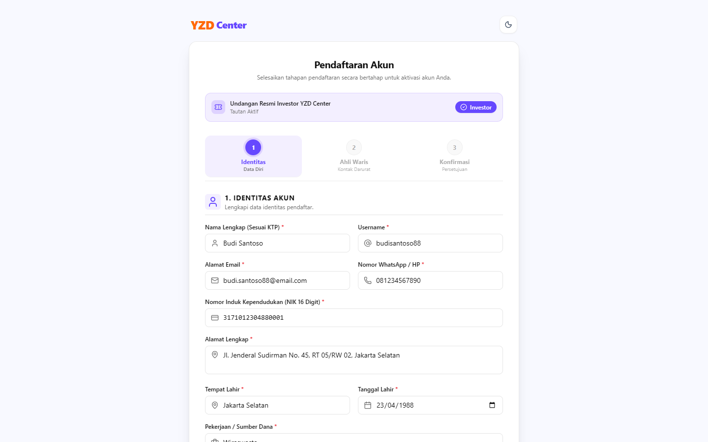

#### Langkah 2: Pengisian Data Perlindungan Ahli Waris
1. Masukkan **Nama Lengkap Ahli Waris** yang sah (keluarga inti yang berhak atas perlindungan aset investasi Anda).
2. Pilih **Hubungan / Relasi** dari daftar pilihan (*Anak*, *Istri*, *Suami*, *Orang Tua*, *Saudara Kandung*, atau *Lainnya*).
3. Masukkan **Nomor WhatsApp / HP Ahli Waris** yang aktif. Pastikan nomor ini **berbeda** dari nomor telepon pribadi Anda pada Langkah 1.
4. Isi **Alamat Ahli Waris** secara lengkap, lalu klik tombol **"Lanjutkan ke Konfirmasi"**.

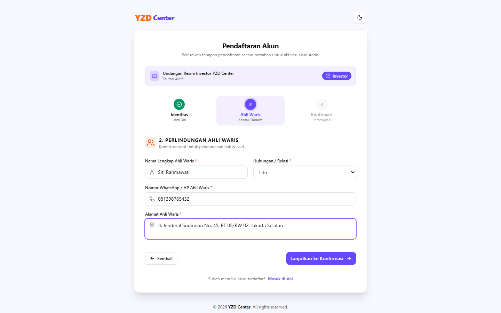

#### Langkah 3: Konfirmasi Data, Kode Referral & Persetujuan
1. Periksa kembali ringkasan **Data Identitas Diri** dan **Data Ahli Waris**. Jika ada data yang ingin diperbaiki, klik tombol **"Ubah"** di sudut kanan atas masing-masing kotak untuk kembali ke langkah sebelumnya.
2. **Kode Referral Affiliator (Opsional):** Jika Anda direkomendasikan oleh mitra *Affiliator* YZD Center, masukkan kode referral mereka pada kolom yang tersedia lalu klik tombol **"Periksa"**. Jika kode valid, akan muncul keterangan hijau berisi nama mitra *Affiliator* tersebut. Jika tidak ada, biarkan kosong.
3. Bacalah **Syarat & Ketentuan Layanan** serta **Kebijakan Privasi** dengan mengeklik tautan berwarna biru (jendela bacaan akan terbuka).
4. Beri tanda centang (`✓`) pada kotak persetujuan, kemudian klik tombol **"Kirim Pendaftaran"**.

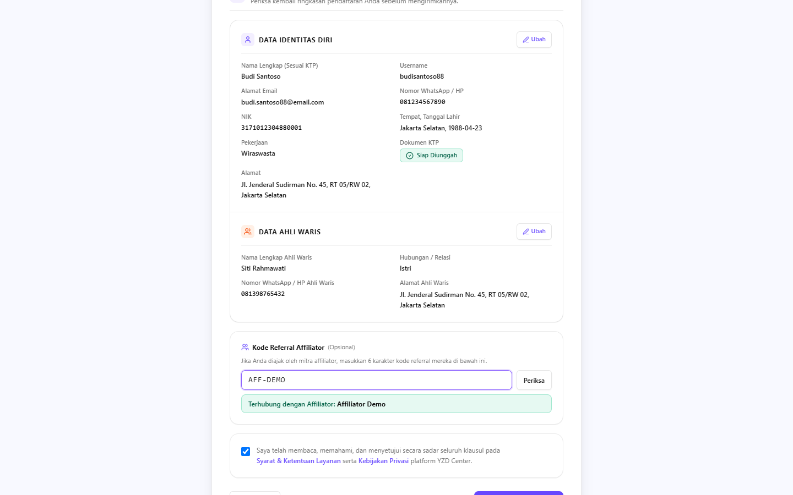

---

### 2.3 Tabel Ketentuan Pengisian Formulir Pendaftaran

| Nama Kolom | Sifat | Ketentuan & Format Pengisian |
| :--- | :--- | :--- |
| **Nama Lengkap** | Wajib | Sesuai KTP yang berlaku, maksimal 255 karakter. |
| **Username** | Wajib | Minimal 3 karakter, unik (belum dipakai pengguna lain), hanya boleh huruf, angka, dan garis bawah (`_`) tanpa spasi. |
| **Alamat Email** | Wajib | Format email aktif dan valid (contoh: `nama@email.com`), belum pernah terdaftar. |
| **Nomor WhatsApp / HP** | Wajib | Minimal 9 digit angka, maksimal 20 karakter. |
| **NIK KTP** | Wajib | Tepat **16 digit angka** sesuai Kartu Tanda Penduduk. |
| **Tempat & Tanggal Lahir** | Wajib | Kota kelahiran dan tanggal lahir sesuai KTP. |
| **Pekerjaan / Sumber Dana** | Wajib | Profesi atau sumber dana investasi (contoh: *Wiraswasta*, *Karyawan Swasta*). |
| **Kata Sandi** | Wajib | Minimal **8 karakter**, harus sama persis dengan kolom Konfirmasi Kata Sandi. |
| **Foto KTP** | Wajib | Format gambar `JPG`, `JPEG`, atau `PNG`. Ukuran berkas maksimal **10 MB**. |
| **Nomor HP Ahli Waris** | Wajib | Nomor aktif (9–20 digit) dan **wajib berbeda** dari nomor HP pendaftar. |
| **Kode Referral Affiliator** | Opsional | Kode 6–12 karakter dari mitra *Affiliator* (jika ada). |

---

### 2.4 Cara Masuk ke Sistem (Login)
1. Buka halaman masuk YZD Center melalui alamat `/login`.
2. Masukkan **Username atau Email** yang telah Anda daftarkan.
3. Masukkan **Kata Sandi** akun Anda (klik ikon mata di sisi kanan kolom jika ingin melihat ketikan kata sandi).
4. Opsional: Centang **"Ingat saya di perangkat ini"** jika Anda menggunakan perangkat pribadi agar tidak perlu masuk berulang kali.
5. Klik tombol **"Masuk"**.

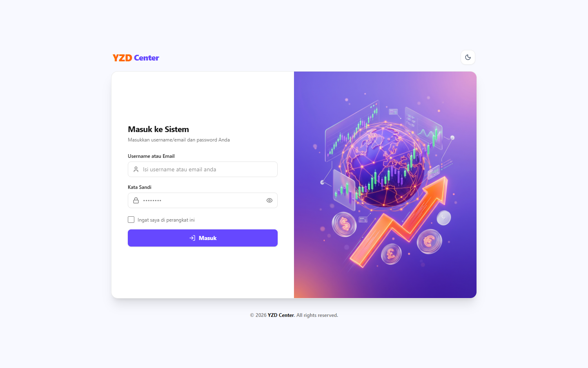

---

### 2.5 Kondisi Khusus (Edge Cases) & Solusi pada Pendaftaran & Login

> [!WARNING]
> **Perhatikan kondisi-kondisi khusus berikut apabila Anda mengalami kendala saat mendaftar atau masuk ke dalam sistem:**

1. **Pesan "Tautan Undangan Tidak Valid" Saat Membuka Halaman Pendaftaran:**
   - **Penyebab:** Anda membuka halaman `/register` tanpa kode undangan, tautan undangan sudah melewati batas waktu berlaku (*kedaluwarsa*), kuota penggunaan tautan sudah habis, atau tautan telah dicabut oleh Administrator.
   - **Solusi:** Hubungi Administrator YZD Center untuk meminta tautan undangan baru yang masih aktif.

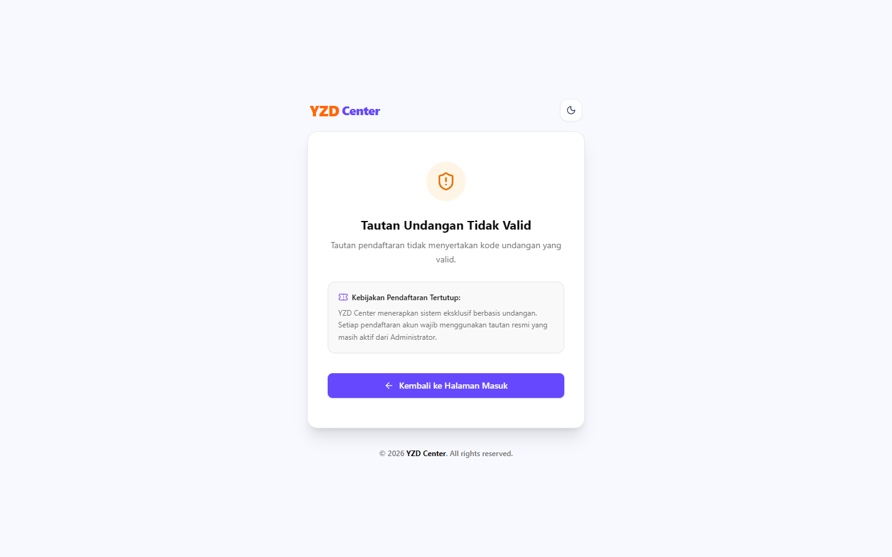

2. **Muncul "Peringatan Kualitas: Foto KTP Terindikasi Buram" Saat Mengunggah KTP:**
   - **Penyebab:** Sistem pendeteksi ketajaman gambar menemukan bahwa foto KTP yang Anda pilih memiliki resolusi terlalu rendah atau sedikit kabur (*blur*).
   - **Perilaku Sistem:** Sistem **tidak memblokir** pendaftaran Anda dan otomatis mengompres ukuran berkas di latar belakang agar cepat terunggah. Namun, tanda peringatan ini juga akan terlihat oleh Administrator saat meninjau akun Anda.
   - **Solusi:** Sangat disarankan menekan tombol **"Ganti Foto KTP"** dan memotret ulang KTP di tempat terang agar NIK serta nama terbaca tajam dan verifikasi akun Anda langsung disetujui tanpa revisi.

3. **Tidak Bisa Lanjut dari Langkah 2 karena Nomor HP Ahli Waris Ditolak:**
   - **Penyebab:** Anda memasukkan nomor WhatsApp/HP yang sama persis dengan nomor HP pribadi Anda pada Langkah 1.
   - **Solusi:** Demi fungsi kontak darurat, gunakan nomor telepon milik ahli waris yang bersangkutan (berbeda dari nomor pribadi Anda).

4. **Muncul Kotak Konfirmasi Saat Menekan Tombol Kembali / Menutup Tab:**
   - **Penyebab:** Anda sudah mulai mengetik data pendaftaran tetapi belum menekan **"Kirim Pendaftaran"**. Sistem menampilkan perlindungan agar data yang sudah Anda ketik tidak hilang secara tidak sengaja.

---

## Bab 3: Informasi Akun & Verifikasi Dokumen Legalitas (KYC)

### 3.1 Memeriksa Data Identitas, Ahli Waris & Dokumen
Halaman **Informasi Akun** dapat diakses kapan saja dengan mengeklik **Nama / Inisial Profil Anda** di pojok kanan atas layar, lalu memilih **"Informasi Akun"**. Halaman ini menampilkan:
- **Kartu Data Identitas:** Nama lengkap, username, email, nomor WhatsApp/HP, NIK, tempat/tanggal lahir, pekerjaan, dan alamat domisili.
- **Kartu Ahli Waris / Kontak Darurat:** Nama ahli waris, hubungan keluarga, nomor kontak darurat, dan alamat domisili ahli waris.
- **Kartu Foto KTP & Surat Perjanjian:** Menampilkan status verifikasi berkas legalitas Anda beserta tombol **"Lihat Berkas"** untuk membuka pratinjau dokumen langsung di layar.

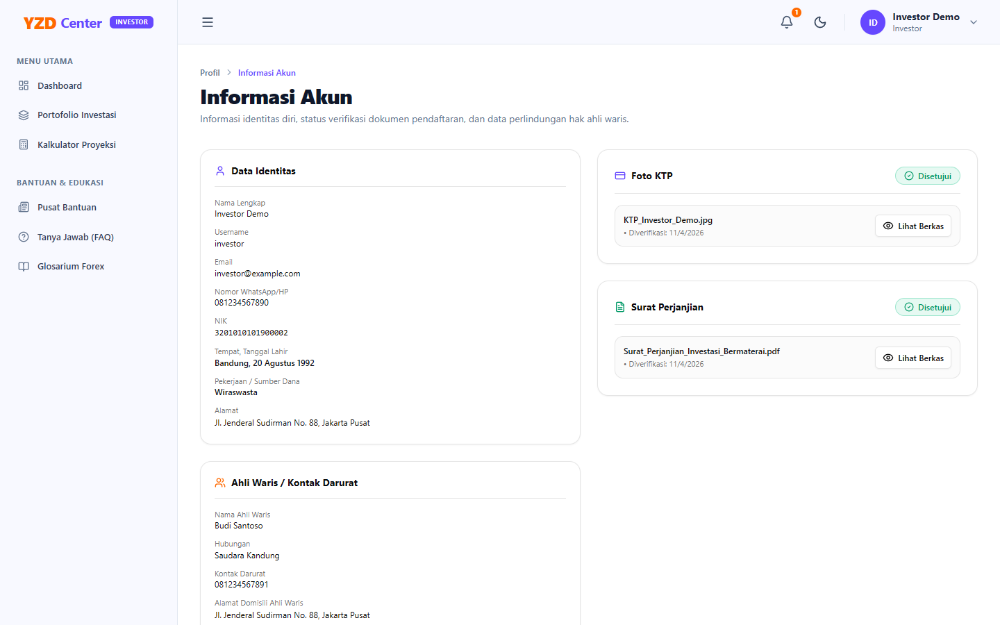

---

### 3.2 Mengenal Status Verifikasi Dokumen
Setiap dokumen legalitas pada halaman Informasi Akun memiliki salah satu dari tiga status berikut:
- **Menunggu Peninjauan (Biru):** Berkas Anda sudah masuk ke sistem dan sedang dalam antrean pemeriksaan Administrator.
- **Disetujui (Hijau):** Berkas telah diverifikasi dan dinyatakan sah oleh Administrator.
- **Perlu Revisi (Oranye/Kuning):** Berkas ditolak sementara oleh Administrator karena alasan tertentu (misalnya foto KTP buram/terpotong atau tanda tangan perjanjian belum sesuai). Anda wajib mengunggah ulang berkas perbaikan.

---

### 3.3 Prosedur Revisi / Unggah Ulang Dokumen yang Ditolak
Apabila dokumen **Foto KTP** atau **Surat Perjanjian** Anda berstatus **"Perlu Revisi"**, ikuti langkah berikut:
1. Buka halaman **Informasi Akun** (jika akun Anda masih berstatus *Pending*, Anda akan otomatis diarahkan ke halaman ini saat login).
2. Perhatikan kotak **"Catatan Administrator"** yang terletak di bawah dokumen yang berstatus **Perlu Revisi**. Bacalah instruksi perbaikan yang diminta oleh Administrator.
3. Klik kotak area **"Klik untuk memilih foto KTP baru"** (atau **"Klik untuk memilih berkas Surat Perjanjian baru"**).
4. Pilih berkas perbaikan dari perangkat Anda, lalu klik tombol **"Kirim Berkas Revisi"**.
5. Status dokumen akan otomatis berubah kembali menjadi **"Menunggu Peninjauan"** dan Administrator akan menerima notifikasi untuk memeriksa berkas baru Anda.

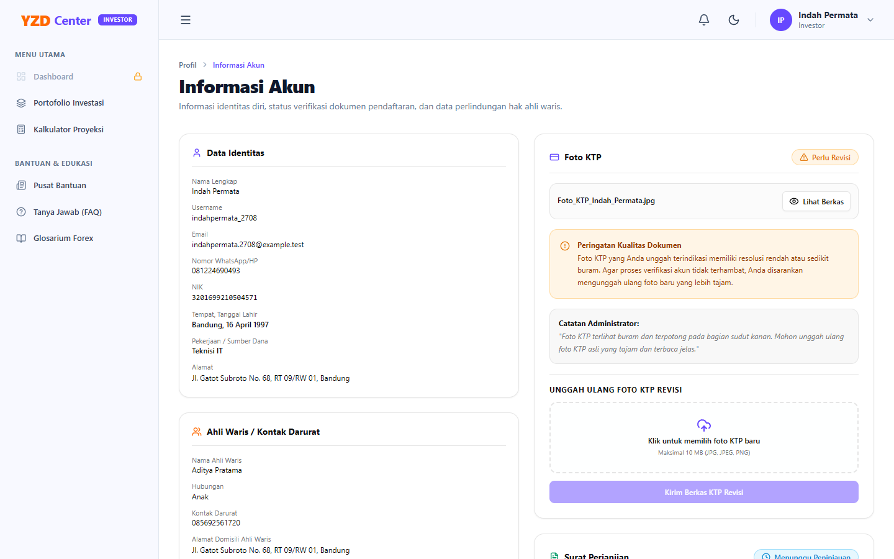

---

### 3.4 Tabel Ketentuan Berkas Legalitas

| Jenis Dokumen | Format yang Diterima | Ukuran Maksimal | Siapa yang Mengunggah Pertama Kali? |
| :--- | :--- | :--- | :--- |
| **Foto KTP** | `JPG`, `JPEG`, `PNG` | **10 MB** (dikompresi otomatis) | Diunggah oleh **Investor** saat pendaftaran akun (Langkah 1). |
| **Surat Perjanjian** | `PDF`, `JPG`, `JPEG`, `PNG` | **10 MB** | Diunggah oleh **Administrator**. Investor hanya dapat mengunggah ulang jika statusnya ditetapkan **"Perlu Revisi"** oleh Admin. |

---

### 3.5 Kondisi Khusus (Edge Cases) & Solusi pada Verifikasi Akun

> [!IMPORTANT]
> **Pahami perilaku sistem berikut saat akun Anda baru saja terdaftar atau sedang dalam proses verifikasi:**

1. **Menu Dashboard Terlihat Redup dengan Ikon Gembok Oranye (`🔒`):**
   - **Penyebab:** Akun Anda baru selesai didaftarkan dan masih berstatus **Menunggu Verifikasi (*Pending*)**, atau dokumen KYC Anda masih berstatus **Perlu Revisi**.
   - **Perilaku Sistem:** Selama akun belum diaktifkan oleh Administrator, jika Anda mengeklik menu **Dashboard** atau **Portofolio Investasi**, sistem akan otomatis mengarahkan Anda kembali ke halaman **Informasi Akun**. Namun, Anda **tetap dapat mengakses** seluruh menu **Bantuan & Edukasi** (*Pusat Bantuan*, *Tanya Jawab/FAQ*, dan *Glosarium Forex*) sambil menunggu proses verifikasi selesai.

2. **Tidak Ada Tombol Unggah pada Kartu "Surat Perjanjian" Saat Pertama Kali Mendaftar:**
   - **Penyebab:** Berbeda dengan Foto KTP, berkas awal **Surat Perjanjian Investasi** diterbitkan dan diunggah oleh Administrator setelah identitas Anda diverifikasi.
   - **Perilaku Sistem:** Jika Administrator belum mengunggah berkas tersebut, kartu Surat Perjanjian akan menampilkan keterangan *"Belum ada berkas Surat Perjanjian yang diunggah oleh Administrator"*. Kolom unggah mandiri bagi Investor hanya akan muncul apabila Administrator meminta Anda melakukan **Revisi** atas berkas Surat Perjanjian tersebut.

3. **Kotak "Peringatan Kualitas Dokumen" Muncul pada Kartu Foto KTP:**
   - **Penyebab:** Foto KTP yang Anda unggah saat pendaftaran terdeteksi memiliki resolusi rendah atau kurang tajam.
   - **Solusi:** Jika Administrator mengubah status KTP menjadi **Perlu Revisi**, segera unggah foto KTP baru dengan pencahayaan yang terang dan fokus yang tajam.

---

## Bab 4: Menu Utama 1 — Dashboard Portofolio

### 4.1 Fungsi Utama Halaman Dashboard
Setelah akun Anda disetujui oleh Administrator (berstatus **Aktif**), halaman **Dashboard** menjadi beranda utama setiap kali Anda masuk ke sistem. Halaman ini merangkum kesehatan finansial seluruh akun investasi Anda dalam satu pandangan cepat.

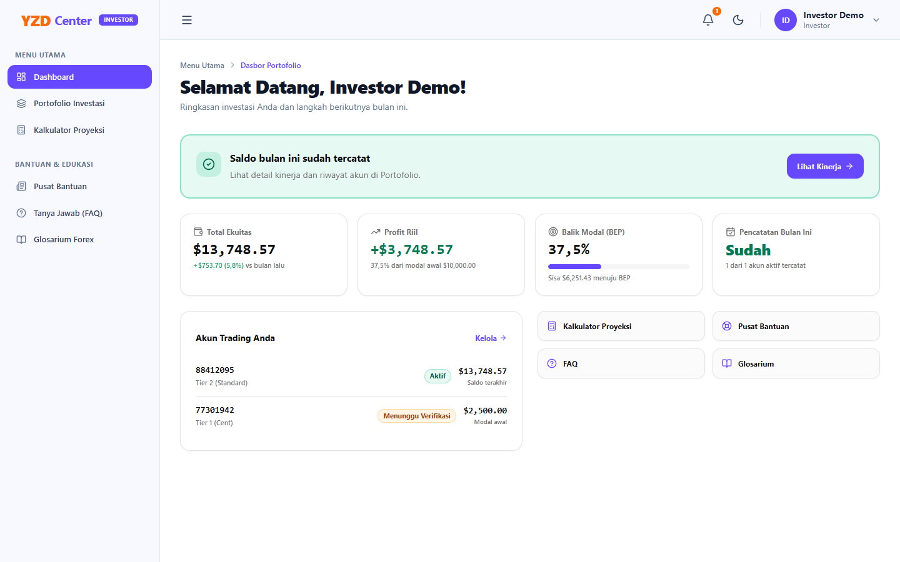

---

### 4.2 Membaca 4 Kartu Metrik Utama
Di bagian atas halaman Dashboard, terdapat 4 kartu indikator kinerja:
1. **Total Modal Awal:** Menampilkan jumlah akumulasi deposit awal (USD) dari seluruh akun investasi Anda yang telah berstatus **Aktif**, beserta jumlah akun aktif dan akun yang masih *pending*.
2. **Total Saldo Terkini:** Menampilkan total nilai saldo terakhir (USD) dari seluruh akun aktif Anda berdasarkan pencatatan saldo terbaru.
3. **Total Keuntungan (ROI):** Menampilkan selisih keuntungan atau kerugian bersih dalam nominal dolar (`+$...`) sekaligus persentase imbal hasil (*Return on Investment* / `%`) terhadap total modal awal.
4. **Progres Balik Modal (BEP):** Menampilkan persentase progres kembalinya modal awal Anda dari akumulasi keuntungan yang telah dicapai, lengkap dengan bilah progres visual dan informasi sisa nominal menuju titik impas (*Break-Even Point* 100%).

---

### 4.3 Daftar Akun Trading & Pintasan Cepat
Di bawah kartu metrik, bagian **Akun Trading Anda** menampilkan kartu-kartu ringkas untuk setiap akun MetaTrader 4 (MT4) yang Anda miliki. Setiap kartu memuat:
- Lencana **Tier Investasi** (*Tier 1*, *Tier 2*, atau *Tier 3*), nama **Broker**, dan **Status Akun** (*Aktif* atau *Menunggu Verifikasi*).
- **Nomor Akun MT4** dan **Tanggal Mulai Investasi**.
- Ringkasan **Modal Awal**, **Saldo Terkini**, dan **Laba / Rugi** masing-masing akun.
- Klik pada salah satu kartu akun atau klik tombol **"Kelola Portofolio & Saldo"** di kanan atas untuk langsung menuju halaman **Portofolio Investasi**.

---

### 4.4 Kondisi Khusus (Edge Cases) & Solusi pada Dashboard

1. **Kartu Akun Berstatus "Menunggu Verifikasi" Tidak Dihitung dalam Total Modal Awal di Atas:**
   - **Penyebab:** Akun investasi baru yang masih berstatus **Menunggu Verifikasi (*Pending*)** belum disetujui oleh Administrator.
   - **Perilaku Sistem:** Agar perhitungan persentase keuntungan (ROI) dan progres balik modal (BEP) tetap akurat dan tidak terdistorsi, sistem **hanya menjumlahkan** modal awal dan saldo dari akun yang sudah berstatus **Aktif**. Pada kartu akun *pending*, kolom Saldo Terkini akan tertulis `Pending` dan Laba/Rugi tertulis `-`.

2. **Tampilan Saat Belum Memiliki Akun Investasi Sama Sekali:**
   - **Perilaku Sistem:** Keempat kartu metrik akan menampilkan nilai `$0.00` (`0%`), dan area daftar akun akan menampilkan tombol pintasan **"Daftarkan Akun Investasi Pertama"** yang langsung mengarahkan Anda ke halaman Portofolio Investasi.

---

## Bab 5: Menu Utama 2 — Portofolio Investasi & Pencatatan Saldo Bulanan

Halaman **Portofolio Investasi** adalah pusat kendali utama bagi Anda untuk mendaftarkan akun trading baru, memantau grafik pertumbuhan saldo dari bulan ke bulan, serta mencatat saldo bulanan setiap tanggal 1.

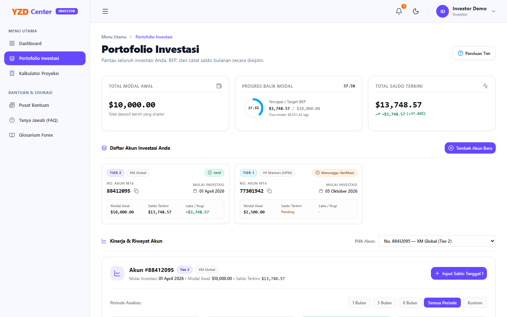

---

### 5.1 Ringkasan Konsolidasi & Progres Balik Modal (BEP)
Bagian teratas halaman menampilkan 3 kartu konsolidasi:
- **Total Modal Awal:** Total deposit bersih yang disetor pada seluruh akun aktif.
- **Progres Balik Modal (Gauge Lingkaran):** Diagram lingkaran persentase pencapaian target balik modal (*Tercapai / Target BEP*) beserta keterangan sisa nominal dolar menuju balik modal 100%.
- **Total Saldo Terkini:** Total nilai saldo terakhir beserta pertumbuhan keuntungan gabungan (`+$...` dan `+%`).
- Di pojok kanan atas halaman, tersedia tombol **"Panduan Tier"** yang dapat Anda klik kapan saja untuk membaca penjelasan skema pembagian *Tier* investasi.

---

### 5.2 Mendaftarkan Akun Investasi / Copytrade Baru
Jika Anda membuka akun trading baru atau menambah alokasi dana pada akun MT4 baru, daftarkan akun tersebut dengan langkah berikut:
1. Pada halaman **Portofolio Investasi**, klik tombol **"Tambah Akun Baru"** di sebelah kanan judul *Daftar Akun Investasi Anda*.
2. Jendela formulir **Tambah Akun Investasi** akan terbuka.
3. Pilih **Pilihan Tier Investasi** sesuai besaran modal yang Anda setorkan (*Tier 1*, *Tier 2*, atau *Tier 3*).
4. Masukkan **Nomor Akun Investor (Copier)** (nomor login akun MetaTrader 4 Anda, hanya berupa angka).
5. Masukkan nominal **Modal Deposit (USD)** sesuai rentang *Tier* yang Anda pilih.
6. Pilih **Tanggal Mulai Investasi/Copytrade** (tanggal akun mulai terhubung ke sistem *copytrade*).
7. Klik tombol **"Daftarkan Akun Investasi"**. Akun baru akan muncul pada daftar dengan status **"Menunggu Verifikasi"** hingga disetujui oleh Administrator.

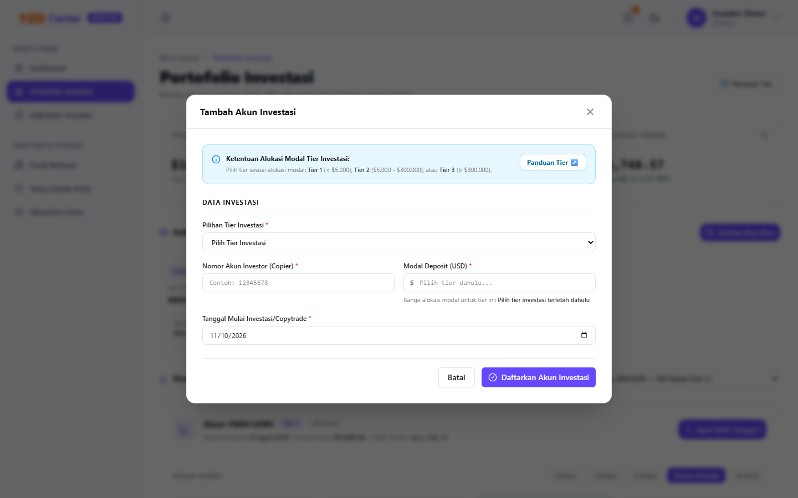

---

### 5.3 Tabel Ketentuan Tier Investasi & Rentang Modal

| Tingkatan Tier | Rentang Modal Deposit (USD) | Keterangan Pengisian di Formulir |
| :--- | :--- | :--- |
| **Tier 1** | **$< \$5,000$** (Minimal $\$1$ s/d $\$4,999.99$) | Pilih *Tier 1* jika modal awal akun MT4 Anda di bawah $\$5,000$. |
| **Tier 2** | **$\$5,000$ – $\$300,000$** | Pilih *Tier 2* jika modal awal akun MT4 Anda antara $\$5,000$ hingga $\$300,000$. |
| **Tier 3** | **$\ge \$300,000$** (Minimal $\$300,000$ ke atas) | Pilih *Tier 3* jika modal awal akun MT4 Anda mencapai $\$300,000$ atau lebih. |

---

### 5.4 Memantau Kinerja Akun & Grafik Tren Saldo Bulanan
Di bawah daftar kartu akun, terdapat seksi **Kinerja & Riwayat Akun**:
1. **Memilih Akun:** Anda dapat memilih akun mana yang ingin dianalisis dengan mengeklik langsung **Kartu Akun** di atasnya, atau melalui kotak pilihan **Pilih Akun** di sebelah kanan.
2. **Memilih Periode Analisis:** Gunakan tombol filter periode (**1 Bulan**, **3 Bulan**, **6 Bulan**, **Semua Periode**, atau **Kustom** dengan memilih rentang tanggal awal dan akhir) untuk menyaring data kinerja.
3. **4 Kartu Kinerja Periode:** Menampilkan **Saldo Awal Periode**, **Saldo Akhir Periode**, **Laba Periode Ini** (nominal dolar), serta **Pertumbuhan & Rata-rata** persentase bulanan pada periode yang dipilih.
4. **Grafik Tren Saldo Bulanan:** Menampilkan kurva visual perjalanan saldo MT4 Anda dari waktu ke waktu. Arahkan kursor (atau sentuh titik bulat pada layar HP) untuk melihat kotak rincian tanggal pencatatan, nominal saldo, dan keuntungan *Month-on-Month* (MoM) pada titik tersebut.

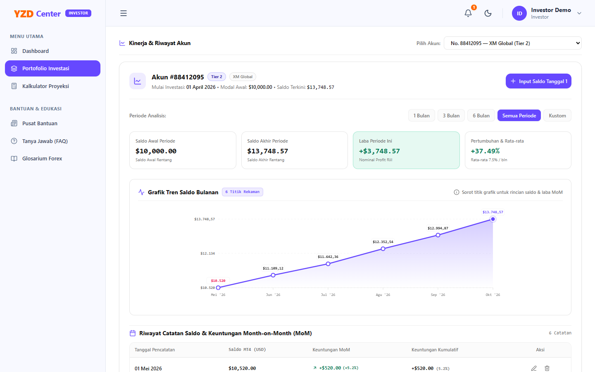

---

### 5.5 Disiplin Pencatatan: Input Saldo Tanggal 1
Agar grafik pertumbuhan, perhitungan laba bulanan (*Month-on-Month*), dan indikator balik modal (BEP) Anda selalu mutakhir, catatlah nilai saldo akun MT4 Anda secara rutin setiap **tanggal 1 awal bulan**:
1. Pastikan akun MT4 yang dipilih pada seksi **Kinerja & Riwayat Akun** sudah berstatus **Aktif**.
2. Klik tombol **"Input Saldo Tanggal 1"** di sudut kanan atas kartu akun terpilih.
3. Pada jendela **Input Saldo MT4 Tanggal 1** yang muncul:
   - Periksa **Tanggal Pencatatan Saldo** (secara bawaan sistem otomatis memilih tanggal 1 pada bulan berjalan, namun Anda tetap dapat menyesuaikannya jika sedang mencatat riwayat bulan sebelumnya).
   - Ketikkan nominal saldo akhir yang tertera di aplikasi MetaTrader 4 Anda pada kolom **Nilai Saldo Terkini di MT4 (USD)**.
   - Perhatikan kotak pratinjau **Estimasi Keuntungan** di bawah kolom input: sistem secara langsung menghitung estimasi laba/rugi dolar (`+$...`) dan persentase (`+%`) dibandingkan catatan saldo bulan sebelumnya.
4. Klik tombol **"Simpan Saldo"**.

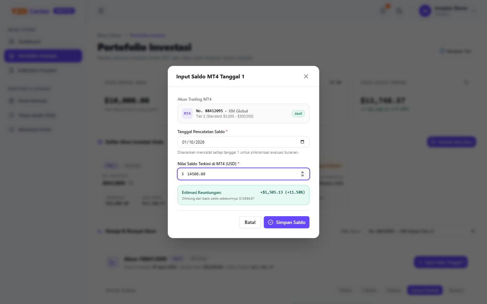

---

### 5.6 Mengelola Tabel Riwayat Catatan Saldo (Ubah & Hapus)
Di bagian paling bawah halaman Portofolio Investasi, terdapat tabel **Riwayat Catatan Saldo & Keuntungan Month-on-Month (MoM)** yang mencatat setiap rekaman saldo secara kronologis:
- **Tanggal Pencatatan:** Tanggal rekaman saldo.
- **Saldo MT4 (USD):** Nilai total saldo pada tanggal tersebut.
- **Keuntungan MoM:** Selisih keuntungan/kerugian dibandingkan catatan saldo tepat satu periode sebelumnya. Jika keuntungan bernilai positif ditampilkan hijau (`+$...`), jika rugi/drawdown ditampilkan merah (`-$...`), dan jika tidak mengalami perubahan saldo ($0.00) ditampilkan netral (teks abu-abu `$0.00`, persentase `0%`, serta ikon strip datar `—` / `Minus`).
- **Keuntungan Kumulatif:** Total akumulasi keuntungan/kerugian dibandingkan dengan **Modal Awal** saat akun pertama kali dibuka.
- **Kolom Aksi (Ikon Pensil & Tempat Sampah):**
  - Klik **Ikon Pensil (`✏️`)** untuk memperbaiki tanggal atau nominal saldo jika terjadi salah ketik.
  - Klik **Ikon Tempat Sampah (`🗑️`)** untuk menghapus catatan saldo tertentu (sistem akan menampilkan dialog konfirmasi sebelum benar-benar menghapus data).

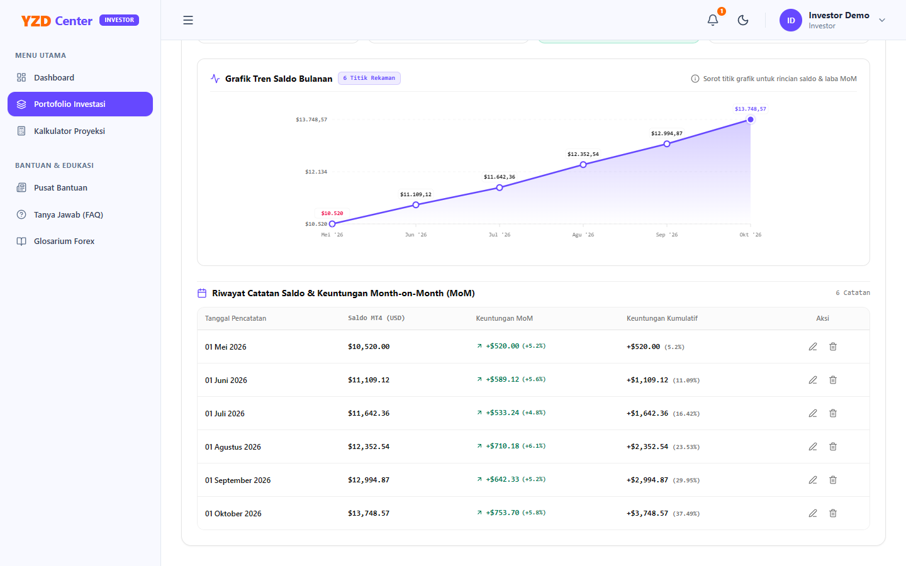

---

### 5.7 Kondisi Khusus (Edge Cases) & Solusi pada Portofolio Investasi

> [!WARNING]
> **Perhatikan aturan bisnis dan kondisi khusus berikut saat mengelola akun dan riwayat saldo investasi Anda:**

1. **Saat Memilih Akun Berstatus "Menunggu Verifikasi", Tombol Input Saldo & Grafik Tidak Muncul:**
   - **Penyebab:** Akun trading MT4 yang baru Anda daftarkan masih dalam antrean peninjauan Administrator.
   - **Perilaku Sistem:** Seksi Kinerja & Riwayat Akun akan menampilkan kotak informasi kuning **"Akun Sedang Menunggu Verifikasi Administrator"**. Anda baru dapat mencatat saldo bulanan setelah Administrator menyetujui dan mengaktifkan akun tersebut.

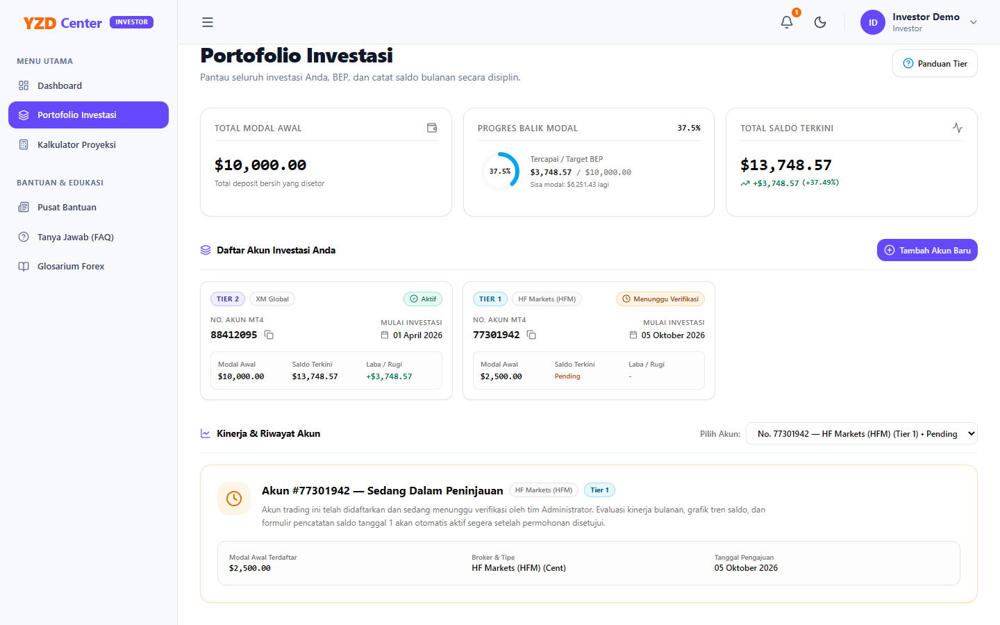

2. **Gagal Menyimpan Akun Baru karena Modal Tidak Sesuai Tier:**
   - **Penyebab:** Anda memilih *Tier 1* tetapi memasukkan modal `$5,000` (yang seharusnya masuk *Tier 2*), atau memilih *Tier 2* tetapi memasukkan modal `$2,000`.
   - **Solusi:** Sesuaikan pilihan *Tier* dengan nominal modal deposit Anda mengacu pada [Tabel Ketentuan Tier Investasi](#53-tabel-ketentuan-tier-investasi--rentang-modal). Kolom input modal juga baru dapat diketik setelah Anda memilih *Tier* terlebih dahulu.

3. **Nomor Akun MT4 Ditolak Saat Pendaftaran Akun Baru:**
   - **Penyebab:** Nomor akun MT4 hanya boleh berisi angka (`0-9`) dan tidak boleh sama dengan nomor akun MT4 yang sudah pernah terdaftar di sistem.

4. **Grafik Tren Saldo Bulanan Belum Menampilkan Garis Kurva (Hanya Keterangan Menunggu Data):**
   - **Penyebab:** Akun Anda baru memiliki **0 atau 1 catatan saldo**.
   - **Perilaku Sistem:**Sebuah grafik garis tren membutuhkan **minimal 2 titik pencatatan saldo** (misalnya catatan bulan ke-1 dan bulan ke-2) agar dapat membentuk garis penghubung visual. Meski demikian, catatan saldo pertama Anda tetap langsung tampil dengan lengkap di dalam Tabel Riwayat di bawahnya.

5. **Tidak Bisa Mencatat Saldo pada Tanggal yang Sama Dua Kali:**
   - **Penyebab:** Anda mencoba menambahkan catatan saldo baru pada tanggal yang sudah pernah tercatat untuk akun MT4 yang sama.
   - **Solusi:** Jika Anda ingin memperbarui nominal saldo pada tanggal yang sudah ada, jangan gunakan tombol *Tambah*, melainkan klik **Ikon Pensil (`✏️`)** pada baris tanggal tersebut di tabel riwayat.

6. ** Tanggal Pencatatan Saldo Ditolak karena Mendahului Tanggal Mulai Investasi atau di Masa Depan:**
   - **Penyebab:** Sistem mengunci agar tanggal pencatatan saldo **tidak boleh lebih awal** dari *Tanggal Mulai Investasi* akun tersebut dan **tidak boleh melebihi tanggal hari ini** (masa depan).

7. **Apa yang Terjadi Jika Saya Mengubah atau Menghapus Catatan Saldo di Tengah Bulan/Periode Lalu?**
   - **Perilaku Sistem (Rekalkulasi Berantai Otomatis):** Anda tidak perlu menghitung ulang bulan-bulan berikutnya secara manual. Setiap kali Anda menambah catatan saldo yang terlewat (tanggal mundur), mengubah nominal saldo lama, atau menghapus salah satu baris catatan, sistem secara otomatis **mengurutkan ulang seluruh riwayat berdasarkan tanggal dan menghitung ulang seluruh nilai Keuntungan MoM, Keuntungan Kumulatif, Saldo Terkini, serta Progres BEP** secara presisi.

---

## Bab 6: Menu Utama 3 — Kalkulator Proyeksi Investasi

### 6.1 Fungsi Kalkulator Proyeksi
Menu **Kalkulator Proyeksi** adalah alat bantu perencanaan finansial interaktif untuk menyimulasikan potensi pertumbuhan modal Anda berdasarkan skema *Tier* investasi, durasi waktu, serta pilihan metode perhitungan bunga (*Compounding* vs *Non-Compounding*).

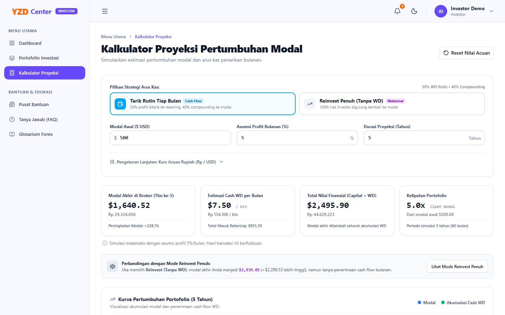

---

### 6.2 Langkah Penggunaan & Pengaturan Parameter Simulasi
Pada panel sebelah kiri (**Parameter Investasi**), Anda dapat mengatur simulasi dengan langkah berikut:
1. **Pilih Preset Tier Investasi:** Klik salah satu tombol preset (**Tier 1**, **Tier 2**, atau **Tier 3**). Setiap preset memiliki estimasi rata-rata pertumbuhan bulanan bawaan yang berbeda.
2. **Atur Modal Awal (USD):** Ketik nominal modal awal pada kolom angka atau geser bilah penggeser (*slider*) di bawahnya.
3. **Atur Target Profit / Bulan (%):** Anda dapat mempertahankan angka estimasi bawaan *Tier* atau menggeser *slider* (antara `0.5%` hingga `15%` per bulan) untuk menguji berbagai skenario pasar.
4. **Pilih Durasi Investasi:** Pilih jangka waktu simulasi mulai dari **6 Bulan**, **1 Tahun**, **2 Tahun**, **3 Tahun**, hingga **5 Tahun**.
5. **Aktifkan / Nonaktifkan Compounding (Bunga Majemuk):**
   - **Aktif (Disarankan):** Laba bulanan diasumsikan tidak ditarik dan langsung digabungkan ke dalam pokok modal bulan berikutnya (efek bola salju / *compounding*).
   - **Nonaktif (Bunga Tetap):** Laba bulanan selalu dihitung hanya dari nilai modal awal yang disetor.
6. Klik tombol **"Reset"** di sudut kanan atas panel parameter jika ingin mengembalikan seluruh angka ke pengaturan awal.

---

### 6.3 Membaca Hasil Proyeksi, Grafik & Tabel Rincian Tahunan
Setiap perubahan yang Anda lakukan pada panel kiri akan langsung memperbarui hasil di sebelah kanan secara seketika (*real-time*):
- **Kartu Utama Estimasi Saldo Akhir:** Menampilkan proyeksi nilai akhir portofolio Anda beserta total persentase imbal hasil (*Total Return*) dan estimasi rata-rata keuntungan per bulan.
- **Kartu Total Keuntungan Bersih & Estimasi Waktu BEP:** Menampilkan nominal laba bersih serta perkiraan berapa bulan waktu yang dibutuhkan hingga akumulasi keuntungan menyamai 100% modal awal Anda (*Break-Even Point*).
- **Grafik Proyeksi Pertumbuhan Modal:** Memvisualisasikan kurva kenaikan saldo dari bulan ke-0 hingga akhir durasi simulasi.
- **Tabel Rincian Pertumbuhan per Tahun:** Memecah proyeksi saldo awal tahun, profit tahunan, saldo akhir tahun, dan persentase pertumbuhan kumulatif dari tahun ke tahun.

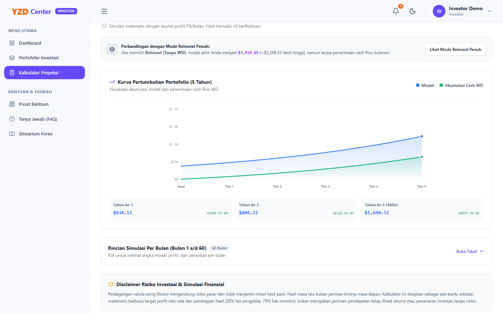

---

### 6.4 Kondisi Khusus (Edge Cases) pada Kalkulator Proyeksi

1. **Nominal Modal Awal Berubah Otomatis Saat Mengklik Preset Tier Lain:**
   - **Perilaku Sistem:** Setiap *Tier* memiliki batas minimum dan maksimum modal (contoh: *Tier 1* maksimal $\$4,999$, sedangkan *Tier 2* minimal $\$5,000$). Jika Anda sedang memasukkan modal $\$2,000$ di *Tier 1* lalu menekan tombol **Tier 2**, sistem otomatis menyesuaikan nilai modal ke batas minimum *Tier 2* ($\$5,000$) agar simulasi tetap valid sesuai aturan *Tier*.

2. **Hasil Simulasi Tidak Mengubah Data Portofolio Asli:**
   - **Perilaku Sistem:** Seluruh angka di halaman Kalkulator Proyeksi bersifat **simulasi perencanaan edukatif** dan tidak mengubah data akun maupun saldo riil Anda pada menu Portofolio Investasi.

---

## Bab 7: Menu Bantuan & Edukasi (Pusat Bantuan, FAQ & Glosarium Forex)

Kelompok menu **Bantuan & Edukasi** dirancang agar Anda memahami mekanisme operasional, aturan keamanan, serta istilah-istilah dalam perdagangan valuta asing (*forex*) tanpa perlu mencari referensi di luar sistem.

---

### 7.1 Pusat Bantuan (Artikel Panduan Lengkap)
Menu **Pusat Bantuan** menyajikan kumpulan artikel panduan resmi yang terstruktur:
1. **Pencarian Cepat:** Ketik kata kunci (misalnya *"copytrade"*, *"komisi"*, atau *"saldo"*) pada bilah pencarian di bagian atas.
2. **Filter Kategori:** Klik tab kategori (**Semua**, **Panduan Memulai**, **Investasi & Copytrade**, **Keamanan & Privasi**, dll.) untuk menyaring topik.
3. **Kartu Artikel Terfokus:** Setiap kartu artikel menampilkan judul jelas, cuplikan ringkasan materi, tanggal pembaruan, dan tombol aksi tanpa elemen badge atau metrik jumlah pembaca agar tampilan bersih dan nyaman dibaca.
4. **Membaca Artikel Lengkap:** Klik kartu atau tombol **"Baca Selengkapnya"** untuk membuka halaman bacaan lengkap. Di dalam halaman artikel, tersedia **Daftar Isi Sub-Bab** di sisi kanan untuk melompat ke bagian tertentu, serta rekomendasi **Artikel Terkait** di bagian bawah.

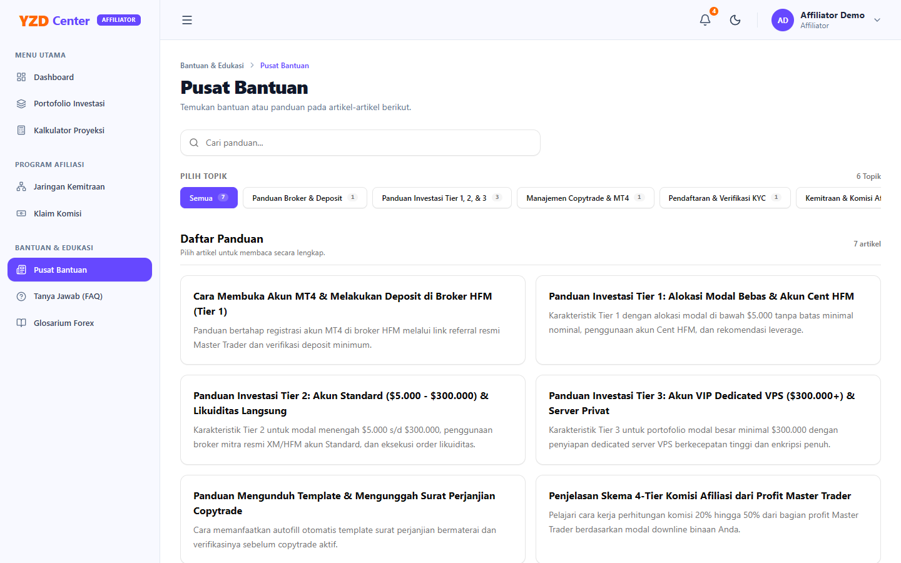

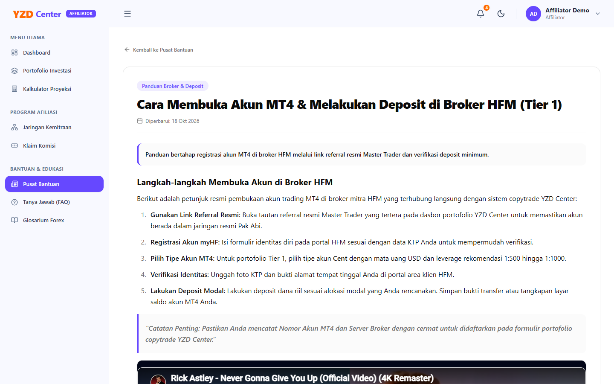

---

### 7.2 Tanya Jawab (FAQ)
Menu **Tanya Jawab (FAQ)** merangkum pertanyaan-pertanyaan yang paling sering diajukan oleh Investor beserta jawaban singkat dan padat:
1. Gunakan kolom **Cari pertanyaan atau kata kunci** atau klik tab kategori di bawahnya untuk menyaring topik.
2. **Tampilan Awal Tertutup Rapi:** Saat pertama kali dibuka, seluruh daftar pertanyaan dalam kondisi tertutup rapi (*collapsed*) agar halaman ringkas.
3. Klik pada baris judul pertanyaan yang ingin Anda baca untuk membuka (*expand*) kotak jawaban di bawahnya, dan klik kembali untuk menutupnya.
4. Jika pertanyaan Anda belum terjawab di daftar FAQ, klik tombol **"Buka Pusat Bantuan"** pada spanduk di bagian bawah halaman.

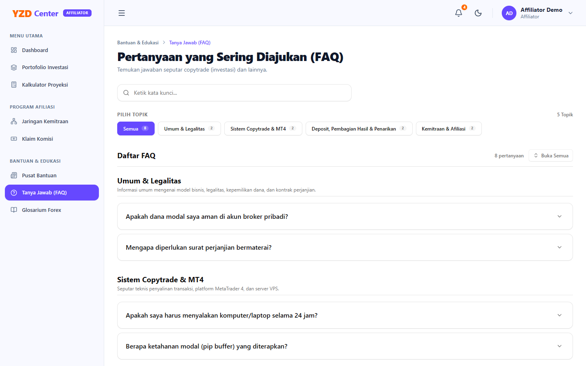

---

### 7.3 Glosarium Forex (Kamus Istilah Trading)
Menu **Glosarium Forex** membantu Anda memahami istilah teknis yang sering muncul pada laporan MetaTrader 4 maupun evaluasi portofolio (seperti *Balance*, *Equity*, *Drawdown*, *Lot*, *Floating*, *Slippage*, dll.):
1. **Cari Istilah:** Ketik istilah yang ingin Anda ketahui pada kolom pencarian.
2. **Filter Kategori atau Abjad (A–Z):** Saring istilah berdasarkan kelompok topik (*Dasar Forex*, *Manajemen Risiko*, *Teknis Copytrade*, *Indikator & Analisis*) atau klik huruf abjad (**A** sampai **Z**) untuk melompat ke istilah berawalan huruf tersebut.
3. Setiap kartu menampilkan nama istilah, kategori, penjelasan bahasa awam yang mudah dipahami, serta **Contoh Penggunaan** nyata.

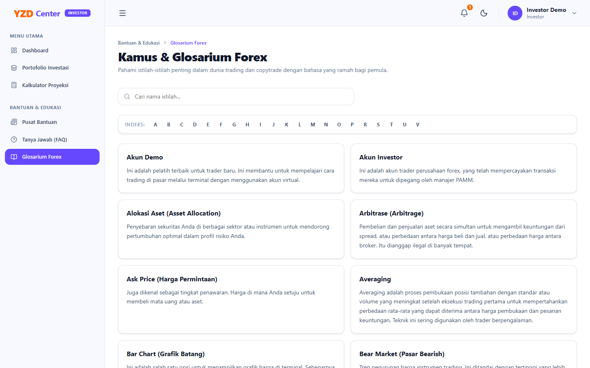

---

### 7.4 Kondisi Khusus (Edge Cases) pada Menu Bantuan & Edukasi

1. **Dapat Diakses Penuh Meskipun Akun Masih Berstatus "Pending":**
   - **Perilaku Sistem:** Berbeda dengan menu *Dashboard* dan *Portofolio Investasi* yang dikunci hingga verifikasi KYC selesai, ketiga menu **Bantuan & Edukasi** dapat dibuka kapan saja sejak hari pertama Anda mendaftar.

2. **Huruf Abjad Tertentu pada Glosarium Tidak Dapat Diklik (Redup):**
   - **Penyebab:** Huruf abjad yang tampil redup menandakan belum ada istilah di dalam kamus yang diawali dengan huruf tersebut, sehingga Anda tidak terjebak membuka halaman kosong.

3. **Pencarian Tidak Menemukan Hasil:**
   - **Solusi:** Jika kata kunci yang Anda ketik sekaligus dikombinasikan dengan filter kategori/abjad tidak menemukan hasil, klik tombol **"Reset Semua Filter"** yang muncul di tengah layar untuk menampilkan kembali seluruh daftar materi.

---

## Bab 8: Pengaturan Akun, Notifikasi & Keamanan (Ganti Password)

### 8.1 Mengelola Notifikasi Sistem
Sistem YZD Center mengirimkan pemberitahuan otomatis ke dalam akun Anda (*in-app notification*) untuk setiap peristiwa penting, seperti:
- Hasil verifikasi akun dan dokumen KYC (*Disetujui* atau *Perlu Revisi*).
- Persetujuan pendaftaran akun trading MT4 baru.
- Pengingat rutin pencatatan **Input Saldo Tanggal 1** setiap awal bulan.

**Cara Membuka & Mengelola Notifikasi:**
1. Klik **Ikon Lonceng (`🔔`)** di pojok kanan atas layar untuk melihat daftar singkat notifikasi terbaru. Angka berwarna oranye pada lonceng menunjukkan jumlah pesan yang belum dibaca.
2. Setiap pesan pemberitahuan dirancang ringkas (catatan penjelasan admin dibatasi maksimal 10 kata pada pratinjau pesan agar tampilan tidak terlalu panjang).
3. Klik salah satu pesan notifikasi untuk langsung menuju ke halaman atau tab spesifik terkait (misalnya menuju tab riwayat klaim atau rincian akun) di mana catatan penjelasan lengkap dapat dibaca secara utuh. Pesan tersebut otomatis ditandai sudah dibaca.
4. Anda juga dapat menekan tautan **"Lihat Semua Notifikasi"** pada bagian bawah popover lonceng untuk membuka halaman arsip **Semua Notifikasi**.
5. Pada halaman **Semua Notifikasi**, Anda dapat menyaring tab **Semua** atau **Belum Dibaca**, menekan tombol **"Tandai semua dibaca"**, atau menghapus pesan lama dengan menekan **Ikon Tempat Sampah (`🗑️`)**.

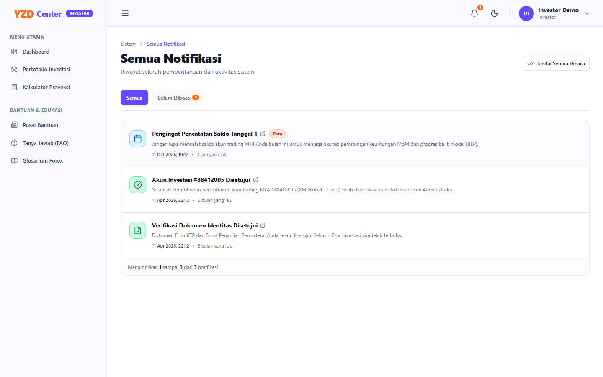

---

### 8.2 Mengganti Kata Sandi (Password) Akun
Demi menjaga keamanan portofolio Anda, gantilah kata sandi akun secara berkala dengan langkah berikut:
1. Klik **Nama / Inisial Profil Anda** di pojok kanan atas layar, lalu pilih menu **"Ganti Password"**.
2. Masukkan **Kata Sandi Saat Ini** yang sedang Anda gunakan.
3. Masukkan **Kata Sandi Baru** (minimal 8 karakter), lalu ketik ulang pada kolom **Konfirmasi Kata Sandi Baru**.
4. Klik tombol **"Simpan Kata Sandi"**. Setelah berhasil disimpan, kata sandi baru langsung berlaku untuk sesi login berikutnya.

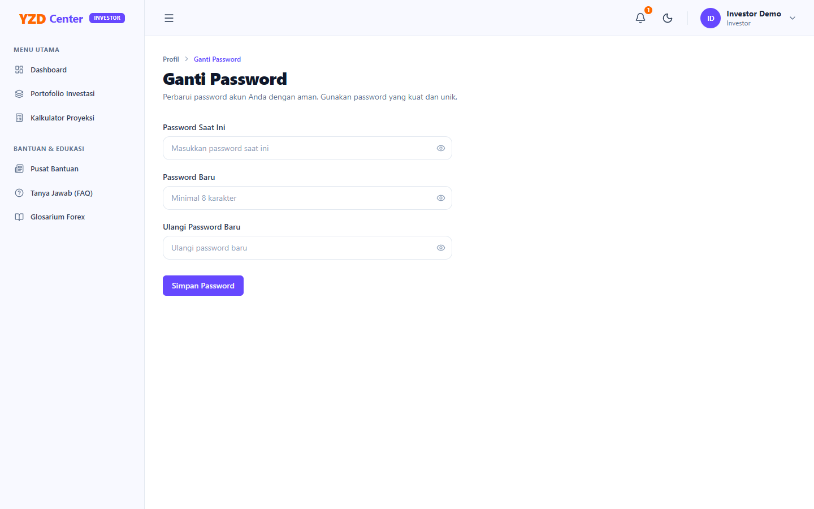

#### Tabel Ketentuan Kata Sandi Baru

| Kolom Input | Sifat | Ketentuan Validasi |
| :--- | :--- | :--- |
| **Kata Sandi Saat Ini** | Wajib | Harus cocok dengan kata sandi aktif akun Anda saat ini. |
| **Kata Sandi Baru** | Wajib | Minimal **8 karakter**. Disarankan menggunakan kombinasi huruf besar, huruf kecil, dan angka. |
| **Konfirmasi Kata Sandi Baru** | Wajib | Harus sama persis dengan ketikan pada kolom Kata Sandi Baru. |

---

### 8.3 Pengaturan Tampilan (Mode Terang / Gelap) & Keluar Akun (Logout)
- **Mengubah Mode Terang / Gelap:** Klik **Ikon Bulan (`🌙`) / Matahari (`☀️`)** di sebelah kanan ikon lonceng notifikasi pada bilah atas untuk beralih antara tampilan *Light Mode* (Terang) dan *Dark Mode* (Gelap) sesuai kenyamanan mata Anda. Pilihan tampilan ini tersimpan otomatis di peramban Anda.
- **Keluar dari Sistem (*Logout*):** Klik **Nama / Inisial Profil Anda** di pojok kanan atas, lalu pilih **"Keluar"** (berwarna merah). Selalu pastikan Anda keluar dari akun apabila mengakses portal menggunakan komputer umum atau perangkat bersama.

---

### 8.4 Kondisi Khusus (Edge Cases) pada Notifikasi & Keamanan

1. **Gagal Mengganti Kata Sandi karena "Kata Sandi Saat Ini Tidak Sesuai":**
   - **Penyebab:** Terdapat kesalahan ketik atau huruf besar/kecil (*Caps Lock*) saat mengisi kolom *Kata Sandi Saat Ini*.
   - **Solusi:** Klik ikon mata (`👁️`) di sisi kanan kolom input untuk memeriksa karakter yang Anda ketik sebelum menekan tombol simpan.

2. **Lupa Kata Sandi Saat Akan Masuk (Login):**
   - **Solusi:** Demi keamanan aset investor, pengaturan ulang kata sandi (*reset password*) dilakukan melalui verifikasi identitas bersama Administrator. Hubungi Administrator resmi YZD Center melalui saluran komunikasi resmi jika Anda kehilangan akses kata sandi akun Anda.
