# Buku Panduan Pengguna (Manual Book) — Ekosistem Portal Member YZD Center

**Versi Dokumen:** 2.0  
**Target Pengguna:** Seluruh Member YZD Center (Investor & Mitra Afiliasi)  
**Platform:** Aplikasi Web YZD Center (Desktop & Perangkat Seluler)

---

## Daftar Isi

1. [Bab 1: Pendahuluan & Ekosistem Terpadu Portal Member](#bab-1-pendahuluan--ekosistem-terpadu-portal-member)
   - [1.1 Tentang Ekosistem Portal Member YZD Center](#11-tentang-ekosistem-portal-member-yzd-center)
   - [1.2 Konsep Peran Terpadu: Investor & Mitra Afiliasi](#12-konsep-peran-terpadu-investor--mitra-afiliasi)
   - [1.3 Peta Perjalanan Pengguna (Alur Hulu ke Hilir Member)](#13-peta-perjalanan-pengguna-alur-hulu-ke-hilir-member)
   - [1.4 Mengenal Tata Letak Layar & Navigasi Antarmuka](#14-mengenal-tata-letak-layar--navigasi-antarmuka)
   - [1.5 Akses Cepat Aplikasi (Instalasi Semi-PWA di HP & Desktop)](#15-akses-cepat-aplikasi-instalasi-semi-pwa-di-hp--desktop)
2. [Bab 2: Pendaftaran Akun (Via Tautan Undangan) & Masuk ke Sistem](#bab-2-pendaftaran-akun-via-tautan-undangan--masuk-ke-sistem)
   - [2.1 Ketentuan Eksklusif Pendaftaran Berbasis Undangan](#21-ketentuan-eksklusif-pendaftaran-berbasis-undangan)
   - [2.2 Langkah Demi Langkah Pendaftaran Akun Baru (3 Langkah)](#22-langkah-demi-langkah-pendaftaran-akun-baru-3-langkah)
   - [2.3 Tabel Ketentuan Pengisian Formulir Pendaftaran](#23-tabel-ketentuan-pengisian-formulir-pendaftaran)
   - [2.4 Cara Masuk ke Sistem (Login)](#24-cara-masuk-ke-sistem-login)
   - [2.5 Kondisi Khusus (Edge Cases) & Solusi pada Pendaftaran & Login](#25-kondisi-khusus-edge-cases--solusi-pada-pendaftaran--login)
3. [Bab 3: Informasi Akun & Verifikasi Dokumen Legalitas (KYC)](#bab-3-informasi-akun--verifikasi-dokumen-legalitas-kyc)
   - [3.1 Memeriksa Data Identitas, Ahli Waris & Dokumen Legalitas](#31-memeriksa-data-identitas-ahli-waris--dokumen-legalitas)
   - [3.2 Mengenal Status Verifikasi Dokumen](#32-mengenal-status-verifikasi-dokumen)
   - [3.3 Prosedur Revisi / Unggah Ulang Dokumen yang Ditolak](#33-prosedur-revisi--unggah-ulang-dokumen-yang-ditolak)
   - [3.4 Tabel Ketentuan Berkas Legalitas](#34-tabel-ketentuan-berkas-legalitas)
   - [3.5 Kondisi Khusus (Edge Cases) & Solusi pada Verifikasi Akun](#35-kondisi-khusus-edge-cases--solusi-pada-verifikasi-akun)
4. [Bab 4: Menu Utama 1 — Dashboard Portofolio](#bab-4-menu-utama-1--dashboard-portofolio)
   - [4.1 Fungsi Utama Halaman Dashboard](#41-fungsi-utama-halaman-dashboard)
   - [4.2 Membaca 4 Kartu Metrik Utama Finansial](#42-membaca-4-kartu-metrik-utama-finansial)
   - [4.3 Daftar Akun Trading & Pintasan Cepat](#43-daftar-akun-trading--pintasan-cepat)
   - [4.4 Kondisi Khusus (Edge Cases) & Solusi pada Dashboard](#44-kondisi-khusus-edge-cases--solusi-pada-dashboard)
5. [Bab 5: Menu Utama 2 — Portofolio Investasi & Pencatatan Saldo Bulanan](#bab-5-menu-utama-2--portofolio-investasi--pencatatan-saldo-bulanan)
   - [5.1 Ringkasan Konsolidasi & Progres Balik Modal (BEP)](#51-ringkasan-konsolidasi--progres-balik-modal-bep)
   - [5.2 Mendaftarkan Akun Investasi / Copytrade Baru](#52-mendaftarkan-akun-investasi--copytrade-baru)
   - [5.3 Tabel Ketentuan Tier Investasi & Rentang Modal](#53-tabel-ketentuan-tier-investasi--rentang-modal)
   - [5.4 Memantau Kinerja Akun & Grafik Tren Saldo Bulanan](#54-memantau-kinerja-akun--grafik-tren-saldo-bulanan)
   - [5.5 Disiplin Pencatatan: Input Saldo Tanggal 1](#55-disiplin-pencatatan-input-saldo-tanggal-1)
   - [5.6 Mengelola Tabel Riwayat Catatan Saldo (Ubah & Hapus)](#56-mengelola-tabel-riwayat-catatan-saldo-ubah--hapus)
   - [5.7 Kondisi Khusus (Edge Cases) & Rekalkulasi Otomatis](#57-kondisi-khusus-edge-cases--rekalkulasi-otomatis)
6. [Bab 6: Menu Utama 3 — Kalkulator Proyeksi Investasi](#bab-6-menu-utama-3--kalkulator-proyeksi-investasi)
   - [6.1 Fungsi Kalkulator Proyeksi Finansial](#61-fungsi-kalkulator-proyeksi-finansial)
   - [6.2 Langkah Penggunaan & Pengaturan Parameter Simulasi](#62-langkah-penggunaan--pengaturan-parameter-simulasi)
   - [6.3 Membaca Hasil Proyeksi, Grafik & Tabel Rincian Tahunan](#63-membaca-hasil-proyeksi-grafik--tabel-rincian-tahunan)
   - [6.4 Kondisi Khusus (Edge Cases) pada Kalkulator Proyeksi](#64-kondisi-khusus-edge-cases-pada-kalkulator-proyeksi)
7. [Bab 7: Program Kemitraan 1 — Tautan Referral & Jaringan Downline](#bab-7-program-kemitraan-1--tautan-referral--jaringan-downline)
   - [7.1 Mekanisme Kode & Tautan Referral Unik Otomatis](#71-mekanisme-kode--tautan-referral-unik-otomatis)
   - [7.2 Cara Membagikan Tautan & Melacak Status Downline](#72-cara-membagikan-tautan--melacak-status-downline)
   - [7.3 Membaca Tabel Jaringan Downline](#73-membaca-tabel-jaringan-downline)
   - [7.4 Kondisi Khusus (Edge Cases) pada Registrasi Referral](#74-kondisi-khusus-edge-cases-pada-registrasi-referral)
8. [Bab 8: Program Kemitraan 2 — Prosedur Klaim Referral Susulan](#bab-8-program-kemitraan-2--prosedur-klaim-referral-susulan)
   - [8.1 Kapan Klaim Susulan Diperlukan?](#81-kapan-klaim-susulan-diperlukan)
   - [8.2 Langkah Demi Langkah Pengajuan Klaim Susulan](#82-langkah-demi-langkah-pengajuan-klaim-susulan)
   - [8.3 Status Pemeriksaan Klaim Susulan (Menunggu, Disetujui, Ditolak)](#83-status-pemeriksaan-klaim-susulan-menunggu-disetujui-ditolak)
   - [8.4 Ketentuan Berkas Bukti Pendukung & Audit Anti-Klaim Ganda](#84-ketentuan-berkas-bukti-pendukung--audit-anti-klaim-ganda)
   - [8.5 Kondisi Khusus (Edge Cases) pada Klaim Susulan](#85-kondisi-khusus-edge-cases-pada-klaim-susulan)
9. [Bab 9: Program Kemitraan 3 — Skema Komisi 4-Tier & Pencairan Dana](#bab-9-program-kemitraan-3--skema-komisi-4-tier--pencairan-dana)
   - [9.1 Prinsip Perhitungan Komisi Berbasis Akun Trading Aktif](#91-prinsip-perhitungan-komisi-berbasis-akun-trading-aktif)
   - [9.2 Tabel Rincian Skema Komisi 4-Tier](#92-tabel-rincian-skema-komisi-4-tier)
   - [9.3 Kriteria Akun Downline yang Layak Diklaim (Eligible)](#93-kriteria-akun-downline-yang-layak-diklaim-eligible)
   - [9.4 Aturan Klaim Komisi Satu Kali Seumur Hidup per Akun](#94-aturan-klaim-komisi-satu-kali-seumur-hidup-per-akun)
   - [9.5 Membaca Kartu Ringkasan Metrik Komisi](#95-membaca-kartu-ringkasan-metrik-komisi)
   - [9.6 Langkah Demi Langkah Pengajuan Pencairan Komisi](#96-langkah-demi-langkah-pengajuan-pencairan-komisi)
   - [9.7 Proses Verifikasi Administrator & Bukti Transfer Bank](#97-proses-verifikasi-administrator--bukti-transfer-bank)
   - [9.8 Kondisi Khusus (Edge Cases) pada Pencairan Komisi](#98-kondisi-khusus-edge-cases-pada-pencairan-komisi)
   - [9.9 Simulasi Proyeksi Potensi Komisi (Kalkulator Afiliator)](#99-simulasi-proyeksi-potensi-komisi-kalkulator-afiliator)
10. [Bab 10: Program Kemitraan 4 — Materi Promosi (Profit Master Feed)](#bab-10-program-kemitraan-4--materi-promosi-profit-master-feed)
    - [10.1 Fungsi Feed Materi Promosi Master Trader](#101-fungsi-feed-materi-promosi-master-trader)
    - [10.2 Pencarian Materi Promosi](#102-pencarian-materi-promosi)
    - [10.3 Fitur Salin Caption Otomatis](#103-fitur-salin-caption-otomatis)
    - [10.4 Fitur Unduh Berkas Grafis / Gambar Materi](#104-fitur-unduh-berkas-grafis--gambar-materi)
    - [10.5 Fitur Bagikan Langsung via Web Share API & Lightbox Gambar](#105-fitur-bagikan-langsung-via-web-share-api--lightbox-gambar)
11. [Bab 11: Saluran Bantuan 1 — Tiket Bantuan (Customer Support Helpdesk)](#bab-11-saluran-bantuan-1--tiket-bantuan-customer-support-helpdesk)
    - [11.1 Kapan Membuat Tiket Bantuan?](#111-kapan-membuat-tiket-bantuan)
    - [11.2 Prosedur Pembuatan Tiket Baru & Kompresi Gambar Otomatis](#112-prosedur-pembuatan-tiket-baru--kompresi-gambar-otomatis)
    - [11.3 Pencarian Instan Tiket Otomatis (Live Debounce Search)](#113-pencarian-instan-tiket-otomatis-live-debounce-search)
    - [11.4 Utas Percakapan Interaktif dengan Admin & Lightbox Lampiran](#114-utas-percakapan-interaktif-dengan-admin--lightbox-lampiran)
    - [11.5 Siklus Hidup Status Tiket (Open, In Progress, Answered, Resolved, Closed)](#115-siklus-hidup-status-tiket-open-in-progress-answered-resolved-closed)
    - [11.6 Menandai Selesai & Prosedur Membuka Kembali Tiket](#116-menandai-selesai--prosedur-membuka-kembali-tiket)
    - [11.7 Penutupan Otomatis Tiket Selesai (Auto-Close 7 Hari)](#117-penutupan-otomatis-tiket-selesai-auto-close-7-hari)
12. [Bab 12: Saluran Bantuan 2 — Pusat Bantuan, Tanya Jawab & Glosarium](#bab-12-saluran-bantuan-2--pusat-bantuan-tanya-jawab--glosarium)
    - [12.1 Pusat Bantuan (Artikel Panduan Lengkap)](#121-pusat-bantuan-artikel-panduan-lengkap)
    - [12.2 Tanya Jawab (FAQ)](#122-tanya-jawab-faq)
    - [12.3 Glosarium Forex (Kamus Istilah Trading)](#123-glosarium-forex-kamus-istilah-trading)
    - [12.4 Kondisi Khusus (Edge Cases) pada Menu Bantuan & Edukasi](#124-kondisi-khusus-edge-cases-pada-menu-bantuan--edukasi)
13. [Bab 13: Pengaturan Akun, Notifikasi & Keamanan](#bab-13-pengaturan-akun-notifikasi--keamanan)
    - [13.1 Mengelola Notifikasi Sistem In-App & Pola Redireksi](#131-mengelola-notifikasi-sistem-in-app--pola-redireksi)
    - [13.2 Mengganti Kata Sandi (Password) Akun](#132-mengganti-kata-sandi-password-akun)
    - [13.3 Pengaturan Tampilan (Mode Terang / Gelap) & Keluar Akun (Logout)](#133-pengaturan-tampilan-mode-terang--gelap--keluar-akun-logout)
    - [13.4 Kondisi Khusus (Edge Cases) pada Notifikasi & Keamanan](#134-kondisi-khusus-edge-cases-pada-notifikasi--keamanan)

---

## Bab 1: Pendahuluan & Ekosistem Terpadu Portal Member

### 1.1 Tentang Ekosistem Portal Member YZD Center
**Portal Member YZD Center** adalah platform manajemen investasi dan kemitraan terpadu yang dirancang untuk memberikan kendali menyeluruh kepada Anda dalam ekosistem perdagangan otomatis (*copytrade*) YZD Center. 

Melalui satu akun Member yang terintegrasi, Anda dapat:
- Mengelola data identitas legalitas (*Know Your Customer* / KYC) dan data perlindungan ahli waris secara privat.
- Mendaftarkan dan memantau seluruh akun trading MetaTrader 4 (MT4) yang terhubung ke strategi *copytrade*.
- Melacak pencapaian **Progres Balik Modal (*Break-Even Point* / BEP)** serta tren pertumbuhan keuntungan bulanan (*Month-on-Month* / MoM).
- Merencanakan proyeksi modal masa depan menggunakan kalkulator simulasi bunga majemuk (*compound interest*).
- Mengembangkan jaringan kemitraan menggunakan **Tautan Referral Unik**, mengklaim downline, dan mencairkan bonus komisi **4-Tier Transparan** langsung ke rekening bank.
- Mengakses materi promosi resmi **Profit Master** siap pakai untuk kebutuhan promosi di media sosial.
- Berkomunikasi langsung dengan tim dukungan teknis melalui fitur **Tiket Bantuan** dua arah.

---

### 1.2 Konsep Peran Terpadu: Investor & Mitra Afiliasi
Dalam pembaruan sistem YZD Center, tidak ada lagi pemisahan kaku antara akun "Investor" dan "Affiliator". Seluruh pengguna terdaftar memegang peran tunggal: **`Member`**.

Sebagai Member, Anda memiliki kebebasan penuh:
1. **Fokus Berinvestasi:** Anda dapat memilih hanya mendaftarkan akun copytrade dan memantau perkembangan profit bulanan tanpa harus mengajak relasi.
2. **Aktif Membina Jaringan Kemitraan:** Anda dapat membagikan tautan referral untuk membina downline dan meraih apresiasi komisi tunai.
3. **Kombinasi Keduanya:** Anda dapat menikmati passive income dari pertumbuhan akun copytrade pribadi sekaligus mendapatkan active income dari komisi jaringan kemitraan.

> [!NOTE]
> **Label Status Otomatis (*Derived Labels*):**  
> Sistem secara cerdas menyematkan label status pada profil Anda berdasarkan aktivitas yang berjalan:
> - **Investor:** Disematkan jika Anda memiliki minimal 1 akun copytrade yang telah berstatus aktif.
> - **Affiliator:** Disematkan jika Anda memiliki minimal 1 investor binaan (downline) yang aktif.
> - **Investor & Affiliator:** Disematkan jika Anda aktif menjalankan kedua instrumen tersebut secara bersamaan.

---

### 1.3 Peta Perjalanan Pengguna (Alur Hulu ke Hilir Member)
Diagram berikut menggambarkan alur perjalanan terpadu seorang Member di platform YZD Center:

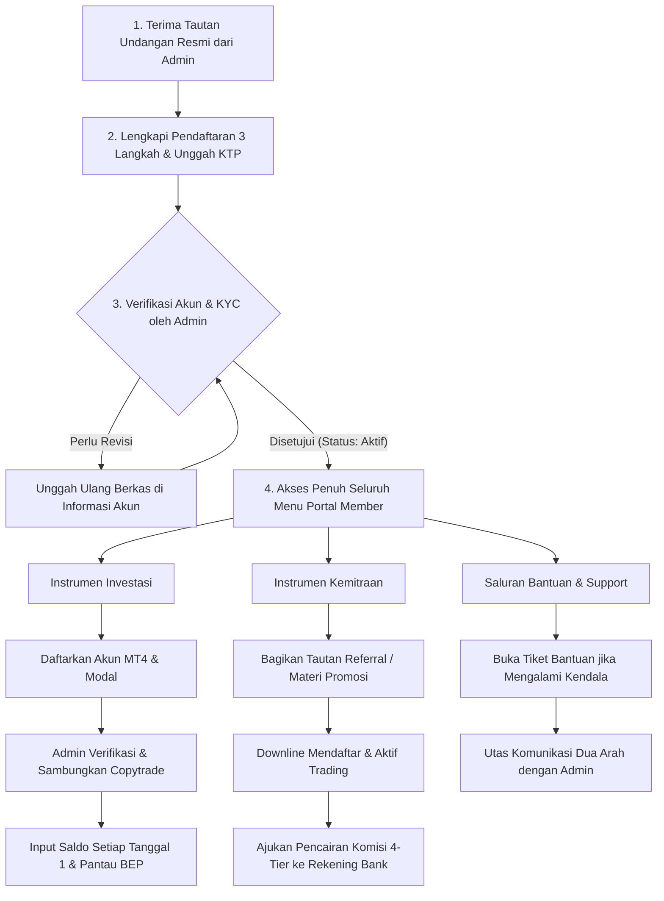

---

### 1.4 Mengenal Tata Letak Layar & Navigasi Antarmuka
Layar antarmuka Member terbagi menjadi tiga area ergonomis:
1. **Bilah Navigasi Samping (*Sidebar* Kiri):**
   - **Menu Utama:** `Dashboard`, `Portofolio Investasi`, dan `Kalkulator Proyeksi`.
   - **Program Kemitraan & Komisi:** `Jaringan Kemitraan`, `Klaim Komisi`, dan `Materi Promosi`.
   - **Bantuan & Edukasi:** `Pusat Bantuan`, `Tiket Bantuan`, `Tanya Jawab (FAQ)`, dan `Glosarium Forex`.
   - *(Pada layar ponsel/HP, bilah samping ini dibuka dengan menekan tombol menu `☰` di pojok kiri atas).*
2. **Bilah Atas (*Header*):**
   - Menampilkan penunjuk halaman (*breadcrumb*) di sisi kiri.
   - Menampilkan tombol **"Install App"** (Semi-PWA), **Lonceng Notifikasi** dengan penanda jumlah pesan baru, tombol pengubah **Tema Terang / Gelap**, serta **Menu Profil** di pojok kanan atas.
3. **Area Kerja Utama (Tengah):**
   - Area dinamis yang menyajikan dasbor metrik, tabel data interaktif, feed promosi, serta jendela formulir (*modal*).

---

### 1.5 Akses Cepat Aplikasi (Instalasi Semi-PWA di HP & Desktop)
Untuk kemudahan akses tanpa harus berulang kali mengetik alamat URL di peramban, portal YZD Center mendukung teknologi **Semi-PWA (*Progressive Web App*)**.

#### Karakteristik Tombol Install:
- **Desktop / Laptop (`sm:` ke atas):** Tombol ungu (*Violet-600*) bertuliskan **"Install App"** dengan ikon unduh.
- **Smartphone / Ponsel (`< 640px`):** Tombol ikon kotak ungu berukuran `38x38px` yang ramah sentuhan jari.

#### Prosedur Pemasangan:
1. **Google Chrome / Microsoft Edge (Android, Windows, macOS):**
   - Klik tombol **"Install App"** di bilah atas.
   - Pada dialog peramban *"Install app YZD Center?"*, pilih **Install**. Ikon aplikasi akan langsung terpasang di layar utama HP atau taskbar komputer Anda.
2. **Apple Safari (iPhone / iPad iOS):**
   - Klik tombol **"Install App"**. Ikuti panduan 3 langkah di layar:
     1. Ketuk ikon **Bagikan (*Share*)** (kotak dengan panah ke atas di bilah navigasi Safari).
     2. Gulir menu dan pilih **Tambah ke Layar Utama (*Add to Home Screen*)**.
     3. Ketuk **Tambah (*Add*)** di sudut kanan atas.

> [!TIP]
> **Tampilan Mandiri (*Standalone Mode*):**  
> Saat dibuka melalui ikon aplikasi yang telah terpasang, aplikasi berjalan layar penuh tanpa bilah URL peramban (*browser chrome*). Tombol "Install App" akan otomatis disembunyikan.

---

## Bab 2: Pendaftaran Akun (Via Tautan Undangan) & Masuk ke Sistem

### 2.1 Ketentuan Eksklusif Pendaftaran Berbasis Undangan
YZD Center menerapkan sistem pendaftaran tertutup (*closed-loop system*). Pendaftaran akun hanya dapat dilakukan melalui **Tautan Undangan Resmi** yang diterbitkan oleh Administrator.

---

### 2.2 Langkah Demi Langkah Pendaftaran Akun Baru (3 Langkah)

#### Langkah 1: Pengisian Identitas Akun & Unggah Foto KTP
1. Buka tautan undangan resmi yang Anda terima pada peramban web.
2. Pastikan lencana hijau **"Tautan Aktif"** tertera di bagian atas formulir.
3. Lengkapi data identitas sesuai KTP:
   - **Nama Lengkap**, **Username** (3-30 karakter alfanumerik unik), **Alamat Email Aktif**, **Nomor WhatsApp/HP**.
   - **NIK KTP (16 Digit)**, **Alamat Lengkap**, **Tempat Lahir**, **Tanggal Lahir**, dan **Pekerjaan / Sumber Dana**.
4. Buat **Kata Sandi** (minimal 8 karakter) dan konfirmasikan ulang.
5. Unggah foto e-KTP asli (`JPG`, `JPEG`, atau `PNG`, maks. 10 MB). Sistem akan mengompresi ukuran berkas secara otomatis di latar belakang.
6. Klik tombol **"Lanjutkan ke Data Ahli Waris"**.

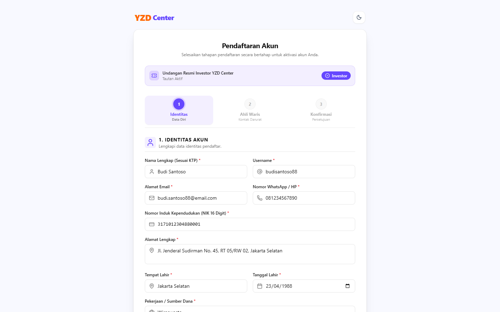

#### Langkah 2: Pengisian Data Perlindungan Ahli Waris
1. Masukkan **Nama Lengkap Ahli Waris** yang sah (keluarga inti yang berhak atas aset Anda).
2. Pilih **Hubungan Keluarga** (*Anak*, *Istri*, *Suami*, *Orang Tua*, *Saudara Kandung*, *Lainnya*).
3. Masukkan **Nomor WhatsApp / HP Ahli Waris** yang aktif (**wajib berbeda** dari nomor pribadi Anda).
4. Masukkan **Alamat Domisili Ahli Waris**, lalu klik **"Lanjutkan ke Konfirmasi"**.

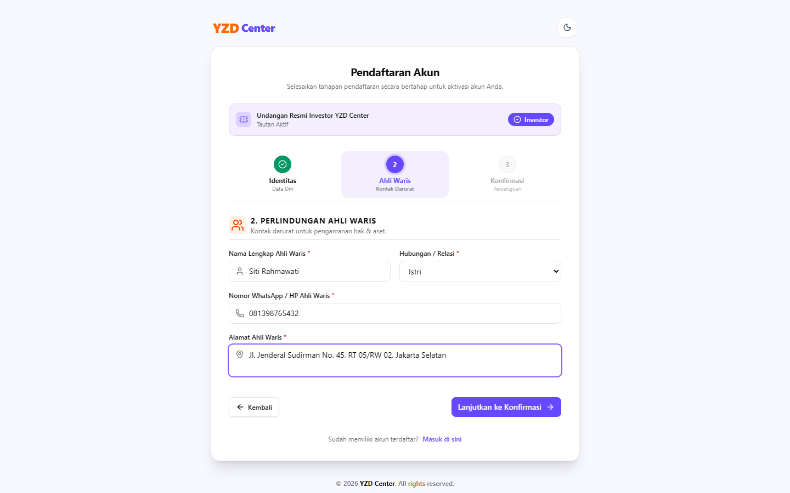

#### Langkah 3: Konfirmasi Data, Kode Referral & Persetujuan
1. Periksa ringkasan identitas pribadi dan ahli waris. Gunakan tombol **"Ubah"** jika ada koreksi.
2. **Kode Referral Mitra (Opsional):** Jika Anda mendaftar melalui tautan mitra, kode referral akan terisi otomatis. Jika mendaftar mandiri namun memiliki kode rekomendasi mitra, ketikkan kode tersebut lalu klik **"Periksa"**.
3. Buka dan pelajari dokumen **Syarat & Ketentuan Layanan** serta **Kebijakan Privasi**.
4. Beri tanda centang persetujuan (`✓`), lalu klik tombol **"Kirim Pendaftaran"**.

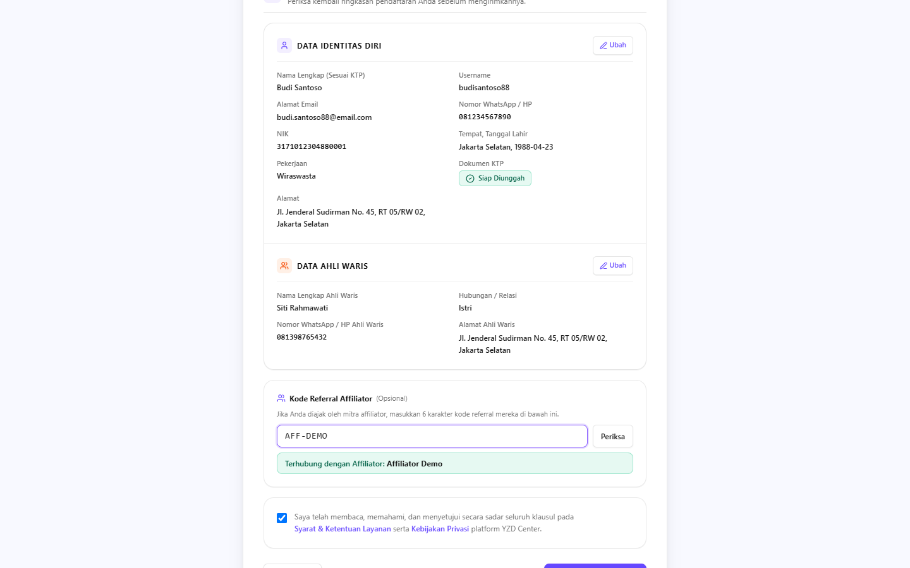

---

### 2.3 Tabel Ketentuan Pengisian Formulir Pendaftaran

| Nama Kolom | Sifat | Ketentuan Validasi Sistem |
| :--- | :--- | :--- |
| **Nama Lengkap** | Wajib | Sesuai KTP resmi, maksimal 255 karakter. |
| **Username** | Wajib | Unik, 3–30 karakter alfanumerik dan garis bawah (`_`). |
| **Alamat Email** | Wajib | Format email valid, aktif, dan belum pernah terdaftar. |
| **Nomor WhatsApp / HP** | Wajib | Format nomor telepon aktif (9–20 digit angka). |
| **NIK KTP** | Wajib | Tepat **16 digit angka** numerik. |
| **Foto KTP** | Wajib | Berkas gambar (`JPG`, `JPEG`, `PNG`, maks. 10 MB). |
| **Nomor HP Ahli Waris** | Wajib | Nomor aktif, **wajib berbeda** dari nomor HP pendaftar. |
| **Kode Referral** | Opsional | Kode 6–12 karakter alfanumerik milik mitra pengundang. |

---

### 2.4 Cara Masuk ke Sistem (Login)
1. Buka halaman `/login`.
2. Masukkan **Username atau Email** terdaftar beserta **Kata Sandi**.
3. Centang opsi *"Ingat saya di perangkat ini"* jika menggunakan gawai pribadi.
4. Klik tombol **"Masuk"**.

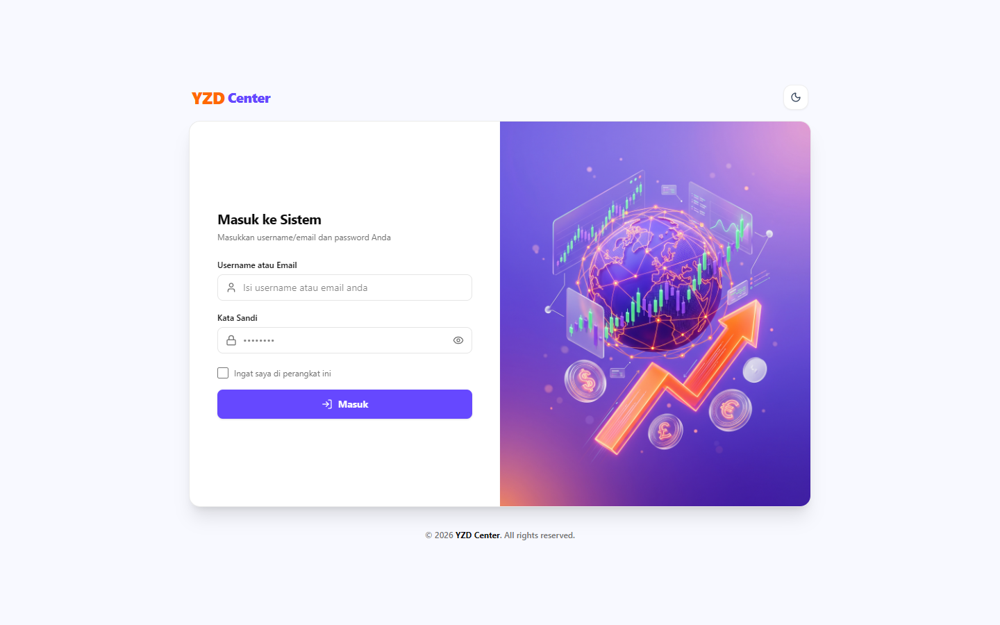

---

### 2.5 Kondisi Khusus (Edge Cases) & Solusi pada Pendaftaran & Login

> [!WARNING]
> 1. **Pesan "Tautan Undangan Tidak Valid":** Terjadi jika tautan telah kedaluwarsa, kuota pendaftaran habis, atau token salah. Hubungi Admin untuk meminta tautan baru.
> 2. **Peringatan Foto KTP Buram:** Sistem mendeteksi gambar KTP kurang tajam. Anda tetap dapat melanjutkan pendaftaran, namun disarankan memotret ulang di tempat terang agar verifikasi tidak ditolak Admin.
> 3. **Nomor HP Ahli Waris Sama:** Sistem menolak nomor HP ahli waris yang identik dengan nomor pendaftar demi keandalan kontak darurat.
> 4. **Konfirmasi Keluar Halaman Pendaftaran:** Menutup tab saat formulir belum dikirimkan akan memicu dialog konfirmasi agar ketikan data Anda tidak hilang tidak sengaja.

---

## Bab 3: Informasi Akun & Verifikasi Dokumen Legalitas (KYC)

### 3.1 Memeriksa Data Identitas, Ahli Waris & Dokumen Legalitas
Akses halaman **Informasi Akun** melalui menu profil di sudut kanan atas. Halaman ini memuat:
- **Kartu Identitas Pengguna:** Nama, username, email, kontak WhatsApp, NIK, tempat/tgl lahir, dan alamat.
- **Kartu Kontak Ahli Waris:** Nama ahli waris, hubungan kekeluargaan, nomor darurat, dan alamat.
- **Kartu Dokumen KTP & Surat Perjanjian:** Memuat status verifikasi berkas legalitas dan tombol **"Lihat Berkas"** untuk membuka dokumen.

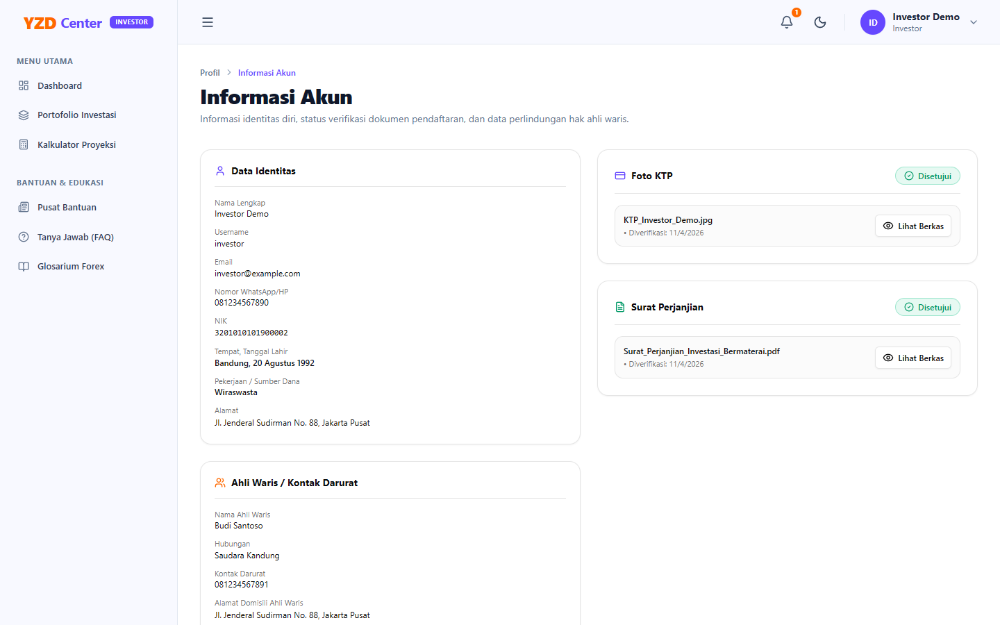

---

### 3.2 Mengenal Status Verifikasi Dokumen
- **Menunggu Peninjauan (Kuning/Biru):** Berkas telah terunggah dan sedang dalam antrean verifikasi Admin.
- **Disetujui (Hijau):** Dokumen sah dan akun telah berstatus aktif penuh.
- **Perlu Revisi (Merah/Oranye):** Dokumen ditolak sementara (misal: foto buram, terpotong, atau tanda tangan tidak sesuai). Anda wajib mengunggah dokumen perbaikan.

---

### 3.3 Prosedur Revisi / Unggah Ulang Dokumen yang Ditolak
1. Masuk ke halaman **Informasi Akun**.
2. Bacalah instruksi perbaikan pada kotak **"Catatan Administrator"**.
3. Klik area unggah berkas baru, pilih foto atau dokumen pengganti dari perangkat Anda.
4. Klik tombol **"Kirim Berkas Revisi"**. Dokumen akan kembali berstatus *Menunggu Peninjauan*.

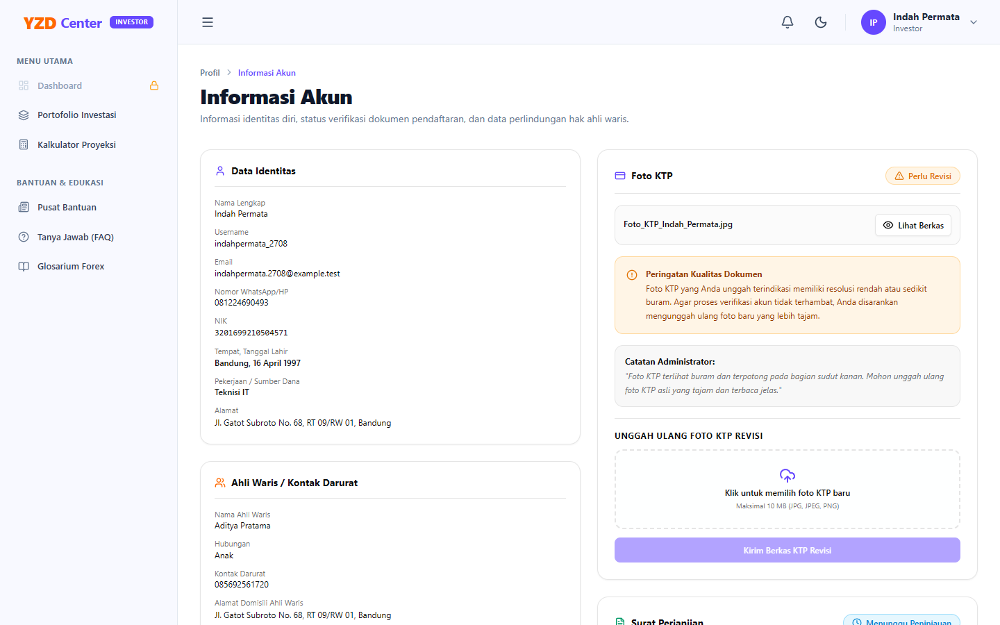

---

### 3.4 Tabel Ketentuan Berkas Legalitas

| Jenis Berkas | Format File | Ukuran Maksimal | Keterangan & Prosedur |
| :--- | :--- | :--- | :--- |
| **Foto KTP** | `JPG`, `JPEG`, `PNG` | **10 MB** (kompresi otomatis) | Diunggah mandiri oleh Member saat registrasi awal atau revisi. |
| **Surat Perjanjian** | `PDF`, `JPG`, `PNG` | **10 MB** | Diterbitkan dan diunggah pertama kali oleh Admin setelah KTP disetujui. Member mengunggah ulang jika diminta revisi. |

---

### 3.5 Kondisi Khusus (Edge Cases) & Solusi pada Verifikasi Akun

> [!IMPORTANT]
> 1. **Menu Sidebar Terkunci dengan Ikon Gembok (`🔒`):**  
>    Saat akun masih berstatus *Pending* atau *Perlu Revisi*, menu transaksional (*Dashboard*, *Portofolio*, *Kemitraan*) dikunci sementara. Anda tetap dapat mengakses menu **Bantuan & Edukasi** (*Pusat Bantuan*, *FAQ*, *Glosarium*) sambil menunggu verifikasi selesai.
> 2. **Surat Perjanjian Belum Tersedia:**  
>    Pada akun yang baru mendaftar, kartu Surat Perjanjian akan tertulis *"Belum ada berkas yang diunggah oleh Administrator"*. Berkas ini disiapkan oleh tim Admin setelah verifikasi identitas Anda disetujui.

---

## Bab 4: Menu Utama 1 — Dashboard Portofolio

### 4.1 Fungsi Utama Halaman Dashboard
Halaman **Dashboard** (`/member/dashboard`) merangkum performa finansial seluruh akun investasi copytrade yang Anda miliki secara konsolidasi.

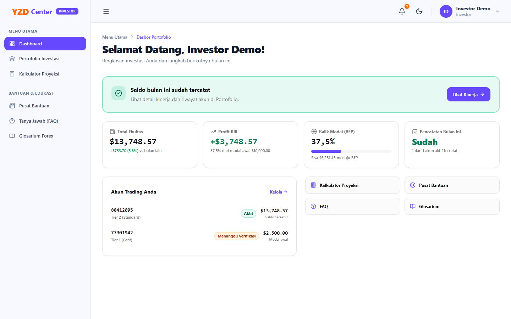

---

### 4.2 Membaca 4 Kartu Metrik Utama Finansial
1. **Total Modal Awal:** Akumulasi modal deposit awal (USD) dari seluruh akun trading MT4 Anda yang berstatus **Aktif**.
2. **Total Saldo Terkini:** Akumulasi total saldo terakhir (USD) berdasarkan pencatatan saldo mutakhir.
3. **Total Keuntungan (ROI):** Nominal laba/rugi bersih kumulatif (`+$...`) beserta persentase imbal hasil (*Return on Investment* / `+%`).
4. **Progres Balik Modal (BEP):** Persentase pemulihan modal menuju titik impas 100% (*Break-Even Point*) dilengkapi bilah progres visual dan sisa nominal dolar.

---

### 4.3 Daftar Akun Trading & Pintasan Cepat
Bagian **Akun Trading Anda** menampilkan kartu untuk setiap akun MetaTrader 4:
- Menampilkan label **Tier Investasi** (*Tier 1, Tier 2, Tier 3*), nama **Broker**, dan **Status Akun** (*Aktif / Pending*).
- Menampilkan **Nomor Akun MT4**, **Modal Awal**, **Saldo Terkini**, serta **Laba/Rugi**.
- Klik tombol **"Kelola Portofolio & Saldo"** untuk berpindah ke halaman rincian portofolio.

---

### 4.4 Kondisi Khusus (Edge Cases) & Solusi pada Dashboard
1. **Akun Berstatus Pending Tidak Dihitung pada Metrik Utama:**  
   Akun yang masih menunggu verifikasi admin tidak dihitung ke dalam Total Modal Awal dan Saldo Terkini agar perhitungan ROI dan BEP tidak terdistorsi.
2. **Kondisi Belum Memiliki Akun:**  
   Jika belum mendaftarkan akun copytrade, kartu metrik bernilai `$0.00` dan tombol pintasan *"Daftarkan Akun Investasi Pertama"* akan tampil di tengah layar.

---

## Bab 5: Menu Utama 2 — Portofolio Investasi & Pencatatan Saldo Bulanan

Halaman **Portofolio Investasi** (`/member/investments`) adalah pusat pengelolaan operasional akun copytrade, pemantauan kurva tren pertumbuhan modal, serta pencatatan saldo rutin setiap tanggal 1.

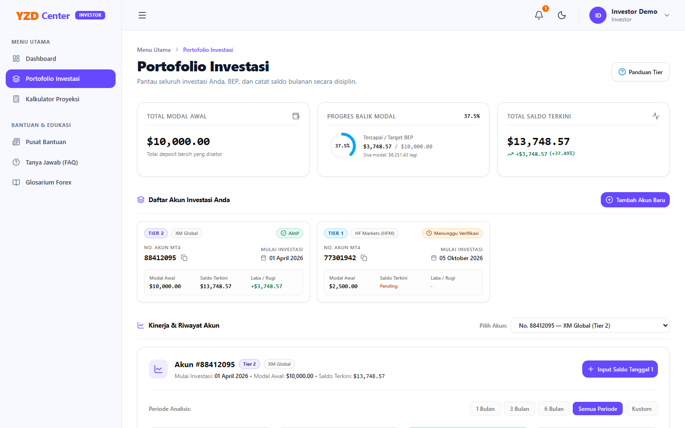

---

### 5.1 Ringkasan Konsolidasi & Progres Balik Modal (BEP)
- **Kartu Total Modal & Saldo:** Menampilkan total deposit aktif dan nilai saldo terkini.
- **Diagram Lingkaran BEP (Radial Gauge):** Menunjukkan persentase pencapaian target balik modal 100% beserta sisa nominal dolar yang dibutuhkan.
- **Tombol Panduan Tier:** Menampilkan modal penjelasan ketentuan tier investasi.

---

### 5.2 Mendaftarkan Akun Investasi / Copytrade Baru
1. Klik tombol **"Mulai Investasi Akun Baru"** pada header tab portofolio atau beralih ke tab **"Alur Memulai Investasi"**.
2. Ikuti alur mandiri (onboarding 6 langkah) terstruktur:
   - **Langkah 1:** Pemilihan Broker (HFM untuk Tier 1 & 2, atau XM untuk Tier 3).
   - **Langkah 2:** Penentuan Modal Investasi (USD) dan verifikasi Tier.
   - **Langkah 3:** Registrasi & Verifikasi Akun Broker.
   - **Langkah 4:** Pembukaan Akun MT4 & Deposit Modal.
   - **Langkah 5:** Pengisian Data Akun MT4 & Bukti Pendaftaran.
   - **Langkah 6:** Sinkronisasi Myfxbook & Verifikasi Akhir.
3. Klik **"Kirim Pengajuan Akun Investasi"**. Akun akan masuk antrean verifikasi Admin dengan status *Menunggu Verifikasi*.

---

### 5.3 Tabel Ketentuan Tier Investasi & Rentang Modal

| Tingkatan Tier | Rentang Modal Deposit (USD) | Karakteristik Akun |
| :--- | :--- | :--- |
| **Tier 1** | **$< \$5,000$** ($\$1$ s/d $\$4,999.99$) | Akun modal mikro/standar pemula. |
| **Tier 2** | **$\$5,000$ – $\$300,000$** | Akun modal menengah dengan manajemen risiko moderat. |
| **Tier 3** | **$\ge \$300,000$** | Akun modal institusi/VIP dengan konfigurasi VPS terdedikasi. |

---

### 5.4 Memantau Kinerja Akun & Grafik Tren Saldo Bulanan
1. **Pemilihan Akun & Periode:** Pilih kartu akun MT4 yang ingin dianalisis, lalu tentukan rentang waktu (**1 Bulan**, **3 Bulan**, **6 Bulan**, **Semua**, atau **Kustom**).
2. **4 Kartu Kinerja:** Menampilkan Saldo Awal Periode, Saldo Akhir Periode, Laba Periode Ini, serta Rata-rata Pertumbuhan Bulanan.
3. **Grafik Kurva Tren Saldo:** Garis tren visual saldo dari bulan ke bulan. Arahkan kursor atau sentuh titik grafik untuk melihat rincian tanggal, saldo, dan profit MoM (*Month-on-Month*).

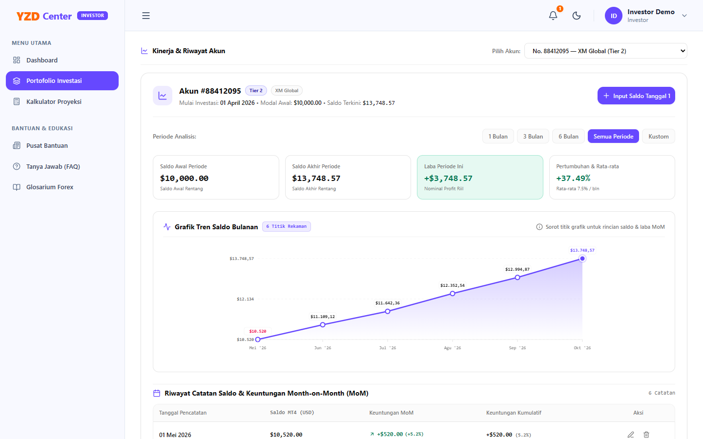

---

### 5.5 Disiplin Pencatatan: Input Saldo Tanggal 1
Catatlah saldo MT4 Anda setiap **tanggal 1 awal bulan**:
1. Pastikan akun MT4 berstatus **Aktif**.
2. Klik tombol **"Input Saldo Tanggal 1"** di pojok kanan atas kartu kinerja.
3. Masukkan nominal saldo terkini yang tertera pada aplikasi MetaTrader 4 Anda.
4. Perhatikan kalkulasi estimasi laba/rugi MoM (`+$...` dan `+%`), lalu klik **"Simpan Saldo"**.

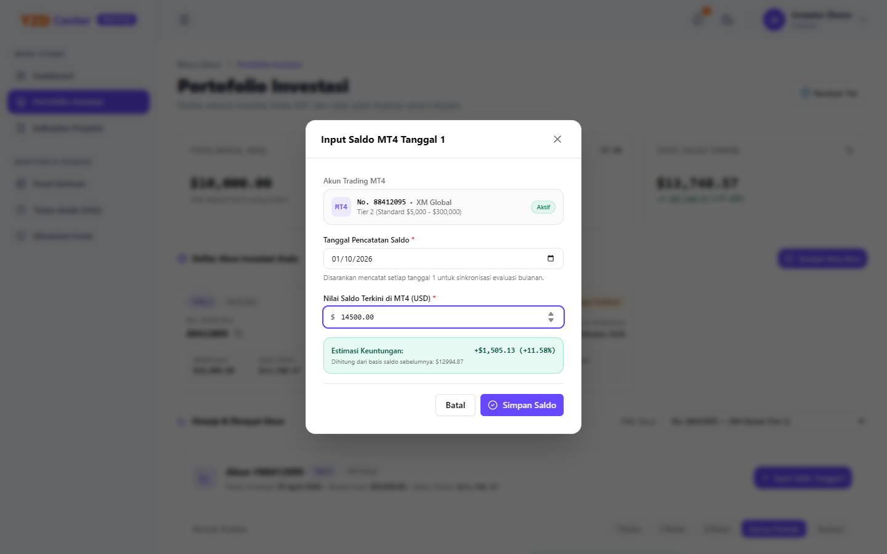

---

### 5.6 Mengelola Tabel Riwayat Catatan Saldo (Ubah & Hapus)
Tabel riwayat di bagian bawah menyajikan rekaman saldo kronologis:
- **Tanggal Pencatatan:** Waktu rekaman saldo.
- **Saldo MT4 (USD):** Total nilai saldo pada tanggal tersebut.
- **Keuntungan MoM:** Selisih laba/rugi dibanding bulan sebelumnya (Hijau = Profit, Merah = Drawdown, Abu-abu strip datar `—` = Flat).
- **Keuntungan Kumulatif:** Akumulasi laba/rugi sejak deposit awal.
- **Aksi:** Tombol **Pensil (`✏️`)** untuk mengubah nilai saldo dan tombol **Tempat Sampah (`🗑️`)** untuk menghapus rekaman.

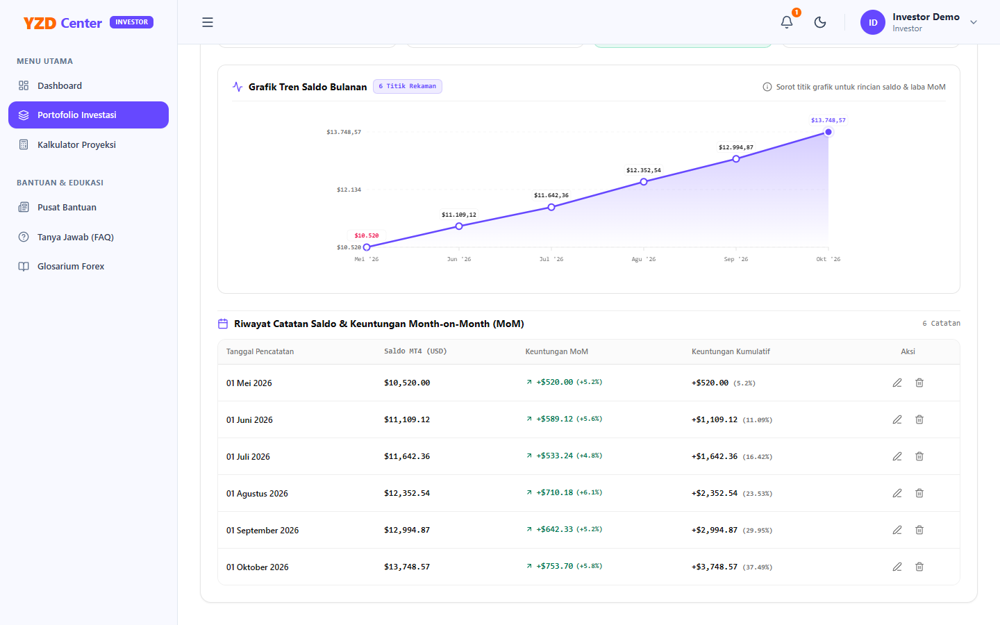

---

### 5.7 Kondisi Khusus (Edge Cases) & Rekalkulasi Otomatis

> [!WARNING]
> 1. **Akun Pending:** Tombol input saldo dan grafik tren dinonaktifkan hingga akun disetujui Admin.
> 2. **Minimal 2 Titik Data untuk Kurva Grafik:** Grafik garis membutuhkan minimal 2 rekaman saldo bulanan untuk membentuk garis kurva.
> 3. **Larangan Tanggal Duplikat & Tanggal Masa Depan:** Sistem mengunci tanggal agar tidak mendahului tanggal deposit awal, tidak melebihi hari ini, dan tidak mencatat dua kali di tanggal yang sama.
> 4. **Rekalkulasi Berantai Otomatis:** Menambah data mundur, mengedit saldo lama, atau menghapus rekaman saldo akan memicu sistem untuk menghitung ulang seluruh nilai MoM, Saldo Kumulatif, dan BEP secara otomatis dan presisi.

---

## Bab 6: Menu Utama 3 — Kalkulator Proyeksi Investasi

### 6.1 Fungsi Kalkulator Proyeksi Finansial
Menu **Kalkulator Proyeksi** (`/member/education/calculator`) adalah simulasi edukatif untuk memperkirakan pertumbuhan modal jangka panjang dengan pilihan bunga berbunga (*compounding*) atau bunga tetap (*non-compounding*).

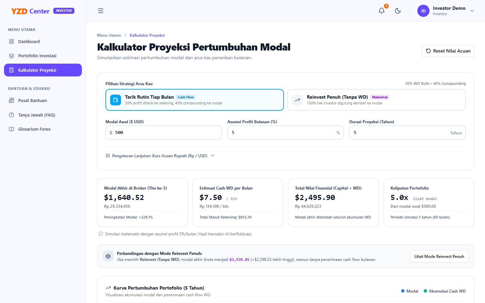

---

### 6.2 Langkah Penggunaan & Pengaturan Parameter Simulasi
1. **Pilih Preset Tier:** Klik tombol *Tier 1*, *Tier 2*, atau *Tier 3* untuk memuat parameter rekomendasi.
2. **Atur Modal Awal (USD):** Ketik angka atau geser penggeser (*slider*).
3. **Atur Target Profit per Bulan (%):** Rentang `0.5%` hingga `15%` per bulan.
4. **Tentukan Durasi Investasi:** Pilihan mulai dari 6 Bulan hingga 5 Tahun.
5. **Sakelar Compounding:**
   - **Aktif (Disarankan):** Profit bulanan diinvestasikan kembali ke pokok modal (efek bunga majemuk).
   - **Nonaktif:** Profit dihitung hanya dari modal pokok awal.

---

### 6.3 Membaca Hasil Proyeksi, Grafik & Tabel Rincian Tahunan
- **Estimasi Saldo Akhir & Total Return:** Proyeksi modal di akhir periode.
- **Laba Bersih & Estimasi Waktu BEP:** Perkiraan jumlah bulan menuju titik impas modal 100%.
- **Kurva Grafik Proyeksi:** Visualisasi eksponensial pertumbuhan saldo.
- **Tabel Rincian Tahunan:** Rincian saldo awal tahun, laba tahun berjalan, dan saldo penutupan tahun.

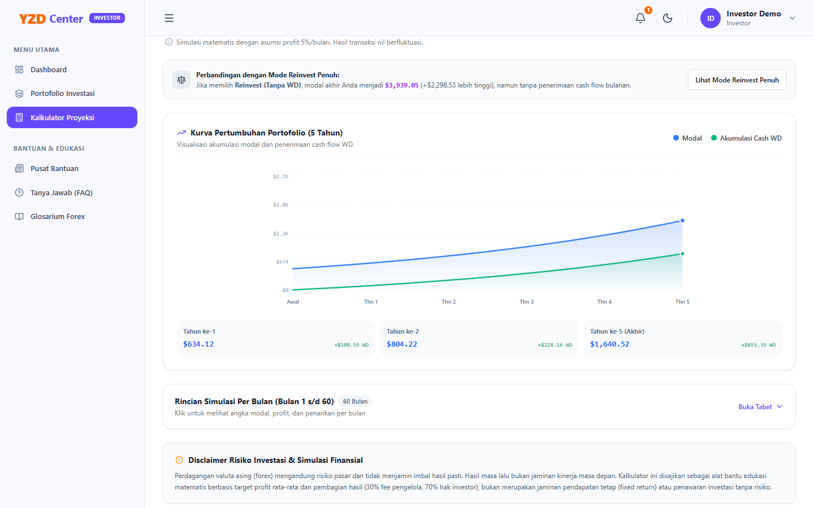

---

### 6.4 Kondisi Khusus (Edge Cases) pada Kalkulator Proyeksi
- **Penyesuaian Modal Otomatis:** Memilih preset Tier yang berbeda otomatis menyesuaikan batas modal ke nilai minimum Tier tersebut.
- **Sifat Edukatif:** Seluruh angka kalkulator bersifat simulasi dan tidak mempengaruhi saldo riil akun trading Anda.

---

## Bab 7: Program Kemitraan 1 — Tautan Referral & Jaringan Downline

### 7.1 Mekanisme Kode & Tautan Referral Unik Otomatis
Setiap Member otomatis memiliki **Kode Referral Unik** yang diterbitkan oleh sistem. 

Buka menu **Program Kemitraan & Komisi** $\rightarrow$ **Jaringan Kemitraan** (`/member/affiliates`):
- Format Tautan: `https://[domain-yzd]/register?invitation=TOKEN&ref=KODE_REFERRAL_ANDA`
- Calon investor yang membuka tautan tersebut otomatis mengunci kode referral Anda pada formulir registrasi.

---

### 7.2 Cara Membagikan Tautan & Melacak Status Downline
1. Pada kartu **Tautan Referral Anda**, klik tombol **"Salin Tautan"**.
2. Bagikan tautan ke calon investor melalui WhatsApp, Telegram, atau media sosial.
3. Setelah calon investor menyelesaikan registrasi dan KYC, profil mereka langsung tercatat di tabel jaringan Anda.

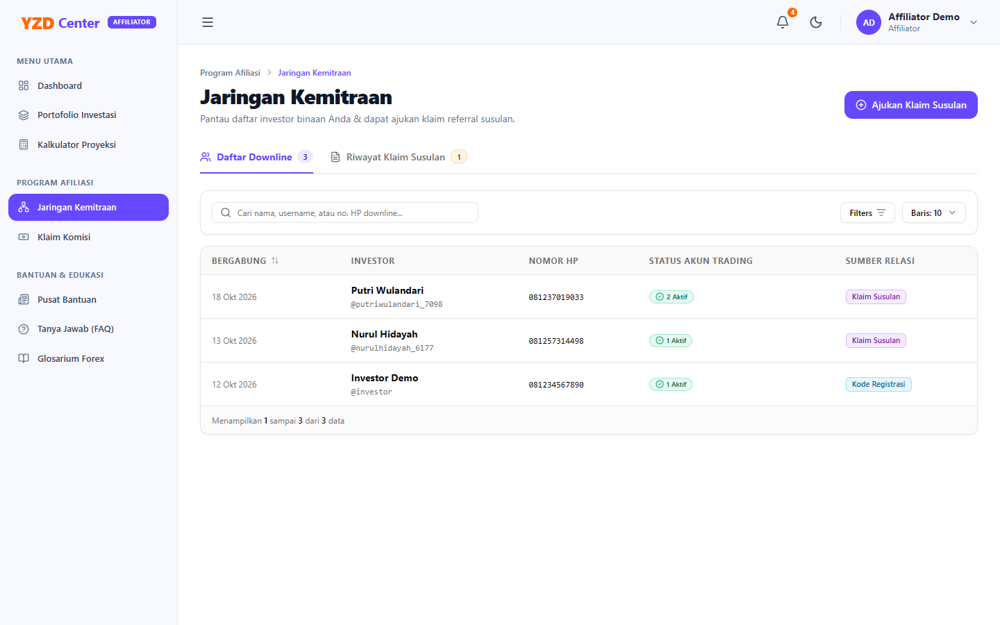

---

### 7.3 Membaca Tabel Jaringan Downline
- **Bergabung:** Tanggal dan waktu investor resmi terdaftar.
- **Investor:** Nama lengkap dan username akun downline.
- **Nomor HP:** Kontak WhatsApp investor binaan untuk koordinasi.
- **Status Akun Trading:** Kesiapan akun copytrade downline (*Belum Mendaftar*, *Menunggu Verifikasi*, atau *Aktif*).
- **Sumber Relasi:** *Tautan Otomatis* atau hasil *Klaim Susulan*.

---

### 7.4 Kondisi Khusus (Edge Cases) pada Registrasi Referral
- **Pendaftaran Tanpa Klik Tautan:** Jika calon investor mendaftar mandiri tanpa tautan atau menggunakan peramban berbeda, relasi tidak terbentuk otomatis. Anda dapat menggunakan prosedur **Klaim Referral Susulan** (Bab 8).

---

## Bab 8: Program Kemitraan 2 — Prosedur Klaim Referral Susulan

### 8.1 Kapan Klaim Susulan Diperlukan?
Fitur **Klaim Referral Susulan** digunakan apabila:
- Calon investor binaan Anda lupa mengklik tautan referral saat mendaftar.
- Investor terdaftar secara organik namun Anda memiliki bukti otentik bimbingan komunikasi.

---

### 8.2 Langkah Demi Langkah Pengajuan Klaim Susulan
1. Masuk ke menu **Jaringan Kemitraan** $\rightarrow$ klik tombol **"Ajukan Klaim Susulan"**.
2. Pada jendela modal:
   - **Username Calon Downline:** Ketik username investor, lalu klik **"Cek Database"**.
   - **Bukti Pendukung:** Unggah tangkapan layar percakapan WhatsApp/Telegram (format `JPG`, `PNG`, `WEBP`, maks. 5 MB).
   - **Kronologi / Alasan Klaim:** Berikan penjelasan singkat perkenalan dan bimbingan Anda.
3. Klik tombol **"Kirim Permohonan Klaim"**.

---

### 8.3 Status Pemeriksaan Klaim Susulan (Menunggu, Disetujui, Ditolak)
Pantau status pada tab **Riwayat Klaim Susulan** (`/member/affiliates?tab=claims`):
- **Menunggu Verifikasi (Kuning):** Sedang dalam antrean pemeriksaan Admin.
- **Disetujui (Hijau):** Klaim sah. Investor masuk ke jaringan downline Anda dan akun tradingnya siap menghasilkan hak komisi.
- **Ditolak (Merah):** Permohonan ditolak disertai alasan pada kolom **Catatan Admin** (klik tombol *"Baca Selengkapnya"*).

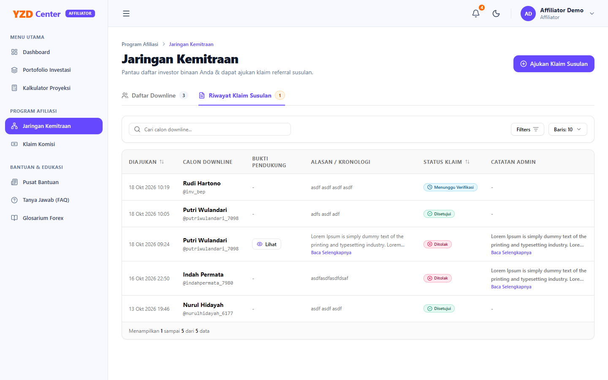

---

### 8.4 Ketentuan Berkas Bukti Pendukung & Audit Anti-Klaim Ganda
- **Aturan Anti-Klaim Ganda:** Jika terdapat klaim bersaing untuk investor yang sama, Admin memvalidasi bukti stempel waktu (*timestamp*) paling awal.
- **Penyimpanan Privat:** Berkas screenshot disimpan pada penyimpanan privat terenkripsi demi menjaga kerahasiaan komunikasi.

---

## Bab 9: Program Kemitraan 3 — Skema Komisi 4-Tier & Pencairan Dana

### 9.1 Prinsip Perhitungan Komisi Berbasis Akun Trading Aktif
Komisi dihitung berdasarkan **jumlah akun trading copytrade MT4 aktif** milik investor binaan Anda menggunakan **Skema 4-Tier Berjenjang**. Kurs konversi resmi sistem: **\$1 USD = Rp 15.000,-**.

---

### 9.2 Tabel Rincian Skema Komisi 4-Tier

| Tingkatan Tier | Batas Akun Trading Aktif Binaan | Komisi per Akun (USD) | Komisi per Akun (IDR) |
| :---: | :---: | :---: | :---: |
| **Tier 1 (Dasar)** | Akun ke-1 s/d ke-10 | **\$10.00** | **Rp 150.000,-** |
| **Tier 2 (Menengah)** | Akun ke-11 s/d ke-30 | **\$25.00** | **Rp 375.000,-** |
| **Tier 3 (Tinggi)** | Akun ke-31 s/d ke-70 | **\$50.00** | **Rp 750.000,-** |
| **Tier 4 (VIP Partner)** | Akun ke-71 ke atas | **\$50.00 + Bonus Khusus** | **Rp 750.000,- + Insentif** |

---

### 9.3 Kriteria Akun Downline yang Layak Diklaim (Eligible)
Akun trading binaan berstatus **Layak Diklaim (*Eligible*)** jika:
1. Investor pemilik akun terdaftar sah di bawah jaringan Anda.
2. Akun MT4 telah diverifikasi dan disetujui Admin (berstatus **Aktif**).
3. Akun tersebut **belum pernah diklaim** pada periode pencairan komisi sebelumnya.

---

### 9.4 Aturan Klaim Komisi Satu Kali Seumur Hidup per Akun
Setiap nomor akun trading MT4 unik hanya memberikan hak komisi sebanyak **1 kali seumur hidup**. Setelah dicairkan, akun tersebut berstatus *Claimed*.

---

### 9.5 Membaca Kartu Ringkasan Metrik Komisi
Buka menu **Klaim Komisi** (`/member/commissions`):
- **Total Komisi Diterima:** Akumulasi dana yang telah berhasil ditransfer ke rekening bank Anda.
- **Komisi Siap Dicairkan:** Nominal Rupiah dari akun aktif baru yang siap diajukan pencairannya.
- **Komisi Dalam Proses:** Nominal klaim yang sedang dalam antrean verifikasi transfer bank oleh Admin.
- **Total Akun Aktif Binaan:** Jumlah akun MT4 aktif di bawah pembinaan Anda.

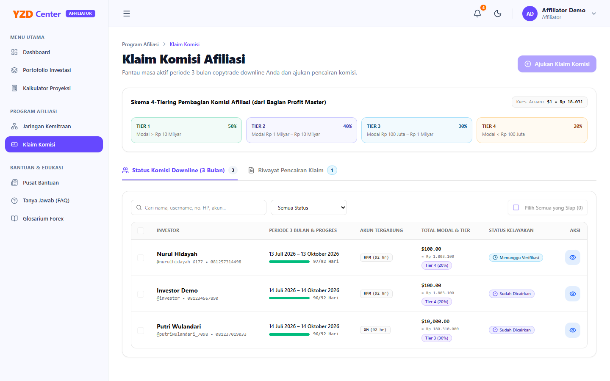

---

### 9.6 Langkah Demi Langkah Pengajuan Pencairan Komisi
1. Klik tombol **"Ajukan Klaim Komisi"** saat nilai *Komisi Siap Dicairkan* $> \text{Rp } 0$.
2. Pada jendela formulir:
   - **Pilih Akun:** Centang akun-akun trading yang ingin dicairkan.
   - **Kalkulasi Otomatis:** Periksa kalkulasi jumlah akun dan total nominal transfer Rupiah.
   - **Konfirmasi Rekening Bank:** Pastikan Nama Bank, Nomor Rekening, dan Nama Pemilik Rekening sudah sesuai data Anda.
3. Klik tombol **"Kirim Pengajuan Pencairan"**.

---

### 9.7 Proses Verifikasi Administrator & Bukti Transfer Bank
1. Admin memverifikasi keabsahan akun dan mentransfer dana ke rekening bank Anda.
2. Admin mengunggah berkas struk bukti transfer resmi bank ke sistem.
3. Status klaim berubah menjadi **Berhasil Ditransfer (Hijau)**.
4. Anda dapat mengklik baris riwayat dan memilih **"Lihat Bukti Transfer Bank"** untuk melihat berkas bukti transfer.

---

### 9.8 Kondisi Khusus (Edge Cases) pada Pencairan Komisi
- **Perubahan Rekening Bank:** Jika terdapat perubahan nomor rekening, perbarui profil sebelum mengirim pengajuan klaim.
- **Penolakan Sebagian Akun:** Jika suatu akun MT4 mengalami pembatalan deposit di broker, Admin dapat menolak akun tersebut dengan catatan rinci, sementara akun lain yang valid tetap dapat diproses.

---

### 9.9 Simulasi Proyeksi Potensi Komisi (Kalkulator Afiliator)
Untuk mempermudah affiliator dalam merencanakan target pembinaan investor dan mempresentasikan potensi kemitraan secara transparan, sistem menyediakan fitur **Kalkulator Komisi Afiliator** (`/member/affiliates-calculator`).

#### Cara Mengakses:
1. Melalui menu samping (*Sidebar*): **Program Kemitraan & Komisi** $\rightarrow$ **Kalkulator Komisi**.
2. Melalui pintasan tombol **"Kalkulator Komisi"** di sudut kanan atas halaman **Jaringan Kemitraan** (`/member/affiliates`).

#### Panduan Penggunaan Formulir Simulasi:
1. **Daftar Investor Binaan (Tanpa Batasan Kuota):**
   - Klik tombol **"Tambah Investor"** untuk menambahkan baris investor baru tanpa batasan jumlah baris.
   - Masukkan **Nama / Label Investor** (misal: "Investor A").
   - Masukkan **Estimasi Modal Awal (IDR)** (minimal Rp 10.000.000). Nilai ekuivalen USD dihitung otomatis berdasarkan kurs pasar saat ini.
   - Atur **Estimasi Profit Bulanan (%)** per investor (baku: 5.0%, rentang: 0.1% s.d. 100%).
   - Klik tombol ikon tempat sampah (*Hapus*) untuk mengurangi baris investor (minimal tersisa 1 baris).
   - Klik tombol **"Reset"** di header untuk mengembalikan isian formulir ke nilai awal (1 investor @ Rp 100 Juta, 5% profit).
2. **Panel Ringkasan & Indikator Tiering:**
   - **Total Estimasi Modal:** Akumulasi total modal seluruh investor binaan dalam Rupiah dan USD.
   - **Total Estimasi Komisi 3 Bulan:** Proyeksi total hak komisi afiliator yang akan dicairkan setelah 3 bulan evaluasi laporan lunas.
   - **Indikator Skema 4-Tier:** Menampilkan tingkatan tier yang aktif dengan highlight warna ungu:
     - **Tier 1:** Modal $> \text{Rp } 10\text{ Milyar}$ $\rightarrow$ Komisi **50%** dari Master Fee.
     - **Tier 2:** Modal $\text{Rp } 1\text{ M} - \text{Rp } 10\text{ M}$ $\rightarrow$ Komisi **40%** dari Master Fee.
     - **Tier 3:** Modal $\text{Rp } 100\text{ Jt} - \text{Rp } 1\text{ M}$ $\rightarrow$ Komisi **30%** dari Master Fee.
     - **Tier 4:** Modal $< \text{Rp } 100\text{ Juta}$ $\rightarrow$ Komisi **20%** dari Master Fee.
3. **Membaca Tabel Rincian Proyeksi Bulanan (Jendela 3 Bulan):**
   - **Bulan ke-1 s.d. ke-3:** Menampilkan modal awal bulan, estimasi gross profit, tagihan Master Fee (30%), estimasi komisi afiliator, proyeksi penarikan tunai investor (60% dari laba bersih investor), dan pemupukan modal (40% dari laba bersih investor ditambahkan ke modal bulan berikutnya).
   - **Baris Total Akumulasi:** Menampilkan total gross profit, total Master Fee, total komisi afiliator, dan total penarikan tunai investor selama 3 bulan.
4. **Pernyataan Sanggahan (*Disclaimer*):**
   - Hasil kalkulasi kalkulator adalah simulasi matematis murni berdasarkan estimasi dan asumsi performa, **bukan merupakan jaminan keuntungan pasti** dari pasar forex.

---

## Bab 10: Program Kemitraan 4 — Materi Promosi (Profit Master Feed)

Menu **Materi Promosi** (`/member/profit-master`) adalah fasilitas khusus bagi seluruh Member untuk mendapatkan materi promosi, infografis performa, dan bukti transaksi nyata Master Trader yang diterbitkan resmi oleh manajemen YZD Center.

---

### 10.1 Fungsi Feed Materi Promosi Master Trader
Feed materi promosi dirancang bergaya linimasa media sosial modern (*social feed*):
- Menyajikan konten promosi terbaru lengkap dengan stempel waktu dan identitas penerbit (*Master Trader*).
- Menyediakan narasi teks (*caption*) profesional yang siap dibagikan ke calon investor.
- Menyajikan galeri gambar tangkapan layar profit dan infografis beresolusi tinggi.

---

### 10.2 Pencarian Materi Promosi
Gunakan bilah pencarian di bagian atas feed untuk menyaring konten promosi berdasarkan kata kunci (contoh: *"rekap profit"*, *"gold"*, atau *"konsistensi"*).

---

### 10.3 Fitur Salin Caption Otomatis
Pada setiap postingan materi promosi, terdapat tombol **"Salin Caption"**:
1. Klik tombol **"Salin Caption"** (ikon salin).
2. Teks promosi akan langsung disalin ke *clipboard* perangkat Anda dan tombol berubah menjadi lencana hijau bertuliskan **"Tersalin!"**.
3. Teks tersebut siap ditempel (*paste*) langsung ke WhatsApp, Telegram, Instagram, atau Facebook.

---

### 10.4 Fitur Unduh Berkas Grafis / Gambar Materi
- **Unduh Sekaligus (*Download All*):** Klik tombol **"Unduh (N)"** pada bilah bawah kartu postingan untuk mengunduh seluruh foto materi promosi dalam satu tindakan.
- **Unduh Satuan:** Buka salah satu gambar untuk menampilkan penampil gambar (*lightbox*), lalu klik tombol ikon unduh di sudut atas jendela.

---

### 10.5 Fitur Bagikan Langsung via Web Share API & Lightbox Gambar
- **Tombol Bagikan (*Share*):** Klik tombol **Bagikan** di sisi kanan kartu postingan. Pada perangkat smartphone atau peramban modern yang mendukung *Web Share API*, sistem akan langsung membuka laci berbagi bawaan perangkat menuju aplikasi WhatsApp, Telegram, Twitter/X, atau email.
- **Pratinjau Lightbox Interaktif:** Klik pada gambar postingan mana saja untuk membuka jendela pratinjau resolusi penuh. Gunakan tombol panah kiri (`←`) dan kanan (`→`) untuk menjelajahi seluruh foto tanpa keluar dari modal.

---

## Bab 11: Saluran Bantuan 1 — Tiket Bantuan (Customer Support Helpdesk)

Menu **Tiket Bantuan** (`/member/tickets`) adalah saluran komunikasi resmi dua arah yang aman dan terdokumentasi antara Member dan Tim Administrator untuk menangani kendala teknis, akun, deposit broker, maupun pertanyaan kemitraan.

---

### 11.1 Kapan Membuat Tiket Bantuan?
Anda disarankan membuat tiket bantuan apabila:
- Mengalami kendala sinkronisasi saldo pada akun trading MT4.
- Mengalami kegagalan verifikasi dokumen legalitas atau kendala KYC.
- Mengalami kendala terkait pencairan komisi bank atau pelacakan downline.
- Menemukan kendala teknis sistem atau membutuhkan klarifikasi operasional dari tim admin.

---

### 11.2 Prosedur Pembuatan Tiket Baru & Kompresi Gambar Otomatis
1. Buka menu **Bantuan & Edukasi** $\rightarrow$ **Tiket Bantuan** $\rightarrow$ klik tombol **"Buat Tiket Baru"** (`/member/tickets/create`).
2. Pada formulir yang disediakan:
   - **Subjek Kendala:** Tuliskan pokok kendala secara singkat dan jelas (maks. 255 karakter, contoh: *"Deposit Akun MT4 123456 Belum Masuk Portofolio"*).
   - **Deskripsi Lengkap Kendala:** Jelaskan kronologi kendala secara detail (tersedia hingga 20.000 karakter).
   - **Lampiran Gambar Bukti:** Klik tombol unggah berkas atau seret foto bukti tangkapan layar kendala (format `JPG`, `JPEG`, `PNG`, `WEBP`, hingga 10 MB per gambar).
3. **Kompresi Gambar Otomatis:** Sistem secara senyap mengompresi gambar tanpa menurunkan keterbacaan teks angka, menampilkan pratinjau thumbnail dengan nama berkas asli serta tombol hapus (`×`).
4. Klik tombol **"Kirim Tiket Bantuan"**. Sistem akan menerbitkan nomor tiket unik berformat `TKT-YYYYMM-XXXX` (contoh: `TKT-202610-0001`).

---

### 11.3 Pencarian Instan Tiket Otomatis (Live Debounce Search)
Pada halaman daftar tiket (`/member/tickets`), tersedia bilah pencarian cerdas:
- **Pencarian Otomatis:** Cukup ketikkan nomor tiket atau kata kunci subjek. Sistem secara otomatis menyaring daftar tiket dengan jeda halus 350ms tanpa mengharuskan Anda menekan tombol Enter.
- **Filter Status Cepat:** Klik tab status (*Semua*, *Aktif*, *Selesai*, *Ditutup*) untuk menyaring antrean tiket berdasarkan siklusnya.
- **Hapus Pencarian:** Klik tombol tanda silang (`×`) pada kotak pencarian untuk mereset filter seketika.

---

### 11.4 Utas Percakapan Interaktif dengan Admin & Lightbox Lampiran
Klik pada salah satu tiket untuk membuka halaman percakapan (`/member/tickets/{id}`):
- **Kartu Rincian Kendala Awal:** Kartu paling atas menyajikan subjek, nomor tiket, badge status, waktu pelaporan, deskripsi kendala pembuka, serta thumbnail gambar bukti awal.
- **Utas Balasan Percakapan:** Bagian percakapan menyajikan balasan berurutan antara Anda (lencana biru Member) dan tim teknis (lencana oranye/emas Tim Admin).
- **Penampil Gambar (Lightbox):** Klik gambar lampiran mana saja di dalam percakapan untuk membuka modal pratinjau beresolusi tinggi lengkap dengan nama berkas dan tombol unduh di bagian header modal.
- **Bilah Balasan:** Selama tiket masih aktif, ketik balasan Anda pada kolom teks bawah dan lampirkan bukti gambar tambahan jika diminta oleh tim admin, lalu klik tombol **"Kirim Balasan"**.

---

### 11.5 Siklus Hidup Status Tiket (Open, In Progress, Answered, Resolved, Closed)

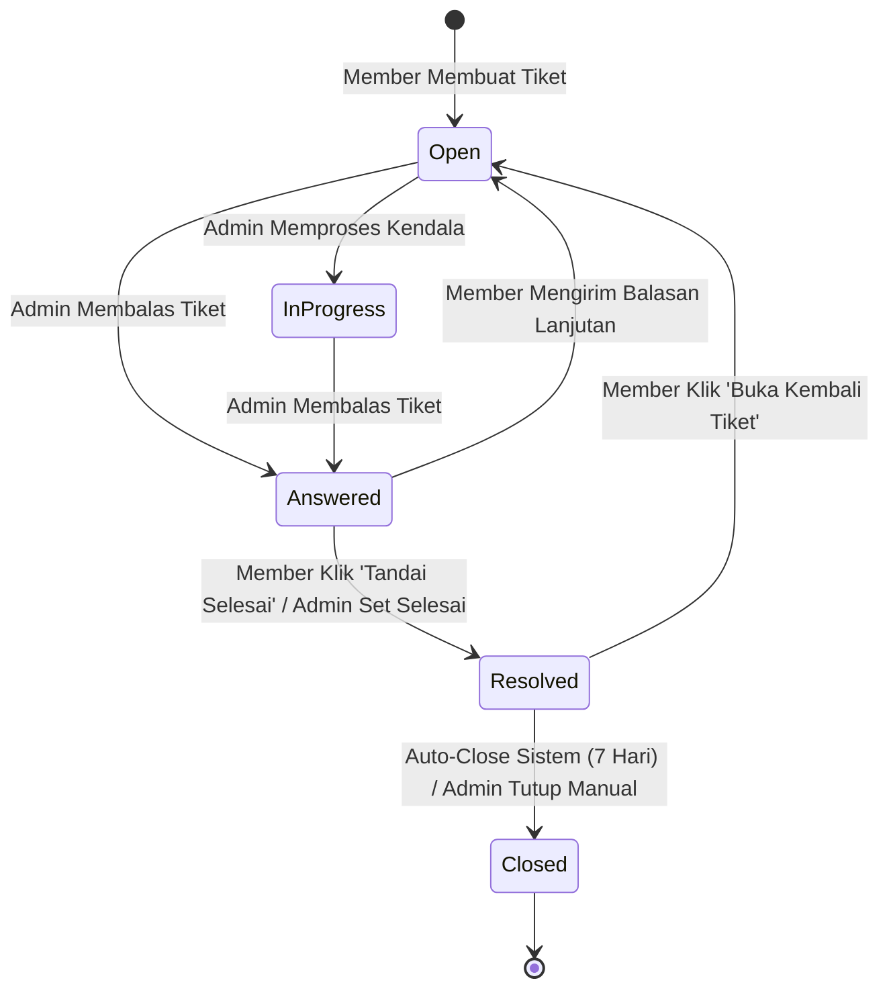

- **Open (Biru):** Tiket baru dibuat atau baru saja dibalas oleh Member dan sedang menunggu tanggapan tim admin.
- **In Progress (Kuning/Amber):** Kendala sedang dalam investigasi atau penanganan tim teknis.
- **Answered (Ungu):** Tim admin telah mengirimkan tanggapan balasan. Mohon periksa balasan tersebut.
- **Resolved (Hijau):** Kendala dinyatakan selesai. Spanduk hijau akan muncul di bagian atas halaman tiket.
- **Closed (Abu-abu):** Tiket resmi ditutup dan diarsipkan. Percakapan tidak dapat dibalas lagi.

---

### 11.6 Menandai Selesai & Prosedur Membuka Kembali Tiket
- **Tandai Selesai:** Apabila panduan atau solusi dari admin telah berhasil mengatasi kendala Anda, klik tombol hijau **"Tandai Selesai"** di sudut kanan atas header tiket. Dialog konfirmasi akan memastikan keputusan Anda sebelum status diubah menjadi *Resolved*.
- **Buka Kembali Tiket:** Jika setelah ditandai selesai kendala serupa muncul kembali, Anda tidak perlu membuat tiket baru dari awal. Klik tombol biru **"Buka Kembali Tiket"** pada header tiket yang berstatus *Resolved*. Status tiket akan kembali menjadi *Open* dan tim admin akan menerima pemberitahuan otomatis.

---

### 11.7 Penutupan Otomatis Tiket Selesai (Auto-Close 7 Hari)
Tiket yang telah berstatus **Resolved** akan resmi ditutup secara otomatis oleh sistem (*Auto-Close*) apabila dalam kurun waktu **7 hari kalender** tidak terdapat balasan lanjutan atau sanggahan dari Member. Jika Anda memiliki kendala baru setelah tiket ditutup, silakan buat tiket bantuan baru.

---

## Bab 12: Saluran Bantuan 2 — Pusat Bantuan, Tanya Jawab & Glosarium

### 12.1 Pusat Bantuan (Artikel Panduan Lengkap)
Menu **Pusat Bantuan** (`/member/education/help`) menyediakan dokumentasi resmi terstruktur:
1. Ketik kata kunci pada bilah pencarian atau klik tab kategori topik.
2. Setiap kartu artikel menyajikan ringkasan topik yang bersih tanpa metrik pengganggu.
3. Klik tombol **"Baca Selengkapnya"** untuk membuka panduan lengkap beserta daftar isi navigasi cepat di sisi kanan.

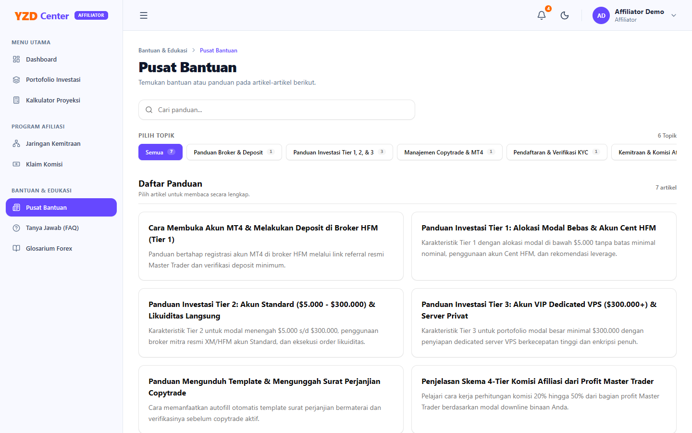

---

### 12.2 Tanya Jawab (FAQ)
Menu **Tanya Jawab (FAQ)** (`/member/education/faq`) merangkum solusi atas pertanyaan umum:
1. Seluruh pertanyaan tersusun ringkas dalam kondisi awal tertutup (*accordion collapsed*).
2. Klik baris pertanyaan untuk membuka kotak penjelasan dan klik kembali untuk menutupnya.
3. Gunakan bilah pencarian FAQ untuk menyaring pertanyaan spesifik.

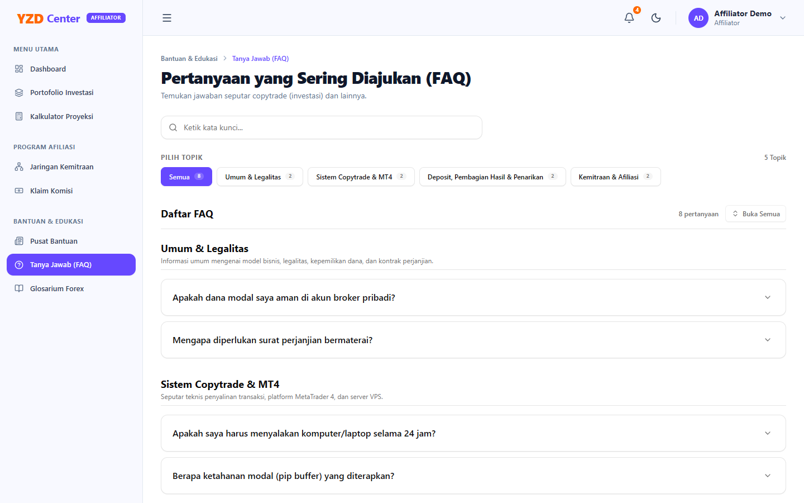

---

### 12.3 Glosarium Forex (Kamus Istilah Trading)
Menu **Glosarium Forex** (`/member/education/glossary`) menyajikan kamus referensi istilah finansial:
1. Cari istilah melalui bilah pencarian atau gunakan bilah abjad (**A–Z**).
2. Setiap kartu istilah memuat nama istilah, kategori, definisi bahasa awam yang mudah dipahami, serta contoh penerapan praktis.

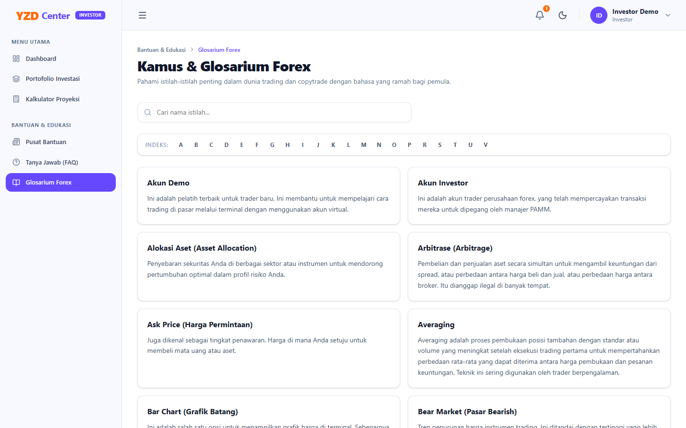

---

### 12.4 Kondisi Khusus (Edge Cases) pada Menu Bantuan & Edukasi
- **Akses Penuh Sejak Awal:** Ketiga menu edukasi ini dapat diakses kapan saja, bahkan saat akun baru Anda masih dalam antrean verifikasi KYC.
- **Tombol Reset Filter:** Jika kombinasi pencarian kata kunci dan kategori tidak menghasilkan data, gunakan tombol *"Reset Semua Filter"* untuk memulihkan tampilan.

---

## Bab 13: Pengaturan Akun, Notifikasi & Keamanan

### 13.1 Mengelola Notifikasi Sistem In-App & Pola Redireksi
Sistem mengirimkan pemberitahuan instan (*in-app notification*) untuk seluruh aktivitas akun Anda:
- Persetujuan verifikasi akun KYC atau instruksi revisi KTP/perjanjian.
- Pengaktifan akun copytrade MT4 baru.
- Pengingat rutin **Laporan Profit Bulanan & Master Fee** pada tanggal 1, 7, dan 15.
- Pendaftaran downline baru di bawah jaringan Anda.
- Persetujuan/penolakan klaim referral susulan.
- Konfirmasi transfer pencairan komisi bank beserta berkas struk bukti transfer.
- Notifikasi tanggapan balasan dan perubahan status **Tiket Bantuan**.

**Penggunaan Notifikasi:**
1. Klik **Ikon Lonceng (`🔔`)** di kanan atas bilah navigasi. Angka oranye menunjukkan jumlah pesan belum dibaca.
2. Pesan notifikasi dirancang ringkas (pratinjau catatan dibatasi maksimal 10 kata).
3. Klik pada salah satu pesan untuk langsung menuju ke halaman atau tab tujuan terkait (misalnya langsung membuka tiket bantuan atau tab klaim komisi). Pesan akan otomatis ditandai terbaca.
4. Klik **"Lihat Semua Notifikasi"** untuk membuka halaman arsip notifikasi lengkap, menandai seluruh pesan dibaca, atau menghapus pesan lama.

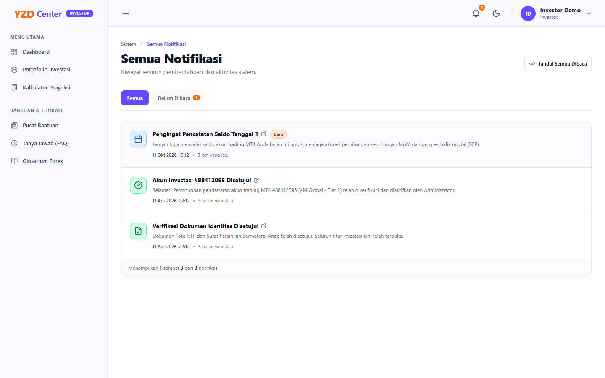

---

### 13.2 Mengganti Kata Sandi (Password) Akun
1. Klik menu profil di sudut kanan atas $\rightarrow$ pilih **"Ganti Password"**.
2. Masukkan **Kata Sandi Saat Ini**, ketik **Kata Sandi Baru** (minimal 8 karakter kombinasi huruf dan angka), lalu ulangi pada kolom **Konfirmasi Kata Sandi Baru**.
3. Klik tombol **"Simpan Kata Sandi"**.

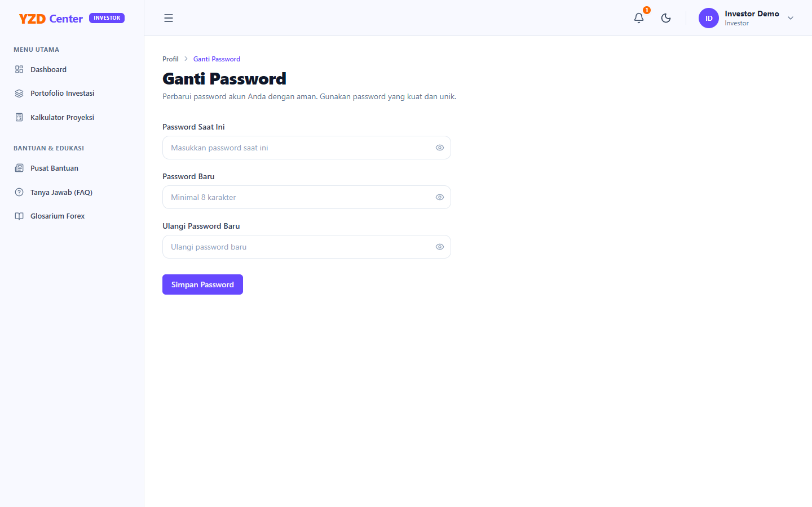

---

### 13.3 Pengaturan Tampilan (Mode Terang / Gelap) & Keluar Akun (Logout)
- **Tema Terang / Gelap:** Klik ikon matahari (`☀️`) / bulan (`🌙`) pada bilah atas untuk beralih antara *Light Mode* dan *Dark Mode* sesuai kenyamanan mata Anda.
- **Keluar Akun (*Logout*):** Klik profil Anda $\rightarrow$ pilih menu **"Keluar"** (warna merah). Selalu biasakan keluar dari sesi akun jika menggunakan gawai bersama.

---

### 13.4 Kondisi Khusus (Edge Cases) pada Notifikasi & Keamanan
- **Salah Ketik Kata Sandi:** Gunakan ikon mata (`👁️`) pada kolom input untuk memeriksa ketikan Anda sebelum menyimpan.
- **Lupa Kata Sandi Login:** Demi perlindungan aset finansial Member, pemulihan kata sandi dilakukan melalui verifikasi identitas resmi bersama Administrator YZD Center.

---

## Bab 14: Manajemen Laporan Profit Bulanan & Master Fee (30%)

Menu **Master Fee** (`/member/master-fee`) adalah modul pelaporan performa trading mandiri bulanan berbasis bukti nyata (Myfxbook dan mutasi penarikan broker) serta penyelesaian kewajiban bagi hasil (*performance fee*) kepada Master Trader.

### 14.1 Siklus Periode Pelaporan
- **Akun Mulai Hari ke-1 s.d. 15:** Periode berakhir pada akhir bulan berjalan. Laporan dibuka mulai tanggal 1 bulan berikutnya.
- **Akun Mulai Hari ke-16 s.d. 31:** Periode berjalan hingga akhir bulan berikutnya (periode awal gabungan). Laporan dibuka mulai tanggal 1 bulan setelahnya.
- **Siklus Rutin:** Periode selanjutnya berjalan tepat 1 bulan kalender (tanggal 1 s.d. akhir bulan).

### 14.2 Prosedur Pelaporan Profit Bulanan
1. Buka menu **Portofolio** $
ightarrow$ **Master Fee** $
ightarrow$ klik tombol **"Input Laporan Profit"**.
2. Pilih akun copytrade yang telah siap lapor.
3. Masukkan **Profit Trading (USD)** sesuai hasil pada akun broker / Myfxbook.
4. Unggah **Screenshot Portofolio Myfxbook** yang memperlihatkan profit pada periode tersebut.
5. **Jika Profit > $0:**
   - Lakukan penarikan dana (*withdrawal* / WD) pada broker sebesar **30% s.d. 60%** dari total profit.
   - Masukkan nominal **Penarikan Dana (USD)** dan nilai Rupiah yang diterima di rekening (**Penarikan Dana IDR**).
   - Unggah **Screenshot Bukti Mutasi Penarikan Broker**.
   - Sistem secara otomatis menghitung nilai tukar riil: `Kurs Riil = WD IDR / WD USD`, serta nominal Master Fee: `Fee IDR = Fee USD * Kurs Riil`.
6. **Jika Profit <= $0 (Rugi / Impas):**
   - Field WD dinonaktifkan.
   - Tagihan fee otomatis bernilai $0 dan status langsung diselesaikan sebagai `tanpa_fee` (ditampilkan "Lunas").
7. Klik tombol **"Simpan & Kirim Laporan"**.

### 14.3 Prosedur Pembayaran & Pengunggahan Bukti Transfer
1. Pada daftar laporan berstatus **Belum Bayar**, klik tombol **"Detail & Bayar"**.
2. Sistem menampilkan rekening penampung resmi Master Trader (BCA / Mandiri) lengkap dengan tombol salin nomor rekening.
3. Lakukan transfer bank via m-banking / ATM sesuai nominal `fee_idr`.
4. Unggah foto / berkas bukti transfer (resi bank) pada formulir pembayaran.
5. Status laporan berubah menjadi **Menunggu Verifikasi**.

### 14.4 Revisi Laporan (Status "Perlu Koreksi")
Jika Administrator mendeteksi ketidaksesuaian input angka dengan screenshot Myfxbook / WD:
1. Status laporan akan ditandai **Perlu Koreksi** dengan catatan instruksi dari Admin.
2. Klik tombol edit pada baris laporan untuk memperbaiki data atau mengunggah ulang screenshot.
