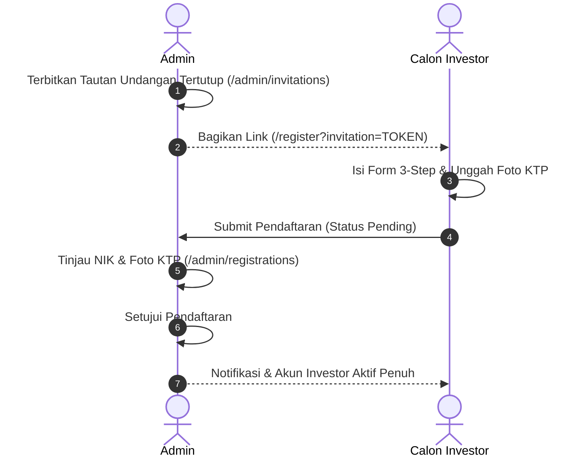
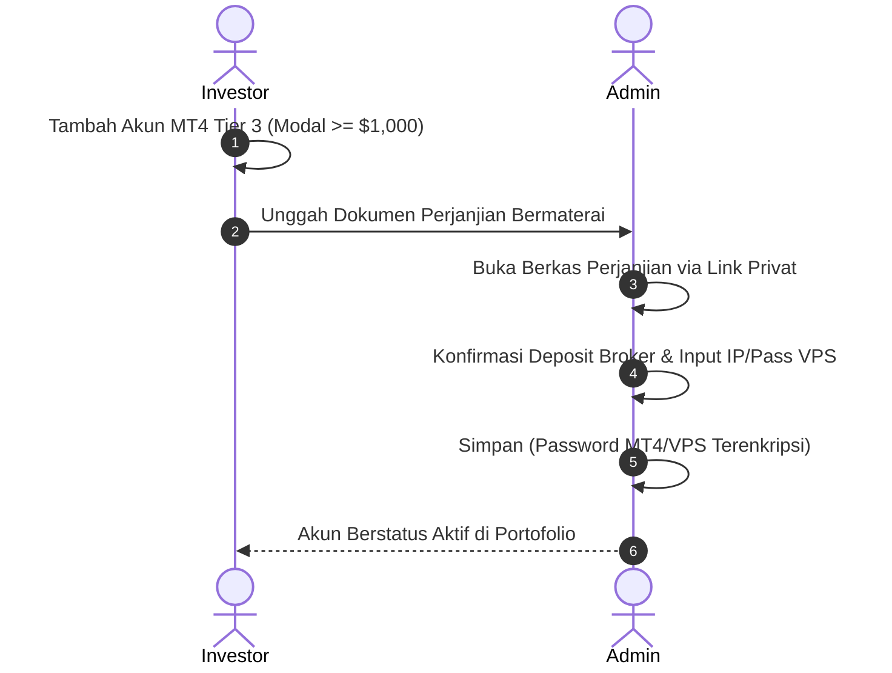
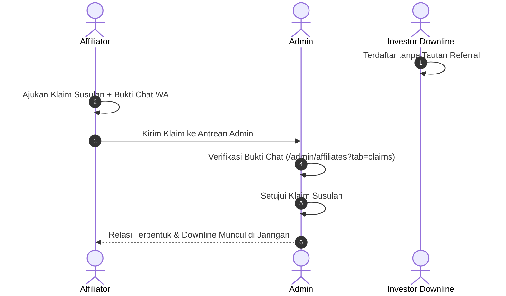
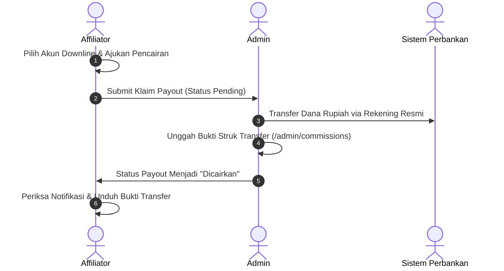

# Lembar Pengujian UAT Praktis (*User Acceptance Testing Checklist*) — Platform YZD Center

**Versi Dokumen:** 1.0 (Final)  
**Target Pengguna:** Tim Penguji Klien (*Client Test Team*), Administrator & Tim QA/Pengembang  
**Tanggal Rilis Dokumen:** 18 Oktober 2026  
**Lingkungan Pengujian:** Lingkungan Lokal / Staging (`http://localhost:8000`)

---

## Daftar Isi

1. [Bab 1: Panduan Pengujian & Kredensial Akun Standar](#bab-1-panduan-pengujian--kredensial-akun-standar)
   - [1.1 Petunjuk Penggunaan Lembar UAT](#11-petunjuk-penggunaan-lembar-uat)
   - [1.2 Data Kredensial Akun Pengujian Bawaan (*Seeder*)](#12-data-kredensial-akun-pengujian-bawaan-seeder)
   - [1.3 Fitur Bantuan Otomatis Pengembang (*Dev Tool Autofill*)](#13-fitur-bantuan-otomatis-pengembang-dev-tool-autofill)
2. [Bab 2: Lembar Pengujian Portal Investor (`UAT-INV`)](#bab-2-lembar-pengujian-portal-investor-uat-inv)
   - [2.1 Registrasi Tertutup, Verifikasi KTP & Manajemen Akun](#21-registrasi-tertutup-verifikasi-ktp--manajemen-akun)
   - [2.2 Portofolio Copytrade, Kredensial & Saldo Bulanan](#22-portofolio-copytrade-kredensial--saldo-bulanan)
   - [2.3 Fitur Interaktif, Pusat Bantuan & Keamanan Akun](#23-fitur-interaktif-pusat-bantuan--keamanan-akun)
3. [Bab 3: Lembar Pengujian Portal Mitra Affiliator (`UAT-AFF`)](#bab-3-lembar-pengujian-portal-mitra-affiliator-uat-aff)
   - [3.1 Hak Akses Khusus & Tautan Referral Otomatis](#31-hak-akses-khusus--tautan-referral-otomatis)
   - [3.2 Pemantauan Jaringan Downline & Pengajuan Klaim Susulan](#32-pemantauan-jaringan-downline--pengajuan-klaim-susulan)
   - [3.3 Skema Komisi 4-Tier & Pengajuan Pencairan Bank](#33-skema-komisi-4-tier--pengajuan-pencairan-bank)
4. [Bab 4: Lembar Pengujian Portal Administrator (`UAT-ADM`)](#bab-4-lembar-pengujian-portal-administrator-uat-adm)
   - [4.1 Dashboard Analitik & Manajemen Tautan Undangan](#41-dashboard-analitik--manajemen-tautan-undangan)
   - [4.2 Verifikasi Registrasi KTP & Akun Copytrade (MT4/VPS)](#42-verifikasi-registrasi-ktp--akun-copytrade-mt4vps)
   - [4.3 Audit Jaringan Kemitraan & Putusan Klaim Susulan](#43-audit-jaringan-kemitraan--putusan-klaim-susulan)
   - [4.4 Pemrosesan Transfer Pencairan Komisi Afiliasi](#44-pemrosesan-transfer-pencairan-komisi-afiliasi)
   - [4.5 Manajemen Pengguna, Materi Edukasi & Pengaturan Legalitas](#45-manajemen-pengguna-materi-edukasi--pengaturan-legalitas)
5. [Bab 5: Skenario Pengujian Terintegrasi Lintas-Peran (`E2E`)](#bab-5-skenario-pengujian-terintegrasi-lintas-peran-e2e)
   - [5.1 E2E-01: Siklus Registrasi Undangan, Audit KYC & Aktivasi](#51-e2e-01-siklus-registrasi-undangan-audit-kyc--aktivasi)
   - [5.2 E2E-02: Siklus Pendaftaran Copytrade Tier 3 & Setup Kredensial VPS](#52-e2e-02-siklus-pendaftaran-copytrade-tier-3--setup-kredensial-vps)
   - [5.3 E2E-03: Siklus Klaim Susulan & Pembentukan Relasi Downline](#53-e2e-03-siklus-klaim-susulan--pembentukan-relasi-downline)
   - [5.4 E2E-04: Siklus Pencairan Komisi & Pengunggahan Bukti Transfer](#54-e2e-04-siklus-pencairan-komisi--pengunggahan-bukti-transfer)
6. [Bab 6: Rekapitulasi Hasil Pengujian & Lembar Catatan Temuan Klien](#bab-6-rekapitulasi-hasil-pengujian--lembar-catatan-temuan-klien)

---

## Bab 1: Panduan Pengujian & Kredensial Akun Standar

### 1.1 Petunjuk Penggunaan Lembar UAT
1. Lembar pengujian ini dirancang secara terstruktur agar perwakilan penguji dari pihak klien dapat memverifikasi kesesuaian sistem secara mandiri atau didampingi tim pengembang.
2. Setiap kasus uji (*Test Case*) memiliki kode unik, langkah tindakan yang terperinci, nilai data uji konkret, hasil yang diharapkan (*Expected Result*), serta kotak centang status:
   - `[ ] Lolos`: Fitur berjalan persis sesuai spesifikasi dan bebas galat (*error*).
   - `[ ] Gagal`: Terjadi kegagalan fungsionalitas, pesan galat tak tertangani, atau ketidaksesuaian antarmuka.
3. Jika ditemukan status `Gagal`, catat detail kendala pada **Bab 6: Lembar Catatan Temuan Klien**.

---

### 1.2 Data Kredensial Akun Pengujian Bawaan (*Seeder*)
Gunakan akun uji berikut yang telah tersedia di basis data sistem:

| Peran Akun (*Role*) | Username / Identitas | Kata Sandi (*Password*) | Status Akun & Profil | Tujuan Pengujian Utama |
| :--- | :--- | :--- | :--- | :--- |
| **Administrator** | `admin` | `admin` | Aktif (*Super User*) | Verifikasi gerbang, audit KTP, approval copytrade/VPS, transfer komisi. |
| **Investor** | `investor` | `investor` | Aktif (KTP Disetujui) | Pemantauan portofolio, input saldo tgl 1, kalkulator proyeksi, edukasi. |
| **Mitra Affiliator** | `affiliator` | `affiliator` | Aktif (KTP Disetujui) | Penyalinan link referral, pantau downline, klaim susulan, tarik komisi. |

---

### 1.3 Fitur Bantuan Otomatis Pengembang (*Dev Tool Autofill*)
Untuk mempercepat pengujian formulir panjang (khususnya saat menguji pendaftaran akun baru):
- Pada halaman `/register?invitation=...`, tersedia banner pengembang atau tombol melayang **"Isi Form Acak (Dev)"**.
- Mengeklik tombol ini akan mengisi secara instan seluruh data diri, NIK 16-digit unik, data ahli waris, kata sandi bawaan `asdf1234`, serta menghasilkan berkas simulasi KTP beresolusi tajam tanpa perlu menyiapkan dokumen fisik.

---

## Bab 2: Lembar Pengujian Portal Investor (`UAT-INV`)

### 2.1 Registrasi Tertutup, Verifikasi KTP & Manajemen Akun

| ID Pengujian | Fitur / Sub-Modul | Langkah-Langkah Pengujian | Data Uji / Nilai Input | Hasil yang Diharapkan (Ekspektasi) | Status Uji | Catatan Penguji |
| :---: | :--- | :--- | :--- | :--- | :---: | :--- |
| **UAT-INV-01** | Gerbang Tertutup (*Closed Registration*) | 1. Buka browser pada mode *Incognito*. 2. Akses URL: `http://localhost:8000/register` tanpa token undangan. | URL: `/register` (tanpa query string) | Sistem menolak akses form dan menampilkan halaman peringatan *"Tautan Undangan Tidak Valid atau Diperlukan"*. | [ ] Lolos [ ] Gagal | |
| **UAT-INV-02** | Registrasi via Undangan Valid | 1. Buka tautan undangan valid (misal: `/register?invitation=TOKEN_UJI`). 2. Langkah 1: Lengkapi Data Diri & unggah foto KTP. 3. Langkah 2: Lengkapi Data Ahli Waris. 4. Langkah 3: Centang persetujuan syarat & klik **"Kirim Pendaftaran"**. | - Nama: `Budi Santoso` - NIK: `3578012345678901` - HP: `081234567890` - User: `budi_investor` - Pass: `Rahasia123!` | Pendaftaran berhasil dikirim, muncul pesan sukses, dan halaman dialihkan ke status *"Menunggu Verifikasi KTP"*. | [ ] Lolos [ ] Gagal | |
| **UAT-INV-03** | Autentikasi Masuk (*Login*) | 1. Buka `http://localhost:8000/login`. 2. Masukkan username dan password salah $\rightarrow$ klik **"Masuk"**. 3. Masukkan kredensial benar (`investor` / `investor`) $\rightarrow$ klik **"Masuk"**. | User: `investor` Pass salah: `salah` Pass benar: `investor` | - Percobaan salah: Muncul validasi *"Kredensial tidak cocok"*. - Percobaan benar: Berhasil masuk ke Dashboard Investor. | [ ] Lolos [ ] Gagal | |
| **UAT-INV-04** | Restriksi Menu Akun Pending | 1. Login menggunakan akun yang baru mendaftar (belum diverifikasi Admin). 2. Perhatikan bilah samping (*sidebar*). 3. Coba akses paksa URL `/investor/portfolio`. | Akun status: `pending` | Menu Portofolio terkunci/tersembunyi. Akses paksa dialihkan kembali dengan pesan *"Akun Anda sedang dalam antrean verifikasi KTP"*. | [ ] Lolos [ ] Gagal | |
| **UAT-INV-05** | Perbaikan Dokumen KYC (*Revisi KTP*) | 1. Login akun berstatus *Perlu Revisi*. 2. Buka menu **Informasi Akun**. 3. Baca catatan Admin, unggah foto KTP baru yang tajam, klik **"Unggah Ulang KTP"**. | Berkas KTP revisi format JPG/PNG | Berkas berhasil diperbarui, status berubah kembali menjadi *Menunggu Verifikasi*, catatan revisi diperbarui. | [ ] Lolos [ ] Gagal | |

---

### 2.2 Portofolio Copytrade, Kredensial & Saldo Bulanan

| ID Pengujian | Fitur / Sub-Modul | Langkah-Langkah Pengujian | Data Uji / Nilai Input | Hasil yang Diharapkan (Ekspektasi) | Status Uji | Catatan Penguji |
| :---: | :--- | :--- | :--- | :--- | :---: | :--- |
| **UAT-INV-06** | Dashboard Utama Investor | 1. Login sebagai `investor` / `investor`. 2. Buka halaman `/investor/dashboard`. 3. Amati kartu ringkasan keuangan. | Halaman: Dashboard | Menampilkan kartu Total Modal Aktif (\$ USD), Total Akun MT4, Indikator BEP (Balik Modal), dan grafik pertumbuhan. | [ ] Lolos [ ] Gagal | |
| **UAT-INV-07** | Pendaftaran Akun Copytrade Baru | 1. Buka menu **Portofolio Investasi**. 2. Klik tombol **"Tambah Akun Investasi"**. 3. Pilih Tier, isi No Akun MT4, Modal, Tanggal, Rekening Bank, dan unggah Surat Perjanjian bermaterai. 4. Klik **"Kirim Pendaftaran Akun"**. | - Tier: `Tier 1 ($100 - $499)` - MT4: `88991122` - Modal: `$100.00` - Bank: BCA `1234567890` an Budi Santoso | Pengajuan akun trading tersimpan, muncul notifikasi sukses, dan akun berstatus *Menunggu Verifikasi Admin*. | [ ] Lolos [ ] Gagal | |
| **UAT-INV-08** | Pratinjau Kredensial Akun Aktif | 1. Buka menu **Portofolio Investasi**. 2. Klik salah satu kartu akun trading berstatus **Aktif**. 3. Periksa informasi broker, nomor akun, dan data rekening penarikan. | Akun MT4 Aktif | Seluruh informasi akun tertampil rapi. Kredensial terlindungi dan Surat Perjanjian dapat dibuka via tombol link privat. | [ ] Lolos [ ] Gagal | |
| **UAT-INV-09** | Input Saldo Rutin Tanggal 1 | 1. Pada kartu akun aktif, klik tombol **"Input Saldo Tanggal 1"**. 2. Masukkan saldo baru yang lebih besar dari modal awal. 3. Perhatikan pratinjau profit otomatis. 4. Klik **"Simpan Saldo"**. | - Modal awal: `$100.00` - Saldo baru: `$110.00` | Pratinjau menghitung profit `+$10.00` (+10%). Data tersimpan dan grafik saldo ter-update seketika. | [ ] Lolos [ ] Gagal | |
| **UAT-INV-10** | Verifikasi Nilai Profit Netral `$0.00` | 1. Buka detail akun aktif. 2. Periksa riwayat saldo pada dua bulan berturut-turut yang bernilai identik (misal Jan: \$110, Feb: \$110). 3. Cek kolom *Profit* dan *%*. | Bulan 1: `$110.00` Bulan 2: `$110.00` | Kolom Profit menampilkan persis **+$0.00** dengan persentase **0%**, berwarna abu-abu netral dengan ikon *Minus* (tidak terhitung profit ganda). | [ ] Lolos [ ] Gagal | |

---

### 2.3 Fitur Interaktif, Pusat Bantuan & Keamanan Akun

| ID Pengujian | Fitur / Sub-Modul | Langkah-Langkah Pengujian | Data Uji / Nilai Input | Hasil yang Diharapkan (Ekspektasi) | Status Uji | Catatan Penguji |
| :---: | :--- | :--- | :--- | :--- | :---: | :--- |
| **UAT-INV-11** | Kalkulator Proyeksi Finansial | 1. Buka menu **Kalkulator Proyeksi** (`/investor/calculator`). 2. Masukkan Modal Awal \$1,000. 3. Geser slider estimasi profit ke 5% per bulan. 4. Amati tabel proyeksi 1–5 tahun. | - Modal: `$1,000` - Profit: `5% / bulan` - Tenor: `12 - 60 bulan` | Tabel dan grafik akumulasi modal majemuk (*compound*) terhitung dinamis secara *real-time*. | [ ] Lolos [ ] Gagal | |
| **UAT-INV-12** | Pusat Bantuan & Panduan | 1. Buka menu **Pusat Bantuan** (`/investor/education/help`). 2. Ketik kata kunci pada kotak pencarian. 3. Klik salah satu judul artikel untuk membaca detail. | Kata kunci: `copytrade` | Menampilkan artikel terkait. Tampilan artikel bersih, tanpa badge kategori atau jumlah pembaca yang tidak perlu. | [ ] Lolos [ ] Gagal | |
| **UAT-INV-13** | Tanya Jawab FAQ Interaktif | 1. Buka menu **Tanya Jawab (FAQ)** (`/investor/education/faq`). 2. Perhatikan kondisi accordion pertanyaan. 3. Klik salah satu pertanyaan untuk membuka jawaban. | Halaman: FAQ | Seluruh item FAQ dalam kondisi tertutup secara default (*collapsed*). Saat diklik, jawaban terbuka dengan animasi mulus. | [ ] Lolos [ ] Gagal | |
| **UAT-INV-14** | Glosarium Istilah Forex | 1. Buka menu **Glosarium** (`/investor/education/glossary`). 2. Gunakan filter abjad (misal huruf "D" untuk Drawdown). | Abjad: `D` | Istilah tersaring tepat, memuat definisi istilah trading yang mudah dimengerti investor awam. | [ ] Lolos [ ] Gagal | |
| **UAT-INV-15** | Notifikasi In-App | 1. Klik ikon lonceng (`🔔`) di pojok kanan atas. 2. Buka daftar notifikasi masuk. 3. Klik salah satu item notifikasi. | Notifikasi sistem | Dropdown menampilkan pesan riil. Mengeklik notifikasi mengarahkan pengguna langsung ke modul yang relevan. | [ ] Lolos [ ] Gagal | |
| **UAT-INV-16** | Penggantian Kata Sandi Mandiri | 1. Klik profil pengguna $\rightarrow$ pilih **Ganti Password**. 2. Masukkan password lama dan password baru $\rightarrow$ klik **"Perbarui Kata Sandi"**. | - Lama: `investor` - Baru: `InvestorBaru2026!` | Password berhasil diperbarui, muncul toast konfirmasi hijau, dan login berikutnya menggunakan password baru. | [ ] Lolos [ ] Gagal | |

---

## Bab 3: Lembar Pengujian Portal Mitra Affiliator (`UAT-AFF`)

### 3.1 Hak Akses Khusus & Tautan Referral Otomatis

| ID Pengujian | Fitur / Sub-Modul | Langkah-Langkah Pengujian | Data Uji / Nilai Input | Hasil yang Diharapkan (Ekspektasi) | Status Uji | Catatan Penguji |
| :---: | :--- | :--- | :--- | :--- | :---: | :--- |
| **UAT-AFF-01** | Visibilitas Menu Program Afiliasi | 1. Login sebagai akun Affiliator (`affiliator` / `affiliator`). 2. Periksa menu bilah samping (*sidebar*). | User: `affiliator` | Muncul kelompok menu **"Program Afiliasi"** berisi sub-menu **Jaringan Kemitraan** dan **Klaim Komisi**. | [ ] Lolos [ ] Gagal | |
| **UAT-AFF-02** | Penyalinan Tautan Referral | 1. Buka menu **Jaringan Kemitraan** (`/investor/affiliates`). 2. Klik tombol **"Salin Tautan"** pada panel referral. 3. Tempel (*paste*) URL di tab browser baru / incognito. | Panel Tautan Referral | Tautan tersalin ke clipboard dengan feedback toast sukses. Saat dibuka di incognito, URL memuat kode referral affiliator. | [ ] Lolos [ ] Gagal | |

---

### 3.2 Pemantauan Jaringan Downline & Pengajuan Klaim Susulan

| ID Pengujian | Fitur / Sub-Modul | Langkah-Langkah Pengujian | Data Uji / Nilai Input | Hasil yang Diharapkan (Ekspektasi) | Status Uji | Catatan Penguji |
| :---: | :--- | :--- | :--- | :--- | :---: | :--- |
| **UAT-AFF-03** | Tabel Daftar Downline | 1. Buka tab **Daftar Downline** di menu Jaringan Kemitraan. 2. Periksa data investor binaan, status copytrade, dan modal. | Tab: Downlines | Menampilkan daftar lengkap: Nama, Nomor HP/WhatsApp, Tanggal Bergabung, Akun MT4 Aktif, dan Akumulasi Modal binaan. | [ ] Lolos [ ] Gagal | |
| **UAT-AFF-04** | Pengajuan Klaim Referral Susulan | 1. Klik tombol **"Ajukan Klaim Susulan"** di kanan atas. 2. Masukkan username investor yang belum ber-upline $\rightarrow$ klik **"Cek Database"**. 3. Unggah bukti chat (screenshot WA). 4. Isi kronologi alasan $\rightarrow$ klik **"Kirim Permohonan Klaim"**. | - Downline: `investor` - Bukti: File JPG/PNG chat - Alasan: *"Investor mendaftar arahan saya via WhatsApp"* | Validasi database menemukan akun investor, bukti terunggah aman, klaim masuk ke antrean Admin dengan status *Pending*. | [ ] Lolos [ ] Gagal | |
| **UAT-AFF-05** | Validasi Anti-Klaim Diri Sendiri & Ganda | 1. Buka modal klaim susulan. 2. Coba masukkan username akun sendiri (`affiliator`) atau investor yang sudah memiliki upline permanen. | Username: `affiliator` | Sistem memvalidasi dan menolak pencarian dengan pesan peringatan *"Anda tidak dapat mengklaim akun Anda sendiri / sudah memiliki upline"*. | [ ] Lolos [ ] Gagal | |
| **UAT-AFF-06** | Riwayat Klaim & Catatan Penolakan | 1. Buka tab **Riwayat Klaim Susulan**. 2. Periksa item klaim yang berstatus *Ditolak*. 3. Klik tombol **"Baca Selengkapnya"** pada kolom catatan. | Baris status: `rejected` | Modal membaca detail alasan penolakan dari Administrator terbuka utuh tanpa merusak tata letak tabel (*anti-hover dependency*). | [ ] Lolos [ ] Gagal | |

---

### 3.3 Skema Komisi 4-Tier & Pengajuan Pencairan Bank

| ID Pengujian | Fitur / Sub-Modul | Langkah-Langkah Pengujian | Data Uji / Nilai Input | Hasil yang Diharapkan (Ekspektasi) | Status Uji | Catatan Penguji |
| :---: | :--- | :--- | :--- | :--- | :---: | :--- |
| **UAT-AFF-07** | Kartu Ringkasan Metrik Komisi | 1. Buka menu **Klaim Komisi** (`/investor/commissions`). 2. Amati kartu saldo: Komisi Siap Dicairkan, Total Komisi Dicairkan, Akun Binaan Layak Komisi. | Halaman: Klaim Komisi | Data numerik terformat rapi dalam mata uang Rupiah (IDR) berdasarkan kurs resmi \$1 = Rp 15.000,-. | [ ] Lolos [ ] Gagal | |
| **UAT-AFF-08** | Pengajuan Pencairan Komisi Bank | 1. Klik tombol **"Ajukan Klaim Komisi"**. 2. Centang akun-akun downline aktif yang ingin dicairkan. 3. Periksa kalkulasi otomatis Total Rupiah. 4. Konfirmasi rincian nomor rekening bank tujuan $\rightarrow$ klik **"Kirim Pengajuan Pencairan"**. | - Pilihan: 1 Akun Aktif Tier 1 ($100) - Rekening: BCA `987654321` an Mitra Affiliator | Pengajuan komisi tersimpan, saldo siap cair berkurang sesuai klaim, dan muncul di tabel riwayat penarikan status *Pending*. | [ ] Lolos [ ] Gagal | |
| **UAT-AFF-09** | Pembukaan Bukti Transfer Bank | 1. Pada tabel riwayat pencairan, cari transaksi berstatus **"Berhasil Ditransfer"**. 2. Klik tombol **"Lihat Bukti Transfer"**. | Transaksi status: `transferred` | Berkas bukti transfer resmi yang diunggah Admin dapat dibuka/diunduh secara aman via tab baru browser. | [ ] Lolos [ ] Gagal | |
| **UAT-AFF-10** | Aturan Komisi 1x Seumur Hidup | 1. Buka kembali modal ajukan pencairan komisi. 2. Periksa apakah akun trading downline yang sudah pernah dicairkan masih muncul dalam pilihan. | Akun yang sudah `transferred` | Akun tersebut otomatis terkunci/tidak lagi muncul di daftar pilihan klaim (*one-time commission policy per unique account*). | [ ] Lolos [ ] Gagal | |

---

## Bab 4: Lembar Pengujian Portal Administrator (`UAT-ADM`)

### 4.1 Dashboard Analitik & Manajemen Tautan Undangan

| ID Pengujian | Fitur / Sub-Modul | Langkah-Langkah Pengujian | Data Uji / Nilai Input | Hasil yang Diharapkan (Ekspektasi) | Status Uji | Catatan Penguji |
| :---: | :--- | :--- | :--- | :--- | :---: | :--- |
| **UAT-ADM-01** | Dashboard Administrator | 1. Login sebagai `admin` / `admin`. 2. Akses halaman `/admin/dashboard`. 3. Periksa kartu metrik dan antrean *Action Needed*. | User: `admin` | Menampilkan Total Modal Ekosistem (\$ USD), Total Investor, Total Affiliator, dan badge antrean tugas verifikasi pending. | [ ] Lolos [ ] Gagal | |
| **UAT-ADM-02** | Pembuatan Tautan Undangan Baru | 1. Buka menu **Tautan Undangan** (`/admin/invitations`). 2. Klik **"Buat Undangan Baru"**. 3. Isi Label, pilih Role, isi Kuota, dan tentukan Masa Berlaku $\rightarrow$ klik **"Simpan & Buat Tautan"**. | - Label: `UAT Demo Batch 1` - Role: `investor` - Kuota: `5` - Masa: `24 Jam` | Modal terbuka mulus, tautan terbit dengan token unik, muncul di tabel utama berstatus aktif (*Active badge* hijau). | [ ] Lolos [ ] Gagal | |
| **UAT-ADM-03** | Penghapusan Massal (*Batch Delete*) | 1. Pada tabel undangan, centang 2 atau lebih baris token yang tidak digunakan. 2. Klik tombol merah **"Hapus Terpilih (N)"** pada bilah aksi massal. 3. Konfirmasi dialog modal. | Checklist 2 baris token | Seluruh token terpilih terhapus permanen dari sistem, dan seleksi otomatis ter-reset bersih. | [ ] Lolos [ ] Gagal | |

---

### 4.2 Verifikasi Registrasi KTP & Akun Copytrade (MT4/VPS)

| ID Pengujian | Fitur / Sub-Modul | Langkah-Langkah Pengujian | Data Uji / Nilai Input | Hasil yang Diharapkan (Ekspektasi) | Status Uji | Catatan Penguji |
| :---: | :--- | :--- | :--- | :--- | :---: | :--- |
| **UAT-ADM-04** | Persetujuan Verifikasi KYC KTP | 1. Buka menu **Verifikasi Pendaftaran** (`/admin/registrations`). 2. Klik tombol **"Tinjau Pendaftaran"** pada baris pendaftar baru. 3. Periksa kesesuaian Nama, NIK, dan pratinjau foto KTP. 4. Pilih opsi **"Setujui Pendaftaran"** $\rightarrow$ klik **"Simpan Keputusan"**. | Pendaftar baru status: `pending` | Status pendaftar seketika berubah menjadi *Aktif*, akun pengguna dapat langsung login dan menggunakan modul investor penuh. | [ ] Lolos [ ] Gagal | |
| **UAT-ADM-05** | Penolakan Verifikasi KYC KTP | 1. Buka modal tinjau pendaftaran pada akun dengan data tidak sesuai. 2. Pilih opsi **"Tolak Pendaftaran"**. 3. Ketikkan alasan pada kolom catatan $\rightarrow$ klik **"Simpan Keputusan"**. | Alasan: *"Foto KTP buram pada angka NIK"* | Status pendaftar berubah menjadi *Perlu Revisi*, catatan penolakan terkirim ke notifikasi akun calon investor. | [ ] Lolos [ ] Gagal | |
| **UAT-ADM-06** | Verifikasi Copytrade & Surat Perjanjian | 1. Buka menu **Kelola Copytrade** (`/admin/copytrade`) $\rightarrow$ tab **Menunggu Verifikasi**. 2. Klik tombol **"Tinjau Pengajuan"**. 3. Klik tombol **"Buka Berkas"** Surat Perjanjian Kemitraan. | Pengajuan MT4 pending | Berkas PDF Surat Perjanjian bermaterai terbuka pada tab baru via rute streaming aman `/documents/copytrade/{id}`. | [ ] Lolos [ ] Gagal | |
| **UAT-ADM-07** | Setup Kredensial MT4/VPS Khusus Tier 3 | 1. Buka modal persetujuan pengajuan akun **Tier 3** (modal $\ge$ \$1.000). 2. Lengkapi form kredensial: No MT4, Server, Master Password, Investor Password, IP VPS, Port, User & Pass VPS. 3. Klik **"Simpan & Aktifkan Copytrade"**. | - MT4: `1002003` - Server: `HFMarkets-Live` - IP VPS: `103.150.10.25` - Pass VPS: `VpsSecret2026!` | Akun berpindah ke tab **Akun Aktif**. Seluruh password MT4 & VPS tersimpan terenkripsi (*AES-256 encrypted cast*) di database. | [ ] Lolos [ ] Gagal | |
| **UAT-ADM-08** | Input Saldo & Rumus Profit Bulanan | 1. Buka tab **Akun Aktif** $\rightarrow$ klik **"Tinjau / Detail Akun"**. 2. Buka tabel Riwayat Saldo. 3. Catat saldo baru per tanggal 1 bulan berikutnya. | - Modal awal: `$100.00` - Saldo baru: `$120.00` | Riwayat mencatat saldo secara presisi. Kolom Profit menampilkan `+$20.00` dan persentase terhitung otomatis. | [ ] Lolos [ ] Gagal | |

---

### 4.3 Audit Jaringan Kemitraan & Putusan Klaim Susulan

| ID Pengujian | Fitur / Sub-Modul | Langkah-Langkah Pengujian | Data Uji / Nilai Input | Hasil yang Diharapkan (Ekspektasi) | Status Uji | Catatan Penguji |
| :---: | :--- | :--- | :--- | :--- | :---: | :--- |
| **UAT-ADM-09** | Pemantauan Jaringan Downline | 1. Buka menu **Jaringan Kemitraan** (`/admin/affiliates`) $\rightarrow$ tab **Daftar Mitra**. 2. Klik tombol mata (**"Lihat Downline"**) pada salah satu baris affiliator. | Affiliator terpilih | Modal terbuka menampilkan daftar downline lengkap: nama, username, sumber bergabung (link/klaim), dan total modal investasi. | [ ] Lolos [ ] Gagal | |
| **UAT-ADM-10** | Form Dinamis Putusan Klaim Susulan | 1. Buka tab **Verifikasi Klaim Susulan Referral** (`/admin/affiliates?tab=claims`). 2. Klik **"Tinjau & Putuskan"**. 3. Perhatikan perilaku field *"Catatan Instruksi / Alasan"*: Pilih **Setujui**, lalu ubah ke **Tolak**. | - Opsi 1: `Setujui` - Opsi 2: `Tolak` | - Saat pilih Setujui: Field catatan **otomatis sembunyi**. - Saat pilih Tolak: Field catatan **otomatis muncul** & wajib diisi. | [ ] Lolos [ ] Gagal | |
| **UAT-ADM-11** | Eksekusi Persetujuan Klaim Susulan | 1. Pada modal tinjau klaim, evaluasi bukti chat WhatsApp pendukung. 2. Pilih **"Setujui Permohonan"** $\rightarrow$ klik **"Simpan Keputusan"**. | Bukti chat valid | Klaim berstatus *Approved*. Relasi referral terbuat seketika: investor menjadi downline affiliator dan akunnya berstatus eligible komisi. | [ ] Lolos [ ] Gagal | |
| **UAT-ADM-12** | Penolakan Klaim & Truncate Notifikasi | 1. Buka modal klaim yang bukti chat-nya tidak valid. 2. Pilih **"Tolak Permohonan"**. 3. Tulis catatan panjang (> 100 karakter) $\rightarrow$ klik **"Simpan Keputusan"**. | Catatan: Alasan penolakan detail | Klaim berstatus *Rejected*. Notifikasi in-app affiliator menampilkan teks catatan yang diringkas rapi (*truncated*) dengan tombol detail. | [ ] Lolos [ ] Gagal | |

---

### 4.4 Pemrosesan Transfer Pencairan Komisi Afiliasi

| ID Pengujian | Fitur / Sub-Modul | Langkah-Langkah Pengujian | Data Uji / Nilai Input | Hasil yang Diharapkan (Ekspektasi) | Status Uji | Catatan Penguji |
| :---: | :--- | :--- | :--- | :--- | :---: | :--- |
| **UAT-ADM-13** | Antrean Pencairan Komisi Afiliasi | 1. Buka menu **Pencairan Komisi** (`/admin/commissions`). 2. Periksa baris pengajuan berstatus *Pending*. 3. Klik tombol **"Proses Pencairan"**. | Pengajuan komisi pending | Modal proses pencairan terbuka, menyajikan rincian Akun Downline, Nominal IDR, dan Rekening Bank Tujuan lengkap. | [ ] Lolos [ ] Gagal | |
| **UAT-ADM-14** | Unggah Bukti Transfer & Konfirmasi Payout | 1. Lakukan transfer bank simulasi/riil sesuai nominal IDR. 2. Unggah file struk/tangkapan layar bukti transfer (JPG/PNG/PDF). 3. Masukkan catatan nomor referensi bank. 4. Klik tombol **"Konfirmasi Pembayaran Selesai"**. | - File: Struk transfer bank - Catatan: `Ref BCA-2026101801` | Bukti transfer terunggah aman, status transaksi berubah menjadi **"Berhasil Ditransfer"** (*transferred*), dan Affiliator menerima notifikasi. | [ ] Lolos [ ] Gagal | |

---

### 4.5 Manajemen Pengguna, Materi Edukasi & Pengaturan Legalitas

| ID Pengujian | Fitur / Sub-Modul | Langkah-Langkah Pengujian | Data Uji / Nilai Input | Hasil yang Diharapkan (Ekspektasi) | Status Uji | Catatan Penguji |
| :---: | :--- | :--- | :--- | :--- | :---: | :--- |
| **UAT-ADM-15** | Pencarian & Filter Peran Pengguna | 1. Buka menu **Manajemen Pengguna** (`/admin/users`). 2. Filter dropdown peran: *Investor*, *Affiliator*, *Administrator*. 3. Gunakan kolom pencarian berdasarkan nama/username. | Filter: `Affiliator` Keyword: `affiliator` | Tabel data menyaring pengguna secara instan sesuai kriteria pencarian dan filter peran yang dipilih. | [ ] Lolos [ ] Gagal | |
| **UAT-ADM-16** | Promosi / Demosi Peran (*Role Switching*) | 1. Buka detail salah satu akun investor. 2. Ubah peran pengguna dari *Investor* menjadi *Affiliator* $\rightarrow$ Simpan. | Perubahan peran: `investor` $\rightarrow$ `affiliator` | Hak akses pengguna berubah seketika; saat pengguna login kembali, menu Program Afiliasi otomatis aktif. | [ ] Lolos [ ] Gagal | |
| **UAT-ADM-17** | Penonaktifan (*Suspend*) Akun | 1. Pada baris pengguna, klik toggle/tombol ubah status akun menjadi **Nonaktif (Suspended)**. 2. Coba login menggunakan akun tersebut di tab browser lain. | Akun: `status = suspended` | Login ditolak dengan pesan peringatan *"Akun Anda telah dinonaktifkan oleh Administrator. Silakan hubungi pusat bantuan"*. | [ ] Lolos [ ] Gagal | |
| **UAT-ADM-18** | Manajemen Konten Edukasi (Help & FAQ) | 1. Buka `/admin/education/help` $\rightarrow$ tambah/edit artikel panduan. 2. Buka `/admin/education/faq` $\rightarrow$ tambah topik & pertanyaan FAQ. | Konten bantuan baru | Konten tersimpan di database dan langsung terbit di portal investor secara *real-time*. | [ ] Lolos [ ] Gagal | |
| **UAT-ADM-19** | Sunting Dokumen Legalitas Platform | 1. Buka `/admin/settings/legal`. 2. Sunting teks pada tab *Syarat & Ketentuan* atau *Kebijakan Privasi* $\rightarrow$ klik **"Simpan Perubahan"**. | Sunting klausul legal | Teks dokumen legalitas langsung terbarukan pada halaman pendaftaran publik dan tautan footer platform. | [ ] Lolos [ ] Gagal | |

---

## Bab 5: Skenario Pengujian Terintegrasi Lintas-Peran (`E2E`)

Skenario terintegrasi ini menguji kesinambungan alur kerja platform (*end-to-end*) yang melibatkan kolaborasi lintas-aktor (Admin $\leftrightarrow$ Investor $\leftrightarrow$ Affiliator) dari hulu ke hilir.

---

### 5.1 E2E-01: Siklus Registrasi Undangan, Audit KYC & Aktivasi

| Kode Uji | Aktor Terlibat | Langkah Pengujian Integrasi | Hasil yang Diharapkan | Status Uji | Catatan |
| :---: | :--- | :--- | :--- | :---: | :--- |
| **E2E-01** | Administrator $\rightarrow$ Calon Investor $\rightarrow$ Administrator | 1. Admin membuat token undangan baru di `/admin/invitations`. 2. Calon investor membuka link registrasi & melengkapi form registrasi KYC. 3. Admin membuka `/admin/registrations` dan mengecek kesesuaian KTP. 4. Admin menyetujui pendaftaran. 5. Calon investor login kembali ke portal. | Alur pendaftaran closed-loop berhasil 100%. Akun investor aktif penuh tanpa ada hambatan (*seamless transition*). | [ ] Lolos [ ] Gagal | |

---

### 5.2 E2E-02: Siklus Pendaftaran Copytrade Tier 3 & Setup Kredensial VPS

| Kode Uji | Aktor Terlibat | Langkah Pengujian Integrasi | Hasil yang Diharapkan | Status Uji | Catatan |
| :---: | :--- | :--- | :--- | :---: | :--- |
| **E2E-02** | Investor $\rightarrow$ Administrator | 1. Investor menambahkan akun MT4 Tier 3 modal \$1.000 dan mengunggah PDF perjanjian. 2. Admin membuka tab *Menunggu Verifikasi* di `/admin/copytrade`. 3. Admin meninjau dokumen legalitas via tombol *Buka Berkas*. 4. Admin menyetujui sambil mengisi kredensial MT4 dan IP/Port/Password VPS. 5. Investor memantau status di menu Portofolio Investasi. | Akun aktif di portofolio investor. Kredensial VPS terenkripsi di database dan hanya dapat dikelola oleh pemilik hak otorisasi. | [ ] Lolos [ ] Gagal | |

---

### 5.3 E2E-03: Siklus Klaim Susulan & Pembentukan Relasi Downline

| Kode Uji | Aktor Terlibat | Langkah Pengujian Integrasi | Hasil yang Diharapkan | Status Uji | Catatan |
| :---: | :--- | :--- | :--- | :---: | :--- |
| **E2E-03** | Mitra Affiliator $\rightarrow$ Administrator $\rightarrow$ Investor | 1. Investor mendaftar mandiri tanpa link referral. 2. Affiliator mengajukan klaim susulan di `/investor/affiliates` dengan melampirkan screenshot chat WhatsApp. 3. Admin memeriksa bukti di `/admin/affiliates?tab=claims`. 4. Admin memilih *Setujui Permohonan* (field catatan hilang) & simpan. 5. Affiliator memeriksa tab *Daftar Downline*. | Investor berhasil terhubung menjadi downline resmi affiliator. Seluruh akun copytrade aktif miliknya tercatat layak komisi. | [ ] Lolos [ ] Gagal | |

---

### 5.4 E2E-04: Siklus Pencairan Komisi & Pengunggahan Bukti Transfer

| Kode Uji | Aktor Terlibat | Langkah Pengujian Integrasi | Hasil yang Diharapkan | Status Uji | Catatan |
| :---: | :--- | :--- | :--- | :---: | :--- |
| **E2E-04** | Mitra Affiliator $\rightarrow$ Administrator | 1. Affiliator memilih akun downline aktif dan mengajukan penarikan komisi ke rekening bank. 2. Admin membuka `/admin/commissions` dan mengeklik *Proses Pencairan*. 3. Admin melakukan transfer dan mengunggah berkas bukti transfer resmi. 4. Admin konfirmasi pembayaran selesai. 5. Affiliator memantau status transaksi dan membuka bukti transfer. | Payout komisi sukses dari hulu ke hilir. Bukti transfer bank dapat diakses dan akun MT4 terkait terkunci dari klaim ganda seumur hidup. | [ ] Lolos [ ] Gagal | |

---

## Bab 6: Rekapitulasi Hasil Pengujian & Lembar Catatan Temuan Klien

### 6.1 Tabel Ringkasan Metrik Kelulusan UAT

| Kategori Pengujian | Kode Uji | Total Kasus Uji | Jumlah Lolos | Jumlah Gagal | Persentase Kelulusan (%) |
| :--- | :---: | :---: | :---: | :---: | :---: |
| **Portal Investor** | `UAT-INV-01 s/d 16` | 16 | _______ | _______ | _______ % |
| **Portal Mitra Affiliator** | `UAT-AFF-01 s/d 10` | 10 | _______ | _______ | _______ % |
| **Portal Administrator** | `UAT-ADM-01 s/d 19` | 19 | _______ | _______ | _______ % |
| **Skenario Terintegrasi (E2E)** | `E2E-01 s/d 04` | 4 | _______ | _______ | _______ % |
| **TOTAL KESELURUHAN** | — | **49** | _______ | _______ | _______ % |

---

### 6.2 Lembar Catatan Temuan / Umpan Balik Klien (*Defect & Feedback Log*)

Gunakan tabel di bawah ini untuk mencatat setiap temuan, ketidaksesuaian, atau catatan khusus selama sesi pengujian bersama klien:

| No | Kode Kasus Uji | Deskripsi Temuan / Kendala yang Terjadi | Tingkat Urgensi (*Critical / Major / Minor*) | Rekomendasi / Tindak Lanjut Tim Teknis | Status Solusi (*Open / Resolved*) |
| :---: | :---: | :--- | :---: | :--- | :---: |
| 1 | | | | | |
| 2 | | | | | |
| 3 | | | | | |
| 4 | | | | | |
| 5 | | | | | |
| 6 | | | | | |
| 7 | | | | | |
| 8 | | | | | |

---

### 6.3 Pengesahan Hasil Pengujian Bersama (*Test Acknowledgment*)

Lembar catatan ini menandai bahwa rangkaian pengujian penerimaan pengguna (*User Acceptance Testing*) telah dilaksanakan bersama pada lingkungan yang disepakati:

- **Tanggal Pelaksanaan UAT:** __________________________________
- **Lokasi / Media Pengujian:** __________________________________

**Perwakilan Tim Penguji Klien:**
- Nama Penguji: _____________________________________________
- Jabatan: __________________________________________________
- Tanda Tangan: _____________________________________________

**Perwakilan Tim Teknis / Pengembang:**
- Nama Pengembang: __________________________________________
- Jabatan: __________________________________________________
- Tanda Tangan: _____________________________________________

---
*Lembar Pengujian UAT Resmi — Sistem Manajemen Kemitraan & Perdagangan Otomatis YZD Center.*
