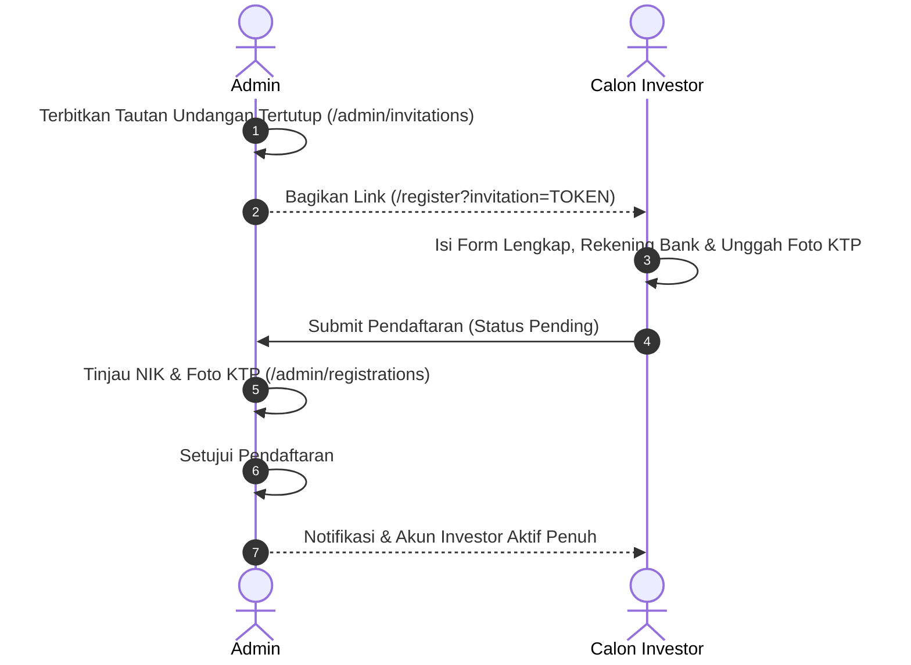
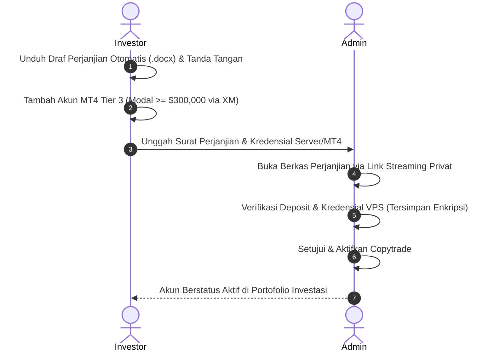
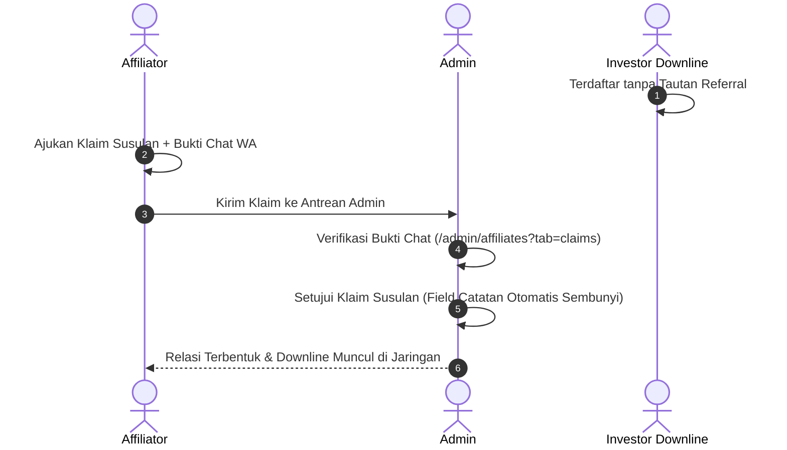
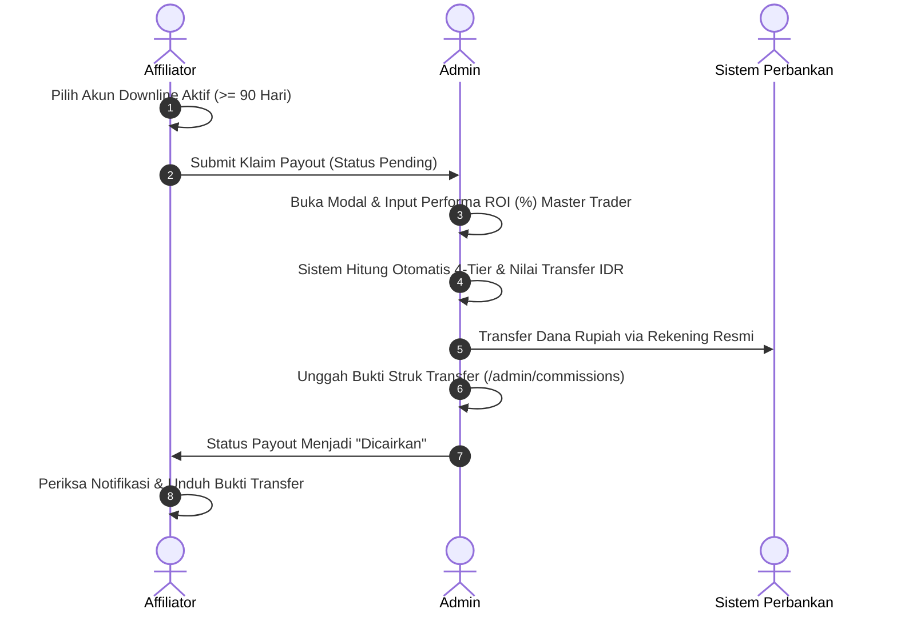

# Lembar Pengujian UAT Praktis (*User Acceptance Testing Checklist*) — Platform YZD Center

**Versi Dokumen:** 1.3.0 (Fokus Fungsionalitas Klien & Tersinkronisasi)  
**Target Pengguna:** Tim Penguji Klien (*Client Test Team*), Administrator & Tim QA/Pengembang  
**Tanggal Rilis Dokumen:** 21 Oktober 2026  
**Lingkungan Pengujian:** Lingkungan Lokal / Staging (`http://localhost:8000`)  

---

## Daftar Riwayat Pembaruan Lembar UAT

*   **v1.0.0 (18-10-2026):** Rilis awal lembar pengujian UAT mencakup 49 kasus uji dasar (Investor, Affiliator, Administrator, dan 4 skenario E2E).
*   **v1.3.0 (21-10-2026):** Pembaruan menyeluruh berfokus pada fungsionalitas operasional klien dan portal pengguna:
    *   **Sinkronisasi 3 Tier Copytrade:** Penyelarasan modal Tier 1 (Cent < $5,000 via HFM), Tier 2 (Standard $5,000–$300,000 via XM), dan Tier 3 (Direct VPS $\ge \$300,000$ via XM dengan kredensial MT4/VPS terenkripsi dan kontrak 5 tahun).
    *   **Fitur Unduh Draf Perjanjian Otomatis (.docx):** Penambahan kasus uji generasi draf perjanjian kemitraan otomatis terisi data investor dan akun trading untuk dicetak bermaterai.
    *   **Sinkronisasi Formula Finansial & 4-Tier Komisi:** Penyelarasan kalkulasi komisi 4-tier berbasis modal IDR (>10M: 50%, 1M–10M: 40%, 100Jt–1M: 30%, <100Jt: 20%), live exchange rate dinamis, input ROI (%) Master Trader, dan proteksi *Drawdown Guard*.
    *   **Kalkulator Simulasi Komparatif:** Pengujian 2 mode penarikan finansial: Tarik Rutin (30% WD, 30% Master, 40% Compounding) dan Reinvest Penuh (0% WD, 30% Master, 70% Compounding).
    *   **Modul Log Aktivitas & Jejak Audit Imutabel:** Penambahan kasus uji penelusuran log aktivitas admin, filter multi-kriteria, inspeksi *audit diff* sebelum/sesudah, sensor data sensitif otomatis, dan ekspor spreadsheet Excel (.xlsx).
    *   **Pengingat Bulanan Saldo Tanggal 1:** Penambahan kasus uji verifikasi spanduk dasbor dan notifikasi in-app pada periode tanggal 1 s.d. 5 setiap bulan.

---

## Daftar Isi

1. [Bab 1: Panduan Pengujian & Kredensial Akun Standar](#bab-1-panduan-pengujian--kredensial-akun-standar)
   - [1.1 Petunjuk Penggunaan Lembar UAT](#11-petunjuk-penggunaan-lembar-uat)
   - [1.2 Data Kredensial Akun Pengujian Bawaan (*Seeder*)](#12-data-kredensial-akun-pengujian-bawaan-seeder)
   - [1.3 Fitur Bantuan Otomatis Pengembang (*Dev Tool Autofill*)](#13-fitur-bantuan-otomatis-pengembang-dev-tool-autofill)
2. [Bab 2: Lembar Pengujian Portal Investor (`UAT-INV`)](#bab-2-lembar-pengujian-portal-investor-uat-inv)
   - [2.1 Registrasi Tertutup, Verifikasi KTP & Manajemen Akun](#21-registrasi-tertutup-verifikasi-ktp--manajemen-akun)
   - [2.2 Portofolio Copytrade, Kredensial & Saldo Bulanan](#22-portofolio-copytrade-kredensial--saldo-bulanan)
   - [2.3 Fitur Interaktif, Pusat Bantuan & Keamanan Akun](#23-fitur-interaktif-pusat-bantuan--keamanan-akun)
3. [Bab 3: Lembar Pengujian Portal Mitra Affiliator (`UAT-AFF`)](#bab-3-lembar-pengujian-portal-mitra-affiliator-uat-aff)
   - [3.1 Hak Akses Khusus & Tautan Referral Otomatis](#31-hak-akses-khusus--tautan-referral-otomatis)
   - [3.2 Pemantauan Jaringan Downline & Pengajuan Klaim Susulan](#32-pemantauan-jaringan-downline--pengajuan-klaim-susulan)
   - [3.3 Skema Komisi 4-Tier & Pengajuan Pencairan Bank](#33-skema-komisi-4-tier--pengajuan-pencairan-bank)
4. [Bab 4: Lembar Pengujian Portal Administrator (`UAT-ADM`)](#bab-4-lembar-pengujian-portal-administrator-uat-adm)
   - [4.1 Dashboard Analitik & Manajemen Tautan Undangan](#41-dashboard-analitik--manajemen-tautan-undangan)
   - [4.2 Verifikasi Registrasi KTP & Akun Copytrade (MT4/VPS)](#42-verifikasi-registrasi-ktp--akun-copytrade-mt4vps)
   - [4.3 Audit Jaringan Kemitraan & Putusan Klaim Susulan](#43-audit-jaringan-kemitraan--putusan-klaim-susulan)
   - [4.4 Pemrosesan Transfer Pencairan Komisi Afiliasi (ROI Input & Payout)](#44-pemrosesan-transfer-pencairan-komisi-afiliasi-roi-input--payout)
   - [4.5 Manajemen Pengguna, Materi Edukasi & Pengaturan Legalitas](#45-manajemen-pengguna-materi-edukasi--pengaturan-legalitas)
   - [4.6 Jejak Audit Aktivitas & Log Keamanan Sistem (`Activity Logs`)](#46-jejak-audit-aktivitas--log-keamanan-sistem-activity-logs)
5. [Bab 5: Skenario Pengujian Terintegrasi Lintas-Peran (`E2E`)](#bab-5-skenario-pengujian-terintegrasi-lintas-peran-e2e)
   - [5.1 E2E-01: Siklus Registrasi Undangan, Audit KYC & Aktivasi](#51-e2e-01-siklus-registrasi-undangan-audit-kyc--aktivasi)
   - [5.2 E2E-02: Siklus Pendaftaran Copytrade Tier 3 & Setup Kredensial VPS](#52-e2e-02-siklus-pendaftaran-copytrade-tier-3--setup-kredensial-vps)
   - [5.3 E2E-03: Siklus Klaim Susulan & Pembentukan Relasi Downline](#53-e2e-03-siklus-klaim-susulan--pembentukan-relasi-downline)
   - [5.4 E2E-04: Siklus Pencairan Komisi, Input ROI & Payout Transfer Bank](#54-e2e-04-siklus-pencairan-komisi-input-roi--payout-transfer-bank)
6. [Bab 6: Rekapitulasi Hasil Pengujian & Lembar Catatan Temuan Klien](#bab-6-rekapitulasi-hasil-pengujian--lembar-catatan-temuan-klien)

---

## Bab 1: Panduan Pengujian & Kredensial Akun Standar

### 1.1 Petunjuk Penggunaan Lembar UAT
1. Lembar pengujian ini dirancang secara terstruktur agar perwakilan penguji dari pihak klien dapat memverifikasi kesesuaian sistem secara mandiri atau didampingi tim pengembang.
2. Setiap kasus uji (*Test Case*) memiliki kode unik, langkah tindakan yang terperinci, nilai data uji konkret, hasil yang diharapkan (*Expected Result*), serta kotak centang status:
   - `[ ] Lolos`: Fitur berjalan persis sesuai spesifikasi dan bebas galat (*error*).
   - `[ ] Gagal`: Terjadi kegagalan fungsionalitas, pesan galat tak tertangani, atau ketidaksesuaian antarmuka.
3. Jika ditemukan status `Gagal`, catat detail kendala pada **Bab 6: Lembar Catatan Temuan Klien**.

---

### 1.2 Data Kredensial Akun Pengujian Bawaan (*Seeder*)
Gunakan akun uji berikut yang telah tersedia di basis data sistem:

| Peran Akun (*Role*) | Username / Identitas | Kata Sandi (*Password*) | Status Akun & Profil | Tujuan Pengujian Utama |
| :--- | :--- | :--- | :--- | :--- |
| **Administrator** | `admin` | `admin` | Aktif (*Super User*) | Verifikasi gerbang, audit KTP, approval copytrade/VPS, input ROI transfer komisi, inspeksi log aktivitas. |
| **Investor** | `investor` | `investor` | Aktif (KTP Disetujui) | Pemantauan portofolio, pendaftaran akun copytrade, input saldo tgl 1, kalkulator proyeksi, edukasi. |
| **Mitra Affiliator** | `affiliator` | `affiliator` | Aktif (KTP Disetujui) | Penyalinan link referral, pantau downline aktif, klaim susulan, pengajuan pencairan komisi berjenjang. |

---

### 1.3 Fitur Bantuan Otomatis Pengembang (*Dev Tool Autofill*)
Untuk mempercepat pengujian formulir panjang (khususnya saat menguji pendaftaran akun baru):
- Pada halaman `/register?invitation=...`, tersedia banner pengembang atau tombol melayang **"Isi Form Acak (Dev)"**.
- Mengeklik tombol ini akan mengisi secara instan seluruh data diri, NIK 16-digit unik, data ahli waris, data rekening bank, kata sandi bawaan `asdf1234`, serta menghasilkan berkas simulasi KTP beresolusi tajam tanpa perlu menyiapkan dokumen fisik secara manual.

---

## Bab 2: Lembar Pengujian Portal Investor (`UAT-INV`)

### 2.1 Registrasi Tertutup, Verifikasi KTP & Manajemen Akun

| ID Pengujian | Fitur / Sub-Modul | Langkah-Langkah Pengujian | Data Uji / Nilai Input | Hasil yang Diharapkan (Ekspektasi) | Status Uji | Catatan Penguji |
| :---: | :--- | :--- | :--- | :--- | :---: | :--- |
| **UAT-INV-01** | Gerbang Tertutup (*Closed Registration*) | 1. Buka browser pada mode *Incognito*. 2. Akses URL: `http://localhost:8000/register` tanpa token undangan. | URL: `/register` (tanpa query string) | Sistem menolak akses form dan menampilkan halaman peringatan *"Tautan Undangan Tidak Valid atau Diperlukan"*. | [ ] Lolos [ ] Gagal | |
| **UAT-INV-02** | Registrasi via Undangan Valid | 1. Buka tautan undangan valid (misal: `/register?invitation=TOKEN_UJI`). 2. Langkah 1: Lengkapi Data Diri, NIK, Tempat/Tgl Lahir, Pekerjaan & unggah foto KTP. 3. Langkah 2: Lengkapi Data Ahli Waris & Data Rekening Bank. 4. Langkah 3: Centang persetujuan syarat & ketentuan $\rightarrow$ klik **"Kirim Pendaftaran"**. | - Nama: `Budi Santoso` - NIK: `3578012345678901` - HP: `081234567890` - User: `budi_investor` - Pass: `Rahasia123!` | Pendaftaran berhasil dikirim, muncul pesan sukses, dan halaman dialihkan ke status *"Menunggu Verifikasi KTP"*. | [ ] Lolos [ ] Gagal | |
| **UAT-INV-03** | Autentikasi Masuk (*Login*) | 1. Buka `http://localhost:8000/login`. 2. Masukkan username dan password salah $\rightarrow$ klik **"Masuk"**. 3. Masukkan kredensial benar (`investor` / `investor`) $\rightarrow$ klik **"Masuk"**. | User: `investor` Pass salah: `salah` Pass benar: `investor` | - Percobaan salah: Muncul validasi *"Kredensial tidak cocok"*. - Percobaan benar: Berhasil masuk ke Dashboard Investor. | [ ] Lolos [ ] Gagal | |
| **UAT-INV-04** | Restriksi Menu Akun Pending | 1. Login menggunakan akun yang baru mendaftar (belum diverifikasi Admin). 2. Perhatikan bilah samping (*sidebar*). 3. Coba akses paksa URL `/investor/portfolio`. | Akun status: `pending` | Menu Portofolio terkunci/tersembunyi. Akses paksa dialihkan kembali dengan pesan *"Akun Anda sedang dalam antrean verifikasi KTP"*. | [ ] Lolos [ ] Gagal | |
| **UAT-INV-05** | Perbaikan Dokumen KYC (*Revisi KTP*) | 1. Login akun berstatus *Perlu Revisi*. 2. Buka menu **Informasi Akun**. 3. Baca catatan Admin, unggah foto KTP baru yang tajam, klik **"Unggah Ulang KTP"**. | Berkas KTP revisi format JPG/PNG | Berkas berhasil diperbarui, status berubah kembali menjadi *Menunggu Verifikasi*, catatan revisi diperbarui. | [ ] Lolos [ ] Gagal | |

---

### 2.2 Portofolio Copytrade, Kredensial & Saldo Bulanan

| ID Pengujian | Fitur / Sub-Modul | Langkah-Langkah Pengujian | Data Uji / Nilai Input | Hasil yang Diharapkan (Ekspektasi) | Status Uji | Catatan Penguji |
| :---: | :--- | :--- | :--- | :--- | :---: | :--- |
| **UAT-INV-06** | Dashboard Utama Investor | 1. Login sebagai `investor` / `investor`. 2. Buka halaman `/investor/dashboard`. 3. Amati kartu ringkasan keuangan dan status akun. | Halaman: Dashboard | Menampilkan kartu Total Modal Aktif (\$ USD), Total Akun MT4, Indikator BEP (Balik Modal), dan grafik pertumbuhan modal. | [ ] Lolos [ ] Gagal | |
| **UAT-INV-07** | Pendaftaran Akun Copytrade & Klasifikasi Tier | 1. Buka menu **Portofolio Investasi**. 2. Klik tombol **"Tambah Akun Investasi"**. 3. Pilih Tier investasi: **Tier 1 (Cent < $5,000 via HFM)**, **Tier 2 (Standard $5,000–$300,000 via XM)**, atau **Tier 3 (Direct VPS $\ge \$300,000$ via XM)**. 4. Isi Nomor Akun, Modal Riil, Tanggal Mulai, dan Rekening Bank. | - Tier: `Tier 1 (Cent < $5,000)` - Broker: `HFM` - MT4: `88991122` - Modal: `$500.00` | Formulir memvalidasi batasan nominal modal sesuai tier yang dipilih. Field relevan muncul sesuai tipe tier. | [ ] Lolos [ ] Gagal | |
| **UAT-INV-08** | Unduh Draf Perjanjian Otomatis (.docx) & Upload | 1. Pada modal tambah akun investasi, klik tombol **"Unduh Draf Surat Perjanjian"**. 2. Buka berkas Word (`.docx`) yang terunduh. 3. Periksa kelengkapan data nama, nomor akun, modal, dan rekening bank. 4. Unggah berkas yang telah ditandatangani bermaterai $\rightarrow$ klik **"Kirim Pendaftaran Akun"**. | Template `.docx` terisi otomatis | Dokumen Word terisi presisi sesuai input pengguna. Pengajuan akun tersimpan berstatus *Menunggu Verifikasi Admin*. | [ ] Lolos [ ] Gagal | |
| **UAT-INV-09** | Kredensial Terenkripsi Khusus Tier 3 | 1. Pilih Tier 3 (Direct VPS) dengan modal $\ge \$300,000$. 2. Perhatikan kemunculan field wajib: Server Broker, Master Password, Investor Password. 3. Kirim pendaftaran akun Tier 3. | - Modal: `$300,000` - Server: `XMGlobal-Real` - Pass: `MasterSecret123!` | Sistem mewajibkan pengisian kredensial server dan password MT4/VPS yang disimpan secara terenkripsi kuat di server. | [ ] Lolos [ ] Gagal | |
| **UAT-INV-10** | Pratinjau Kredensial Akun Aktif | 1. Buka menu **Portofolio Investasi**. 2. Klik salah satu kartu akun trading berstatus **Aktif**. 3. Periksa informasi broker, nomor akun, dan data rekening penarikan. | Akun MT4 Aktif | Seluruh informasi akun tertampil rapi. Kredensial terlindungi dan Surat Perjanjian dapat dibuka via tautan privat aman. | [ ] Lolos [ ] Gagal | |
| **UAT-INV-11** | Input Saldo Rutin Tanggal 1 & Metrik BEP | 1. Pada kartu akun aktif, klik tombol **"Input Saldo Tanggal 1"**. 2. Masukkan saldo baru yang lebih besar dari modal awal. 3. Perhatikan pratinjau profit otomatis. 4. Klik **"Simpan Saldo"**. | - Modal awal: `$500.00` - Saldo baru: `$550.00` | Pratinjau menghitung profit `+$50.00` (+10%). Data tersimpan, grafik saldo dan indikator Break Even Point (BEP) ter-update seketika. | [ ] Lolos [ ] Gagal | |
| **UAT-INV-12** | Verifikasi Nilai Profit Netral `$0.00` | 1. Buka detail akun aktif. 2. Periksa riwayat saldo pada dua bulan berturut-turut yang bernilai identik (misal Jan: \$550, Feb: \$550). 3. Cek kolom *Profit* dan *%*. | Bulan 1: `$550.00` Bulan 2: `$550.00` | Kolom Profit menampilkan persis **+$0.00** dengan persentase **0%**, berwarna abu-abu netral dengan ikon *Minus* (tidak terhitung profit ganda). | [ ] Lolos [ ] Gagal | |
| **UAT-INV-13** | Spanduk & Notifikasi Pengingat Saldo Tanggal 1 | 1. Buka dasbor portofolio investasi pada periode hari ke-1 s.d. 5 setiap bulan. 2. Amati header halaman dan lonceng notifikasi. | Periode: Tanggal 1–5 | Spanduk peringatan warna kuning/oranye muncul di atas tabel mengingatkan input saldo MT4, dan notifikasi in-app terbit otomatis. | [ ] Lolos [ ] Gagal | |

---

### 2.3 Fitur Interaktif, Pusat Bantuan & Keamanan Akun

| ID Pengujian | Fitur / Sub-Modul | Langkah-Langkah Pengujian | Data Uji / Nilai Input | Hasil yang Diharapkan (Ekspektasi) | Status Uji | Catatan Penguji |
| :---: | :--- | :--- | :--- | :--- | :---: | :--- |
| **UAT-INV-14** | Kalkulator Proyeksi Finansial (Tarik Rutin vs Reinvest Penuh) | 1. Buka menu **Kalkulator Proyeksi** (`/investor/calculator`). 2. Masukkan Modal Awal \$500 dan estimasi profit 5% per bulan. 3. Pilih Opsi Penarikan: **Tarik Rutin** (30% WD, 30% Master, 40% Compounding). 4. Alihkan ke **Reinvest Penuh** (0% WD, 30% Master, 70% Compounding). | - Modal: `$500` - Profit: `5% / bulan` - Tenor: `1–10 Tahun` | Hasil proyeksi bulanan dan akumulasi tahunan menghitung formula profit sharing dan compounding secara dinamis dengan live kurs USD/IDR. | [ ] Lolos [ ] Gagal | |
| **UAT-INV-15** | Pusat Bantuan & Panduan | 1. Buka menu **Pusat Bantuan** (`/investor/education/help`). 2. Ketik kata kunci pada kotak pencarian. 3. Klik salah satu judul artikel untuk membaca detail. | Kata kunci: `copytrade` | Menampilkan artikel terkait secara instan. Tampilan artikel bersih, rapi, dan mudah dibaca pada perangkat mobile/desktop. | [ ] Lolos [ ] Gagal | |
| **UAT-INV-16** | Tanya Jawab FAQ Interaktif | 1. Buka menu **Tanya Jawab (FAQ)** (`/investor/education/faq`). 2. Perhatikan kondisi accordion pertanyaan. 3. Klik salah satu pertanyaan untuk membuka jawaban. | Halaman: FAQ | Seluruh item FAQ dalam kondisi tertutup (*collapsed*) secara default. Saat diklik, jawaban terbuka dengan animasi mulus tanpa lonjakan layout. | [ ] Lolos [ ] Gagal | |
| **UAT-INV-17** | Glosarium Istilah Forex | 1. Buka menu **Glosarium** (`/investor/education/glossary`). 2. Gunakan filter abjad (misal huruf "D" untuk Drawdown). | Abjad: `D` | Istilah tersaring tepat, memuat definisi istilah trading yang mudah dimengerti investor awam. | [ ] Lolos [ ] Gagal | |
| **UAT-INV-18** | Notifikasi In-App | 1. Klik ikon lonceng (`🔔`) di pojok kanan atas. 2. Buka daftar notifikasi masuk. 3. Klik salah satu item notifikasi. | Notifikasi sistem | Dropdown menampilkan pesan riil. Mengeklik notifikasi mengarahkan pengguna langsung ke modul yang relevan. | [ ] Lolos [ ] Gagal | |
| **UAT-INV-19** | Penggantian Kata Sandi Mandiri | 1. Klik profil pengguna $\rightarrow$ pilih **Ganti Password**. 2. Masukkan password lama dan password baru $\rightarrow$ klik **"Perbarui Kata Sandi"**. | - Lama: `investor` - Baru: `InvestorBaru2026!` | Password berhasil diperbarui, muncul toast konfirmasi hijau, dan login berikutnya menggunakan password baru. | [ ] Lolos [ ] Gagal | |

---

## Bab 3: Lembar Pengujian Portal Mitra Affiliator (`UAT-AFF`)

### 3.1 Hak Akses Khusus & Tautan Referral Otomatis

| ID Pengujian | Fitur / Sub-Modul | Langkah-Langkah Pengujian | Data Uji / Nilai Input | Hasil yang Diharapkan (Ekspektasi) | Status Uji | Catatan Penguji |
| :---: | :--- | :--- | :--- | :--- | :---: | :--- |
| **UAT-AFF-01** | Visibilitas Menu Program Afiliasi | 1. Login sebagai akun Affiliator (`affiliator` / `affiliator`). 2. Periksa menu bilah samping (*sidebar*). | User: `affiliator` | Muncul kelompok menu **"Program Afiliasi"** berisi sub-menu **Jaringan Kemitraan** dan **Klaim Komisi**. | [ ] Lolos [ ] Gagal | |
| **UAT-AFF-02** | Penyalinan Tautan Referral | 1. Buka menu **Jaringan Kemitraan** (`/investor/affiliates`). 2. Klik tombol **"Salin Tautan"** pada panel referral. 3. Tempel (*paste*) URL di tab browser baru / incognito. | Panel Tautan Referral | Tautan tersalin ke clipboard dengan feedback toast sukses. Saat dibuka di incognito, URL memuat kode referral affiliator. | [ ] Lolos [ ] Gagal | |

---

### 3.2 Pemantauan Jaringan Downline & Pengajuan Klaim Susulan

| ID Pengujian | Fitur / Sub-Modul | Langkah-Langkah Pengujian | Data Uji / Nilai Input | Hasil yang Diharapkan (Ekspektasi) | Status Uji | Catatan Penguji |
| :---: | :--- | :--- | :--- | :--- | :---: | :--- |
| **UAT-AFF-03** | Tabel Daftar Downline & Durasi Aktif | 1. Buka tab **Daftar Downline** di menu Jaringan Kemitraan. 2. Periksa data investor binaan, status copytrade, modal, dan hari aktif. | Tab: Downlines | Menampilkan daftar lengkap: Nama, Username, Tanggal Bergabung, Akun MT4 Aktif, Modal Riil, dan hitungan durasi hari aktif. | [ ] Lolos [ ] Gagal | |
| **UAT-AFF-04** | Pengajuan Klaim Referral Susulan | 1. Klik tombol **"Ajukan Klaim Susulan"** di kanan atas. 2. Masukkan username investor yang belum ber-upline $\rightarrow$ klik **"Cek Database"**. 3. Unggah bukti chat (screenshot WA). 4. Isi kronologi alasan $\rightarrow$ klik **"Kirim Permohonan Klaim"**. | - Downline: `investor` - Bukti: File JPG/PNG chat - Alasan: *"Investor mendaftar arahan saya via WhatsApp"* | Validasi database menemukan akun investor, bukti terunggah aman, klaim masuk ke antrean Admin dengan status *Pending*. | [ ] Lolos [ ] Gagal | |
| **UAT-AFF-05** | Validasi Anti-Klaim Diri Sendiri & Ganda | 1. Buka modal klaim susulan. 2. Coba masukkan username akun sendiri (`affiliator`) atau investor yang sudah memiliki upline permanen. | Username: `affiliator` | Sistem memvalidasi dan menolak pencarian dengan pesan peringatan *"Anda tidak dapat mengklaim akun Anda sendiri / sudah memiliki upline"*. | [ ] Lolos [ ] Gagal | |
| **UAT-AFF-06** | Riwayat Klaim & Catatan Penolakan | 1. Buka tab **Riwayat Klaim Susulan**. 2. Periksa item klaim yang berstatus *Ditolak*. 3. Klik tombol **"Baca Selengkapnya"** pada kolom catatan. | Baris status: `rejected` | Modal membaca detail alasan penolakan dari Administrator terbuka utuh tanpa merusak tata letak tabel (*anti-hover dependency*). | [ ] Lolos [ ] Gagal | |

---

### 3.3 Skema Komisi 4-Tier & Pengajuan Pencairan Bank

| ID Pengujian | Fitur / Sub-Modul | Langkah-Langkah Pengujian | Data Uji / Nilai Input | Hasil yang Diharapkan (Ekspektasi) | Status Uji | Catatan Penguji |
| :---: | :--- | :--- | :--- | :--- | :---: | :--- |
| **UAT-AFF-07** | Kartu Ringkasan Metrik Komisi & Live Rate | 1. Buka menu **Klaim Komisi** (`/investor/commissions`). 2. Amati kartu saldo: Komisi Siap Dicairkan, Total Komisi Dicairkan, Akun Binaan Layak Komisi. 3. Periksa informasi kurs acuan konversi USD ke IDR. | Halaman: Klaim Komisi | Data numerik terformat rapi dalam mata uang Rupiah (IDR) berdasarkan kurs pasar riil live (bukan kurs statis). | [ ] Lolos [ ] Gagal | |
| **UAT-AFF-08** | Syarat Minimal Masa Aktif 90 Hari (3 Bulan) | 1. Buka modal pengajuan klaim komisi. 2. Periksa akun-akun downline yang muncul dalam daftar pilihan. | Akun aktif $< 90\text{ hari}$ vs $\ge 90\text{ hari}$ | Hanya akun downline yang telah aktif minimal 90 hari sejak copytrade pertama yang dapat dicentang untuk pencairan komisi. | [ ] Lolos [ ] Gagal | |
| **UAT-AFF-09** | Pengajuan Pencairan Komisi Berjenjang 4-Tier | 1. Centang akun downline yang memenuhi syarat. 2. Periksa penentuan Tier otomatis berdasarkan modal IDR akun masing-masing (Tier 1: 50%, Tier 2: 40%, Tier 3: 30%, Tier 4: 20%). 3. Konfirmasi nomor rekening bank tujuan $\rightarrow$ klik **"Kirim Pengajuan Pencairan"**. | Akun downline aktif $\ge 90\text{ hari}$ | Pengajuan tersimpan dengan kode klaim unik (`CLM-...`), status *Pending*, dan menunggu pemrosesan transfer oleh Admin. | [ ] Lolos [ ] Gagal | |
| **UAT-AFF-10** | Pembukaan Bukti Transfer Bank | 1. Pada tabel riwayat pencairan, cari transaksi berstatus **"Berhasil Ditransfer"**. 2. Klik tombol **"Lihat Bukti Transfer"**. | Transaksi status: `transferred` | Berkas bukti transfer resmi yang diunggah Admin dapat dibuka/diunduh secara aman via tab baru browser. | [ ] Lolos [ ] Gagal | |

---

## Bab 4: Lembar Pengujian Portal Administrator (`UAT-ADM`)

### 4.1 Dashboard Analitik & Manajemen Tautan Undangan

| ID Pengujian | Fitur / Sub-Modul | Langkah-Langkah Pengujian | Data Uji / Nilai Input | Hasil yang Diharapkan (Ekspektasi) | Status Uji | Catatan Penguji |
| :---: | :--- | :--- | :--- | :--- | :---: | :--- |
| **UAT-ADM-01** | Dashboard Administrator | 1. Login sebagai `admin` / `admin`. 2. Akses halaman `/admin/dashboard`. 3. Periksa kartu metrik ekosistem dan antrean *Action Needed*. | User: `admin` | Menampilkan Total Modal Ekosistem (\$ USD), Total Investor, Total Affiliator, dan badge antrean tugas verifikasi pending. | [ ] Lolos [ ] Gagal | |
| **UAT-ADM-02** | Pembuatan Tautan Undangan Baru | 1. Buka menu **Tautan Undangan** (`/admin/invitations`). 2. Klik **"Buat Undangan Baru"**. 3. Isi Label, pilih Role, isi Kuota, dan tentukan Masa Berlaku $\rightarrow$ klik **"Simpan & Buat Tautan"**. | - Label: `UAT Demo Batch 1` - Role: `investor` - Kuota: `5` - Masa: `24 Jam` | Modal terbuka mulus, tautan terbit dengan token unik, muncul di tabel utama berstatus aktif (*Active badge* hijau). | [ ] Lolos [ ] Gagal | |
| **UAT-ADM-03** | Penghapusan Massal (*Batch Delete*) | 1. Pada tabel undangan, centang 2 atau lebih baris token yang tidak digunakan. 2. Klik tombol merah **"Hapus Terpilih (N)"** pada bilah aksi massal. 3. Konfirmasi dialog modal. | Checklist 2 baris token | Seluruh token terpilih terhapus permanen dari sistem, dan seleksi otomatis ter-reset bersih. | [ ] Lolos [ ] Gagal | |

---

### 4.2 Verifikasi Registrasi KTP & Akun Copytrade (MT4/VPS)

| ID Pengujian | Fitur / Sub-Modul | Langkah-Langkah Pengujian | Data Uji / Nilai Input | Hasil yang Diharapkan (Ekspektasi) | Status Uji | Catatan Penguji |
| :---: | :--- | :--- | :--- | :--- | :---: | :--- |
| **UAT-ADM-04** | Persetujuan Verifikasi KYC KTP | 1. Buka menu **Verifikasi Pendaftaran** (`/admin/registrations`). 2. Klik tombol **"Tinjau Pendaftaran"** pada baris pendaftar baru. 3. Periksa kesesuaian Nama, NIK, dan pratinjau foto KTP. 4. Pilih opsi **"Setujui Pendaftaran"** $\rightarrow$ klik **"Simpan Keputusan"**. | Pendaftar baru status: `pending` | Status pendaftar seketika berubah menjadi *Aktif*, akun pengguna dapat langsung login dan menggunakan modul investor penuh. | [ ] Lolos [ ] Gagal | |
| **UAT-ADM-05** | Penolakan Verifikasi KYC KTP | 1. Buka modal tinjau pendaftaran pada akun dengan data tidak sesuai. 2. Pilih opsi **"Tolak Pendaftaran"**. 3. Ketikkan alasan pada kolom catatan $\rightarrow$ klik **"Simpan Keputusan"**. | Alasan: *"Foto KTP buram pada angka NIK"* | Status pendaftar berubah menjadi *Perlu Revisi*, catatan penolakan terkirim ke notifikasi akun calon investor. | [ ] Lolos [ ] Gagal | |
| **UAT-ADM-06** | Verifikasi Copytrade & Surat Perjanjian | 1. Buka menu **Kelola Copytrade** (`/admin/copytrade`) $\rightarrow$ tab **Menunggu Verifikasi**. 2. Klik tombol **"Tinjau Pengajuan"**. 3. Klik tombol **"Buka Berkas"** Surat Perjanjian Kemitraan. | Pengajuan MT4 pending | Berkas PDF Surat Perjanjian bermaterai terbuka pada tab baru via rute streaming aman `/documents/copytrade/{id}`. | [ ] Lolos [ ] Gagal | |
| **UAT-ADM-07** | Verifikasi Kredensial MT4/VPS Khusus Tier 3 | 1. Buka modal persetujuan pengajuan akun **Tier 3** ($\ge \$300,000$). 2. Periksa kredensial server, master password, dan investor password terenkripsi. 3. Klik **"Setujui & Aktifkan Copytrade"**. | Akun Tier 3 pending | Akun berpindah ke tab **Akun Aktif**. Akses kredensial oleh admin tercatat pada audit log aktivitas berlevel *warning*. | [ ] Lolos [ ] Gagal | |
| **UAT-ADM-08** | Input Saldo & Rumus Profit Bulanan | 1. Buka tab **Akun Aktif** $\rightarrow$ klik **"Tinjau / Detail Akun"**. 2. Buka tabel Riwayat Saldo. 3. Catat saldo baru per tanggal 1 bulan berikutnya. | - Modal awal: `$500.00` - Saldo baru: `$550.00` | Riwayat mencatat saldo secara presisi. Kolom Profit menampilkan `+$50.00` dan persentase terhitung otomatis. | [ ] Lolos [ ] Gagal | |

---

### 4.3 Audit Jaringan Kemitraan & Putusan Klaim Susulan

| ID Pengujian | Fitur / Sub-Modul | Langkah-Langkah Pengujian | Data Uji / Nilai Input | Hasil yang Diharapkan (Ekspektasi) | Status Uji | Catatan Penguji |
| :---: | :--- | :--- | :--- | :--- | :---: | :--- |
| **UAT-ADM-09** | Pemantauan Jaringan Downline | 1. Buka menu **Jaringan Kemitraan** (`/admin/affiliates`) $\rightarrow$ tab **Daftar Mitra**. 2. Klik tombol mata (**"Lihat Downline"**) pada salah satu baris affiliator. | Affiliator terpilih | Modal terbuka menampilkan daftar downline lengkap: nama, username, sumber bergabung (link/klaim), dan total modal investasi. | [ ] Lolos [ ] Gagal | |
| **UAT-ADM-10** | Form Dinamis Putusan Klaim Susulan | 1. Buka tab **Verifikasi Klaim Susulan Referral** (`/admin/affiliates?tab=claims`). 2. Klik **"Tinjau & Putuskan"**. 3. Perhatikan perilaku field *"Catatan Instruksi / Alasan"*: Pilih **Setujui**, lalu ubah ke **Tolak**. | - Opsi 1: `Setujui` - Opsi 2: `Tolak` | - Saat pilih Setujui: Field catatan **otomatis sembunyi**. - Saat pilih Tolak: Field catatan **otomatis muncul** & wajib diisi. | [ ] Lolos [ ] Gagal | |
| **UAT-ADM-11** | Eksekusi Persetujuan Klaim Susulan | 1. Pada modal tinjau klaim, evaluasi bukti chat WhatsApp pendukung. 2. Pilih **"Setujui Permohonan"** $\rightarrow$ klik **"Simpan Keputusan"**. | Bukti chat valid | Klaim berstatus *Approved*. Relasi referral terbuat seketika: investor menjadi downline affiliator dan akunnya berstatus eligible komisi. | [ ] Lolos [ ] Gagal | |
| **UAT-ADM-12** | Penolakan Klaim & Truncate Notifikasi | 1. Buka modal klaim yang bukti chat-nya tidak valid. 2. Pilih **"Tolak Permohonan"**. 3. Tulis catatan panjang (> 100 karakter) $\rightarrow$ klik **"Simpan Keputusan"**. | Catatan: Alasan penolakan detail | Klaim berstatus *Rejected*. Notifikasi in-app affiliator menampilkan teks catatan yang diringkas rapi (*truncated*) dengan tombol detail. | [ ] Lolos [ ] Gagal | |

---

### 4.4 Pemrosesan Transfer Pencairan Komisi Afiliasi (ROI Input & Payout)

| ID Pengujian | Fitur / Sub-Modul | Langkah-Langkah Pengujian | Data Uji / Nilai Input | Hasil yang Diharapkan (Ekspektasi) | Status Uji | Catatan Penguji |
| :---: | :--- | :--- | :--- | :--- | :---: | :--- |
| **UAT-ADM-13** | Antrean Pencairan & Input ROI Master Trader | 1. Buka menu **Pencairan Komisi** (`/admin/commissions`). 2. Klik tombol **"Proses Pencairan"** pada baris pengajuan *Pending*. 3. Masukkan persentase performa ROI (%) Master Trader pada periode tersebut (misal: 10.0%). | - Input ROI: `10.0%` - Kurs live: Terisi otomatis | Sistem secara otomatis menghitung Gross Profit, Jatah 30% Master Trader, Komisi Afiliator sesuai tier modal, dan Nilai Transfer IDR riil. | [ ] Lolos [ ] Gagal | |
| **UAT-ADM-14** | Proteksi Finansial *Drawdown Guard* | 1. Pada modal proses pencairan, uji coba masukkan ROI negatif atau nol (misal `-5.0%` atau `0.0%`). 2. Perhatikan kalkulasi komisi afiliator. | ROI: `<= 0.0%` | Komisi afiliator otomatis terhitung **$0.00** (*Drawdown Guard* aktif), jatah master $0.00, dan modal investor tidak terpotong. | [ ] Lolos [ ] Gagal | |
| **UAT-ADM-15** | Unggah Bukti Transfer & Konfirmasi Payout | 1. Lakukan transfer bank simulasi/riil sesuai total nominal IDR hasil kalkulasi. 2. Unggah file struk/tangkapan layar bukti transfer (JPG/PNG/PDF). 3. Masukkan catatan referensi bank $\rightarrow$ klik **"Konfirmasi Pembayaran Selesai"**. | - File: Struk transfer bank - Catatan: `Ref BCA-2026102101` | Bukti transfer terunggah aman, status transaksi menjadi **"Berhasil Ditransfer"** (*transferred*), dan Affiliator menerima notifikasi. | [ ] Lolos [ ] Gagal | |

---

### 4.5 Manajemen Pengguna, Materi Edukasi & Pengaturan Legalitas

| ID Pengujian | Fitur / Sub-Modul | Langkah-Langkah Pengujian | Data Uji / Nilai Input | Hasil yang Diharapkan (Ekspektasi) | Status Uji | Catatan Penguji |
| :---: | :--- | :--- | :--- | :--- | :---: | :--- |
| **UAT-ADM-16** | Pencarian & Filter Peran Pengguna | 1. Buka menu **Manajemen Pengguna** (`/admin/users`). 2. Filter dropdown peran: *Investor*, *Affiliator*, *Administrator*. 3. Gunakan kolom pencarian berdasarkan nama/username. | Filter: `Affiliator` Keyword: `affiliator` | Tabel data menyaring pengguna secara instan sesuai kriteria pencarian dan filter peran yang dipilih. | [ ] Lolos [ ] Gagal | |
| **UAT-ADM-17** | Promosi / Demosi Peran (*Role Switching*) | 1. Buka detail salah satu akun investor. 2. Ubah peran pengguna dari *Investor* menjadi *Affiliator* $\rightarrow$ Simpan. | Perubahan peran: `investor` $\rightarrow$ `affiliator` | Hak akses pengguna berubah seketika; sistem otomatis meng-generate kode referral unik baru bagi pengguna tersebut. | [ ] Lolos [ ] Gagal | |
| **UAT-ADM-18** | Penonaktifan (*Suspend*) Akun | 1. Pada baris pengguna, ubah status akun menjadi **Nonaktif (Suspended)**. 2. Coba login menggunakan akun tersebut di tab browser lain. | Akun: `status = suspended` | Login ditolak dengan pesan peringatan *"Akun Anda telah dinonaktifkan oleh Administrator. Silakan hubungi pusat bantuan"*. | [ ] Lolos [ ] Gagal | |
| **UAT-ADM-19** | Manajemen Konten Edukasi (Help & FAQ) | 1. Buka `/admin/education/help` $\rightarrow$ tambah/edit artikel panduan. 2. Buka `/admin/education/faq` $\rightarrow$ tambah topik & pertanyaan FAQ. | Konten bantuan baru | Konten tersimpan di database dan langsung terbit di portal investor secara *real-time*. | [ ] Lolos [ ] Gagal | |
| **UAT-ADM-20** | Sunting Dokumen Legalitas Platform | 1. Buka `/admin/settings/legal`. 2. Sunting teks pada tab *Syarat & Ketentuan* atau *Kebijakan Privasi* $\rightarrow$ klik **"Simpan Perubahan"**. | Sunting klausul legal | Teks dokumen legalitas langsung terbarukan pada halaman pendaftaran publik dan tautan footer platform. | [ ] Lolos [ ] Gagal | |

---

### 4.6 Jejak Audit Aktivitas & Log Keamanan Sistem (`Activity Logs`)

| ID Pengujian | Fitur / Sub-Modul | Langkah-Langkah Pengujian | Data Uji / Nilai Input | Hasil yang Diharapkan (Ekspektasi) | Status Uji | Catatan Penguji |
| :---: | :--- | :--- | :--- | :--- | :---: | :--- |
| **UAT-ADM-21** | Penelusuran Log Aktivitas & Filter Multi-Kriteria | 1. Buka menu **Log Aktivitas** (`/admin/activity-logs`). 2. Uji filter Kategori (*kyc_dokumen*, *copytrade*, *komisi_afiliasi*, dll.), Peran (*Investor*, *Affiliator*, *Administrator*), dan Tingkat Risiko (*Info*, *Warning*, *Critical*). 3. Gunakan pencarian teks deskripsi. | Filter kombinasi & kata kunci pencarian | Tabel merespon instan dengan paginasi *server-side*. Kolom Aktor dan Subjek menyebutkan `@username` dengan jelas tanpa duplikasi gelar. | [ ] Lolos [ ] Gagal | |
| **UAT-ADM-22** | Rincian Rekam Perubahan (*Audit Diff*) & Sensor Data Sensitif | 1. Pada salah satu baris log (misal perubahan status user atau pengajuan copytrade), klik tombol **Detail (Mata)**. 2. Perhatikan kartu perbandingan nilai *Sebelum* vs *Sesudah*. 3. Periksa apakah field kata sandi atau token disensor. | Modal Detail Audit Log | Modal menampilkan rekam perubahan field-by-field (*Audit Diff*). Data sensitif seperti `password` dan `token` otomatis disensor `[TERSIMPAN_TERENKRIPSI]`. | [ ] Lolos [ ] Gagal | |
| **UAT-ADM-23** | Ekspor Laporan Jejak Audit (.XLSX) | 1. Terapkan filter tertentu pada halaman Log Aktivitas. 2. Klik tombol **"Ekspor XLSX"** di pojok kanan atas. 3. Buka file spreadsheet Excel yang terunduh. | Tombol Ekspor XLSX | File Excel (.xlsx) terunduh utuh berisi kolom Waktu, Pengguna, Peran, Kategori, Aksi, Deskripsi, Tingkat Risiko, dan Alamat IP. | [ ] Lolos [ ] Gagal | |
| **UAT-ADM-24** | Restriksi Hak Akses Audit Trail | 1. Buka browser baru dan login sebagai `investor` atau `affiliator`. 2. Coba akses paksa URL `/admin/activity-logs` atau `/admin/activity-logs/export`. | Akses non-admin | Akses ditolak dengan status **403 Forbidden**. Jejak audit hanya dapat diakses eksklusif oleh Administrator. | [ ] Lolos [ ] Gagal | |

---

## Bab 5: Skenario Pengujian Terintegrasi Lintas-Peran (`E2E`)

Skenario terintegrasi ini menguji kesinambungan alur kerja platform (*end-to-end*) yang melibatkan kolaborasi lintas-aktor (Admin $\leftrightarrow$ Investor $\leftrightarrow$ Affiliator) dari hulu ke hilir.

---

### 5.1 E2E-01: Siklus Registrasi Undangan, Audit KYC & Aktivasi

| Kode Uji | Aktor Terlibat | Langkah Pengujian Integrasi | Hasil yang Diharapkan | Status Uji | Catatan |
| :---: | :--- | :--- | :--- | :---: | :--- |
| **E2E-01** | Administrator $\rightarrow$ Calon Investor $\rightarrow$ Administrator | 1. Admin membuat token undangan baru di `/admin/invitations`. 2. Calon investor membuka link registrasi & melengkapi form registrasi KYC. 3. Admin membuka `/admin/registrations` dan mengecek kesesuaian KTP. 4. Admin menyetujui pendaftaran. 5. Calon investor login kembali ke portal. | Alur pendaftaran closed-loop berhasil 100%. Akun investor aktif penuh tanpa ada hambatan (*seamless transition*). | [ ] Lolos [ ] Gagal | |

---

### 5.2 E2E-02: Siklus Pendaftaran Copytrade Tier 3 & Setup Kredensial VPS

| Kode Uji | Aktor Terlibat | Langkah Pengujian Integrasi | Hasil yang Diharapkan | Status Uji | Catatan |
| :---: | :--- | :--- | :--- | :---: | :--- |
| **E2E-02** | Investor $\rightarrow$ Administrator | 1. Investor memilih Tier 3 modal $\ge \$300,000$ via broker XM. 2. Investor mengunduh draf perjanjian `.docx` terisi otomatis, menandatangani basah bermaterai, dan mengunggah kembali. 3. Investor mengisi kredensial server dan password trading. 4. Admin meninjau dokumen legalitas via tombol *Buka Berkas* di `/admin/copytrade`. 5. Admin menyetujui akun. 6. Investor memantau status aktif di menu Portofolio Investasi. | Akun aktif di portofolio investor. Kredensial MT4/VPS terenkripsi di basis data (*encrypted cast*) dan audit akses tercatat dengan aman. | [ ] Lolos [ ] Gagal | |

---

### 5.3 E2E-03: Siklus Klaim Susulan & Pembentukan Relasi Downline

| Kode Uji | Aktor Terlibat | Langkah Pengujian Integrasi | Hasil yang Diharapkan | Status Uji | Catatan |
| :---: | :--- | :--- | :--- | :---: | :--- |
| **E2E-03** | Mitra Affiliator $\rightarrow$ Administrator $\rightarrow$ Investor | 1. Investor mendaftar mandiri tanpa link referral. 2. Affiliator mengajukan klaim susulan di `/investor/affiliates` dengan melampirkan screenshot chat WhatsApp. 3. Admin memeriksa bukti di `/admin/affiliates?tab=claims`. 4. Admin memilih *Setujui Permohonan* (field catatan otomatis hilang) & simpan. 5. Affiliator memeriksa tab *Daftar Downline*. | Investor berhasil terhubung menjadi downline resmi affiliator. Seluruh akun copytrade aktif miliknya tercatat dalam jaringan kemitraan. | [ ] Lolos [ ] Gagal | |

---

### 5.4 E2E-04: Siklus Pencairan Komisi, Input ROI & Payout Transfer Bank

| Kode Uji | Aktor Terlibat | Langkah Pengujian Integrasi | Hasil yang Diharapkan | Status Uji | Catatan |
| :---: | :--- | :--- | :--- | :---: | :--- |
| **E2E-04** | Mitra Affiliator $\rightarrow$ Administrator | 1. Affiliator memilih akun downline aktif $\ge 90\text{ hari}$ dan mengajukan penarikan komisi. 2. Admin membuka `/admin/commissions` dan mengeklik *Proses Pencairan*. 3. Admin menginput persentase performa ROI (%) Master Trader; sistem otomatis mengalkulasi nominal komisi IDR sesuai 4-tier. 4. Admin melakukan transfer bank riil dan mengunggah berkas bukti transfer resmi. 5. Admin mengonfirmasi pembayaran selesai. 6. Affiliator memantau status transaksi dan membuka bukti transfer. | Payout komisi sukses dari hulu ke hilir. Bukti transfer bank dapat diakses aman dan akun MT4 terkait terkunci dari klaim ganda seumur hidup. | [ ] Lolos [ ] Gagal | |

---

## Bab 6: Rekapitulasi Hasil Pengujian & Lembar Catatan Temuan Klien

### 6.1 Tabel Ringkasan Metrik Kelulusan UAT

| Kategori Pengujian | Kode Kasus Uji | Total Kasus Uji | Jumlah Lolos | Jumlah Gagal | Persentase Kelulusan (%) |
| :--- | :---: | :---: | :---: | :---: | :---: |
| **Portal Investor** | `UAT-INV-01 s/d 19` | 19 | _______ | _______ | _______ % |
| **Portal Mitra Affiliator** | `UAT-AFF-01 s/d 10` | 10 | _______ | _______ | _______ % |
| **Portal Administrator** | `UAT-ADM-01 s/d 24` | 24 | _______ | _______ | _______ % |
| **Skenario Terintegrasi (E2E)** | `E2E-01 s/d 04` | 4 | _______ | _______ | _______ % |
| **TOTAL KESELURUHAN** | — | **57** | _______ | _______ | _______ % |

---

### 6.2 Lembar Catatan Temuan / Umpan Balik Klien (*Defect & Feedback Log*)

Gunakan tabel di bawah ini untuk mencatat setiap temuan, ketidaksesuaian, atau catatan khusus selama sesi pengujian bersama klien:

| No | Kode Kasus Uji | Deskripsi Temuan / Kendala yang Terjadi | Tingkat Urgensi (*Critical / Major / Minor*) | Rekomendasi / Tindak Lanjut Tim Teknis | Status Solusi (*Open / Resolved*) |
| :---: | :---: | :--- | :---: | :--- | :---: |
| 1 | | | | | |
| 2 | | | | | |
| 3 | | | | | |
| 4 | | | | | |
| 5 | | | | | |
| 6 | | | | | |
| 7 | | | | | |
| 8 | | | | | |

---

### 6.3 Pengesahan Hasil Pengujian Bersama (*Test Acknowledgment*)

Lembar catatan ini menandai bahwa rangkaian pengujian penerimaan pengguna (*User Acceptance Testing*) telah dilaksanakan bersama pada lingkungan yang disepakati:

- **Tanggal Pelaksanaan UAT:** __________________________________
- **Lokasi / Media Pengujian:** __________________________________

**Perwakilan Tim Penguji Klien:**
- Nama Penguji: _____________________________________________
- Jabatan: __________________________________________________
- Tanda Tangan: _____________________________________________

**Perwakilan Tim Teknis / Pengembang:**
- Nama Pengembang: __________________________________________
- Jabatan: __________________________________________________
- Tanda Tangan: _____________________________________________

---
*Lembar Pengujian UAT Resmi — Sistem Manajemen Kemitraan & Perdagangan Otomatis YZD Center.*
